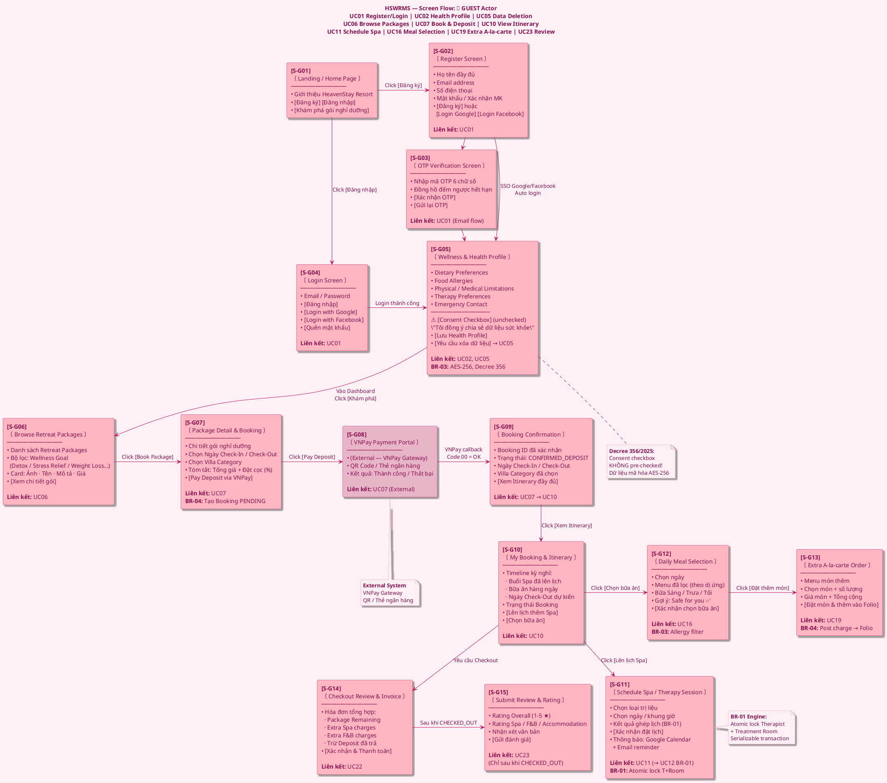
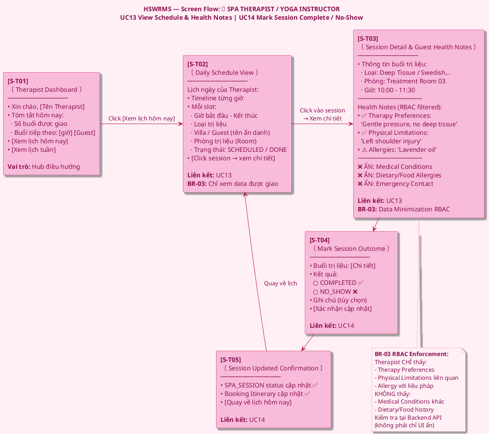
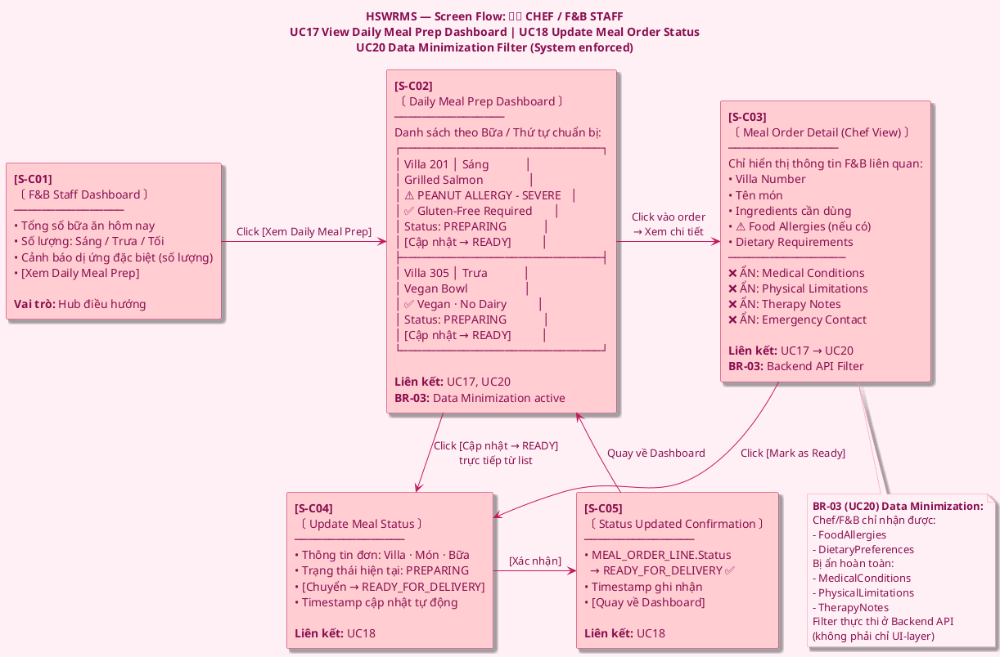
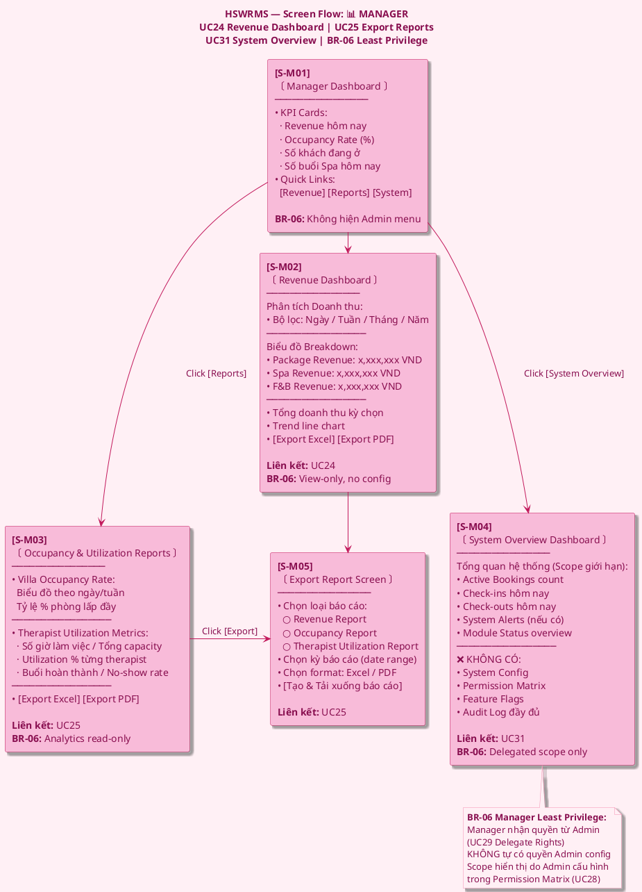
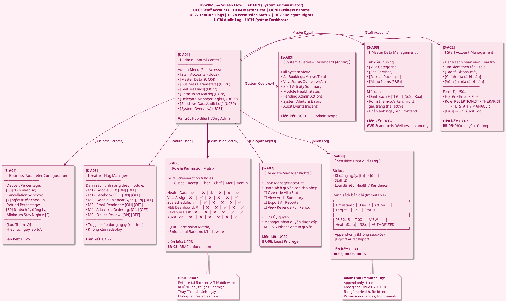
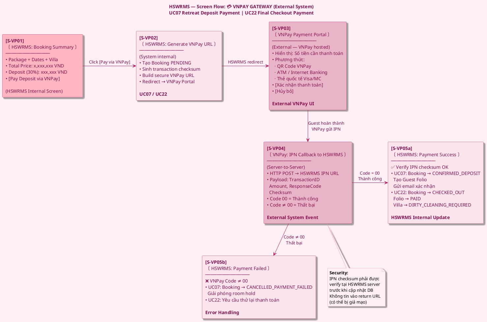
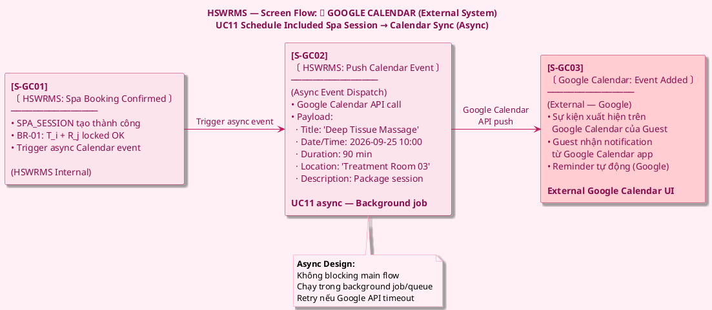
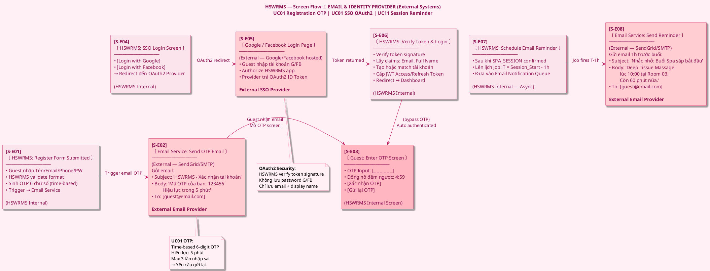

# HSWRMS — Screen Diagrams by Actor (PlantUML)
## Sơ đồ Màn Hình theo từng Actor — HeavenStay Wellness Resort Management System

> **Phương pháp:** PlantUML Screen/UI Flow Diagram (Wireflow)  
> **Chuẩn:** Actor-centric — mỗi actor có một sơ đồ độc lập  
> **Phiên bản:** 1.0 — Tháng 9/2026  
> **Tài liệu tham chiếu:** HSWRMS_Workflow_Modeling.md · HSWRMS_Use_Case_Specification.md · HSWRMS_ISP392_Project_Specification.md

---

## Tổng quan Actors

| # | Actor | Loại | Use Cases chính |
|:---:|:---|:---:|:---|
| 1 | 🧑 **Guest** | External Human | UC01, UC02, UC05, UC06, UC07, UC10, UC11, UC16, UC19, UC23 |
| 2 | 👤 **Receptionist** | Internal Human | UC08, UC09, UC15, UC21, UC22 |
| 3 | 💆 **Spa Therapist / Yoga Instructor** | Internal Human | UC13, UC14 |
| 4 | 👨‍🍳 **Chef / F&B Staff** | Internal Human | UC17, UC18 |
| 5 | 📊 **Manager** | Internal Human | UC24, UC25, UC31 |
| 6 | 🔑 **Admin** | Internal Human | UC03, UC04, UC26, UC27, UC28, UC29, UC30, UC31 |
| 7 | 💳 **VNPay Gateway** | External System | UC07, UC22 |
| 8 | 📅 **Google Calendar** | External System | UC11 |
| 9 | 📧 **Email / Identity Provider** | External System | UC01, UC11 |

---

---

## 1. Actor: 🧑 GUEST

> **Mô tả:** Khách hàng bên ngoài — đăng ký, quản lý hồ sơ sức khỏe, đặt gói nghỉ dưỡng, lên lịch spa, chọn bữa ăn, xem itinerary, thanh toán và gửi đánh giá.

### Các màn hình của Guest (UC01, UC02, UC05, UC06, UC07, UC10, UC11, UC16, UC19, UC23)

---

---

## 2. Actor: 👤 RECEPTIONIST

> **Mô tả:** Nhân viên lễ tân — xác minh khách đến, thu thập thông tin cư trú, gán villa, quản lý trạng thái villa, đặt spa thêm, tạo hóa đơn và thực hiện checkout.

### Các màn hình của Receptionist (UC08, UC09, UC15, UC21, UC22)

```plantuml
@startuml SCREEN_RECEPTIONIST
skinparam shadowing true
skinparam backgroundColor #FFF0F5
skinparam RectangleBorderColor #C2185B
skinparam RectangleFontColor #880E4F
skinparam RectangleBackgroundColor #FCE4EC
skinparam ArrowColor #C2185B
skinparam ArrowFontColor #880E4F
skinparam NoteBackgroundColor #FFF0F5
skinparam NoteBorderColor #F48FB1
skinparam NoteFontColor #880E4F
skinparam TitleFontColor #880E4F
skinparam TitleFontStyle bold

title **HSWRMS — Screen Flow: 👤 RECEPTIONIST Actor**\nUC08 Check-In & Assign Villa | UC09 Manage Villa Status\nUC15 Manual Extra Spa | UC21 Generate Invoice | UC22 Final Checkout

rectangle "**[S-R01]**\n〔 Receptionist Dashboard 〕\n────────────────\n• Today's Expected Arrivals count\n• Check-Out list hôm nay\n• Villa Status overview\n• Quick Links:\n  [Check-In] [Villa Status]\n  [Extra Spa] [Checkout]\n\n**Vai trò:** Hub điều hướng chính" as S_R01 #FCE4EC

rectangle "**[S-R02]**\n〔 Expected Arrivals List 〕\n────────────────\n• Tìm kiếm theo Tên Khách / Booking ID\n• Danh sách arrivals hôm nay\n• Trạng thái: CONFIRMED_DEPOSIT\n• [Chọn] → mở Check-In Form\n\n**Liên kết:** UC08 Step 1" as S_R02 #FCE4EC

rectangle "**[S-R03]**\n〔 Check-In & Identification Form 〕\n────────────────\n• Thông tin booking: Tên · Gói · Ngày\n─────────────────\nResident Compliance Data:\n• Số CCCD / Hộ chiếu\n• Quốc tịch\n• Họ tên đầy đủ\n• Ngày sinh\n• Địa chỉ thường trú\n─────────────────\n• [Lưu thông tin cư trú]\n\n**Liên kết:** UC08\n**BR-05:** AES-256 · Luật Cư trú 2020" as S_R03 #FCE4EC

rectangle "**[S-R04]**\n〔 Villa Assignment Screen 〕\n────────────────\n• Danh sách Villa khả dụng:\n  Trạng thái: CLEAN_AVAILABLE\n• Hiển thị: Số Villa · Loại · Tầng\n• [Chọn Villa] (VD: Villa 102)\n• [Execute Check-In]\n\n**Liên kết:** UC08 Step 2" as S_R04 #FCE4EC

rectangle "**[S-R05]**\n〔 Check-In Confirmation 〕\n────────────────\n• Booking → CHECKED_IN ✅\n• Villa 102 → OCCUPIED ✅\n• Keycard link kích hoạt ✅\n• Itinerary Timeline hiển thị\n• [Xem chi tiết Itinerary]\n\n**Liên kết:** UC08 → UC10\n**BR-05:** Ghi Audit Log" as S_R05 #FCE4EC

rectangle "**[S-R06]**\n〔 Villa Status Management 〕\n────────────────\n• Grid tổng hợp tất cả Villa:\n  · CLEAN_AVAILABLE (xanh)\n  · OCCUPIED (đỏ)\n  · MAINTENANCE (vàng)\n  · DIRTY_CLEANING_REQUIRED (xám)\n• [Thay đổi trạng thái villa]\n• [Ghi ghi chú maintenance]\n\n**Liên kết:** UC09\n**BR-02:** Checkout guard check" as S_R06 #FCE4EC

rectangle "**[S-R07]**\n〔 Manual Extra Spa Booking 〕\n────────────────\n• Tìm kiếm Villa / Guest đang ở\n• Chọn loại dịch vụ Spa thêm\n• Chọn ngày / khung giờ\n• Kết quả BR-01 matching\n• Phí tự động đẩy vào Folio\n• [Xác nhận đặt Extra Spa]\n\n**Liên kết:** UC15\n**BR-01:** Scheduler engine\n**BR-04:** Post charge → Folio" as S_R07 #FCE4EC

rectangle "**[S-R08]**\n〔 Guest Folio Review 〕\n────────────────\n• Guest Name · Villa · Booking ID\n• Chi tiết Folio:\n  · Package Remaining Balance\n  · Extra Spa charges list\n  · Extra F&B charges list\n  · Deposit Paid (−)\n• Tổng cộng phải thanh toán\n• [Generate Invoice]\n\n**Liên kết:** UC21" as S_R08 #FCE4EC

rectangle "**[S-R09]**\n〔 Consolidated Invoice Screen 〕\n────────────────\n• Itemized Folio Statement:\n  · Retreat Package: x.xxx VND\n  · Spa Services: x.xxx VND\n  · F&B Orders: x.xxx VND\n  · Deposit Paid: (x.xxx VND)\n  ─────────────────\n  · TOTAL DUE: x.xxx VND\n─────────────────\n⛔ BR-02 Guard Check:\nUnpaid charges? → Block\n• [Process Final Payment]\n\n**Liên kết:** UC21 → UC22\n**BR-02:** Checkout Guard" as S_R09 #FCE4EC

rectangle "**[S-R10]**\n〔 Final Payment — VNPay 〕\n────────────────\n• (External — VNPay POS/QR)\n• Số tiền thanh toán cuối\n• QR Code / POS Terminal\n• Kết quả: Thành công\n\n**Liên kết:** UC22 (External)" as S_R10 #E8B4C8

rectangle "**[S-R11]**\n〔 Checkout Completion 〕\n────────────────\n• Booking → CHECKED_OUT ✅\n• Folio → PAID ✅\n• Villa → DIRTY_CLEANING_REQUIRED ✅\n• Ghi Audit Log\n• [In hóa đơn / Gửi email]\n\n**Liên kết:** UC22" as S_R11 #FCE4EC

' ====== FLOW ======
S_R01 -right-> S_R02 : Click [Check-In]
S_R02 -right-> S_R03 : Chọn Booking\n→ Mở form
S_R03 -right-> S_R04 : Lưu Residence Data\n→ Chọn Villa
S_R04 -right-> S_R05 : Execute Check-In
S_R01 -down-> S_R06 : Click [Villa Status]
S_R01 -down-> S_R07 : Click [Extra Spa]
S_R01 -down-> S_R08 : Click [Checkout]
S_R08 -right-> S_R09 : Click [Generate Invoice]
S_R09 -right-> S_R10 : Click [Process Payment]\nBR-02 Guard OK
S_R10 -right-> S_R11 : VNPay callback OK

note bottom of S_R03
  **Luật Cư trú 2020:**
  Bắt buộc lưu CCCD/Hộ chiếu
  để xuất báo cáo khai báo
  tạm trú hàng ngày
  Mã hóa AES-256 (BR-05)
end note

note bottom of S_R09
  **BR-02 Checkout Guard:**
  Nếu còn unpaid charges
  → Block nút [Process Payment]
  → Yêu cầu settle trước
end note

@enduml
```

---

---

## 3. Actor: 💆 SPA THERAPIST / YOGA INSTRUCTOR

> **Mô tả:** Nhân viên trị liệu — xem lịch được giao, xem health notes được phép, thực hiện buổi trị liệu, đánh dấu kết quả.

### Các màn hình của Therapist (UC13, UC14)

---

---

## 4. Actor: 👨‍🍳 CHEF / F&B STAFF

> **Mô tả:** Nhân viên bếp/nhà hàng — xem dashboard bữa ăn hàng ngày (với dữ liệu sức khỏe được tối giản hóa), chuẩn bị bữa ăn và cập nhật trạng thái.

### Các màn hình của Chef/F&B Staff (UC17, UC18)

---

---

## 5. Actor: 📊 MANAGER

> **Mô tả:** Người quản lý — xem dashboard doanh thu, xuất báo cáo, xem system overview. Không có quyền Admin đầy đủ (BR-06: Least Privilege).

### Các màn hình của Manager (UC24, UC25, UC31)

---

---

## 6. Actor: 🔑 ADMIN (System Administrator)

> **Mô tả:** Quản trị viên hệ thống — quản lý tài khoản nhân viên, master data, tham số nghiệp vụ, feature flags, ma trận phân quyền, ủy quyền Manager, xem audit log.

### Các màn hình của Admin (UC03, UC04, UC26, UC27, UC28, UC29, UC30, UC31)

---

---

## 7. Actor: 💳 VNPAY GATEWAY (External System)

> **Mô tả:** Hệ thống thanh toán bên ngoài — xử lý cả hai điểm thanh toán: đặt cọc (UC07) và thanh toán cuối (UC22).

### Luồng tương tác VNPay

---

---

## 8. Actor: 📅 GOOGLE CALENDAR (External System)

> **Mô tả:** Đồng bộ lịch spa đã xác nhận lên Google Calendar của Guest (UC11 async event).

### Luồng tương tác Google Calendar

---

---

## 9. Actor: 📧 EMAIL / IDENTITY PROVIDER (External System)

> **Mô tả:** Cung cấp 2 dịch vụ: (1) Email OTP cho xác thực tài khoản (UC01), (2) Email reminder 1h trước buổi spa (UC11), và (3) SSO OAuth2 qua Google/Facebook (UC01).

### Luồng tương tác Email & Identity Provider

---

---

## 📋 Tổng hợp — Ma trận Screen theo Actor

| Actor | Số Màn hình | Màn hình chính |
|:---|:---:|:---|
| 🧑 **Guest** | 15 | S-G01 ~ S-G15 |
| 👤 **Receptionist** | 11 | S-R01 ~ S-R11 |
| 💆 **Therapist** | 5 | S-T01 ~ S-T05 |
| 👨‍🍳 **Chef / F&B** | 5 | S-C01 ~ S-C05 |
| 📊 **Manager** | 5 | S-M01 ~ S-M05 |
| 🔑 **Admin** | 9 | S-A01 ~ S-A09 |
| 💳 **VNPay** | 5 | S-VP01 ~ S-VP05 |
| 📅 **Google Calendar** | 3 | S-GC01 ~ S-GC03 |
| 📧 **Email / IDP** | 8 | S-E01 ~ S-E08 |
| **Tổng cộng** | **66** | |

---

## 🔗 Traceability — Use Case ↔ Screen ↔ Actor

| Use Case | Actor | Màn hình chính | Business Rule |
|:---:|:---:|:---|:---:|
| UC01 | Guest | S-G02, S-G03, S-G04 | BR-03 |
| UC02 | Guest | S-G05 | BR-03, Decree 356 |
| UC03 | Admin | S-A02 | BR-06 |
| UC04 | Admin | S-A03 | GWI |
| UC05 | Guest | S-G05 | BR-07, Decree 356 |
| UC06 | Guest | S-G06 | — |
| UC07 | Guest + VNPay | S-G07, S-G08, S-G09 | BR-04 |
| UC08 | Receptionist | S-R02, S-R03, S-R04, S-R05 | BR-05 |
| UC09 | Receptionist | S-R06 | BR-02 |
| UC10 | Guest | S-G10 | — |
| UC11 | Guest | S-G11 | BR-01 |
| UC12 | System Engine | (Internal — BR-01) | **BR-01 Core** |
| UC13 | Therapist | S-T02, S-T03 | BR-03 |
| UC14 | Therapist | S-T04, S-T05 | BR-01 |
| UC15 | Receptionist | S-R07 | BR-01, BR-04 |
| UC16 | Guest | S-G12 | BR-03 |
| UC17 | Chef | S-C02, S-C03 | BR-03 |
| UC18 | Chef | S-C04, S-C05 | — |
| UC19 | Guest | S-G13 | BR-04 |
| UC20 | System Engine | (Internal — BR-03) | **BR-03 Core** |
| UC21 | Receptionist | S-R08, S-R09 | BR-02, BR-04 |
| UC22 | Receptionist + VNPay | S-R09, S-R10, S-R11 | **BR-02 Guard** |
| UC23 | Guest | S-G15 | — |
| UC24 | Manager | S-M02 | BR-06 |
| UC25 | Manager | S-M03, S-M05 | BR-06 |
| UC26 | Admin | S-A04 | — |
| UC27 | Admin | S-A05 | — |
| UC28 | Admin | S-A06 | BR-03, BR-06 |
| UC29 | Admin → Manager | S-A07 | **BR-06** |
| UC30 | Admin | S-A08 | BR-03, BR-05, BR-07 |
| UC31 | Admin + Manager | S-A09, S-M04 | BR-06 |

---

> **[ END OF HSWRMS SCREEN DIAGRAMS BY ACTOR — v1.0 ]**  
> Tài liệu này mô tả luồng màn hình từ góc nhìn của từng actor trong hệ thống HSWRMS.  
> Sử dụng PlantUML để render các sơ đồ — compatible với PlantUML Server, VS Code Extension, IntelliJ Plugin.
