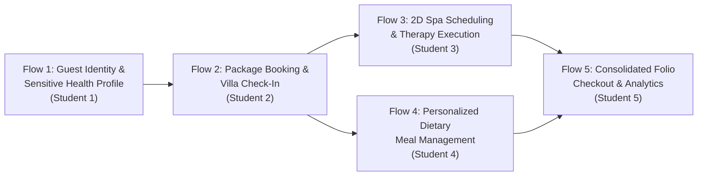
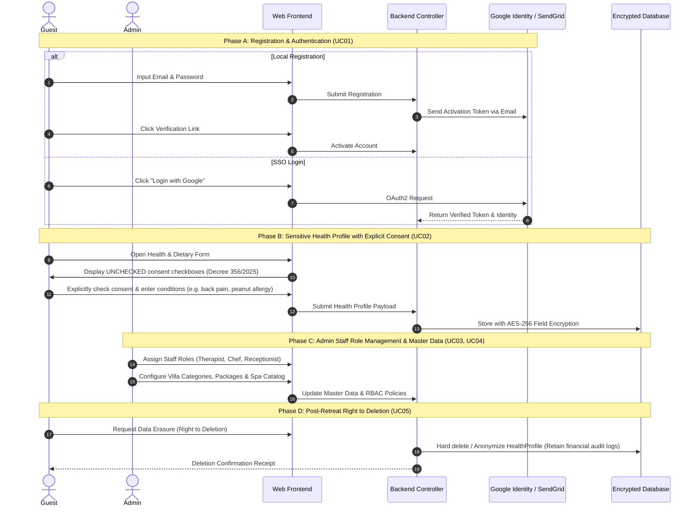
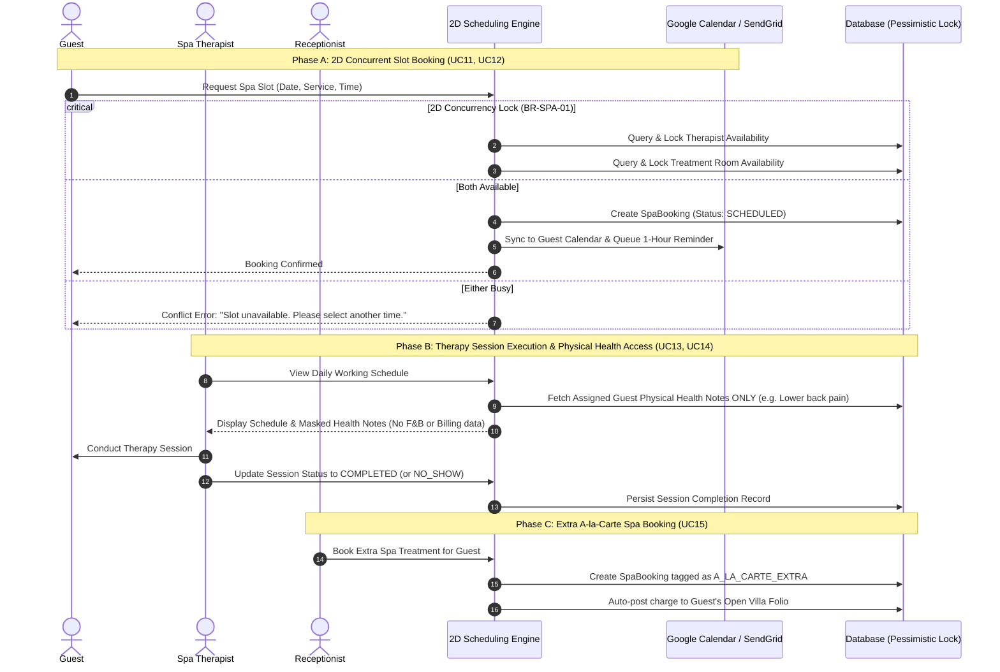
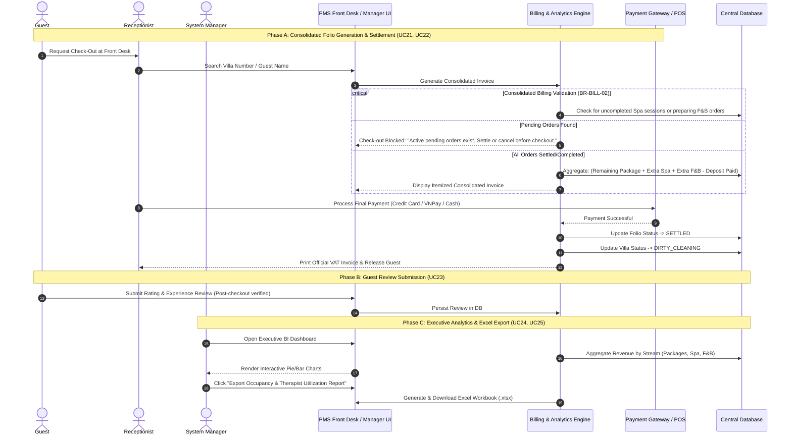
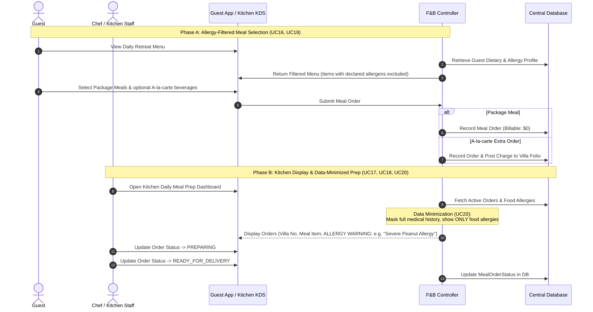

# Analysis of 5 Main System Flows

## Project: Xoai Aura Retreat — Wellness Resort & Spa Management System

**Document Code:** SWP391-HOS-03-FLOWS
**Target Folder:** `02_Requirement/`
**Source Baseline:** `Requirement_Traceability_Matrix.md` & `Context_Diagram_HOS03.drawio`
**Author:** Senior Business Analyst
**Version:** 1.0 (Baseline)
**Date:** September 16, 2026

---

## Executive Summary

Based on the Requirements Traceability Matrix and DFD Level 0 Context Diagram, the 25 Use Cases are structured into **5 End-to-End Main Flows**. Each flow represents an operational lifecycle within Xoai Aura Retreat, owned by one student engineer and strictly governed by domain business rules and Vietnamese legal regulations (Decree 356/2025/ND-CP & Law on Residence 2020).



---

## Flow 1: Guest Onboarding, Sensitive Health Profile & Compliance Lifecycle

- **Primary Module:** Module 1 (Assigned to **Student 1**)
- **Use Cases Covered:** UC01, UC02, UC03, UC04, UC05
- **Primary Actors:** Guest, System Manager (Admin), Google Identity/SSO, System Encryption Service
- **Key Business Rules:** BR-AUTH-01, BR-AUTH-02, BR-AUTH-03, BR-AUTH-04, BR-AUTH-05

### 1.1. Detailed Sequence Diagram



### 1.2. Operational Steps & Edge Cases

1. **Unchecked Consent Validation:** If the guest does not explicitly check the Decree 356/2025 consent checkbox, the system rejects health profile submission and operates in basic hospitality mode.
2. **Field-Level Encryption:** Health notes and allergy data are never stored in plaintext SQL columns.
3. **Right to Erasure Trigger:** Can only be triggered after the guest's folio balance is zero and checkout is completed.

---

## Flow 2: Wellness Retreat Discovery, Villa Reservation & Arrival Check-In

- **Primary Module:** Module 2 (Assigned to **Student 2**)
- **Use Cases Covered:** UC06, UC07, UC08, UC09, UC10
- **Primary Actors:** Guest, Receptionist, Payment Gateway (Stripe/VNPay), System Engine
- **Key Business Rules:** BR-BOOK-01, BR-BOOK-02, BR-BOOK-03, BR-BOOK-04

### 2.1. Detailed Sequence Diagram

```mermaid
sequenceDiagram
    autonumber
    actor G as Guest
    actor R as Receptionist
    participant UI as Portal / PMS UI
    participant BE as Booking Engine
    participant PG as Payment Gateway (Stripe/VNPay)
    participant DB as Central Database

    Note over G, PG: Phase A: Package Browsing & Booking (UC06, UC07, UC10)
    G->>UI: Filter Packages by Wellness Goal (Detox, Yoga, Stress Relief)
    UI->>BE: Query Available Packages & Villa Types
    BE-->>UI: Return Curated Packages & Available Dates
    G->>UI: Select Package, Dates, Villa Type & Proceed to Deposit
    UI->>PG: Initiate 30% Deposit Transaction
    PG-->>BE: Webhook: Payment SUCCESS
    BE->>DB: Create Booking Record (Status: CONFIRMED)
    BE-->>G: Send Booking Confirmation & Itinerary Timeline

    Note over R, DB: Phase B: Front Desk Check-In & Residence Declaration (UC08, UC09)
    R->>UI: Open Expected Arrivals Dashboard
    G->>R: Arrive at Resort Front Desk
    R->>UI: Scan / Input Guest Citizen ID / Passport (Law on Residence 2020)
    R->>UI: Assign physical Villa number (Must be status: AVAILABLE)
    UI->>BE: Execute Check-In
    BE->>DB: Update Villa Status to OCCUPIED & Encrypt Guest ID
    BE-->>R: Check-In Complete; Print Welcome Slip
```

### 2.2. Operational Steps & Edge Cases

1. **Deposit Expiry:** If the 30% deposit is not settled within 30 minutes, the reserved villa lock is released automatically.
2. **Villa Status Conflict:** Check-in fails immediately if the target villa is in `DIRTY_CLEANING` or `MAINTENANCE` state.
3. **Residence Compliance:** Foreign passport and domestic citizen ID data are segregated and exported for local police reporting.

---

## Flow 3: 2-Dimensional Concurrency Spa Scheduling & Therapy Execution

- **Primary Module:** Module 3 (Assigned to **Student 3 - Core 1 Complexity**)
- **Use Cases Covered:** UC11, UC12, UC13, UC14, UC15
- **Primary Actors:** Guest, Spa Therapist, Receptionist, Calendar Service (Google Calendar/SendGrid)
- **Key Business Rules:** BR-SPA-01, BR-SPA-02, BR-SPA-03, BR-SPA-04, RBAC Data Minimization

### 3.1. Detailed Sequence Diagram



### 3.2. Operational Steps & Edge Cases

1. **2D Resource Contention:** Simultaneous booking requests for the same room or therapist are resolved via database isolation (Pessimistic/Optimistic locking) to ensure zero double-booking.
2. **RBAC Filtering:** Therapists can inspect physical ailment notes (injuries, spine issues) but have zero access to food allergies or financial invoices.

---

## Flow 4: Personalized Dietary Meal Planning & Kitchen Fulfillment

- **Primary Module:** Module 4 (Assigned to **Student 4 - Core 2 Complexity**)
- **Use Cases Covered:** UC16, UC17, UC18, UC19, UC20
- **Primary Actors:** Guest, Chef / F&B Staff, Kitchen Display System (KDS)
- **Key Business Rules:** BR-FNB-01, BR-FNB-02, BR-FNB-03, BR-FNB-04, RBAC Data Minimization

### 4.1. Detailed Sequence Diagram

1. 4.2. Operational Steps & Edge Cases
1. **Severe Allergen Alert:** Kitchen display renders prominent visual indicators (red banners) for any orders associated with severe allergies.
1.
1. **Medical History Isolation:** Under no circumstances does the chef interface expose physical therapy notes, diagnoses, or ID details.

---

## Flow 5: Consolidated Folio Billing, Check-Out & Executive Analytics

- **Primary Module:** Module 5 (Assigned to **Student 5**)
- **Use Cases Covered:** UC21, UC22, UC23, UC24, UC25
- **Primary Actors:** Guest, Receptionist, System Manager (Admin), Payment Gateway
- **Key Business Rules:** BR-BILL-01, BR-BILL-02, BR-BILL-03, BR-BILL-04, BR-BILL-05

### 5.1. Detailed Sequence Diagram



### 5.2. Operational Steps & Edge Cases

1. **Unpaid Orders Prevention:** Check-out transaction aborts if any pending F&B or extra Spa order is in unbilled status.
2. **Immediate Room Turnaround:** Villa status changes instantly to `DIRTY_CLEANING` to signal housekeeping.
3. **Multi-Stream Revenue Integrity:** Analytics engine reconciles deposits, final settlements, and refunds with zero discrepancy.

---

## 6. Summary Matrix: Use Case to Flow Mapping

| Flow Number | Flow Name                                     |   Module & Owner   |      Included Use Cases      | External Integrations         | Primary Business Rules             |
| :---------: | :-------------------------------------------- | :----------------: | :--------------------------: | :---------------------------- | :--------------------------------- |
| **Flow 1**  | Guest Identity, Sensitive Health & Compliance | MOD-01 (Student 1) | UC01, UC02, UC03, UC04, UC05 | Google Identity SSO, SendGrid | BR-AUTH-01 to 05, Decree 356       |
| **Flow 2**  | Package Discovery, Villa Booking & Check-In   | MOD-02 (Student 2) | UC06, UC07, UC08, UC09, UC10 | Stripe / VNPay Sandbox        | BR-BOOK-01 to 04, Law on Residence |
| **Flow 3**  | 2D Spa Scheduling & Therapy Execution         | MOD-03 (Student 3) | UC11, UC12, UC13, UC14, UC15 | Google Calendar API, SendGrid | BR-SPA-01 to 04, RBAC Minimization |
| **Flow 4**  | Personalized Dietary Meal Management          | MOD-04 (Student 4) | UC16, UC17, UC18, UC19, UC20 | Kitchen Display System        | BR-FNB-01 to 04, Allergen Safety   |
| **Flow 5**  | Consolidated Folio, Checkout & Analytics      | MOD-05 (Student 5) | UC21, UC22, UC23, UC24, UC25 | Payment Gateway, Excel Export | BR-BILL-01 to 05, Accounting Audit |


