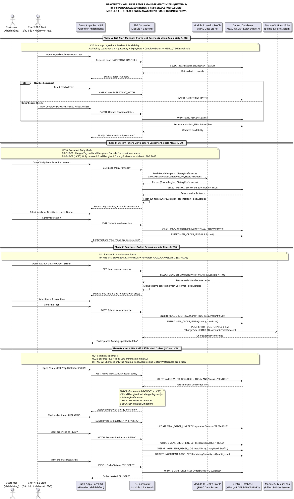

<!-- [TRACEABILITY HEADER] -->

<!-- Project: HEAVENSTAY WELLNESS RESORT MANAGEMENT SYSTEM (HSWRMS) -->

<!-- Module: Module 4 — Dietary F&B Management (CORE) — BF-04 -->

<!-- Target Audience: BA, System Architect, Software Engineer, QA Tester, Product Owner -->

<!-- Requirements Baseline: SRS Ver2 (Section 2.4 - BF-04 & UC16-UC20) & Project Specification Ver2 (Section 4, Module 4) -->

<!-- Business Rules: BR-FNB-01 (Allergy-Safe Menu), BR-FNB-02 (Kitchen Display Masking), BR-FNB-03 (Meal Order Progression), BR-FNB-04 (A-la-carte Folio Posting) -->

<!-- Cross-module Rules: BR-08 (Consolidated Folio), BR-09 (Checkout Guard) -->

<!-- Legal Compliance: Nghị định 13/2023/NĐ-CP & Nghị định 356/2025/NĐ-CP (Personal Data Protection PII) -->

<!-- Created Date: 2026-10-07 -->

<!-- Source File: 02_Requirement/HSWRMS_BF04_MainFlow_Module4.md -->

# SƠ ĐỒ LUỒNG NGHIỆP VỤ CHÍNH (MAIN BUSINESS FLOW DIAGRAM)

## BF-04: PERSONALIZED DINING & F&B SERVICE FULFILLMENT

## MODULE 4: DIETARY F&B MANAGEMENT (QUẢN LÝ ẨM THỰC VÀ DINH DƯỠNG SỨC KHỎE)

---

## 1. THÔNG TIN TỔNG QUAN (FLOW OVERVIEW)

| Thông Tin                              | Nội Dung                                                                                                                                                                                                                                                          |
| :------------------------------------- | :---------------------------------------------------------------------------------------------------------------------------------------------------------------------------------------------------------------------------------------------------------------- |
| **Tên Luồng Nghiệp vụ**                | BF-04: Personalized Dining & F&B Service Fulfillment                                                                                                                                                                                                              |
| **Module Chính**                       | Module 4 — Dietary F&B Management (CORE)                                                                                                                                                                                                                          |
| **Nguồn Tài Liệu**                     | [SRS Ver2 Section 2.4](file:///e:/fal26-isp392-is2005-g1/02_Requirement/SRS/HSWRMS_ISP392_G1_SRS.md) & [Project Specification Ver2 Section 4](file:///e:/fal26-isp392-is2005-g1/02_Requirement/Project_Specification/HSWRMS_ISP392_Project_Specification_Ver2.md) |
| **Tác Nhân Chính**                     | Customer (Khách hàng), Chef / F&B Staff (Đầu bếp / Nhân viên F&B), Module 1: Health Profile Store, Module 5: Guest Folio System                                                                                                                                   |
| **Trigger (Kích hoạt)**                | Khách hàng muốn chọn hoặc đặt món ăn trong suốt kỳ lưu trú tại Resort                                                                                                                                                                                             |
| **End Condition (Điều kiện kết thúc)** | Bữa ăn đã được chế biến và phục vụ; các khoản phụ thu thêm (nếu là a-la-carte) đã được ghi nhận vào Folio thanh toán của Khách hàng                                                                                                                               |
| **Use Cases Bao gồm**                  | UC16, UC17, UC18, UC19, UC20                                                                                                                                                                                                                                      |
| **Quy Tắc Nghiệp Vụ**                  | BR-FNB-01, BR-FNB-02, BR-FNB-03, BR-FNB-04, BR-08 (Cross-Module), BR-09 (Cross-Module)                                                                                                                                                                            |
| **Tuân Thủ Pháp Lý**                   | Nghị định 13/2023/NĐ-CP & 356/2025/NĐ-CP (Bảo vệ dữ liệu cá nhân PII)                                                                                                                                                                                             |

---

## 2. SƠ ĐỒ TỔNG QUAN LUỒNG (HIGH-LEVEL FLOW OVERVIEW)

```
+----------------------------------------------------------------------------------------------------------+
|                    BF-04: PERSONALIZED DINING & F&B SERVICE FULFILLMENT                                 |
+----------------------------------------------------------------------------------------------------------+
|                                                                                                          |
|  [PHASE A]                [PHASE B]                  [PHASE C]                 [PHASE D]                 |
|  F&B Staff               Customer                   Customer                  Chef / F&B Staff           |
|  Manage Batches          Views Allergy-             Orders Extra               Fulfills Orders            |
|  & Menu Availability     Filtered Menu &            A-la-carte                 & Logs Stock              |
|  (UC16)                  Selects Meals              Items                      (UC19 / UC20)             |
|                          (UC17)                     (UC18)                                               |
|       |                       |                          |                          |                    |
|       v                       v                          v                          v                    |
|  INGREDIENT_BATCH         MEAL_ORDER               FOLIO_CHARGE_ITEM         INGREDIENT_USAGE_LOG        |
|  IsAvailable              (IsALaCarte=FALSE)        (ChargeType=EXTRA_FB)    (Deduct from Batch)         |
|  recalculated             $0 — In Package          Auto-posted to M5         + OrderStatus=DELIVERED     |
+----------------------------------------------------------------------------------------------------------+
```

---

## 3. CHI TIẾT TỪNG PHA LUỒNG NGHIỆP VỤ (DETAILED FLOW PHASES)

---

### Phase A: F&B Staff Quản Lý Lô Nguyên Liệu & Tính Khả Dụng Thực Đơn (UC16)

**Tác nhân:** Chef / F&B Staff
**Mục đích:** Duy trì tính chính xác của tồn kho nguyên liệu và tự động cập nhật khả năng phục vụ từng món ăn trên thực đơn.

#### 3A.1. Điều kiện kích hoạt:

- Lô nguyên liệu mới được nhập kho (từ nhà cung cấp).
- Lô nguyên liệu hiện có đã hết hạn, xuống cấp hoặc cần hủy bỏ.
- Cần kiểm tra tồn kho trước khi phục vụ bữa ăn hôm nay.

#### 3A.2. Chuỗi Sự Kiện (Event Sequence):

| Bước | Tác Nhân  | Hành Động                                                                                                                                                           | Hệ Thống Phản Hồi                        |
| :--: | :-------- | :------------------------------------------------------------------------------------------------------------------------------------------------------------------ | :--------------------------------------- |
|  1   | F&B Staff | Truy cập màn hình**F&B Dashboard → Ingredient Inventory**                                                                                                           | Hệ thống tải danh sách`INGREDIENT_BATCH` |
|  2   | Hệ Thống  | Hiển thị danh sách lô nguyên liệu kèm`RemainingQuantity`, `ExpiryDate`, `ConditionStatus`                                                                           | -                                        |
|  3a  | F&B Staff | Nhập thông tin lô mới (BatchNumber, ReceivedDate, ExpiryDate, Qty, ConditionStatus=FRESH)                                                                           | INSERT`INGREDIENT_BATCH`                 |
|  3b  | F&B Staff | Cập nhật`ConditionStatus` = EXPIRED hoặc DISCARDED cho lô đã hết hạn                                                                                                | UPDATE`INGREDIENT_BATCH`                 |
|  4   | Hệ Thống  | **Auto-trigger:** Tính toán lại `MENU_ITEM.IsAvailable` dựa trên tổng `RemainingQuantity` khả dụng cho từng nguyên liệu bắt buộc trong công thức `MENU_ITEM_RECIPE` | UPDATE`MENU_ITEM.IsAvailable`            |
|  5   | Hệ Thống  | Thông báo cập nhật thành công và hiển thị danh sách món ăn đã thay đổi trạng thái                                                                                   | -                                        |

> **Availability Logic:** `MENU_ITEM.IsAvailable = TRUE` khi và chỉ khi TẤT CẢ nguyên liệu bắt buộc (`IsMandatory=TRUE`) trong công thức có `INGREDIENT_BATCH.RemainingQuantity > 0` VÀ `ExpiryDate >= CURRENT_DATE` VÀ `ConditionStatus IN ('FRESH', 'GOOD', 'NEAR_EXPIRY')`.

---

### Phase B: Khách Hàng Xem Thực Đơn Cá Nhân Hóa & Chọn Bữa Ăn (UC16)

**Tác nhân:** Customer (Khách hàng)
**Mục đích:** Khách hàng xem thực đơn đã được lọc bỏ các món chứa chất gây dị ứng và chọn bữa ăn tiêu chuẩn trong gói nghỉ dưỡng.

#### 3B.1. Điều kiện kích hoạt:

- Khách hàng đã đăng nhập thành công.
- Khách hàng đang có đơn đặt phòng nghỉ dưỡng ở trạng thái đã check-in.

#### 3B.2. Chuỗi Sự Kiện (Event Sequence):

| Bước | Tác Nhân | Hành Động                                                                 | Hệ Thống Phản Hồi                                                                                             |
| :--: | :------- | :------------------------------------------------------------------------ | :------------------------------------------------------------------------------------------------------------ |
|  1   | Customer | Truy cập màn hình**"Dietary Menu"** hoặc **"Daily Meal Selection"**       | Hệ thống bắt đầu chuẩn bị menu cá nhân hóa; chưa hiển thị menu chưa lọc                                       |
|  2   | Hệ Thống | Gọi Module 1 để lấy`FoodAllergies` & `DietaryPreferences` của Customer    | Chỉ nhận projection dinh dưỡng cần thiết;`MedicalConditions` & `PhysicalLimitations` bị **MASKED**            |
|  3   | Hệ Thống | Lấy danh sách`MENU_ITEM` đang hoạt động và kiểm tra khả dụng cho ngày/bữa | Đối chiếu`AllergenTags` với `FoodAllergies`; loại bỏ món chứa dị ứng đã khai báo                              |
|  4   | Hệ Thống | Lọc các món còn lại theo`DietaryPreferences` / `DietaryType`              | Chỉ đưa các món phù hợp hồ sơ và khả dụng vào menu hiển thị; món bị loại không được chọn hoặc gửi đặt qua API |
|  5   | Hệ Thống | Trả menu cá nhân hóa đã lọc cho giao diện                                 | Chỉ sau khi nhận danh sách đã lọc, giao diện mới hiển thị menu cho Customer                                   |
|  6   | Customer | Duyệt menu đã lọc và chọn món cho từng bữa (Sáng, Trưa, Tối)              | Hiển thị tóm tắt lựa chọn                                                                                     |
|  7   | Customer | Nhập`SpecialNotes` (nếu có) và xác nhận lựa chọn                          | Gửi yêu cầu tạo Meal Order                                                                                    |
|  8   | Hệ Thống | Kiểm tra lại booking, hồ sơ, món được chọn và khả dụng                    | Từ chối nếu request chứa món xung đột dị ứng/chế độ ăn; không ghi đơn                                         |
|  9   | Hệ Thống | Nếu hợp lệ, INSERT`MEAL_ORDER` (`IsALaCarte=FALSE`, `TotalAmount=0`)      | INSERT`MEAL_ORDER_LINE` với `UnitPrice=0`                                                                     |
|  10  | Hệ Thống | Hiển thị xác nhận: "Bữa ăn của bạn đã được đặt trước"                     | Cập nhật "My Meal Plan"                                                                                       |

> **BR-FNB-01 (Allergy Filter):** Menu khách hàng không hiển thị món có `MENU_ITEM.AllergenTags` giao với `GUEST_HEALTH_PROFILE.FoodAllergies`. API tạo/cập nhật lựa chọn cũng phải từ chối các món đó, kể cả khi gửi trực tiếp mã món.

---

### Phase C: Khách Hàng Đặt Thêm Món A-la-carte (UC19)

**Tác nhân:** Customer (Khách hàng)
**Mục đích:** Khách hàng gọi thêm món ăn/đồ uống ngoài gói và hệ thống tự động hạch toán khoản phụ thu vào Folio.

#### 3C.1. Điều kiện kích hoạt:

- Khách hàng muốn gọi thêm món ăn/đồ uống nằm ngoài tiêu chuẩn gói Retreat.

#### 3C.2. Chuỗi Sự Kiện (Event Sequence):

| Bước | Tác Nhân                    | Hành Động                                                                                                                  | Hệ Thống Phản Hồi                              |
| :--: | :-------------------------- | :------------------------------------------------------------------------------------------------------------------------- | :--------------------------------------------- |
|  1   | Customer                    | Truy cập màn hình**"Extra A-la-carte Order"**                                                                              | Tải danh mục món ăn a-la-carte kèm đơn giá     |
|  2   | Customer                    | Chọn món và số lượng                                                                                                       | Tính`Subtotal = SUM(Quantity × UnitPrice)`     |
|  3   | Customer                    | Xác nhận đồng ý ghi nhận phụ thu vào Folio                                                                                 | POST A-la-carte Order                          |
|  4   | Hệ Thống                    | INSERT`MEAL_ORDER` (`IsALaCarte=TRUE`, `TotalAmount=SUM`)                                                                  | INSERT`MEAL_ORDER_LINE`                        |
|  5   | **Hệ Thống (Auto-trigger)** | **POST `FOLIO_CHARGE_ITEM`** (`ChargeType='EXTRA_FB'`, `Amount=TotalAmount`, `PaymentStatus='PENDING'`) vào Module 5 Folio | `MealOrderID` được liên kết với `ChargeItemID` |
|  6   | Hệ Thống                    | Hiển thị xác nhận đơn đặt món và tham chiếu folio                                                                          | -                                              |

> **BR-FNB-04 / BR-08 (Extra F&B Folio Auto-Posting):** Khi `MEAL_ORDER.IsALaCarte = TRUE`, hệ thống **tự động và ngay lập tức** tạo `FOLIO_CHARGE_ITEM` với `ChargeType = 'EXTRA_FB'` liên kết với Folio của khách hàng tại Module 5. Khoản phí này sẽ bị khóa cho đến khi thanh toán hoàn tất tại Checkout (BR-09).

---

### Phase D: Chef / F&B Staff Chế Biến & Phục Vụ Đơn Ăn (UC17 / UC18 / UC20)

**Tác nhân:** Chef / F&B Staff
**Mục đích:** Bộ phận Bếp tiếp nhận đơn ăn, xem cảnh báo dị ứng, chế biến, phục vụ khách và ghi nhận trừ kho nguyên liệu.

#### 3D.1. Điều kiện kích hoạt:

- Đơn đặt bữa ăn (`MEAL_ORDER`) ở trạng thái `PENDING`.

#### 3D.2. Chuỗi Sự Kiện (Event Sequence):

| Bước | Tác Nhân | Hành Động                                                                                                | Hệ Thống Phản Hồi                                                |
| :--: | :------- | :------------------------------------------------------------------------------------------------------- | :--------------------------------------------------------------- |
|  1   | Chef     | Truy cập màn hình**"Daily Meal Prep Dashboard (KDS)"**                                                   | Load danh sách đơn ăn`PENDING` hôm nay                           |
|  2   | Hệ Thống | **RBAC Enforcement (BR-FNB-02 / UC20):** Chỉ trả về dị ứng thực phẩm và `DietaryPreferences` cần cho bếp | 🔒`MedicalConditions`, `PhysicalLimitations` **KHÔNG xuất hiện** |
|  3   | Chef     | Kiểm tra đơn ăn và cảnh báo dị ứng ⚠                                                                     | Thông tin hiển thị: Villa No., Meal Items, Allergy Warning       |
|  4   | Chef     | Chuyển trạng thái dòng đơn sang`PREPARING`                                                               | UPDATE`MEAL_ORDER_LINE.PreparationStatus = 'PREPARING'`          |
|  5   | Chef     | Hoàn tất chế biến, chuyển sang`READY`                                                                    | UPDATE`MEAL_ORDER_LINE.PreparationStatus = 'READY'`              |
|  6   | Hệ Thống | **Auto-trigger:** INSERT `INGREDIENT_USAGE_LOG`                                                          | UPDATE`INGREDIENT_BATCH.RemainingQuantity -= QuantityUsed`       |
|  7   | Chef     | Phục vụ khách, chuyển`MEAL_ORDER` sang `DELIVERED`                                                       | UPDATE`MEAL_ORDER.OrderStatus = 'DELIVERED'`                     |

> **BR-FNB-02 (Kitchen Display Masking / UC20):** Chef / F&B Staff chỉ được xem dị ứng thực phẩm và `DietaryPreferences` cần thiết cho chế biến. Dữ liệu lấy từ projection tối thiểu; không lưu cảnh báo dị ứng trên `MEAL_ORDER_LINE`. `MedicalConditions` và `PhysicalLimitations` bị **ẩn hoàn toàn**.

---

## 4. MA TRẬN QUY TẮC NGHIỆP VỤ (BUSINESS RULES ENFORCEMENT MATRIX)

| BR ID         | Tên Quy Tắc                   | Pha Áp Dụng            | Cơ Chế Thực Thi                                                                                      |
| :------------ | :---------------------------- | :--------------------- | :--------------------------------------------------------------------------------------------------- |
| **BR-FNB-01** | Allergy-Safe Menu             | Phase B/C (UC16, UC19) | Loại món xung đột với`FoodAllergies` khỏi menu; API cũng từ chối món xung đột                        |
| **BR-FNB-02** | Kitchen Display Masking       | Phase D (UC17, UC20)   | Chỉ expose thông tin dị ứng/chế độ ăn cần cho bếp; mask dữ liệu y tế khác                            |
| **BR-FNB-03** | Meal Order Progression        | Phase D (UC18)         | Chuyển trạng thái theo vòng đời đơn ăn đã quy định                                                   |
| **BR-FNB-04** | A-la-carte Room Folio Posting | Phase C (UC19)         | Đơn ngoài gói được xác nhận và hạch toán vào Folio theo quy định                                     |
| **BR-08**     | Consolidated Folio Accounting | Phase C/D (UC19, UC18) | Toàn bộ khoản phụ thu F&B được truy vết theo`MealOrderID` và `RoomBookingID`                         |
| **BR-09**     | Checkout Guard (Cross-module) | Phase D kết thúc       | Checkout (Module 5) bị chặn nếu còn`FOLIO_CHARGE_ITEM` với `PaymentStatus='PENDING'` chưa giải quyết |

---

## 5. LUỒNG ALT & NGOẠI LỆ (ALTERNATIVE & EXCEPTION FLOWS)

| Tình Huống                                     | Kích Hoạt                                               | Xử Lý Hệ Thống                                                                           |
| :--------------------------------------------- | :------------------------------------------------------ | :--------------------------------------------------------------------------------------- |
| Món ăn không còn khả dụng                      | `MENU_ITEM.IsAvailable = FALSE` do hết nguyên liệu      | Hệ thống ẩn món ăn khỏi thực đơn Customer. Chef được thông báo cần nhập thêm nguyên liệu |
| Request gửi trực tiếp ID món chứa dị ứng       | `AllergenTags ∩ FoodAllergies` phát hiện trùng khớp     | API từ chối yêu cầu và không tạo/cập nhật đơn                                            |
| Lô nguyên liệu hết hạn trong ngày              | `ExpiryDate < CURRENT_DATE` phát hiện trong batch check | Tự động cập nhật`ConditionStatus = EXPIRED`, recalculate `IsAvailable`                   |
| Đơn a-la-carte bị Khách hủy trước khi chế biến | `OrderStatus = 'PENDING'` + Cancel request              | UPDATE`OrderStatus = 'CANCELLED'`, REVERSE `FOLIO_CHARGE_ITEM.PaymentStatus = 'WAIVED'`  |
| Kho nguyên liệu không đủ khi chế biến          | `RemainingQuantity < RequiredQuantity`                  | Hệ thống cảnh báo Chef, đề xuất sử dụng lô nguyên liệu thay thế hoặc từ chối đơn         |

---

## 6. MÃ NGUỒN PLANTUML (PLANTUML DIAGRAM SOURCE)

File mã nguồn PlantUML độc lập được lưu tại: **[HSWRMS_BF04_MainFlow_Module4.puml](file:///e:/fal26-isp392-is2005-g1/02_Requirement/HSWRMS_BF04_MainFlow_Module4.puml)**.

Dưới đây là mã nguồn nhúng PlantUML đầy đủ để hiển thị Sơ đồ Sequence BF-04:



---

## 7. XÁC NHẬN VÀ TRUY VẾT YÊU CẦU (REQUIREMENT TRACEABILITY CHECKLIST)

- [x] **Phủ đủ UC16 - UC20:** Đã mô tả chi tiết cả 5 Use Case cốt lõi Module 4 trong 4 Phase của BF-04.
- [x] **Truy vết BF-04 SRS:** Sơ đồ BF-04 tuân thủ trực tiếp mô tả tại [SRS Ver2 Section 2.4](file:///e:/fal26-isp392-is2005-g1/02_Requirement/SRS/HSWRMS_ISP392_G1_SRS.md): _Trigger_ (Customer muốn chọn bữa ăn), _End Condition_ (Bữa ăn đã phục vụ & phụ thu ghi vào Folio).
- [x] **Truy vết Availability Logic:** Cơ chế tự động tính lại `IsAvailable` khi tồn kho nguyên liệu thay đổi đã được thể hiện trong Phase A.
- [x] **Truy vết BR-FNB-01:** Menu lọc bỏ món chứa dị ứng đã khai báo; API kiểm tra lại các món trong request trước khi tạo/cập nhật đơn.
- [x] **Truy vết BR-FNB-02 / UC20:** Nguyên tắc RBAC ẩn dữ liệu y tế nhạy cảm được áp dụng trên Dashboard Bếp. Tuân thủ quy định bảo vệ dữ liệu cá nhân hiện hành.
- [x] **Truy vết BR-FNB-04 / BR-08:** Luồng tự động hạch toán khoản phụ thu `EXTRA_FB` vào Module 5 Folio đã được thể hiện trong Phase C.
- [x] **Truy vết BR-09 (Cross-module):** Ghi chú cuối sơ đồ xác nhận khoản phí Folio bị khóa cho đến Checkout (Module 5).
- [x] **Tích hợp liên Module:** Sơ đồ thể hiện rõ ràng giao tiếp 2 chiều với Module 1 (Health Profile) và Module 5 (Guest Folio).
