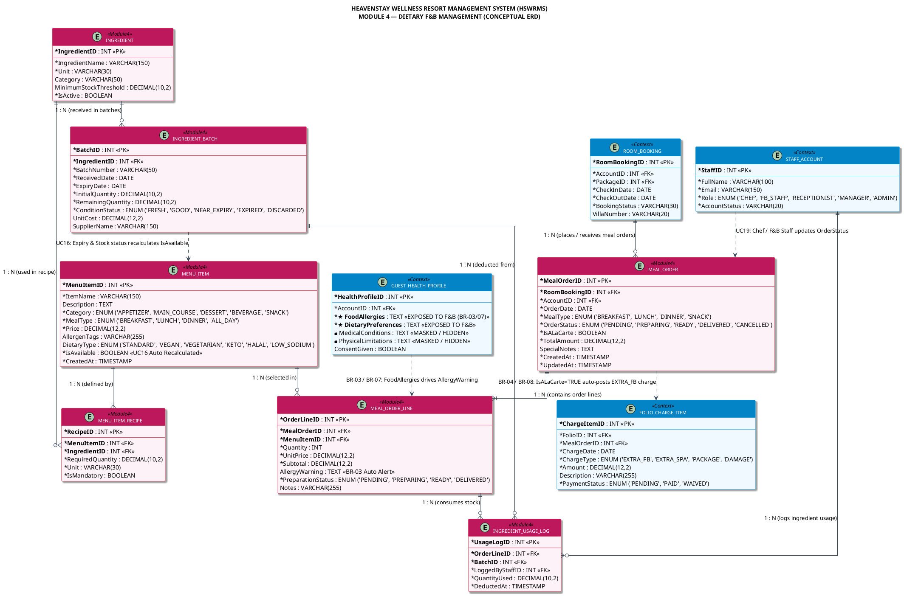

<!-- [TRACEABILITY HEADER] -->
<!-- Project: HEAVENSTAY WELLNESS RESORT MANAGEMENT SYSTEM (HSWRMS) -->
<!-- Module: Module 4 — Dietary F&B Management (CORE) -->
<!-- Target Audience: BA, System Architect, Database Engineer, Developer -->
<!-- Requirements Baseline: SRS Ver2 (UC16 - UC20) & Project Specification Ver2 (Section 4, Module 4) -->
<!-- Business Rules: BR-03 (Data Minimization RBAC), BR-04 (Extra F&B Folio Posting), BR-07 (Batch Availability & Data Minimization), BR-08 (Consolidated Folio Accounting) -->
<!-- Legal Compliance: Nghị định 13/2023/NĐ-CP & Nghị định 356/2025/NĐ-CP (Personal Data Protection PII) -->
<!-- Created Date: 2026-10-07 -->
<!-- Source File: 02_Requirement/HSWRMS_Conceptual_ERD_Module4.md -->

# THIẾT KẾ MÔ HÌNH DỮ LIỆU KHÁI NIỆM (CONCEPTUAL ERD)
## MODULE 4: DIETARY F&B MANAGEMENT (QUẢN LÝ ẨM THỰC VÀ DINH DƯỠNG SỨC KHỎE)

---

## 1. TỔNG QUAN & PHẠM VI (OVERVIEW & SCOPE)

Mô hình Dữ liệu Khái niệm (Conceptual Entity-Relationship Diagram - ERD) cho **Module 4 (Dietary F&B Management)** thuộc hệ thống **HEAVENSTAY WELLNESS RESORT MANAGEMENT SYSTEM (HSWRMS)** được thiết kế dựa trên 02 tài liệu chuẩn nghiệp vụ gốc:
1. **[HSWRMS_ISP392_Project_Specification_Ver2.md](file:///e:/fal26-isp392-is2005-g1/02_Requirement/Project_Specification/HSWRMS_ISP392_Project_Specification_Ver2.md)** (Cập nhật tháng 10/2026)
2. **[HSWRMS_ISP392_G1_SRS.md](file:///e:/fal26-isp392-is2005-g1/02_Requirement/SRS/HSWRMS_ISP392_G1_SRS.md)** (Hồ sơ Yêu cầu Phần mềm)

### 1.1. Mục Tiêu Nghiệp Vụ Của Module 4
Module 4 đóng vai trò cốt lõi trong hành trình trải nghiệm nghỉ dưỡng cá nhân hóa (Personalized Wellness Journey) của khách hàng tại HeavenStay Resort:
- **Tự động hóa lọc thực đơn theo sức khỏe (UC17):** Khách hàng (Customer) chọn bữa ăn hàng ngày dựa trên các món ăn khả dụng đã được hệ thống tự động lọc bỏ allergen (chất gây dị ứng) theo hồ sơ sức khỏe (`GUEST_HEALTH_PROFILE`).
- **Quản lý lô nguyên liệu & tính khả dụng thực đơn (UC16):** Nhân viên F&B/Đầu bếp (Chef) quản lý danh mục và lô nguyên liệu (`INGREDIENT_BATCH`). Hệ thống tự động tính toán lại sự khả dụng của món ăn (`MENU_ITEM.IsAvailable`) dựa trên số lượng tồn thực tế, ngày hết hạn và tình trạng nguyên liệu.
- **Đặt món a-la-carte ngoài gói & hạch toán Folio (UC18):** Cho phép đặt thêm món ăn ngoài gói Retreat. Hệ thống tự động ghi nhận khoản phí phụ thu (`IsALaCarte = TRUE`) thành một khoản tính phí (`FOLIO_CHARGE_ITEM` loại `EXTRA_FB`) vào Folio thanh toán của khách hàng.
- **Thực thi quy trình chế biến & trừ kho nguyên liệu (UC19):** Chef/F&B Staff theo dõi các cảnh báo dị ứng, chuẩn bị món ăn, cập nhật trạng thái đơn đặt (`PENDING` -> `PREPARING` -> `READY` -> `DELIVERED`) và ghi nhận nhật ký tiêu hao nguyên liệu (`INGREDIENT_USAGE_LOG`).
- **Bảo mật & Tối thiểu hóa dữ liệu y tế (UC20 / BR-03 / BR-07):** Phân quyền nghiêm ngặt (RBAC). Nhân viên F&B / Chef chỉ được phép tiếp cận dị ứng thực phẩm (`FoodAllergies`) và chế độ ăn kiêng (`DietaryPreferences`), tuyệt đối **KHÔNG** được xem tiền sử bệnh lý (`MedicalConditions`) hay hạn chế thể chất (`PhysicalLimitations`) của khách hàng.

---

## 2. KIẾN TRÚC MÔ HÌNH DỮ LIỆU (CONCEPTUAL ERD ARCHITECTURE)

Mô hình ERD Module 4 bao gồm **07 Thực thể Cốt lõi (Core Entities)** thuộc Module 4 và **04 Thực thể Ngữ cảnh (Connected Context Entities)** kết nối liên module với Module 1 (Auth & Health), Module 2 (Booking) và Module 5 (Folio & Checkout).

```
+-----------------------------------------------------------------------------------+
|                            CONNECTED CONTEXT ENTITIES                             |
|                                                                                   |
|  +-----------------------+   +-------------------+   +-------------------------+  |
|  | GUEST_HEALTH_PROFILE  |   |   ROOM_BOOKING    |   |    FOLIO_CHARGE_ITEM    |  |
|  | (M1 Sensitive Health) |   | (M2 Accommodat'n) |   | (M5 Folio Accounting)   |  |
|  +-----------+-----------+   +---------+---------+   +------------+------------+  |
+--------------|-------------------------|--------------------------|---------------+
               | (BR-03 Flow)            | (1:N)                    | (BR-04 Flow)
               v                         v                          |
+--------------+-------------------------+--------------------------|---------------+
|                               MODULE 4 CORE ENTITIES              |               |
|                                                                   |               |
|                      +-------------------+                        |               |
|                      |    MEAL_ORDER     |------------------------+               |
|                      +---------+---------+                                        |
|                                | (1:N)                                            |
|                                v                                                  |
|                      +-------------------+       +-------------------+            |
|                      |  MEAL_ORDER_LINE  |<------|     MENU_ITEM     |            |
|                      +---------+---------+ (N:1) +---------+---------+            |
|                                |                           |                      |
|                                | (1:N)                     | (1:N)                |
|                                v                           v                      |
|                      +-------------------+       +-------------------+            |
|                      |INGREDIENT_USAGE_LOG|      | MENU_ITEM_RECIPE  |            |
|                      +---------+---------+       +---------+---------+            |
|                                ^                           |                      |
|                                | (N:1)                     | (N:1)                |
|                      +---------+---------+                 v                      |
|                      | INGREDIENT_BATCH  |<----------------+                      |
|                      +---------+---------+   (1:N) | INGREDIENT |                 |
|                                                    +------------+                 |
+-----------------------------------------------------------------------------------+
```

---

## 3. TỪ ĐỂN DỮ LIỆU CHI TIẾT (DETAILED DATA DICTIONARY)

### 3.1. Các Thực Thể Cốt Lõi Module 4 (Core Module 4 Entities)

#### 1. `MEAL_ORDER` (Đơn Đặt Bữa Ăn)
- **Mục đích:** Quản lý thông tin tổng quan của một lượt đặt bữa ăn do Khách hàng thực hiện cho cả bữa ăn trong gói nghỉ dưỡng hoặc bữa ăn gọi thêm a-la-carte.
- **Bảng CSDL đề xuất:** `MEAL_ORDER`

| Tên Thuộc Tính (Attribute) | Kiểu Dữ Liệu | Ràng Buộc | Mô Tả & Quy Tắc Nghiệp Vụ |
| :--- | :--- | :--- | :--- |
| **`MealOrderID`** | `INT` | **PK**, Auto Inc | Định danh duy nhất cho đơn đặt bữa ăn. |
| **`RoomBookingID`** | `INT` | **FK**, NOT NULL | Liên kết tới đơn đặt phòng nghỉ dưỡng (`ROOM_BOOKING`). |
| **`AccountID`** | `INT` | **FK**, NOT NULL | Định danh tài khoản khách hàng thực hiện đặt đơn. |
| **`OrderDate`** | `DATE` | NOT NULL | Ngày phục vụ bữa ăn dự kiến. |
| **`MealType`** | `ENUM` | NOT NULL | Loại bữa ăn: `'BREAKFAST'`, `'LUNCH'`, `'DINNER'`, `'SNACK'`. |
| **`OrderStatus`** | `ENUM` | NOT NULL | Trạng thái đơn: `'PENDING'`, `'PREPARING'`, `'READY'`, `'DELIVERED'`, `'CANCELLED'`. |
| **`IsALaCarte`** | `BOOLEAN` | NOT NULL | `FALSE`: Bữa ăn nằm trong gói Retreat. `TRUE`: Gọi thêm ngoài gói (phụ thu). |
| **`TotalAmount`** | `DECIMAL(12,2)` | DEFAULT 0 | Tổng tiền đơn ăn (bằng 0 nếu nằm trong gói; >0 nếu là a-la-carte). |
| **`SpecialNotes`** | `TEXT` | NULL | Ghi chú thêm của khách (ví dụ: giao tận Villa, không cay...). |
| **`CreatedAt`** | `TIMESTAMP` | NOT NULL | Thời điểm tạo đơn hàng. |
| **`UpdatedAt`** | `TIMESTAMP` | NOT NULL | Thời điểm cập nhật trạng thái đơn gần nhất. |

---

#### 2. `MEAL_ORDER_LINE` (Chi Tiết Dòng Đơn Ăn)
- **Mục đích:** Lưu trữ chi tiết từng món ăn được chọn trong đơn, thông tin đơn giá và các cảnh báo dị ứng tự động.
- **Bảng CSDL đề xuất:** `MEAL_ORDER_LINE`

| Tên Thuộc Tính (Attribute) | Kiểu Dữ Liệu | Ràng Buộc | Mô Tả & Quy Tắc Nghiệp Vụ |
| :--- | :--- | :--- | :--- |
| **`OrderLineID`** | `INT` | **PK**, Auto Inc | Định danh dòng món ăn. |
| **`MealOrderID`** | `INT` | **FK**, NOT NULL | Liên kết với đơn đặt bữa ăn (`MEAL_ORDER`). |
| **`MenuItemID`** | `INT` | **FK**, NOT NULL | Món ăn được chọn từ thực đơn (`MENU_ITEM`). |
| **`Quantity`** | `INT` | NOT NULL (>=1) | Số lượng suất ăn. |
| **`UnitPrice`** | `DECIMAL(12,2)` | NOT NULL | Đơn giá món ăn tại thời điểm đặt (0 VND nếu bao gồm trong gói). |
| **`Subtotal`** | `DECIMAL(12,2)` | NOT NULL | Thành tiền = `Quantity * UnitPrice`. |
| **`AllergyWarning`** | `TEXT` | NULL | **[BR-03/BR-07]** Chuỗi cảnh báo dị ứng tự động tạo khi `FoodAllergies` khớp với `MENU_ITEM.AllergenTags`. |
| **`PreparationStatus`** | `ENUM` | NOT NULL | Trạng thái chế biến: `'PENDING'`, `'PREPARING'`, `'READY'`, `'DELIVERED'`. |
| **`Notes`** | `VARCHAR(255)`| NULL | Yêu cầu chế biến riêng cho từng món. |

---

#### 3. `MENU_ITEM` (Thực Đơn Món Ăn F&B)
- **Mục đích:** Danh mục thực đơn món ăn/đồ uống của resort, quản lý thẻ dị ứng và khả năng phục vụ.
- **Bảng CSDL đề xuất:** `MENU_ITEM`

| Tên Thuộc Tính (Attribute) | Kiểu Dữ Liệu | Ràng Buộc | Mô Tả & Quy Tắc Nghiệp Vụ |
| :--- | :--- | :--- | :--- |
| **`MenuItemID`** | `INT` | **PK**, Auto Inc | Định danh món ăn. |
| **`ItemName`** | `VARCHAR(150)` | NOT NULL | Tên món ăn (Ví dụ: "Súp Bí Đỏ Hạt Óc Chó", "Cá Hồi Nướng Herb"). |
| **`Description`** | `TEXT` | NULL | Mô tả chi tiết thành phần món ăn. |
| **`Category`** | `ENUM` | NOT NULL | Phân loại: `'APPETIZER'`, `'MAIN_COURSE'`, `'DESSERT'`, `'BEVERAGE'`, `'SNACK'`. |
| **`MealType`** | `ENUM` | NOT NULL | Khung giờ: `'BREAKFAST'`, `'LUNCH'`, `'DINNER'`, `'ALL_DAY'`. |
| **`Price`** | `DECIMAL(12,2)` | NOT NULL (>=0) | Giá bán niêm yết (VND). |
| **`AllergenTags`** | `VARCHAR(255)` | NULL | Thẻ chất gây dị ứng (Ví dụ: `"PEANUT, GLUTEN, DAIRY, SEAFOOD, SOY"`). |
| **`DietaryType`** | `ENUM` | NOT NULL | Chế độ ăn: `'STANDARD'`, `'VEGAN'`, `'VEGETARIAN'`, `'KETO'`, `'HALAL'`, `'LOW_SODIUM'`. |
| **`IsAvailable`** | `BOOLEAN` | NOT NULL | **[UC16]** Tự động tính toán dựa trên tồn kho nguyên liệu còn hạn sử dụng. |
| **`CreatedAt`** | `TIMESTAMP` | NOT NULL | Ngày tạo món trong danh mục. |

---

#### 4. `INGREDIENT` (Danh Mục Nguyên Liệu)
- **Mục đích:** Quản lý danh mục định danh các loại nguyên liệu thô dùng để chế biến món ăn.
- **Bảng CSDL đề xuất:** `INGREDIENT`

| Tên Thuộc Tính (Attribute) | Kiểu Dữ Liệu | Ràng Buộc | Mô Tả & Quy Tắc Nghiệp Vụ |
| :--- | :--- | :--- | :--- |
| **`IngredientID`** | `INT` | **PK**, Auto Inc | Định danh nguyên liệu. |
| **`IngredientName`** | `VARCHAR(150)` | NOT NULL | Tên nguyên liệu (Ví dụ: "Cá Hồi Na-uy Fresh", "Đậu Phộng", "Sữa Hạnh Nhân"). |
| **`Unit`** | `VARCHAR(30)` | NOT NULL | Đơn vị tính: `"KG"`, `"GRAMS"`, `"LITERS"`, `"PIECES"`. |
| **`Category`** | `VARCHAR(50)` | NULL | Phân loại: `"VEGETABLE"`, `"MEAT"`, `"SEAFOOD"`, `"DAIRY"`, `"GRAIN"`, `"SPICE"`. |
| **`MinimumStockThreshold`**| `DECIMAL(10,2)`| DEFAULT 0 | Ngưỡng tồn kho tối thiểu để cảnh báo nhập hàng. |
| **`IsActive`** | `BOOLEAN` | DEFAULT TRUE | Trạng thái nguyên liệu đang kinh doanh/sử dụng. |

---

#### 5. `INGREDIENT_BATCH` (Lô Nguyên Liệu F&B - UC16)
- **Mục đích:** Quản lý từng lô hàng nguyên liệu thực tế nhập vào kho, theo dõi hạn sử dụng, số lượng tồn và tình trạng nguyên liệu.
- **Bảng CSDL đề xuất:** `INGREDIENT_BATCH`

| Tên Thuộc Tính (Attribute) | Kiểu Dữ Liệu | Ràng Buộc | Mô Tả & Quy Tắc Nghiệp Vụ |
| :--- | :--- | :--- | :--- |
| **`BatchID`** | `INT` | **PK**, Auto Inc | Định danh lô nguyên liệu. |
| **`IngredientID`** | `INT` | **FK**, NOT NULL | Liên kết danh mục nguyên liệu (`INGREDIENT`). |
| **`BatchNumber`** | `VARCHAR(50)` | NOT NULL | Số lô nhập hàng (Lot/Batch code). |
| **`ReceivedDate`** | `DATE` | NOT NULL | Ngày nhập kho. |
| **`ExpiryDate`** | `DATE` | NOT NULL | Ngày hết hạn sử dụng. |
| **`InitialQuantity`** | `DECIMAL(10,2)` | NOT NULL | Số lượng ban đầu khi nhập. |
| **`RemainingQuantity`** | `DECIMAL(10,2)` | NOT NULL | Số lượng tồn thực tế khả dụng. |
| **`ConditionStatus`** | `ENUM` | NOT NULL | Trạng thái chất lượng: `'FRESH'`, `'GOOD'`, `'NEAR_EXPIRY'`, `'EXPIRED'`, `'DISCARDED'`. |
| **`UnitCost`** | `DECIMAL(12,2)` | NULL | Giá vốn đơn vị nguyên liệu. |
| **`SupplierName`** | `VARCHAR(150)` | NULL | Tên nhà cung cấp. |

---

#### 6. `MENU_ITEM_RECIPE` (Công Thức Món Ăn / Định Mức Nguyên Liệu)
- **Mục đích:** Quy định định mức tiêu hao nguyên liệu cho mỗi suất món ăn, phục vụ trừ kho và kiểm tra tồn kho.
- **Bảng CSDL đề xuất:** `MENU_ITEM_RECIPE`

| Tên Thuộc Tính (Attribute) | Kiểu Dữ Liệu | Ràng Buộc | Mô Tả & Quy Tắc Nghiệp Vụ |
| :--- | :--- | :--- | :--- |
| **`RecipeID`** | `INT` | **PK**, Auto Inc | Định danh dòng công thức. |
| **`MenuItemID`** | `INT` | **FK**, NOT NULL | Món ăn áp dụng công thức (`MENU_ITEM`). |
| **`IngredientID`** | `INT` | **FK**, NOT NULL | Nguyên liệu thành phần (`INGREDIENT`). |
| **`RequiredQuantity`** | `DECIMAL(10,2)` | NOT NULL | Số lượng nguyên liệu cần cho 01 suất ăn. |
| **`Unit`** | `VARCHAR(30)` | NOT NULL | Đơn vị tính định mức. |
| **`IsMandatory`** | `BOOLEAN` | DEFAULT TRUE | `TRUE`: Thành phần bắt buộc; `FALSE`: Thành phần tùy chọn. |

---

#### 7. `INGREDIENT_USAGE_LOG` (Nhật Ký Sử Dụng Nguyên Liệu - UC19)
- **Mục đích:** Ghi vết (Audit trail) việc trừ kho nguyên liệu thực tế khi Bếp/F&B chế biến từng suất ăn.
- **Bảng CSDL đề xuất:** `INGREDIENT_USAGE_LOG`

| Tên Thuộc Tính (Attribute) | Kiểu Dữ Liệu | Ràng Buộc | Mô Tả & Quy Tắc Nghiệp Vụ |
| :--- | :--- | :--- | :--- |
| **`UsageLogID`** | `INT` | **PK**, Auto Inc | Định danh nhật ký tiêu hao. |
| **`OrderLineID`** | `INT` | **FK**, NOT NULL | Chi tiết dòng đơn ăn tương ứng (`MEAL_ORDER_LINE`). |
| **`BatchID`** | `INT` | **FK**, NOT NULL | Lô nguyên liệu bị xuất trừ (`INGREDIENT_BATCH`). |
| **`LoggedByStaffID`** | `INT` | **FK**, NOT NULL | Nhân viên Bếp/F&B thực hiện xuất kho (`STAFF_ACCOUNT`). |
| **`QuantityUsed`** | `DECIMAL(10,2)` | NOT NULL | Số lượng nguyên liệu đã trừ từ lô. |
| **`DeductedAt`** | `TIMESTAMP` | NOT NULL | Thời điểm ghi nhận xuất kho trừ hàng. |

---

### 3.2. Các Thực Thể Ngữ Cảnh Liên Kết (Connected Context Entities)

#### 1. `GUEST_HEALTH_PROFILE` (Hồ Sơ Sức Khỏe - Module 1 Context)
- **Trách nhiệm ngữ cảnh:** Cung cấp thông tin dị ứng thực phẩm và chế độ ăn uống cho Module 4.
- **Quy tắc bảo mật (BR-03 / BR-07 / UC20):**
  - **★ Thuộc tính mở cho F&B Staff / Chef:** `FoodAllergies`, `DietaryPreferences`.
  - **🔒 Thuộc tính Ẩn/Che giấu (Masked):** `MedicalConditions`, `PhysicalLimitations`, `TreatmentSafetyNotes` (Thuộc tính này chỉ dành cho Spa Therapist / Medical Staff).

#### 2. `ROOM_BOOKING` (Đơn Đặt Phòng Nghỉ Dưỡng - Module 2 Context)
- **Trách nhiệm ngữ cảnh:** Làm gốc tham chiếu (Central Reference Key) để nhóm tất cả các đơn ăn (`MEAL_ORDER`) trong khoảng thời gian lưu trú của Khách hàng tại Resort.

#### 3. `STAFF_ACCOUNT` (Tài Khoản Nhân Viên - Module 1 Context)
- **Trách nhiệm ngữ cảnh:** Xác thực và phân quyền cho nhân viên F&B Staff / Chef thực hiện cập nhật trạng thái đơn ăn (`OrderStatus`) và quản lý lô nguyên liệu (`INGREDIENT_BATCH`).

#### 4. `FOLIO_CHARGE_ITEM` (Khoản Phí Folio Thanh Toán - Module 5 Context)
- **Trách nhiệm ngữ cảnh:** Tiếp nhận các khoản phụ thu tự động từ các đơn ăn gọi thêm a-la-carte ngoài gói (`IsALaCarte = TRUE`) với `ChargeType = 'EXTRA_FB'` nhằm phục vụ gộp hóa đơn checkout tại Module 5.

---

## 4. MA TRẬN QUAN HỆ & CƯỜNG ĐỘ (RELATIONSHIP MATRIX & CARDINALITY)

| Thực Thể Gốc (Source) | Thực Thể Đích (Target) | Loại Quan Hệ | Cường Độ (Cardinality) | Mô Tả Nghiệp Vụ |
| :--- | :--- | :--- | :--- | :--- |
| `ROOM_BOOKING` | `MEAL_ORDER` | 1 - N | `1 : 0..*` | Một đơn phòng lưu trú có thể có 0 hoặc nhiều đơn đặt bữa ăn. |
| `MEAL_ORDER` | `MEAL_ORDER_LINE` | 1 - N | `1 : 1..*` | Một đơn đặt bữa ăn chứa 1 hoặc nhiều dòng món ăn chi tiết. |
| `MENU_ITEM` | `MEAL_ORDER_LINE` | 1 - N | `1 : 0..*` | Một món ăn có thể xuất hiện trong 0 hoặc nhiều dòng đơn ăn. |
| `MENU_ITEM` | `MENU_ITEM_RECIPE` | 1 - N | `1 : 1..*` | Một món ăn được định nghĩa bởi 1 hoặc nhiều định mức nguyên liệu. |
| `INGREDIENT` | `MENU_ITEM_RECIPE` | 1 - N | `1 : 0..*` | Một loại nguyên liệu có thể dùng trong công thức của nhiều món ăn. |
| `INGREDIENT` | `INGREDIENT_BATCH` | 1 - N | `1 : 0..*` | Một loại nguyên liệu được nhập về qua nhiều lô hàng khác nhau. |
| `MEAL_ORDER_LINE` | `INGREDIENT_USAGE_LOG` | 1 - N | `1 : 0..*` | Chế biến một suất ăn ghi nhận trừ kho qua 1 hoặc nhiều nhật ký lô. |
| `INGREDIENT_BATCH` | `INGREDIENT_USAGE_LOG` | 1 - N | `1 : 0..*` | Một lô nguyên liệu bị trừ dần qua nhiều nhật ký chế biến. |
| `STAFF_ACCOUNT` | `INGREDIENT_USAGE_LOG` | 1 - N | `1 : 0..*` | Một Chef/F&B Staff thực hiện ghi nhận nhiều nhật ký xuất kho. |
| `GUEST_HEALTH_PROFILE`| `MEAL_ORDER_LINE` | Tương tác Logic | `1 - - - *` | **[BR-03]** `FoodAllergies` sinh chuỗi `AllergyWarning` tự động. |
| `MEAL_ORDER` | `FOLIO_CHARGE_ITEM` | Tương tác Logic | `1 - - - 0..1` | **[BR-04]** Đơn a-la-carte sinh tự động khoản phí `EXTRA_FB` vào Folio. |

---

## 5. QUY TẮC NGHIỆP VỤ & CƠ CHẾ RÀNG BUỘC (BUSINESS RULES ENFORCEMENT)

### 5.1. BR-03 & BR-07: Tối Thiểu Hóa Dữ Liệu Sức Khỏe & Cảnh Báo Dị Ứng (RBAC Data Minimization)
- **Quy tắc:** Bếp / F&B Staff chỉ có quyền xem dị ứng thực phẩm (`FoodAllergies`) và chế độ ăn kiêng (`DietaryPreferences`). Tất cả thông tin tiền sử bệnh lý (`MedicalConditions`) và hạn chế thể chất (`PhysicalLimitations`) đều bị **MASKED / MÃ HÓA KHÔNG CHO PHÉP TRUY CẬP**.
- **Cơ chế thực thi trên ERD:**
  - Hệ thống tự động so khớp chuỗi `GUEST_HEALTH_PROFILE.FoodAllergies` với `MENU_ITEM.AllergenTags` khi Khách hàng chọn món.
  - Nếu có sự trùng lặp (ví dụ: Khách dị ứng `"PEANUT"`, món ăn chứa tag `"PEANUT"`), hệ thống sẽ:
    1. Hiển thị cảnh báo trực quan cho Khách hàng trên giao diện đặt món.
    2. Tự động ghi chép thông điệp cảnh báo vào thuộc tính `MEAL_ORDER_LINE.AllergyWarning` để Bếp nhận diện ngay lập tức trên Meal Prep Dashboard (UC17).

### 5.2. BR-04 & BR-08: Tự Động Hạch Toán Phụ Thu A-la-carte Vào Folio (Folio Accounting)
- **Quy tắc:**
  - Bữa ăn tiêu chuẩn trong gói nghỉ dưỡng có `IsALaCarte = FALSE` (Đơn giá `UnitPrice = 0 VND`).
  - Bữa ăn gọi thêm ngoài gói có `IsALaCarte = TRUE`.
- **Cơ chế thực thi trên ERD:**
  - Ngay khi đơn ăn có `IsALaCarte = TRUE` được chuyển sang trạng thái xác nhận (`OrderStatus = 'PREPARING'` hoặc `'READY'`), Trigger/Service sẽ tính tổng tiền `TotalAmount = SUM(Quantity * UnitPrice)` và **tự động sinh ra 01 bản ghi `FOLIO_CHARGE_ITEM`** với `ChargeType = 'EXTRA_FB'` gắn trực tiếp với `FolioID` của khách hàng.
  - Phụ thu này sẽ được gộp tự động vào Hóa đơn thanh toán cuối cùng tại thời điểm Checkout (Module 5), chặn Checkout nếu chưa hoàn tất nghĩa vụ thanh toán (BR-09).

### 5.3. UC16: Tự Động Tính Toán Khả Năng Phục Vụ Của Thực Đơn (Batch Stock & Expiry Logic)
- **Quy tắc:** Món ăn chỉ hiển thị ở trạng thái sẵn sàng (`MENU_ITEM.IsAvailable = TRUE`) khi tất cả các nguyên liệu bắt buộc (`IsMandatory = TRUE`) trong công thức `MENU_ITEM_RECIPE` còn tồn kho khả dụng (`RemainingQuantity > 0`) ở các lô chưa hết hạn (`ConditionStatus IN ('FRESH', 'GOOD', 'NEAR_EXPIRY')` và `ExpiryDate >= CURRENT_DATE`).
- **Cơ chế thực thi trên ERD:**
  - Khi Bếp nhập lô mới hoặc khi Bếp ghi nhận xuất kho (`INGREDIENT_USAGE_LOG`), hệ thống tự động chạy hàm recalculate lại cột `MENU_ITEM.IsAvailable`.

---

## 6. MÃ NGUỒN PLANTUML (PLANTUML SOURCE CODE)

File mã nguồn PlantUML độc lập được lưu tại: **[HSWRMS_Conceptual_ERD_Module4.puml](file:///e:/fal26-isp392-is2005-g1/02_Requirement/HSWRMS_Conceptual_ERD_Module4.puml)**. 

Dưới đây là mã nguồn nhúng PlantUML đầy đủ để hiển thị trực tiếp trên các trình xem Markdown hỗ trợ PlantUML:



---

## 7. XÁC NHẬN VÀ TRUY VẾT YÊU CẦU (REQUIREMENT TRACEABILITY AUDIT)

- [x] **Truy vết UC16 (Quản lý Lô nguyên liệu & Tính khả dụng):** Đã mô tả đầy đủ thực thể `INGREDIENT_BATCH` và logic tính toán lại `MENU_ITEM.IsAvailable`.
- [x] **Truy vết UC17 (Tự chọn Bữa ăn Dinh dưỡng):** Đã mô tả thực thể `MEAL_ORDER`, `MEAL_ORDER_LINE` kết hợp lọc theo `GUEST_HEALTH_PROFILE`.
- [x] **Truy vết UC18 (Đặt thêm Món A-la-carte):** Đã mô tả cờ `IsALaCarte` và luồng sinh khoản phí `FOLIO_CHARGE_ITEM` (loại `EXTRA_FB`).
- [x] **Truy vết UC19 (Chế biến & Trừ Kho Nguyên liệu):** Đã bổ sung thực thể `INGREDIENT_USAGE_LOG` để ghi nhận trừ lô nguyên liệu khi Bếp chế biến.
- [x] **Truy vết UC20 / BR-03 / BR-07 (Tối thiểu hóa dữ liệu y tế PII):** Khẳng định rõ trên ERD F&B Staff chỉ truy cập `FoodAllergies` và `DietaryPreferences`, che giấu hoàn toàn các dữ liệu y tế nhạy cảm khác.
