<!-- [TRACEABILITY HEADER] -->
<!-- Project: HEAVENSTAY WELLNESS RESORT MANAGEMENT SYSTEM (HSWRMS) -->
<!-- Module: Module 4 — Dietary F&B Management (CORE) -->
<!-- Target Audience: BA, System Architect, Database Engineer, Developer -->
<!-- Requirements Baseline: SRS Ver2 (UC16 - UC20) & Project Specification Ver2 (Section 4, Module 4) -->
<!-- Database Schema Baseline: 05_Development/database/schema.sql (MS SQL Server HSWRMS Database) -->
<!-- Business Rules: BR-03 (Data Minimization RBAC), BR-04 (Extra F&B Folio Posting), BR-07 (Batch Availability & Data Minimization), BR-08 (Consolidated Folio Accounting) -->
<!-- Legal Compliance: Nghị định 13/2023/NĐ-CP & Nghị định 356/2025/NĐ-CP (Personal Data Protection PII) -->
<!-- Created Date: 2026-10-07 | Synchronized Date: 2026-10-12 -->
<!-- Source File: 02_Requirement/HSWRMS_Conceptual_ERD_Module4.md -->

# THIẾT KẾ MÔ HÌNH DỮ LIỆU KHÁI NIỆM (CONCEPTUAL ERD)

## MODULE 4: DIETARY F&B MANAGEMENT (QUẢN LÝ ẨM THỰC VÀ DINH DƯỠNG SỨC KHỎE)

---

## 1. TỔNG QUAN & PHẠM VI (OVERVIEW & SCOPE)

Mô hình Dữ liệu Khái niệm (Conceptual Entity-Relationship Diagram - ERD) cho **Module 4 (Dietary F&B Management)** thuộc hệ thống **HEAVENSTAY WELLNESS RESORT MANAGEMENT SYSTEM (HSWRMS)** được thiết kế và đồng bộ hóa trực tiếp với:

1. **[HSWRMS_ISP392_Project_Specification_Ver2.md](file:///e:/fal26-isp392-is2005-g1/02_Requirement/Project_Specification/HSWRMS_ISP392_Project_Specification_Ver2.md)** (Cập nhật tháng 10/2026)
2. **[HSWRMS_ISP392_G1_SRS.md](file:///e:/fal26-isp392-is2005-g1/02_Requirement/SRS/HSWRMS_ISP392_G1_SRS.md)** (Hồ sơ Yêu cầu Phần mềm)
3. **[05_Development/database/schema.sql](file:///e:/fal26-isp392-is2005-g1/05_Development/database/schema.sql)** (Kịch bản CSDL vật lý Microsoft SQL Server - Nguồn sự thật CSDL)

### 1.1. Mục Tiêu Nghiệp Vụ Của Module 4

Module 4 đóng vai trò cốt lõi trong hành trình trải nghiệm nghỉ dưỡng cá nhân hóa (Personalized Wellness Journey) của khách hàng tại HeavenStay Resort:

- **Tự động hóa lọc thực đơn theo sức khỏe (UC17 / S34):** Khách hàng (Customer) duyệt và chọn món dựa trên thực đơn đã được hệ thống tự động lọc bỏ allergen (chất gây dị ứng) theo hồ sơ sức khỏe (`HealthProfile`).
- **Quản lý lô nguyên liệu & tính khả dụng thực đơn (UC16 / S38):** Nhân viên F&B/Đầu bếp (Chef) quản lý danh mục và lô nguyên liệu (`IngredientBatch`). Hệ thống tự động tính toán lại khả năng phục vụ của món ăn (`MenuItem.availability_status` và khả dụng số suất phục vụ) dựa trên số lượng tồn khả dụng thực tế, ngày hết hạn và tình trạng nguyên liệu (`stock_condition`).
- **Đặt món a-la-carte ngoài gói & hạch toán Folio (UC18 / S36):** Cho phép đặt thêm món ăn ngoài gói Retreat (`order_type = 'A_LA_CARTE'`). Hệ thống tự động ghi nhận khoản phí phụ thu vào Folio thanh toán của khách hàng thông qua `FolioItem` (với `charge_category = 'FNB'` và khóa ngoại liên kết trực tiếp `source_meal_order_id`).
- **Thực thi quy trình chế biến & trừ kho nguyên liệu (UC19 / S39, S40):** Chef/F&B Staff theo dõi các cảnh báo dị ứng, chuẩn bị món ăn, cập nhật trạng thái đơn đặt (`PENDING` -> `PREPARING` -> `READY` -> `DELIVERED`). Khi món chuyển sang `READY`, hệ thống tự động trừ kho nguyên liệu từ các lô khả dụng theo nguyên tắc FEFO (First-Expired-First-Out) trực tiếp trên `IngredientBatch.remaining_quantity`.
- **Bảo mật & Tối thiểu hóa dữ liệu y tế (UC20 / BR-03 / BR-07):** Phân quyền nghiêm ngặt (RBAC). Nhân viên F&B / Chef chỉ được phép tiếp cận dị ứng thực phẩm (`allergies`) và chế độ ăn uống (`dietary_requirements`), tuyệt đối **KHÔNG** được xem tiền sử bệnh lý hay ghi chú điều trị (`treatment_safety_notes`) của khách hàng.

---

## 2. KIẾN TRÚC MÔ HÌNH DỮ LIỆU ĐỒNG BỘ (SYNCHRONIZED ERD ARCHITECTURE)

Mô hình ERD Module 4 đồng bộ chuẩn xác với cấu trúc bảng và khóa ngoại trong [`schema.sql`](file:///e:/fal26-isp392-is2005-g1/05_Development/database/schema.sql):

- **06 Thực thể Cốt lõi (Core Entities):** `MenuItem`, `Ingredient`, `MenuItemIngredient`, `IngredientBatch`, `MealOrder`, `MealOrderItem`.
- **04 Nhóm Thực thể Ngữ cảnh (Connected Context Entities):** `HealthProfile` (M1 Context), `RetreatBooking` (M2 Context), `User` / `Role` (M1/M6 Context), `Folio` / `FolioItem` (M5 Context).

```
+---------------------------------------------------------------------------------------------+
|                                 CONNECTED CONTEXT ENTITIES                                  |
|                                                                                             |
|  +------------------------+   +------------------------+   +-----------------------------+  |
|  |     HealthProfile      |   |     RetreatBooking     |   |          FolioItem          |  |
|  | (M1 Sensitive Health)  |   |   (M2 Accommodation)   |   |   (M5 Billing / Folio)      |  |
|  +-----------+------------+   +-----------+------------+   +--------------+--------------+  |
+--------------|----------------------------|-------------------------------|-----------------+
               | (BR-03 Flow)               | (1:N)                         | (BR-04/08 FK)
               v                            v                               |
+--------------+----------------------------+-------------------------------|-----------------+
|                                    MODULE 4 CORE ENTITIES                 |                 |
|                                                                           |                 |
|                           +------------------------+                      |                 |
|                           |       MealOrder        |<---------------------+                 |
|                           | (order_type / status)  | (source_meal_order_id)                 |
|                           +-----------+------------+                                        |
|                                       | (1:N)                                               |
|                                       v                                                     |
|                           +------------------------+       +------------------------+       |
|                           |     MealOrderItem      |<------|        MenuItem        |       |
|                           |    (quantity > 0)      | (N:1) |  (price / status)      |       |
|                           +------------------------+       +-----------+------------+       |
|                                                                        |                    |
|                                                                        | (1:N)              |
|                                                                        v                    |
|                                                            +------------------------+       |
|                                                            |   MenuItemIngredient   |       |
|                                                            |  (required_quantity)   |       |
|                                                            +-----------+------------+       |
|                                                                        |                    |
|                                                                        | (N:1)              |
|                                                                        v                    |
|                           +------------------------+       +------------------------+       |
|                           |    IngredientBatch     |<------|       Ingredient       |       |
|                           |  (FEFO remaining_qty)  | (N:1) |    (ingredient_name)   |       |
|                           +------------------------+       +------------------------+       |
+---------------------------------------------------------------------------------------------+
```

---

## 3. TỪ ĐỂN DỮ LIỆU CHI TIẾT (DETAILED DATA DICTIONARY)

> [!NOTE]
> Mọi thuộc tính dưới đây đã được đối soát 1:1 với định nghĩa bảng, kiểu dữ liệu, ràng buộc CHECK và khóa ngoại trong [`05_Development/database/schema.sql`](file:///e:/fal26-isp392-is2005-g1/05_Development/database/schema.sql).

### 3.1. Các Thực Thể Cốt Lõi Module 4 (Core Module 4 Entities)

#### 1. `MealOrder` (Đơn Đặt Bữa Ăn)

- **Mục đích:** Quản lý thông tin đơn đặt bữa ăn gắn với kỳ nghỉ dưỡng của khách hàng cho cả bữa ăn trong gói (`DAILY_MEAL`) và bữa ăn gọi thêm a-la-carte (`A_LA_CARTE`).
- **Bảng CSDL vật lý:** `dbo.MealOrder`
- **Khóa chính:** `meal_order_id` (INT IDENTITY)

| Tên Thuộc Tính Khái Niệm | Tên Cột CSDL Vật Lý  | Kiểu Dữ Liệu SQL    | Ràng Buộc CSDL                       | Mô Tả & Quy Tắc Nghiệp Vụ Đồng Bộ Schema                                                                                          |
| :----------------------- | :------------------- | :------------------ | :----------------------------------- | :-------------------------------------------------------------------------------------------------------------------------------- |
| **`MealOrderID`**        | `meal_order_id`      | `INT`               | **PK**, IDENTITY(1,1)                | Định danh duy nhất cho đơn đặt bữa ăn.                                                                                            |
| **`RetreatBookingID`**   | `retreat_booking_id` | `INT`               | **FK**, NOT NULL                     | Khóa ngoại tham chiếu `dbo.RetreatBooking(retreat_booking_id)`.                                                                   |
| **`OrderDate`**          | `order_date`         | `DATE`              | NOT NULL                             | Ngày phục vụ bữa ăn theo lịch lưu trú.                                                                                            |
| **`MealType`**           | `meal_type`          | `NVARCHAR(50)`      | NULL                                 | Khung bữa ăn trong ngày: `'BREAKFAST'`, `'LUNCH'`, `'DINNER'`, `'ALL_DAY'`.                                                       |
| **`OrderType`**          | `order_type`         | `VARCHAR(20)`       | NOT NULL, CHECK                      | Loại đơn: `'DAILY_MEAL'` (bữa ăn tiêu chuẩn trong gói) hoặc `'A_LA_CARTE'` (gọi món thêm phụ thu). Ràng buộc `CK_MealOrder_Type`. |
| **`OrderStatus`**        | `order_status`       | `VARCHAR(20)`       | NOT NULL, DEFAULT `'PENDING'`        | Trạng thái chế biến: `'PENDING'`, `'PREPARING'`, `'READY'`, `'DELIVERED'`, `'CANCELLED'`. Ràng buộc `CK_MealOrder_Status`.        |
| **`CreatedAt`**          | `created_at`         | `DATETIME2(0)`      | NOT NULL, DEFAULT `SYSUTCDATETIME()` | Thời điểm tạo đơn hàng.                                                                                                           |
| _Ghi chú nghiệp vụ:_     | `special_notes`      | _Tầng ứng dụng/DTO_ | _NVARCHAR(1000) (DTO)_               | Yêu cầu phục vụ đặc biệt (ví dụ: giao tại Villa, ít cay) được xử lý tại DTO request/response của tầng Service M4.                 |

---

#### 2. `MealOrderItem` (Chi Tiết Món Ăn Trong Đơn)

- **Mục đích:** Lưu trữ chi tiết từng món ăn được chọn trong đơn đặt bữa ăn.
- **Bảng CSDL vật lý:** `dbo.MealOrderItem`
- **Khóa chính:** `meal_order_item_id` (INT IDENTITY)

| Tên Thuộc Tính Khái Niệm | Tên Cột CSDL Vật Lý                | Kiểu Dữ Liệu SQL    | Ràng Buộc CSDL                               | Mô Tả & Quy Tắc Nghiệp Vụ Đồng Bộ Schema                                                                              |
| :----------------------- | :--------------------------------- | :------------------ | :------------------------------------------- | :-------------------------------------------------------------------------------------------------------------------- |
| **`MealOrderItemID`**    | `meal_order_item_id`               | `INT`               | **PK**, IDENTITY(1,1)                        | Định danh duy nhất của dòng món trong đơn.                                                                            |
| **`MealOrderID`**        | `meal_order_id`                    | `INT`               | **FK**, NOT NULL                             | Khóa ngoại tham chiếu `dbo.MealOrder(meal_order_id)`.                                                                 |
| **`MenuItemID`**         | `menu_item_id`                     | `INT`               | **FK**, NOT NULL                             | Khóa ngoại tham chiếu `dbo.MenuItem(menu_item_id)`.                                                                   |
| **`Quantity`**           | `quantity`                         | `INT`               | NOT NULL, CHECK                              | Số lượng suất ăn đặt (> 0). Ràng buộc `CK_MealOrderItem_Quantity`.                                                    |
| _Ràng buộc duy nhất:_    | `UQ_MealOrderItem_OrderMenu`       | -                   | **UNIQUE** (`meal_order_id`, `menu_item_id`) | Mỗi món ăn chỉ xuất hiện tối đa một lần trong cùng một đơn ăn.                                                        |
| _Đơn giá & Trạng thái:_  | `unit_price`, `preparation_status` | _Tầng ứng dụng/DTO_ | _DECIMAL(18,2), ENUM_                        | Được bắt giữ tại DTO/Service M4 (đối với `DAILY_MEAL` đơn giá là 0đ; đối với `A_LA_CARTE` lấy theo `MenuItem.price`). |

---

#### 3. `MenuItem` (Thực Đơn Món Ăn Dinh Dưỡng)

- **Mục đích:** Quản lý danh mục món ăn, phân loại, khung bữa ăn, giá bán niêm yết, thông tin dị ứng và trạng thái khả dụng.
- **Bảng CSDL vật lý:** `dbo.MenuItem`
- **Khóa chính:** `menu_item_id` (INT IDENTITY)

| Tên Thuộc Tính Khái Niệm  | Tên Cột CSDL Vật Lý    | Kiểu Dữ Liệu SQL | Ràng Buộc CSDL                  | Mô Tả & Quy Tắc Nghiệp Vụ Đồng Bộ Schema                                                                               |
| :------------------------ | :--------------------- | :--------------- | :------------------------------ | :--------------------------------------------------------------------------------------------------------------------- |
| **`MenuItemID`**          | `menu_item_id`         | `INT`            | **PK**, IDENTITY(1,1)           | Định danh món ăn trong thực đơn resort.                                                                                |
| **`ItemName`**            | `item_name`            | `NVARCHAR(150)`  | NOT NULL, **UNIQUE**            | Tên món ăn (duy nhất trong toàn bộ thực đơn). Ràng buộc `UQ_MenuItem_Name`.                                            |
| **`Category`**            | `category`             | `NVARCHAR(100)`  | NULL                            | Phân loại món: `'STARTER'`, `'MAIN'`, `'DESSERT'`, `'BEVERAGE'`, `'WELLNESS_DRINK'`.                                   |
| **`MealType`**            | `meal_type`            | `NVARCHAR(50)`   | NULL                            | Khung giờ phục vụ: `'BREAKFAST'`, `'LUNCH'`, `'DINNER'`, `'ALL_DAY'`.                                                  |
| **`Price`**               | `price`                | `DECIMAL(18,2)`  | NOT NULL, DEFAULT 0, CHECK      | Đơn giá niêm yết (VND). Ràng buộc `CK_MenuItem_Price (price >= 0)`.                                                    |
| **`DietaryTags`**         | `dietary_tags`         | `NVARCHAR(500)`  | NULL                            | Thẻ nhãn dinh dưỡng (ví dụ: `GLUTEN_FREE, VEGAN, VEGETARIAN, LOW_SODIUM, ORGANIC`).                                    |
| **`AllergenInformation`** | `allergen_information` | `NVARCHAR(MAX)`  | NULL                            | Danh sách chất gây dị ứng (ví dụ: `PEANUT, SHELLFISH, DAIRY, SOY, EGGS`). Dùng đối chiếu hồ sơ khách hàng (BR-FNB-01). |
| **`AvailabilityStatus`**  | `availability_status`  | `VARCHAR(20)`    | NOT NULL, DEFAULT `'AVAILABLE'` | Trạng thái điều hành: `'AVAILABLE'` hoặc `'UNAVAILABLE'`. Ràng buộc `CK_MenuItem_Availability`.                        |

---

#### 4. `Ingredient` (Danh Mục Nguyên Liệu)

- **Mục đích:** Danh mục định danh các loại nguyên liệu thực phẩm thô dùng để nấu nướng và pha chế.
- **Bảng CSDL vật lý:** `dbo.Ingredient`
- **Khóa chính:** `ingredient_id` (INT IDENTITY)

| Tên Thuộc Tính Khái Niệm | Tên Cột CSDL Vật Lý | Kiểu Dữ Liệu SQL | Ràng Buộc CSDL        | Mô Tả & Quy Tắc Nghiệp Vụ Đồng Bộ Schema                                                                        |
| :----------------------- | :------------------ | :--------------- | :-------------------- | :-------------------------------------------------------------------------------------------------------------- |
| **`IngredientID`**       | `ingredient_id`     | `INT`            | **PK**, IDENTITY(1,1) | Định danh duy nhất cho loại nguyên liệu.                                                                        |
| **`IngredientName`**     | `ingredient_name`   | `NVARCHAR(150)`  | NOT NULL, **UNIQUE**  | Tên nguyên liệu thô (ví dụ: `"Cá Hồi Na-uy Fresh"`, `"Hạt Diêm Mạch Organic"`). Ràng buộc `UQ_Ingredient_Name`. |

---

#### 5. `MenuItemIngredient` (Công Thức Món Ăn / Định Mức Tiêu Hao)

- **Mục đích:** Bảng cầu nối (Bridge table) quy định định lượng nguyên liệu cần thiết để chế biến 01 suất ăn của món.
- **Bảng CSDL vật lý:** `dbo.MenuItemIngredient`
- **Khóa chính:** Composite PK `(menu_item_id, ingredient_id)`

| Tên Thuộc Tính Khái Niệm | Tên Cột CSDL Vật Lý | Kiểu Dữ Liệu SQL | Ràng Buộc CSDL       | Mô Tả & Quy Tắc Nghiệp Vụ Đồng Bộ Schema                                                                                                                                                |
| :----------------------- | :------------------ | :--------------- | :------------------- | :-------------------------------------------------------------------------------------------------------------------------------------------------------------------------------------- |
| **`MenuItemID`**         | `menu_item_id`      | `INT`            | **PK, FK**, NOT NULL | Khóa ngoại tham chiếu `dbo.MenuItem(menu_item_id)`.                                                                                                                                     |
| **`IngredientID`**       | `ingredient_id`     | `INT`            | **PK, FK**, NOT NULL | Khóa ngoại tham chiếu `dbo.Ingredient(ingredient_id)`.                                                                                                                                  |
| **`RequiredQuantity`**   | `required_quantity` | `DECIMAL(18,3)`  | NULL, CHECK          | Số lượng nguyên liệu cần cho 01 suất ăn. Ràng buộc `CK_MenuItemIngredient_Quantity (required_quantity IS NULL OR required_quantity > 0)`. _Domain terminology: `quantity_per_serving`._ |

---

#### 6. `IngredientBatch` (Lô Nguyên Liệu & Hạn Sử Dụng - FEFO)

- **Mục đích:** Quản lý từng lô hàng nhập kho thực tế, theo dõi hạn dùng, lượng tồn và tình trạng chất lượng để phục vụ tính khả dụng thực đơn và trừ kho.
- **Bảng CSDL vật lý:** `dbo.IngredientBatch`
- **Khóa chính:** `ingredient_batch_id` (INT IDENTITY)

| Tên Thuộc Tính Khái Niệm | Tên Cột CSDL Vật Lý   | Kiểu Dữ Liệu SQL | Ràng Buộc CSDL        | Mô Tả & Quy Tắc Nghiệp Vụ Đồng Bộ Schema                                                                     |
| :----------------------- | :-------------------- | :--------------- | :-------------------- | :----------------------------------------------------------------------------------------------------------- |
| **`IngredientBatchID`**  | `ingredient_batch_id` | `INT`            | **PK**, IDENTITY(1,1) | Định danh duy nhất cho lô nguyên liệu.                                                                       |
| **`IngredientID`**       | `ingredient_id`       | `INT`            | **FK**, NOT NULL      | Khóa ngoại tham chiếu `dbo.Ingredient(ingredient_id)`.                                                       |
| **`ReceivedDate`**       | `received_date`       | `DATE`           | NOT NULL              | Ngày nhập kho nguyên liệu.                                                                                   |
| **`ExpirationDate`**     | `expiration_date`     | `DATE`           | NOT NULL              | Ngày hết hạn sử dụng của lô. Ràng buộc `CK_IngredientBatch_Dates (expiration_date >= received_date)`.        |
| **`RemainingQuantity`**  | `remaining_quantity`  | `DECIMAL(18,3)`  | NOT NULL, CHECK       | Số lượng tồn khả dụng hiện tại của lô. Ràng buộc `CK_IngredientBatch_Quantity (remaining_quantity >= 0)`.    |
| **`StockCondition`**     | `stock_condition`     | `NVARCHAR(50)`   | NOT NULL              | Tình trạng kiểm định chất lượng: `'FRESH'`, `'GOOD'`, `'NEAR_EXPIRY'`, `'HOLD'`, `'EXPIRED'`, `'DISCARDED'`. |

> [!IMPORTANT]
> **Cơ Chế Trừ Kho Trực Tiếp (In-place Stock Deduction):**
> Trong thiết kế CSDL chuẩn hóa [`schema.sql`](file:///e:/fal26-isp392-is2005-g1/05_Development/database/schema.sql), hệ thống trừ trực tiếp trên `dbo.IngredientBatch.remaining_quantity` theo thuật toán FEFO (First-Expired-First-Out) trong cùng transaction với cập nhật trạng thái món mà không tạo bảng riêng `dbo.IngredientUsageLog`.

---

### 3.2. Các Thực Thể Ngữ Cảnh Liên Kết (Connected Context Entities)

#### 1. `HealthProfile` (Hồ Sơ Sức Khỏe Nhạy Cảm - Module 1 Context)

- **Bảng CSDL vật lý:** `dbo.HealthProfile` (Khóa ngoại tới `dbo.CustomerProfile` và `dbo.[User]`).
- **Trách nhiệm ngữ cảnh đối với M4:** Cung cấp dữ liệu dị ứng và chế độ ăn uống cho việc lọc thực đơn tự động.
- **Quy tắc bảo mật & Tối thiểu hóa dữ liệu (BR-03 / BR-07 / UC20):**
  - **★ Thuộc tính mở cho F&B Staff / Chef:** `allergies` (NVARCHAR(MAX)), `dietary_requirements` (NVARCHAR(MAX)).
  - **🔒 Thuộc tính Che giấu hoàn toàn (Masked):** `treatment_safety_notes` (Chỉ mở cho Spa Therapist / Y tế).
  - Tuân thủ Nghị định 13/2023/NĐ-CP và Nghị định 356/2025/NĐ-CP về bảo vệ dữ liệu cá nhân sức khỏe PII.

#### 2. `RetreatBooking` (Đơn Đặt Kỳ Nghỉ Dưỡng - Module 2 Context)

- **Bảng CSDL vật lý:** `dbo.RetreatBooking` (Khóa chính: `retreat_booking_id`).
- **Trách nhiệm ngữ cảnh đối với M4:** Làm gốc liên kết (`retreat_booking_id`) cho mọi đơn đặt món ăn trong suốt kỳ lưu trú. Kiểm tra kỳ nghỉ ở trạng thái `CHECKED_IN` và ngày đặt món nằm giữa `check_in_date` và `check_out_date`.

#### 3. `User` & `Role` (Tài Khoản & Quyền Người Dùng - Module 1/M6 Context)

- **Bảng CSDL vật lý:** `dbo.[User]`, `dbo.[Role]`, `dbo.UserRole`.
- **Trách nhiệm ngữ cảnh đối với M4:** Xác thực khách hàng (`ROLE_CUSTOMER`), nhân viên bếp (`ROLE_F&B STAFF`), và quản trị viên (`ROLE_ADMIN`).

#### 4. `FolioItem` & `Folio` (Hạch Toán Phụ Thu Folio - Module 5 Context)

- **Bảng CSDL vật lý:** `dbo.Folio` (Khóa chính: `folio_id`), `dbo.FolioItem` (Khóa chính: `folio_item_id`).
- **Trách nhiệm ngữ cảnh đối với M4:**
  - Khóa ngoại trực tiếp trong CSDL: `dbo.FolioItem.source_meal_order_id` tham chiếu `dbo.MealOrder(meal_order_id)`.
  - Ràng buộc toàn vẹn `CK_FolioItem_Category` & `CK_FolioItem_Source`: Khi `charge_category = 'FNB'`, bắt buộc `source_meal_order_id IS NOT NULL` và `source_booking_id IS NULL`, `source_spa_session_id IS NULL`.
  - Phụ thu a-la-carte được gộp tự động vào Folio thanh toán của khách hàng tại kỳ Checkout (BR-04, BR-08, BR-09).

---

## 4. MA TRẬN QUAN HỆ & CƯỜNG ĐỘ (RELATIONSHIP MATRIX & CARDINALITY)

| Thực Thể Gốc (Source) | Thực Thể Đích (Target)   | Khóa Ngoại Tham Chiếu (FK) |  Cường Độ  | Ý Nghĩa Nghiệp Vụ                                                                                                         |
| :-------------------- | :----------------------- | :------------------------- | :--------: | :------------------------------------------------------------------------------------------------------------------------ |
| `dbo.RetreatBooking`  | `dbo.MealOrder`          | `retreat_booking_id`       | `1 : 0..*` | Một kỳ nghỉ dưỡng có thể có 0 hoặc nhiều đơn đặt bữa ăn (hàng ngày hoặc a-la-carte).                                      |
| `dbo.MealOrder`       | `dbo.MealOrderItem`      | `meal_order_id`            | `1 : 1..*` | Mỗi đơn đặt bữa ăn bắt buộc chứa ít nhất 1 dòng món ăn chi tiết.                                                          |
| `dbo.MenuItem`        | `dbo.MealOrderItem`      | `menu_item_id`             | `1 : 0..*` | Một món ăn trong thực đơn có thể xuất hiện trong nhiều dòng đơn ăn.                                                       |
| `dbo.MenuItem`        | `dbo.MenuItemIngredient` | `menu_item_id`             | `1 : 0..*` | Một món ăn được cấu thành từ 0 hoặc nhiều dòng định mức nguyên liệu.                                                      |
| `dbo.Ingredient`      | `dbo.MenuItemIngredient` | `ingredient_id`            | `1 : 0..*` | Một loại nguyên liệu có thể dùng trong công thức của nhiều món ăn khác nhau.                                              |
| `dbo.Ingredient`      | `dbo.IngredientBatch`    | `ingredient_id`            | `1 : 0..*` | Một loại nguyên liệu được quản lý qua nhiều lô hàng nhập kho khác nhau.                                                   |
| `dbo.MealOrder`       | `dbo.FolioItem`          | `source_meal_order_id`     | `1 : 0..1` | **[BR-04 / BR-08]** Đơn a-la-carte (`order_type = 'A_LA_CARTE'`) sinh bản ghi phụ thu FNB vào Folio thanh toán của phòng. |

---

## 5. QUY TẮC NGHIỆP VỤ & CƠ CHẾ RÀNG BUỘC (BUSINESS RULES ENFORCEMENT)

### 5.1. BR-FNB-01: Lọc Thực Đơn Dị Ứng (Allergy-Safe Menu Filtering)

- **Quy tắc:** Thực đơn hiển thị cho Customer (S34) và API đặt món (S35, S36) phải loại trừ mọi món ăn có `MenuItem.allergen_information` giao với dị ứng đã khai báo trong `HealthProfile.allergies` của khách hàng.
- **Thực thi:** Lọc tại tầng Service trước khi trả về client; kiểm tra lại (re-validate) tại API `placeOrder` để chặn trường hợp gửi mã món trực tiếp.

### 5.2. BR-FNB-02: Che Giấu Dữ Liệu Bếp (Kitchen Display Masking / UC20)

- **Quy tắc:** Màn hình KDS/Dashboard Bếp (S38, S39, S40) chỉ hiển thị `allergies` và `dietary_requirements` của khách lưu trú tại Villa tương ứng. Tuyệt đối **không** gửi trường `treatment_safety_notes` hay bệnh lý y tế sang phân hệ F&B.
- **Thực thi:** Áp dụng Projection tối thiểu thông qua interface `DietaryProfilePort`.

### 5.3. BR-04 / BR-08: Hạch Toán Phụ Thu A-la-carte Vào Folio (Extra F&B Folio Posting)

- **Quy tắc:**
  - Đơn ăn tiêu chuẩn trong gói (`order_type = 'DAILY_MEAL'`): Không phát sinh chi phí phòng (`UnitPrice = 0`).
  - Đơn ăn gọi thêm (`order_type = 'A_LA_CARTE'`): Phát sinh phụ thu vào Folio.
- **Thực thi CSDL:** CSDL lưu vết liên kết bằng khóa ngoại `dbo.FolioItem.source_meal_order_id` trỏ về `dbo.MealOrder.meal_order_id` với `charge_category = 'FNB'`. Khoản phí này bị khóa và phải được thanh toán trước khi hoàn tất Checkout (BR-09).

### 5.4. UC16: Thuật Toán Khả Dụng & Trừ Kho Nguyên Liệu (FEFO Usable Stock)

- **Khả dụng:** Lô nguyên liệu được tính là khả dụng khi và chỉ khi:
  1. `expiration_date >= CURRENT_DATE`
  2. `remaining_quantity > 0`
  3. `stock_condition IN ('FRESH', 'GOOD', 'NEAR_EXPIRY')`
- **Trừ kho:** Khi món ăn chuyển sang trạng thái `READY`, hệ thống thực hiện trừ kho nguyên liệu theo thứ tự ưu tiên lô có `expiration_date` gần nhất (FEFO) trực tiếp trên `dbo.IngredientBatch.remaining_quantity`. Nếu tồn kho khả dụng không đủ, giao dịch bị rollback và ném ngoại lệ `INSUFFICIENT_USABLE_STOCK`.

---

## 6. MÃ NGUỒN PLANTUML ĐỒNG BỘ SCHEMA (PLANTUML SOURCE CODE)

File mã nguồn PlantUML độc lập được lưu tại: **[HSWRMS_Conceptual_ERD_Module4.puml](file:///e:/fal26-isp392-is2005-g1/02_Requirement/HSWRMS_Conceptual_ERD_Module4.puml)**.

Dưới đây là mã nguồn nhúng PlantUML đầy đủ đã được đồng bộ hóa 100% với [`05_Development/database/schema.sql`](file:///e:/fal26-isp392-is2005-g1/05_Development/database/schema.sql):

```plantuml
@startuml HSWRMS_Conceptual_ERD_Module4

title HEAVENSTAY WELLNESS RESORT MANAGEMENT SYSTEM (HSWRMS)\nMODULE 4 — DIETARY F&B MANAGEMENT (CONCEPTUAL ERD - SYNCHRONIZED WITH SCHEMA)

skinparam backgroundColor #FFFFFF
skinparam classAttributeIconSize 0
skinparam monochrome false
skinparam packageStyle rectangle
skinparam linetype ortho
skinparam shadowing true

skinparam class {
    BackgroundColor #F8FAFC
    BorderColor #475569
    ArrowColor #334155
    FontSize 11
    FontName "Segoe UI", Arial, sans-serif
}

' Styling for Core Module 4 Entities (Pink/Rose Theme)
skinparam class<<Module4>> {
    BackgroundColor #FDF2F8
    HeaderBackgroundColor #BE185D
    BorderColor #F43F5E
    FontColor #FFFFFF
}

' Styling for Connected Context Entities (Blue Theme)
skinparam class<<Context>> {
    BackgroundColor #F0F9FF
    HeaderBackgroundColor #0284C7
    BorderColor #38BDF8
    FontColor #FFFFFF
}

' ============================================================
' CORE MODULE 4 ENTITIES (PINK HEADER)
' ============================================================

entity "MealOrder" as MealOrder <<Module4>> {
    * **meal_order_id** : INT <<PK, IDENTITY>>
    --
    * **retreat_booking_id** : INT <<FK>>
    * order_date : DATE
    meal_type : NVARCHAR(50)
    * order_type : VARCHAR(20) <<DAILY_MEAL | A_LA_CARTE>>
    * order_status : VARCHAR(20) <<PENDING | PREPARING | READY | DELIVERED | CANCELLED>>
    * created_at : DATETIME2(0)
}

entity "MealOrderItem" as MealOrderItem <<Module4>> {
    * **meal_order_item_id** : INT <<PK, IDENTITY>>
    --
    * **meal_order_id** : INT <<FK>>
    * **menu_item_id** : INT <<FK>>
    * quantity : INT <<quantity > 0>>
    .. Unique Constraint ..
    UQ_MealOrderItem_OrderMenu (meal_order_id, menu_item_id)
}

entity "MenuItem" as MenuItem <<Module4>> {
    * **menu_item_id** : INT <<PK, IDENTITY>>
    --
    * item_name : NVARCHAR(150) <<UQ>>
    category : NVARCHAR(100)
    meal_type : NVARCHAR(50)
    * price : DECIMAL(18,2) <<price >= 0>>
    dietary_tags : NVARCHAR(500)
    allergen_information : NVARCHAR(MAX)
    * availability_status : VARCHAR(20) <<AVAILABLE | UNAVAILABLE>>
}

entity "Ingredient" as Ingredient <<Module4>> {
    * **ingredient_id** : INT <<PK, IDENTITY>>
    --
    * ingredient_name : NVARCHAR(150) <<UQ>>
}

entity "MenuItemIngredient" as MenuItemIngredient <<Module4>> {
    * **menu_item_id** : INT <<PK, FK>>
    * **ingredient_id** : INT <<PK, FK>>
    --
    required_quantity : DECIMAL(18,3) <<required_quantity > 0>>
}

entity "IngredientBatch" as IngredientBatch <<Module4>> {
    * **ingredient_batch_id** : INT <<PK, IDENTITY>>
    --
    * **ingredient_id** : INT <<FK>>
    * received_date : DATE
    * expiration_date : DATE <<expiration_date >= received_date>>
    * remaining_quantity : DECIMAL(18,3) <<remaining_quantity >= 0>>
    * stock_condition : NVARCHAR(50) <<FRESH | GOOD | NEAR_EXPIRY | HOLD | EXPIRED | DISCARDED>>
}

' ============================================================
' CONNECTED CONTEXT ENTITIES (BLUE HEADER)
' ============================================================

entity "HealthProfile" as HealthProfile <<Context>> {
    * **health_profile_id** : INT <<PK, IDENTITY>>
    --
    * customer_profile_id : INT <<FK, UQ>>
    * ★ allergies : NVARCHAR(MAX) <<EXPOSED TO F&B (BR-FNB-01/02)>>
    * ★ dietary_requirements : NVARCHAR(MAX) <<EXPOSED TO F&B>>
    🔒 treatment_safety_notes : NVARCHAR(MAX) <<MASKED / HIDDEN>>
    * anonymization_status : VARCHAR(20) <<IDENTIFIABLE | ANONYMIZED>>
    * created_at : DATETIME2(0)
    * updated_at : DATETIME2(0)
}

entity "RetreatBooking" as RetreatBooking <<Context>> {
    * **retreat_booking_id** : INT <<PK, IDENTITY>>
    --
    * customer_profile_id : INT <<FK>>
    * retreat_package_id : INT <<FK>>
    requested_villa_category_id : INT <<FK>>
    assigned_villa_id : INT <<FK>>
    * check_in_date : DATE
    * check_out_date : DATE
    * booking_status : VARCHAR(20) <<PENDING | CONFIRMED | CHECKED_IN | CANCELLED | COMPLETED>>
    * deposit_amount : DECIMAL(18,2)
    * total_estimated_amount : DECIMAL(18,2)
}

entity "User" as User <<Context>> {
    * **user_id** : INT <<PK, IDENTITY>>
    --
    * full_name : NVARCHAR(150)
    * email : NVARCHAR(255) <<UQ>>
    * account_status : VARCHAR(20)
    * email_verified : BIT
}

entity "FolioItem" as FolioItem <<Context>> {
    * **folio_item_id** : INT <<PK, IDENTITY>>
    --
    * folio_id : INT <<FK>>
    * charge_category : VARCHAR(20) <<PACKAGE | SPA | FNB>>
    * description : NVARCHAR(500)
    * amount : DECIMAL(18,2)
    * charged_at : DATETIME2(0)
    source_booking_id : INT <<FK, NULL>>
    source_spa_session_id : INT <<FK, NULL>>
    * **source_meal_order_id** : INT <<FK, NOT NULL WHEN FNB>>
}

' ============================================================
' RELATIONSHIPS & CARDINALITIES
' ============================================================

RetreatBooking ||--o{ MealOrder : "1 : N (retreat_booking_id)"
MealOrder ||--|{ MealOrderItem : "1 : N (meal_order_id)"
MenuItem ||--o{ MealOrderItem : "1 : N (menu_item_id)"
MenuItem ||--o{ MenuItemIngredient : "1 : N (menu_item_id)"
Ingredient ||--o{ MenuItemIngredient : "1 : N (ingredient_id)"
Ingredient ||--o{ IngredientBatch : "1 : N (ingredient_id)"

' Business Logic & Folio Integrations
MealOrder ||--o| FolioItem : "BR-04/08: source_meal_order_id (FNB Charge)"
HealthProfile ..> MealOrder : "BR-FNB-01: Allergy-safe filtering"
IngredientBatch ..> MenuItem : "UC16: FEFO stock recalculates availability"

@enduml
```



---

## 7. BẢNG ĐỐI CHIẾU THỰC THỂ KHÁI NIỆM & BẢNG CSDL VẬT LÝ (SCHEMA SYNCHRONIZATION AUDIT)

| Thực Thể Khái Niệm                | Bảng CSDL Vật Lý ([`schema.sql`](file:///e:/fal26-isp392-is2005-g1/05_Development/database/schema.sql)) | Khóa Chính (PK)                 | Khóa Ngoại Chính (FK)                                                    | Ràng Buộc & Ghi Chú Đồng Bộ Schema                                                                                                       |
| --------------------------------- | ------------------------------------------------------------------------------------------------------- | ------------------------------- | ------------------------------------------------------------------------ | ---------------------------------------------------------------------------------------------------------------------------------------- |
| **`MealOrder`**                   | `dbo.MealOrder`                                                                                         | `meal_order_id` (INT)           | `retreat_booking_id` -> `dbo.RetreatBooking`                             | Đồng bộ 100% cột: `order_type` (`DAILY_MEAL`, `A_LA_CARTE`), `order_status` (`PENDING`, `PREPARING`, `READY`, `DELIVERED`, `CANCELLED`). |
| **`MealOrderItem`**               | `dbo.MealOrderItem`                                                                                     | `meal_order_item_id` (INT)      | `meal_order_id` -> `dbo.MealOrder`<br/>`menu_item_id` -> `dbo.MenuItem`  | Đồng bộ 100%: Ràng buộc `quantity > 0` và `UQ (meal_order_id, menu_item_id)`.                                                            |
| **`MenuItem`**                    | `dbo.MenuItem`                                                                                          | `menu_item_id` (INT)            | Không                                                                    | Đồng bộ 100%: `price >= 0`, `availability_status` (`AVAILABLE`, `UNAVAILABLE`), `allergen_information`.                                  |
| **`Ingredient`**                  | `dbo.Ingredient`                                                                                        | `ingredient_id` (INT)           | Không                                                                    | Đồng bộ 100%: `ingredient_name` UNIQUE.                                                                                                  |
| **`MenuItemIngredient`**          | `dbo.MenuItemIngredient`                                                                                | `(menu_item_id, ingredient_id)` | `menu_item_id` -> `dbo.MenuItem`<br/>`ingredient_id` -> `dbo.Ingredient` | Đồng bộ 100%: Cột `required_quantity DECIMAL(18,3)` (domain alias: `quantity_per_serving`).                                              |
| **`IngredientBatch`**             | `dbo.IngredientBatch`                                                                                   | `ingredient_batch_id` (INT)     | `ingredient_id` -> `dbo.Ingredient`                                      | Đồng bộ 100%: `expiration_date >= received_date`, `remaining_quantity >= 0`, `stock_condition`.                                          |
| **`HealthProfile`** (Context M1)  | `dbo.HealthProfile`                                                                                     | `health_profile_id` (INT)       | `customer_profile_id` -> `dbo.CustomerProfile`                           | Thuộc tính F&B: `allergies`, `dietary_requirements`. Thuộc tính bảo mật ẩn: `treatment_safety_notes`.                                    |
| **`RetreatBooking`** (Context M2) | `dbo.RetreatBooking`                                                                                    | `retreat_booking_id` (INT)      | `customer_profile_id`, `retreat_package_id`                              | Tham chiếu gốc cho đơn ăn lưu trú.                                                                                                       |
| **`FolioItem`** (Context M5)      | `dbo.FolioItem`                                                                                         | `folio_item_id` (INT)           | `folio_id` -> `dbo.Folio`<br/>`source_meal_order_id` -> `dbo.MealOrder`  | Đồng bộ 100%: Khóa ngoại trực tiếp `source_meal_order_id` với `charge_category = 'FNB'` theo BR-04/BR-08.                                |

---

## 8. XÁC NHẬN VÀ TRUY VẾT YÊU CẦU (REQUIREMENT TRACEABILITY AUDIT)

- [x] **Truy vết UC16 (Quản lý Lô nguyên liệu & Tính khả dụng):** Đã mô tả đầy đủ thực thể `IngredientBatch` và logic tính toán khả dụng số suất ăn theo công thức định mức FEFO.
- [x] **Truy vết UC17 / S34, S35 (Tự chọn Bữa ăn Dinh dưỡng):** Đã mô tả thực thể `MealOrder` (`order_type = 'DAILY_MEAL'`), `MealOrderItem` kết hợp lọc dị ứng theo `HealthProfile.allergies`.
- [x] **Truy vết UC18 / S36 (Đặt thêm Món A-la-carte):** Đã mô tả loại đơn `order_type = 'A_LA_CARTE'` và khóa ngoại liên kết trực tiếp tới `dbo.FolioItem.source_meal_order_id` (loại `FNB`).
- [x] **Truy vết UC19 / S39, S40 (Chế biến & Trừ Kho Nguyên liệu):** Làm rõ cơ chế trừ kho trực tiếp trên `IngredientBatch.remaining_quantity` khi món chuyển sang `READY`.
- [x] **Truy vết UC20 / BR-03 / BR-07 (Tối thiểu hóa dữ liệu y tế PII):** Khẳng định rõ trên ERD: F&B Staff / Chef chỉ truy cập `allergies` và `dietary_requirements`, che giấu hoàn toàn `treatment_safety_notes` tuân thủ Nghị định 13/2023/NĐ-CP.
