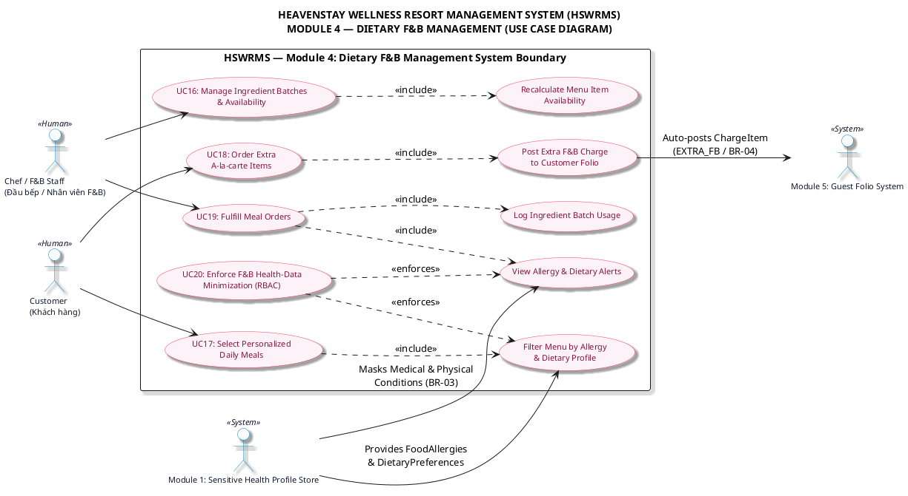

<!-- [TRACEABILITY HEADER] -->
<!-- Project: HEAVENSTAY WELLNESS RESORT MANAGEMENT SYSTEM (HSWRMS) -->
<!-- Module: Module 4 — Dietary F&B Management (CORE) -->
<!-- Target Audience: BA, System Architect, Software Engineer, QA Tester -->
<!-- Requirements Baseline: SRS Ver2 (UC16 - UC20, Section 4.3.4) & Project Specification Ver2 (Section 4, Module 4) -->
<!-- Business Rules: BR-03 (Data Minimization RBAC), BR-04 (Extra F&B Folio Posting), BR-07 (Batch Availability & Data Minimization), BR-08 (Consolidated Folio Accounting) -->
<!-- Legal Compliance: Nghị định 13/2023/NĐ-CP & Nghị định 356/2025/NĐ-CP (Personal Data Protection PII) -->
<!-- Created Date: 2026-10-07 -->
<!-- Source File: 02_Requirement/HSWRMS_UseCase_Diagram_Module4.md -->

# SƠ ĐỒ USE CASE VÀ MÔ TẢ CHI TIẾT (USE CASE DIAGRAM & SPECIFICATION)
## MODULE 4: DIETARY F&B MANAGEMENT (QUẢN LÝ ẨM THỰC VÀ DINH DƯỠNG SỨC KHỎE)

---

## 1. TỔNG QUAN & PHẠM VI (OVERVIEW & SCOPE)

Tài liệu thiết kế Sơ đồ Use Case và Mô tả chi tiết các Use Case cho **Module 4 (Dietary F&B Management)** thuộc hệ thống **HEAVENSTAY WELLNESS RESORT MANAGEMENT SYSTEM (HSWRMS)** được chuẩn hóa theo 02 tài liệu yêu cầu gốc:
1. **[HSWRMS_ISP392_Project_Specification_Ver2.md](file:///e:/fal26-isp392-is2005-g1/02_Requirement/Project_Specification/HSWRMS_ISP392_Project_Specification_Ver2.md)** (Cập nhật tháng 10/2026)
2. **[HSWRMS_ISP392_G1_SRS.md](file:///e:/fal26-isp392-is2005-g1/02_Requirement/SRS/HSWRMS_ISP392_G1_SRS.md)** (Section 4.3.4 & Functional Requirements UC16 - UC20)

### 1.1. Phạm Vi Nghiệp Vụ Của Module 4
Module 4 chịu trách nhiệm quản lý toàn bộ chuỗi cung ứng ẩm thực dinh dưỡng cá nhân hóa tại Resort:
- Cho phép Khách hàng chọn thực đơn bữa ăn hàng ngày đã được hệ thống tự động lọc bỏ các chất gây dị ứng (`FoodAllergies`) theo hồ sơ sức khỏe.
- Cho phép Khách hàng gọi thêm các món ăn/đồ uống a-la-carte ngoài gói nghỉ dưỡng và tự động hạch toán khoản tính phí (`FOLIO_CHARGE_ITEM` loại `EXTRA_FB`) vào Folio thanh toán.
- Cho phép Đầu bếp/Nhân viên F&B quản lý thông tin lô nguyên liệu (`INGREDIENT_BATCH`), tự động cập nhật sự khả dụng của món ăn (`MENU_ITEM.IsAvailable`), xem cảnh báo dị ứng thực phẩm và thực hiện chế biến bữa ăn, trừ kho nguyên liệu.
- Đảm bảo tuân thủ nghiêm ngặt quy định bảo mật dữ liệu y tế PII (Nghị định 13/2023 & 356/2025): Che giấu toàn bộ tiền sử bệnh lý và hạn chế thể chất đối với bộ phận F&B/Bếp.

---

## 2. DANH SÁCH TÁC NHÂN (ACTORS SPECIFICATION)

### 2.1. Tác Nhân Con Người (Human Actors)

| Tác Nhân (Actor) | Vai Trò & Mô Tả Nghiệp Vụ | Phân Quyền Access Level |
| :--- | :--- | :--- |
| **`Customer`** (Khách hàng) | Khách nghỉ dưỡng đã xác thực tài khoản. Thực hiện xem thực đơn cá nhân hóa, chọn bữa ăn hàng ngày trong gói nghỉ dưỡng và đặt thêm món ăn a-la-carte ngoài gói. | User / Customer Access |
| **`Chef / F&B Staff`** (Đầu bếp / Nhân viên F&B) | Nhân viên bộ phận Bếp và Ẩm thực. Quản lý danh mục/lô nguyên liệu, tiếp nhận đơn ăn, xem cảnh báo dị ứng thực phẩm, chế biến bữa ăn và cập nhật trạng thái đơn. | Staff Access (F&B / Kitchen Role) |

### 2.2. Hệ Thống Ngữ Cảnh Tương Tác (External / Context Subsystems)

| Tác Nhân Hệ Thống (Subsystem) | Vai Trò & Giao Tiếp Nghiệp Vụ |
| :--- | :--- |
| **`Module 1: Sensitive Health Profile Store`** | Cung cấp thông tin dị ứng thực phẩm (`FoodAllergies`) và chế độ ăn (`DietaryPreferences`), đồng thời áp dụng cơ chế phân quyền (RBAC) che giấu hoàn toàn các dữ liệu y tế nhạy cảm khác. |
| **`Module 5: Guest Folio System`** | Tiếp nhận các khoản phụ thu tự động (`EXTRA_FB`) từ các đơn đặt món a-la-carte ngoài gói để tổng hợp vào hóa đơn thanh toán khi Checkout. |

---

## 3. DANH SÁCH & MÔ TẢ CHI TIẾT USE CASE (USE CASE SPECIFICATIONS)

---

### 3.1. `UC16: Manage Ingredient Batches & Availability` (Quản Lý Lô Nguyên Liệu & Tính Khả Dụng Thực Đơn)

- **Mã Use Case:** `UC16`
- **Tác nhân chính:** `Chef / F&B Staff`
- **Tóm tắt:** Đầu bếp/Nhân viên F&B quản lý danh mục và lô hàng nguyên liệu nhập kho (bao gồm loại thực phẩm, ngày nhập, hạn sử dụng, số lượng tồn và tình trạng chất lượng). Hệ thống tự động tính toán lại tính khả dụng của món ăn trên thực đơn.
- **Tiền điều kiện:** `Chef / F&B Staff` đã đăng nhập thành công và có quyền truy cập màn hình F&B Dashboard / Ingredient Inventory.
- **Hậu điều kiện:** Thông tin lô nguyên liệu được cập nhật; trạng thái khả dụng `IsAvailable` của món ăn trong thực đơn được tự động tính toán lại.

#### Luồng Sự Kiện Chính (Main Flow):
1. Nhân viên F&B chọn chức năng quản lý kho nguyên liệu trên F&B Dashboard.
2. Hệ thống hiển thị danh sách các nguyên liệu và các lô hàng hiện có (`INGREDIENT_BATCH`).
3. Nhân viên F&B thực hiện thêm mới lô nguyên liệu nhập kho (nhập Mã lô, Ngày nhập, Hạn sử dụng, Số lượng, Tình trạng quality) hoặc cập nhật tình trạng lô hàng (ví dụ: Hủy lô hết hạn).
4. Hệ thống lưu thông tin lô nguyên liệu và kích hoạt Use Case con `Recalculate Menu Item Availability`.
5. Hệ thống kiểm tra tổng lượng tồn kho khả dụng của các nguyên liệu bắt buộc (`IsMandatory = TRUE`) còn hạn sử dụng cho từng món ăn.
6. Hệ thống cập nhật lại trạng thái `MENU_ITEM.IsAvailable = TRUE/FALSE` tương ứng.
7. Hệ thống thông báo cập nhật thành công cho Nhân viên F&B.

#### Use Case Con Phụ Thuộc:
- `Recalculate Menu Item Availability` (`<<include>>`): Tự động tính toán lại sự khả dụng của món ăn dựa trên tồn kho lô nguyên liệu chưa hết hạn.

---

### 3.2. `UC17: Select Personalized Daily Meals` (Khách Hàng Chọn Bữa Ăn Hàng Ngày Cá Nhân Hóa)

- **Mã Use Case:** `UC17`
- **Tác nhân chính:** `Customer`
- **Tóm tắt:** Khách hàng xem thực đơn bữa ăn hàng ngày được cá nhân hóa (đã tự động lọc bỏ các món ăn chứa thành phần dị ứng theo hồ sơ sức khỏe) và thực hiện chọn bữa ăn nằm trong gói Retreat.
- **Tiền điều kiện:** `Customer` đã đăng nhập, đang có một đơn đặt phòng nghỉ dưỡng (`ROOM_BOOKING`) ở trạng thái xác nhận / đã check-in.
- **Hậu điều kiện:** Đơn đặt bữa ăn tiêu chuẩn trong gói (`MEAL_ORDER` với `IsALaCarte = FALSE`) được tạo ở trạng thái `PENDING`.

#### Luồng Sự Kiện Chính (Main Flow):
1. Khách hàng truy cập chức năng "Dietary Menu / Daily Meal Selection" trên Customer Dashboard.
2. Hệ thống gọi Use Case con `Filter Menu by Allergy & Dietary Profile`.
3. Hệ thống truy vấn `GUEST_HEALTH_PROFILE` của Khách hàng từ Module 1 để lấy thông tin `FoodAllergies` và `DietaryPreferences`.
4. Hệ thống lọc danh sách món ăn khả dụng (`IsAvailable = TRUE`), đánh dấu hoặc ẩn các món ăn có thuộc tính `AllergenTags` trùng với `FoodAllergies` của khách hàng.
5. Khách hàng xem danh sách bữa ăn (Sáng, Trưa, Tối) và chọn các món ăn cho ngày lưu trú dự kiến.
6. Khách hàng nhập ghi chú riêng (nếu có) và xác nhận chọn bữa ăn.
7. Hệ thống tạo bản ghi `MEAL_ORDER` (`IsALaCarte = FALSE`, `TotalAmount = 0 VND`) và các dòng `MEAL_ORDER_LINE` tương ứng.
8. Hệ thống hiển thị thông báo xác nhận chọn bữa ăn thành công.

#### Use Case Con Phụ Thuộc:
- `Filter Menu by Allergy & Dietary Profile` (`<<include>>`): Lọc thực đơn theo dị ứng thực phẩm và chế độ ăn. Ràng buộc bởi `UC20` (Data Minimization).

---

### 3.3. `UC18: Order Extra A-la-carte Items` (Khách Hàng Đặt Thêm Món Ăn Gọi Theo Yêu Cầu)

- **Mã Use Case:** `UC18`
- **Tác nhân chính:** `Customer`
- **Tóm tắt:** Khách hàng đặt thêm các món ăn/đồ uống ngoài gói dịch vụ nghỉ dưỡng tiêu chuẩn. Hệ thống ghi nhận đơn hàng và tự động hạch toán khoản phụ thu vào Folio thanh toán của khách hàng.
- **Tiền điều kiện:** `Customer` đã đăng nhập và đang lưu trú tại Resort.
- **Hậu điều kiện:** Đơn đặt món a-la-carte (`MEAL_ORDER` với `IsALaCarte = TRUE`) được ghi nhận và khoản phí `FOLIO_CHARGE_ITEM` (loại `EXTRA_FB`) được tự động đẩy sang Folio (Module 5).

#### Luồng Sự Kiện Chính (Main Flow):
1. Khách hàng truy cập chức năng "Extra A-la-carte Order".
2. Hệ thống hiển thị danh mục các món ăn gọi thêm cùng đơn giá tương ứng.
3. Khách hàng chọn món ăn, số lượng và thời gian giao/phục vụ dự kiến.
4. Hệ thống tính tổng tiền `TotalAmount = SUM(Quantity * UnitPrice)`.
5. Khách hàng xác nhận đồng ý ghi nhận khoản phụ thu này vào Hóa đơn thanh toán phòng (Folio).
6. Hệ thống khởi tạo đơn ăn `MEAL_ORDER` (`IsALaCarte = TRUE`).
7. Hệ thống kích hoạt Use Case con `Post Extra F&B Charge to Customer Folio`.
8. Hệ thống tự động tạo bản ghi `FOLIO_CHARGE_ITEM` với `ChargeType = 'EXTRA_FB'` liên kết tới `FolioID` của khách hàng tại Module 5.
9. Hệ thống gửi thông báo xác nhận đơn đặt món thành công cho Khách hàng.

#### Use Case Con Phụ Thuộc:
- `Post Extra F&B Charge to Customer Folio` (`<<include>>`): Tự động hạch toán khoản phí phụ thu ăn uống vào Folio thanh toán của khách (**BR-04 / BR-08**).

---

### 3.4. `UC19: Fulfill Meal Orders` (Chế Biến & Phục Vụ Đơn Ăn)

- **Mã Use Case:** `UC19`
- **Tác nhân chính:** `Chef / F&B Staff`
- **Tóm tắt:** Đầu bếp/Nhân viên F&B tiếp nhận đơn đặt ăn trên màn hình Daily Meal Prep List, xem cảnh báo dị ứng thực phẩm của khách, tiến hành chế biến, cập nhật trạng thái đơn và ghi nhận trừ kho nguyên liệu.
- **Tiền điều kiện:** Đơn đặt bữa ăn (`MEAL_ORDER`) đã được khởi tạo thành công.
- **Hậu điều kiện:** Trạng thái đơn ăn được chuyển từ `PENDING` -> `PREPARING` -> `READY` -> `DELIVERED`; số lượng tồn kho của lô nguyên liệu tương ứng được trừ tự động trong `INGREDIENT_USAGE_LOG`.

#### Luồng Sự Kiện Chính (Main Flow):
1. Đầu bếp/Nhân viên F&B truy cập màn hình "Daily Meal Prep List / Meal Order Detail" trên F&B Dashboard.
2. Hệ thống hiển thị danh sách các đơn ăn cần chế biến theo khung giờ.
3. Hệ thống kích hoạt Use Case con `View Allergy & Dietary Alerts`.
4. Hệ thống hiển thị dị ứng thực phẩm và chế độ ăn cần thiết từ projection tối thiểu của hồ sơ khách hàng; dữ liệu y tế khác bị ẩn (tuân thủ **BR-FNB-02**).
5. Đầu bếp chuyển trạng thái đơn sang `PREPARING` và tiến hành chế biến món ăn.
6. Khi hoàn tất chế biến, Đầu bếp cập nhật trạng thái đơn sang `READY` và hệ thống kích hoạt Use Case con `Log Ingredient Batch Usage`.
7. Hệ thống tự động tính toán số lượng nguyên liệu tiêu hao theo định mức `MENU_ITEM_RECIPE`, trừ vào `RemainingQuantity` của `INGREDIENT_BATCH` tương ứng và lưu nhật ký `INGREDIENT_USAGE_LOG`.
8. Nhân viên F&B thực hiện phục vụ/giao món ăn cho khách và chuyển trạng thái đơn sang `DELIVERED`.

#### Use Case Con Phụ Thuộc:
- `View Allergy & Dietary Alerts` (`<<include>>`): Hiển thị cảnh báo dị ứng thực phẩm của khách hàng trên giao diện Bếp (**BR-03**).
- `Log Ingredient Batch Usage` (`<<include>>`): Ghi nhận nhật ký trừ tồn kho nguyên liệu thực tế khi chế biến.

---

### 3.5. `UC20: Enforce F&B Health-Data Minimization` (Thực Thi Tối Thiểu Hóa Dữ Liệu Y Tế Cho Bộ Phận F&B)

- **Mã Use Case:** `UC20`
- **Tác nhân chính:** `HSWRMS System` (Ràng buộc Bảo mật & Phân quyền RBAC)
- **Tóm tắt:** Hệ thống tự động kiểm soát quyền truy cập dữ liệu y tế cá nhân. Bộ phận Bếp / Nhân viên F&B chỉ được phép tiếp cận dị ứng thực phẩm (`FoodAllergies`) và chế độ ăn kiêng (`DietaryPreferences`). Tất cả các thông tin y tế nhạy cảm khác (tiền sử bệnh lý, hạn chế thể chất) đều bị ẩn hoàn toàn.
- **Tối thiểu hóa dữ liệu PII:** Đảm bảo tuân thủ Luật Bảo vệ dữ liệu cá nhân (Nghị định 13/2023/NĐ-CP & 356/2025/NĐ-CP).

---

## 4. MA TRẬN VÀ QUAN HỆ GIỮA CÁC USE CASE (USE CASE RELATIONSHIP MATRIX)

```
====================================================================================
  TÁC NHÂN (ACTOR)             USE CASE CHÍNH                USE CASE CON / PHỤ THUỘC
====================================================================================
  Customer             --->   UC17: Select Personalized  --[include]-> Filter Menu by Allergy
                              Daily Meals                              & Dietary Profile
                                                          
                       --->   UC18: Order Extra          --[include]-> Post Extra F&B Charge
                              A-la-carte Items                         to Customer Folio (M5)

  Chef / F&B Staff     --->   UC16: Manage Ingredient    --[include]-> Recalculate Menu Item
                              Batches & Availability                   Availability
                                                          
                       --->   UC19: Fulfill Meal Orders  --[include]-> View Allergy Alerts (BR-03)
                                                         --[include]-> Log Batch Usage

  HSWRMS System        --->   UC20: Enforce Health-Data  --[enforces]-> UC17_Filter (Profile Filter)
                              Minimization (RBAC)        --[enforces]-> UC19_Alert (Chef View Alert)
====================================================================================
```

---

## 5. MÃ NGUỒN PLANTUML (PLANTUML DIAGRAM SOURCE CODE)

File mã nguồn PlantUML độc lập được lưu tại: **[HSWRMS_UseCase_Diagram_Module4.puml](file:///e:/fal26-isp392-is2005-g1/02_Requirement/HSWRMS_UseCase_Diagram_Module4.puml)**.

Dưới đây là mã nguồn nhúng PlantUML đầy đủ để hiển thị Sơ đồ Use Case Module 4:



---

## 6. XÁC NHẬN VÀ TRUY VẾT YÊU CẦU (REQUIREMENT TRACEABILITY CHECKLIST)

- [x] **Phân quyền Tác nhân:** Định nghĩa rõ ràng 02 Tác nhân con người chính (`Customer`, `Chef / F&B Staff`) và 02 Hệ thống ngữ cảnh (`Module 1`, `Module 5`).
- [x] **Bao phủ Use Case 16 - 20:** Đã mô tả chi tiết cả 5 Use Case cốt lõi của Module 4 trong tài liệu Project Specification Ver2 & SRS Ver2.
- [x] **Truy vết Quy tắc Nghiệp vụ BR-03 / BR-07:** Đã làm rõ cơ chế lọc thực đơn dị ứng và che giấu hoàn toàn dữ liệu y tế nhạy cảm đối với bộ phận F&B/Bếp (`UC20` & `UC19_Alert`).
- [x] **Truy vết Quy tắc Nghiệp vụ BR-04 / BR-08:** Đã thể hiện luồng tự động hạch toán khoản phụ thu món a-la-carte (`EXTRA_FB`) từ `UC18` sang Folio thanh toán của Module 5.
- [x] **Chuẩn hóa định dạng xuất:** Đã tạo đầy đủ cả file mã nguồn PlantUML (`.puml`) độc lập và file báo cáo chi tiết Markdown (`.md`).
