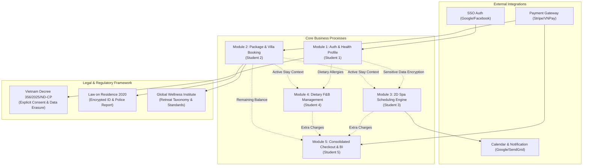

# Requirements Traceability Matrix (RTM)
## Project: Xoai Aura Retreat — Wellness Resort & Spa Management System
**Document Code:** SWP391-HOS-03-RTM  
**Target Folder:** `02_Requirement/`  
**Author:** Senior Business Analyst  
**Version:** 1.0 (Baseline)  
**Date:** September 16, 2026  

---

## 1. Traceability Overview & Architecture Mapping

| Module ID | Module Title | Complexity | Assigned Owner | Database Entities Involved | Primary 3rd-Party APIs |
| :--- | :--- | :--- | :--- | :--- | :--- |
| **MOD-01** | Authentication & Sensitive Health Profile | Medium - High | **Student 1** | User, Role, HealthProfile, ConsentLog, AuditLog | Google Identity / Facebook SSO, SendGrid |
| **MOD-02** | Retreat Package & Accommodation Booking | Medium | **Student 2** | RetreatPackage, PackageGoal, Villa, VillaCategory, Booking | Stripe / VNPay Sandbox |
| **MOD-03** | Spa & Therapy Scheduling Engine (CORE 1) | High | **Student 3** | SpaService, Therapist, TreatmentRoom, SpaBooking, SessionSlot | Google Calendar API, SendGrid |
| **MOD-04** | Dietary F&B Management (CORE 2) | Medium | **Student 4** | MenuItem, MealPlan, DietaryRestriction, Allergen, MealOrder | N/A (Internal Kitchen KDS) |
| **MOD-05** | Consolidated Checkout & Analytics | Medium - High | **Student 5** | FolioInvoice, InvoiceItem, PaymentTransaction, ReviewRating | Payment Gateway API, Apache POI / Excel Export |

---

## 2. Complete Requirements Traceability Matrix (UC01 – UC25)

| UC ID | Use Case Name / Requirement Summary | Module & Owner | Primary Actor(s) | Context Diagram Flow(s) | Business Rules Enforced | Legal / Domain Standard | Test Case ID | Status |
| :---: | :--- | :---: | :---: | :--- | :--- | :--- | :---: | :---: |
| **UC01** | Guest Registration, Email Verification & Secure Login | MOD-01 (Student 1) | Guest | `F_E1_in` (Reg/Login Request) `F_S3_out/in` (SSO Auth) | BR-AUTH-01 | Decree 356/2025/ND-CP | TC-AUTH-01 | Baseline |
| **UC02** | Complete Dietary & Health Profile with Explicit Consent | MOD-01 (Student 1) | Guest | `F_E1_in` (Dietary/Health Profile) | BR-AUTH-02, BR-AUTH-03 | Decree 356/2025 Art. 4 & 6 | TC-AUTH-02 | Baseline |
| **UC03** | Manage Staff Accounts & Strict RBAC Role Assignment | MOD-01 (Student 1) | Admin | `F_E5_in` (Staff Account & RBAC) | BR-AUTH-05, RBAC Matrix | Decree 356 Data Minimization | TC-AUTH-03 | Baseline |
| **UC04** | Manage Master Data (Villa Categories, Spa Services, Packages) | MOD-01 (Student 1) | Admin | `F_E5_in` (Master Data CRUD) | BR-BOOK-01, GWI Taxonomy | GWI Wellness Standards | TC-AUTH-04 | Baseline |
| **UC05** | Right to Deletion (Permanent Erasure of Health/Allergy Data) | MOD-01 (Student 1) | Guest | `F_E1_in` (Data Deletion Request) `F_E1_out` (Deletion Confirmation) | BR-AUTH-04 | Decree 356/2025 Art. 6 | TC-AUTH-05 | Baseline |
| **UC06** | Browse Retreat Packages & Filter by Wellness Goal | MOD-02 (Student 2) | Guest | `F_E1_out` (Available Packages) | BR-BOOK-01, GWI Taxonomy | GWI Wellness Standards | TC-BOOK-01 | Baseline |
| **UC07** | Select Package, Dates, Villa Type & Pay Online Deposit | MOD-02 (Student 2) | Guest | `F_E1_in` (Booking/Deposit) `F_S1_out/in` (Payment Gateway) | BR-BOOK-02 | PCI-DSS, E-Commerce Law | TC-BOOK-02 | Baseline |
| **UC08** | Front Desk Check-In & Physical Villa Assignment | MOD-02 (Student 2) | Receptionist | `F_E2_in` (Check-In Request) `F_E2_out` (Arrivals Dashboard) | BR-BOOK-03, BR-BOOK-04 | Law on Residence 2020 | TC-BOOK-03 | Baseline |
| **UC09** | Manage Villa Physical Statuses (Available, Occupied, Maintenance) | MOD-02 (Student 2) | Receptionist | `F_E2_in` (Villa Status Update) `F_E2_out` (Villa Status Board) | BR-BOOK-03, BR-BILL-03 | PMS Hospitality Best Practice | TC-BOOK-04 | Baseline |
| **UC10** | View Overall Booking Details & Itinerary Timeline | MOD-02 (Student 2) | Guest | `F_E1_out` (Booking Confirmation & Itinerary) | BR-BOOK-01 | GWI Itinerary Standards | TC-BOOK-05 | Baseline |
| **UC11** | Schedule Package Included Spa/Therapy Sessions | MOD-03 (Student 3) | Guest | `F_E1_in` (Spa Session Scheduling) `F_S2_out/in` (Calendar Sync) | BR-SPA-01, BR-SPA-03 | GWI Spa Protocols | TC-SPA-01 | Baseline |
| **UC12** | Automatic 2D Slot Matching (Therapist + Treatment Room) | MOD-03 (Student 3) | System Engine | Internal Matching & Resource Lock | BR-SPA-01, BR-SPA-02 | Concurrency Isolation (DB) | TC-SPA-02 | Baseline |
| **UC13** | Therapist Daily Schedule & Physical Health Notes View | MOD-03 (Student 3) | Spa Therapist | `F_E3_out` (Daily Schedule & Health Notes) | BR-AUTH-03, BR-AUTH-05, RBAC Matrix | Decree 356 (Physical Health only) | TC-SPA-03 | Baseline |
| **UC14** | Mark Spa Session Status (Completed / No-Show) | MOD-03 (Student 3) | Spa Therapist | `F_E3_in` (Session Status Update) | BR-SPA-04 | PMS Operational Auditing | TC-SPA-04 | Baseline |
| **UC15** | Manual Booking of Extra Spa Services & Villa Folio Posting | MOD-03 (Student 3) | Receptionist | `F_E2_in` (Extra Spa Booking) | BR-SPA-03, BR-BILL-01 | Consolidated Folio Accounting | TC-SPA-05 | Baseline |
| **UC16** | Pre-select Daily Meals with Allergy-Safe Filtering | MOD-04 (Student 4) | Guest | `F_E1_in` (Meal Selection) `F_E1_out` (Filtered Menu) | BR-FNB-01, BR-AUTH-03 | Food Safety & Health Law | TC-FNB-01 | Baseline |
| **UC17** | Kitchen Daily Meal Prep Dashboard with Allergy Warnings | MOD-04 (Student 4) | Chef / F&B Staff | `F_E4_out` (Daily Meal Prep & Allergy Warnings) | BR-FNB-01, BR-FNB-02, RBAC Matrix | Decree 356 Data Minimization | TC-FNB-02 | Baseline |
| **UC18** | Update Meal Order Prep Status (Preparing -> Ready) | MOD-04 (Student 4) | Chef | `F_E4_in` (Meal Order Status Update) | BR-FNB-03 | Kitchen Order Ticket (KOT) | TC-FNB-03 | Baseline |
| **UC19** | Order Extra A-la-carte Food/Beverage to Villa Folio | MOD-04 (Student 4) | Guest | `F_E1_in` (A-la-carte Order) | BR-FNB-04, BR-BILL-01 | PMS Room Folio Standard | TC-FNB-04 | Baseline |
| **UC20** | Data Minimization Masking of Medical History from Kitchen | MOD-04 (Student 4) | System Engine | `F_E4_out` (Masked Medical History) | BR-FNB-02, RBAC Matrix | Decree 356/2025 Art. 4 | TC-FNB-05 | Baseline |
| **UC21** | Generate Consolidated Folio Invoice for Checkout | MOD-05 (Student 5) | Receptionist | `F_E2_out` (Consolidated Invoice) | BR-BILL-01, BR-BILL-02 | VAT Invoicing & Accounting | TC-BILL-01 | Baseline |
| **UC22** | Process Final Checkout Payment & Trigger Villa Cleaning | MOD-05 (Student 5) | Receptionist | `F_E2_in` (Final Payment) `F_S1_out/in` (Payment Gateway) | BR-BILL-02, BR-BILL-03 | PCI-DSS / Hospitality Standard | TC-BILL-02 | Baseline |
| **UC23** | Submit Post-Stay Experience Review & Rating | MOD-05 (Student 5) | Guest | `F_E1_in` (Review Submission) | BR-BILL-04 | E-Commerce Rating Integrity | TC-BILL-03 | Baseline |
| **UC24** | Executive Revenue Dashboard (Packages, Spa, F&B) | MOD-05 (Student 5) | System Manager | `F_E5_out` (Revenue Dashboard Charts) | BR-BILL-05 | Financial Reporting BI | TC-BILL-04 | Baseline |
| **UC25** | Export Monthly Occupancy & Therapist Utilization Report | MOD-05 (Student 5) | System Manager | `F_E5_out` (Excel Export Files) | BR-BILL-05, BR-BOOK-04 | Law on Residence 2020 | TC-BILL-05 | Baseline |

---

## 3. Compliance & Cross-Cutting Verification Matrix

