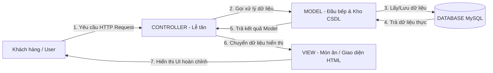

# CODING CONVENTIONS — QUY CHUẨN LẬP TRÌNH KIẾN TRÚC MVC & CODE TRUY VẾT (TRACEABLE CODING)

> **Dự án:** HEAVENSTAY WELLNESS RESORT MANAGEMENT SYSTEM (HSWRMS)  
> **Phân nhóm tài liệu:** `03-Design` — Đồ họa & Thiết kế Kiến trúc Mã nguồn  
> **Đối tượng đọc:** Lập trình viên, Kiểm thử viên (QA/QC), Chuyên viên Phân tích Nghiệp vụ (BA), Quản lý Dự án (PM) và Người không chuyên viết code (Non-coder Stakeholders).  
> **Phiên bản:** 1.0 — Tháng 9/2026  
> **Cơ sở dẫn chiếu:** `ADR-001` (Lựa chọn MVC Pattern), `HSWRMS_ERD_DataDictionary.md`, Nghị định 356/2025/NĐ-CP (Bảo vệ PII).

---

## MỤC LỤC

1. [Tổng quan về Kiến trúc MVC dành cho Người không chuyên](#1-tổng-quan-về-kiến-trúc-mvc-dành-cho-người-không-chuyên)
2. [Định nghĩa Kỹ thuật Code Truy Vết (Traceable Code)](#2-định-nghĩa-kỹ-thuật-code-truy-vết-traceable-code)
3. [Quy tắc Đặt tên (Naming Conventions)](#3-quy-tắc-đặt-tên-naming-conventions)
4. [Quy chuẩn Cấu trúc Thư mục Dự án](#4-quy-chuẩn-cấu-trúc-thư-mục-dự-án)
5. [Bộ Code Mẫu Truy Vết Thực Tế (Xây dựng trên CSDL HSWRMS)](#5-bộ-code-mẫu-truy-vết-thực-tế-xây-dựng-trên-csdl-hswrms)
   - [5.1 Tầng Model (Xử lý Dữ liệu CSDL & Mã hóa PII)](#51-tầng-model-xử-lý-dữ-liệu-csdl--mã-hóa-pii)
   - [5.2 Tầng Controller (Bộ Điều phối & Phân quyền)](#52-tầng-controller-bộ-điều-phối--phân-quyền)
   - [5.3 Tầng View (Giao diện Hiển thị Dành cho Người dùng)](#53-tầng-view-giao-diện-hiển-thị-dành-cho-người-dùng)
6. [Bảng Kiểm tra Nghiệp vụ (Audit Checklist cho Non-coder)](#6-bảng-kiểm-tra-nghiệp-vụ-audit-checklist-cho-non-coder)

---

## 1. TỔNG QUAN VỀ KIẾN TRÚC MVC DÀNH CHO NGƯỜI KHÔNG CHUYÊN

Dành cho các thành viên quản lý, BA hoặc kiểm thử viên không có chuyên môn sâu về lập trình, hãy hình dung kiến trúc **MVC (Model - View - Controller)** giống như quy trình hoạt động tại một **Nhà hàng Trị liệu Cao cấp**:



- **1. VIEW (Giao diện người dùng):** 
  - *Giải thích:* Là những gì hiện ra trên màn hình web (nút bấm, bảng dữ liệu, form nhập thông tin dị ứng/sức khỏe).
  - *Quy tắc sắt:* View **KHÔNG ĐƯỢC phép** trực tiếp xuống cơ sở dữ liệu để lấy hay sửa dữ liệu.
- **2. CONTROLLER (Bộ điều hướng):** 
  - *Giải thích:* Giống như người Lễ tân. Tiếp nhận bấm nút từ người dùng, kiểm tra xem người này có quyền (Login/Role) hay không, sau đó yêu cầu Model chuẩn bị dữ liệu và chọn màn hình View tương ứng để trả về cho người dùng.
- **3. MODEL (Xử lý Dữ liệu & Nghiệp vụ):** 
  - *Giải thích:* Giống như người Thủ kho / Đầu bếp. Chịu trách nhiệm thực hiện các câu lệnh tính toán, mã hóa dữ liệu nhạy cảm PII, đọc/ghi vào Cơ sở Dữ liệu MySQL (Database).

---

## 2. ĐỊNH NGHĨA KỸ THUẬT CODE TRUY VẾT (TRACEABLE CODE)

### 2.1 Tại sao phải viết Code Truy Vết?
Người không chuyên code khi nhìn vào hàng ngàn dòng mã nguồn thường cảm thấy rất khó hiểu. **Code Truy Vết (Traceable Code)** là phương pháp thêm các khối chú thích (comments) theo định dạng chuẩn hóa vào **ngay đầu mỗi file, mỗi hàm và từng dòng xử lý quan trọng**.

Nhờ đó, một người không chuyên viết code (như BA, QA, PM) chỉ cần đọc phần ghi chú tiếng Việt là có thể hiểu ngay:
1. Đoạn code này đang làm tính năng gì trong tài liệu Yêu cầu (`SRS / User Story`)?
2. Đoạn code này đang tuân thủ Luật / Quy tắc Nghiệp vụ nào (`Business Rule - BR`)?
3. Đoạn code này thao tác với bảng dữ liệu nào trong sơ đồ CSDL (`ERD / Data Dictionary`)?
4. Luồng chạy của dữ liệu đi từ đâu đến đâu?

### 2.2 Cấu trúc Khối Chú thích Truy vết Chuẩn (Traceability Header Block)

Mọi file source mã nguồn trong dự án HSWRMS **BẮT BUỘC** phải có khối ghi chú chuẩn ở đầu hàm/class như sau:

```java
// ============================================================================
// [TRACEABILITY HEADER - MÃ TRUY VẾT NGHIỆP VỤ]
// ----------------------------------------------------------------------------
// Mã Yêu Cầu (Requirement ID) : US-REC-002 / SR-03 / UC02 (Quản lý Hồ sơ Sức khỏe)
// Quy tắc Nghiệp vụ (BR Ref)  : BR-03 (Bảo vệ PII & Đồng ý Explicit Consent)
// Bảng CSDL (Database Entity) : GUEST_HEALTH_PROFILE, ACCOUNT
// Pháp lý / Compliance Scope  : Nghị định 356/2025/NĐ-CP (Bảo vệ dữ liệu cá nhân)
// Tầng Kiến trúc (MVC Layer)  : [MODEL / CONTROLLER / VIEW]
// Mô tả Tóm tắt (Summary)     : [Mô tả ngắn gọn dòng code này làm gì bằng tiếng Việt]
// ============================================================================
```

---

## 3. QUY TẮC ĐẶT TÊN (NAMING CONVENTIONS)

Để đảm bảo tính đồng nhất giữa tài liệu thiết kế CSDL (ERD) và mã nguồn:

| Loại thành phần | Quy tắc đặt tên | Ví dụ trong HSWRMS | Giải thích |
|-----------------|-----------------|-------------------|------------|
| **Bảng CSDL (Database Table)** | UPPERCASE, viết hoa có gạch dưới | `GUEST_HEALTH_PROFILE`, `RETREAT_PACKAGE` | Khớp 100% với file ERD Data Dictionary |
| **Lớp Entity (Model Object)** | PascalCase (Viết hoa chữ cái đầu) | `GuestHealthProfile.java`, `RetreatPackage.java` | Đại diện cho 1 dòng dữ liệu trong bảng CSDL |
| **Lớp DAO / Repository** | `[Entity]DAO.java` | `GuestHealthProfileDAO.java` | Chứa các câu lệnh SQL đọc/ghi CSDL |
| **Lớp Controller (Servlet)** | `[Feature]Controller.java` | `HealthProfileController.java` | Tiếp nhận và điều hướng HTTP Request |
| **File View (Giao diện JSP/HTML)** | kebab-case (chữ thường nối dấu gạch ngang) | `health-profile-view.jsp`, `package-detail.jsp` | File giao diện hiển thị cho người dùng |
| **Hàm / Phương thức (Method)** | camelCase (chữ đầu thường, chữ sau hoa) | `getHealthProfileByAccountId()`, `updateConsent()` | Động từ mô tả hành động cụ thể |

---

## 4. QUY CHUẨN CẤU TRÚC THƯ MỤC DỰ ÁN

Mã nguồn dự án phải được phân chia thành các gói (packages) rõ ràng theo đúng tầng MVC:

```text
src/main/java/com/heavenstay/hswrms/
├── model/                     <-- TẦNG MODEL (Dữ liệu & Logic Nghiệp vụ)
│   ├── entity/                <-- Chứa các đối tượng đại diện cho bảng CSDL
│   │   ├── Account.java
│   │   └── GuestHealthProfile.java
│   ├── dao/                   <-- Chứa mã tương tác CSDL MySQL (Data Access Objects)
│   │   ├── AccountDAO.java
│   │   └── GuestHealthProfileDAO.java
│   └── service/               <-- Chứa logic mã hóa PII, kiểm tra Business Rules (BR)
│       └── HealthProfileService.java
│
├── controller/                <-- TẦNG CONTROLLER (Điều phối Request & Phân quyền)
│   ├── HealthProfileController.java
│   └── BookingController.java
│
└── util/                      <-- Tiện ích chung (Mã hóa AES-256, Audit Log, DB Connection)
    ├── AESEncryptionUtil.java
    └── AuditLogger.java

src/main/webapp/WEB-INF/views/ <-- TẦNG VIEW (Giao diện hiển thị HTML/JSP)
├── guest/
│   ├── health-profile-view.jsp
│   └── health-profile-edit.jsp
└── common/
    ├── header.jsp
    └── error.jsp
```

---

## 5. BỘ CODE MẪU TRUY VẾT THỰC TẾ (XÂY DỰNG TRÊN CSDL HSWRMS)

Dưới đây là ví dụ minh họa **từ đầu đến cuối (End-to-End)** cho Chức năng: **UC02 — Quản lý Hồ sơ Sức khỏe & Chế độ Ăn uống của Khách hàng (`GUEST_HEALTH_PROFILE`)**.

---

### 5.1 Tầng Model (Xử lý Dữ liệu CSDL & Mã hóa PII)

**File Path:** `src/main/java/com/heavenstay/hswrms/model/dao/GuestHealthProfileDAO.java`

```java
package com.heavenstay.hswrms.model.dao;

import com.heavenstay.hswrms.model.entity.GuestHealthProfile;
import com.heavenstay.hswrms.util.AESEncryptionUtil;
import com.heavenstay.hswrms.util.DBConnection;

import java.sql.Connection;
import java.sql.PreparedStatement;
import java.sql.ResultSet;
import java.sql.Timestamp;

// ============================================================================
// [TRACEABILITY HEADER - MÃ TRUY VẾT NGHIỆP VỤ]
// ----------------------------------------------------------------------------
// Mã Yêu Cầu (Requirement ID) : SR-03 / UC02 (Quản lý Hồ sơ Sức khỏe Khách hàng)
// Quy tắc Nghiệp vụ (BR Ref)  : BR-03 (Bắt buộc Khách hàng Xác nhận Consent)
// Bảng CSDL (Database Entity) : Bảng [GUEST_HEALTH_PROFILE] trong ERD Data Dictionary
// Tuân thủ Pháp lý            : Nghị định 356/2025/NĐ-CP (Mã hóa PII nhạy cảm AES-256)
// Tầng Kiến trúc (MVC Layer)  : MODEL (Data Access Object - DAO)
// ============================================================================
public class GuestHealthProfileDAO {

    /**
     * TRUY VẾT CODE: Hàm tìm kiếm Hồ sơ Sức khỏe theo mã Tài khoản Khách hàng
     * 
     * @param accountId Mã ID tài khoản khách (AccountID trong bảng ACCOUNT)
     * @return Đối tượng GuestHealthProfile chứa thông tin sức khỏe đã giải mã
     */
    public GuestHealthProfile getProfileByAccountId(int accountId) throws Exception {
        
        // [TRACEABILITY LINE 1]: Khởi tạo câu lệnh SQL đọc trực tiếp bảng GUEST_HEALTH_PROFILE
        // CSDL tương ứng: Bảng GUEST_HEALTH_PROFILE (HealthProfileID, DietaryPreferences, FoodAllergies...)
        String sql = "SELECT HealthProfileID, AccountID, DietaryPreferences, FoodAllergies, " +
                     "PhysicalLimitations, TherapyPreferences, EmergencyContact, " +
                     "ConsentGiven, ConsentTimestamp, ConsentVersion " +
                     "FROM GUEST_HEALTH_PROFILE WHERE AccountID = ?";

        GuestHealthProfile profile = null;

        // [TRACEABILITY LINE 2]: Mở kết nối CSDL MySQL an toàn bằng kết nối pool
        try (Connection conn = DBConnection.getConnection();
             PreparedStatement stmt = conn.prepareStatement(sql)) {

            // [TRACEABILITY LINE 3]: Gán tham số AccountID vào dấu ? trong câu lệnh SQL để chống tấn công SQL Injection
            stmt.setInt(1, accountId);

            try (ResultSet rs = stmt.executeQuery()) {
                if (rs.next()) {
                    profile = new GuestHealthProfile();

                    // [TRACEABILITY LINE 4]: Gán các dữ liệu thông thường từ CSDL vào đối tượng Model
                    profile.setHealthProfileId(rs.getInt("HealthProfileID"));
                    profile.setAccountId(rs.getInt("AccountID"));

                    // [TRACEABILITY LINE 5 - BR-03 & NĐ 356]:
                    // GIẢI MÃ DỮ LIỆU PII NHẠY CẢM: Thông tin dị ứng và bệnh lý trong CSDL được lưu ở dạng mã hóa AES-256.
                    // Tại tầng Model, ta gọi mã hóa giải ngược lại để hiển thị an toàn.
                    String encryptedAllergies = rs.getString("FoodAllergies");
                    String decryptedAllergies = AESEncryptionUtil.decrypt(encryptedAllergies);
                    profile.setFoodAllergies(decryptedAllergies);

                    profile.setDietaryPreferences(rs.getString("DietaryPreferences"));
                    profile.setPhysicalLimitations(rs.getString("PhysicalLimitations"));
                    profile.setTherapyPreferences(rs.getString("TherapyPreferences"));
                    profile.setEmergencyContact(rs.getString("EmergencyContact"));
                    
                    // [TRACEABILITY LINE 6 - BR-03 Consent Check]:
                    // Đọc trạng thái khách đã bấm "Tôi đồng ý cung cấp thông tin sức khỏe" hay chưa
                    profile.setConsentGiven(rs.getBoolean("ConsentGiven"));
                    profile.setConsentTimestamp(rs.getTimestamp("ConsentTimestamp"));
                    profile.setConsentVersion(rs.getString("ConsentVersion"));
                }
            }
        }
        
        // [TRACEABILITY LINE 7]: Trả kết quả dữ liệu Model hoàn chỉnh về cho Controller
        return profile;
    }
}
```

---

### 5.2 Tầng Controller (Bộ Điều phối & Phân quyền)

**File Path:** `src/main/java/com/heavenstay/hswrms/controller/HealthProfileController.java`

```java
package com.heavenstay.hswrms.controller;

import com.heavenstay.hswrms.model.dao.GuestHealthProfileDAO;
import com.heavenstay.hswrms.model.entity.GuestHealthProfile;

import jakarta.servlet.ServletException;
import jakarta.servlet.annotation.WebServlet;
import jakarta.servlet.http.HttpServlet;
import jakarta.servlet.http.HttpServletRequest;
import jakarta.servlet.http.HttpServletResponse;
import jakarta.servlet.http.HttpSession;
import java.io.IOException;

// ============================================================================
// [TRACEABILITY HEADER - MÃ TRUY VẾT NGHIỆP VỤ]
// ----------------------------------------------------------------------------
// Mã Yêu Cầu (Requirement ID) : US-REC-002 / SR-03 / UC02
// Quy tắc Nghiệp vụ (BR Ref)  : BR-03 (Phân quyền truy cập thông tin sức khỏe cá nhân)
// Đường dẫn Web URL           : /guest/health-profile
// Tầng Kiến trúc (MVC Layer)  : CONTROLLER (Servlet điều phối yêu cầu HTTP)
// ============================================================================
@WebServlet("/guest/health-profile")
public class HealthProfileController extends HttpServlet {

    private GuestHealthProfileDAO healthProfileDAO = new GuestHealthProfileDAO();

    @Override
    protected void doGet(HttpServletRequest request, HttpServletResponse response) 
            throws ServletException, IOException {

        // --------------------------------------------------------------------
        // BƯỚC 1 TRUY VẾT: KIỂM TRA ĐĂNG NHẬP & PHÂN QUYỀN (AUTHENTICATION CHECK)
        // --------------------------------------------------------------------
        HttpSession session = request.getSession(false);
        if (session == null || session.getAttribute("CURRENT_USER_ID") == null) {
            // [TRACEABILITY]: Khách chưa đăng nhập -> Controller chặn lại và chuyển hướng về trang Login
            response.sendRedirect(request.getContextPath() + "/login.jsp");
            return;
        }

        // Lấy mã AccountID của khách hàng đang đăng nhập từ Session hệ thống
        int currentAccountId = (Integer) session.getAttribute("CURRENT_USER_ID");

        try {
            // --------------------------------------------------------------------
            // BƯỚC 2 TRUY VẾT: GỌI TẦNG MODEL ĐỂ LẤY DỮ LIỆU TỪ CSDL MYSQL
            // --------------------------------------------------------------------
            // [TRACEABILITY]: Controller gọi hàm getProfileByAccountId() của Model DAO
            GuestHealthProfile profile = healthProfileDAO.getProfileByAccountId(currentAccountId);

            // --------------------------------------------------------------------
            // BƯỚC 3 TRUY VẾT: ĐÓNG GÓI DỮ LIỆU ĐỂ CHUYỂN CHO TẦNG VIEW HIỂN THỊ
            // --------------------------------------------------------------------
            // Gán đối tượng profile vào request thuộc tính "healthProfile"
            request.setAttribute("healthProfile", profile);

            // --------------------------------------------------------------------
            // BƯỚC 4 TRUY VẾT: ĐIỀU HƯỚNG SANG FILE GIAO DIỆN VIEW (JSP)
            // --------------------------------------------------------------------
            // [TRACEABILITY]: Controller quyết định mở file giao diện health-profile-view.jsp
            request.getRequestDispatcher("/WEB-INF/views/guest/health-profile-view.jsp")
                   .forward(request, response);

        } catch (Exception e) {
            // Ghi log lỗi hệ thống và chuyển hướng đến trang báo lỗi chung
            e.printStackTrace();
            request.setAttribute("errorMessage", "Không thể tải hồ sơ sức khỏe. Vui lòng thử lại sau.");
            request.getRequestDispatcher("/WEB-INF/views/common/error.jsp").forward(request, response);
        }
    }
}
```

---

### 5.3 Tầng View (Giao diện Hiển thị Dành cho Người dùng)

**File Path:** `src/main/webapp/WEB-INF/views/guest/health-profile-view.jsp`

```html
<%@ page contentType="text/html;charset=UTF-8" language="java" %>
<%@ taglib prefix="c" uri="http://java.sun.com/jsp/jstl/core" %>

<!-- ==========================================================================
[TRACEABILITY HEADER - MÃ TRUY VẾT GIAO DIỆN VIEW]
-------------------------------------------------------------------------------
Mã Yêu Cầu (Requirement ID) : US-REC-002 / SR-03 / UC02 (Màn hình Hồ sơ Sức khỏe)
Quy tắc Nghiệp vụ (BR Ref)  : BR-03 (Chỉ hiển thị khi khách đã xác nhận Consent)
Tầng Kiến trúc (MVC Layer)  : VIEW (JSP Template — Không chứa câu lệnh SQL!)
=========================================================================== -->

<!DOCTYPE html>
<html lang="vi">
<head>
    <meta charset="UTF-8">
    <title>Hồ Sơ Sức Khỏe & Chế Độ Trị Liệu — HeavenStay Resort</title>
    <link rel="stylesheet" href="${pageContext.request.contextPath}/assets/css/style.css">
</head>
<body>

    <div class="container">
        <h1>Hồ Sơ Trị Liệu & Sức Khỏe Cá Nhân</h1>
        <p class="subtitle">Được bảo mật theo tiêu chuẩn Nghị định 356/2025/NĐ-CP</p>

        <!-- BƯỚC 1 TRUY VẾT VIEW: KIỂM TRA XEM CÓ DỮ LIỆU TỪ CONTROLLER TRẢ VỀ HAY KHÔNG -->
        <c:choose>
            <c:when test="${not empty healthProfile}">
                
                <!-- BƯỚC 2 TRUY VẾT VIEW: HIỂN THỊ TRẠNG THÁI CONSENT ĐỒNG Ý DỮ LIỆU SỨC KHỎE (BR-03) -->
                <div class="consent-badge ${healthProfile.consentGiven ? 'status-active' : 'status-warning'}">
                    <strong>Trạng thái đồng ý chia sẻ thông tin:</strong> 
                    <c:out value="${healthProfile.consentGiven ? 'Đã xác nhận (Consent Valid)' : 'Chưa xác nhận'}"/>
                    <span class="timestamp">(Thời gian: ${healthProfile.consentTimestamp})</span>
                </div>

                <!-- BƯỚC 3 TRUY VẾT VIEW: BẢNG HỒ SƠ THÔNG TIN SỨC KHỎE KHÁCH HÀNG -->
                <table class="profile-table">
                    <tr>
                        <th>Thông tin dị ứng thực phẩm (Food Allergies):</th>
                        <!-- TRACEABILITY: Dữ liệu này đã được Model giải mã AES-256 an toàn trước khi truyền sang đây -->
                        <td class="text-alert"><c:out value="${healthProfile.foodAllergies}"/></td>
                    </tr>
                    <tr>
                        <th>Chế độ ăn kiêng ưu tiên (Dietary Preferences):</th>
                        <td><c:out value="${healthProfile.dietaryPreferences}"/></td>
                    </tr>
                    <tr>
                        <th>Hạn chế vận động / Bệnh lý (Physical Limitations):</th>
                        <td><c:out value="${healthProfile.physicalLimitations}"/></td>
                    </tr>
                    <tr>
                        <th>Gợi ý trị liệu ưu tiên (Therapy Preferences):</th>
                        <td><c:out value="${healthProfile.therapyPreferences}"/></td>
                    </tr>
                    <tr>
                        <th>Liên hệ khẩn cấp (Emergency Contact):</th>
                        <td><c:out value="${healthProfile.emergencyContact}"/></td>
                    </tr>
                </table>

                <div class="action-buttons">
                    <a href="${pageContext.request.contextPath}/guest/health-profile/edit" class="btn btn-primary">Chỉnh Sửa Hồ Sơ</a>
                </div>

            </c:when>
            <c:otherwise>
                <div class="alert alert-info">
                    <p>Bạn chưa khởi tạo Hồ sơ Sức khỏe & Dị ứng. Vui lòng cập nhật để nhà hàng và kỹ thuật viên Spa phục vụ tốt nhất.</p>
                    <a href="${pageContext.request.contextPath}/guest/health-profile/create" class="btn btn-success">Tạo Hồ Sơ Mới</a>
                </div>
            </c:otherwise>
        </c:choose>

    </div>

</body>
</html>
```

---

## 6. BẢNG KIỂM TRA NGHIỆP VỤ (AUDIT CHECKLIST CHO NON-CODER)

Dành cho Chuyên viên BA, Kiểm thử viên QA hoặc Quản lý dự án khi duyệt mã nguồn (Code Review / Pull Request) mà không cần giỏi code:

| STT | Câu hỏi Kiểm tra (Audit Question) | Cách kiểm tra trong File Mã Nguồn | Đạt / Không Đạt |
|:---:|-----------------------------------|------------------------------------|:---------------:|
| 1 | File code có chứa khối **Traceability Header** không? | Kiểm tra ở 10 dòng đầu tiên của file có ghi mã `US-xxx`, `BR-xxx`, và `Database Table` hay không. | [ ] Đạt  [ ] Không |
| 2 | File **View (JSP/HTML)** có bị viết vi phạm chứa mã SQL không? | Mở file `.jsp`, tìm kiếm các từ khóa `SELECT`, `INSERT`, `UPDATE`, `DELETE`, `DriverManager`. Nếu có -> **VI PHẠM MVC!** | [ ] Đạt  [ ] Không |
| 3 | File **Controller (Servlet)** có kiểm tra Đăng nhập/Quyền hạn không? | Mở file `*Controller.java`, kiểm tra xem có đoạn `session.getAttribute("CURRENT_USER_ID")` ở đầu hàm hay không. | [ ] Đạt  [ ] Không |
| 4 | Dữ liệu nhạy cảm PII (`FoodAllergies`, `MedicalConditions`) có được mã hóa không? | Kiểm tra trong file `*DAO.java` xem có gọi hàm mã hóa `AESEncryptionUtil.encrypt()` / `decrypt()` hay không. | [ ] Đạt  [ ] Không |
| 5 | Tên file và tên hàm có đặt đúng quy chuẩn **Naming Conventions** ở Mục 3 không? | Kiểm tra tên file class (PascalCase) và file view (kebab-case). | [ ] Đạt  [ ] Không |

---
*Tài liệu Quy chuẩn Lập trình MVC & Code Truy vết — Ban Quản trị Kiến trúc Hệ thống HSWRMS*
