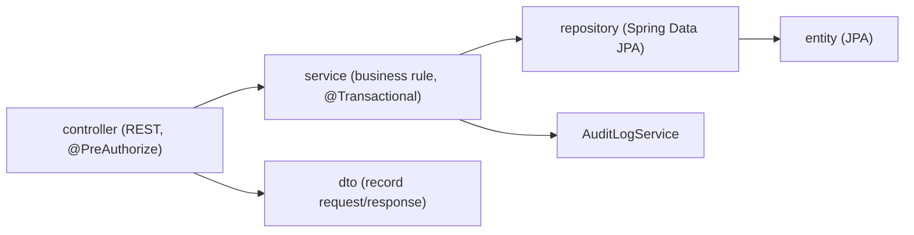

# 01 — Tổ chức mã nguồn (Code Organization)

## 1. Tổng quan workspace

```
05_Development/
├── frontend/     React 19 + TypeScript + Vite 8 (SPA, prototype demo)
├── backend/      Spring Boot 3.3.4, Java 17, Maven (Modular Monolith)
├── database/     schema.sql (SQL Server DDL) + seed/ + migrations/
└── docs/         ARCHITECTURE, API_CONTRACT, MODULE_OWNERSHIP, ...
```

Mã nguồn được chia theo **6 module nghiệp vụ** dùng chung ký hiệu ở cả FE và BE:

| Module | Tên | FE (`features/`) | BE (package) |
|---|---|---|---|
| M1 | Identity & Customer Profile | `m1-identity/` (rỗng) | `m1identity` ✅ một phần |
| M2 | Retreat Booking & Front Desk | `m2-booking/` (rỗng) | `m2booking` (rỗng) |
| M3 | Spa & Therapy Scheduling | `m3-spa/` (rỗng) | `m3spa` (rỗng) |
| M4 | Dining / F&B | `m4-fnb/` (rỗng) | `m4fnb` (rỗng) |
| M5 | Folio, Payment, Checkout, Review, Analytics | `m5-billing/` (rỗng) | `m5billing` (rỗng) |
| M6 | Admin, Permission, Governance | `m6-admin/` (api + types) | `m6admin` ✅ |

> Ở FE, nghiệp vụ thực tế hiện **không nằm trong `features/`** mà nằm trong `src/context/*` + `src/pages/*`. `features/` là khung dự kiến cho giai đoạn nối API thật.

---

## 2. Frontend — `05_Development/frontend/src`

```
src/
├── main.tsx                 Điểm vào: mount <App/>
├── App.tsx                  Lồng toàn bộ Provider + Router + RoleSwitcher + DevHealthIndicator
├── app/
│   ├── router/index.tsx     Khai báo TẤT CẢ route (8 nhóm theo role)
│   ├── router/guards/RoleGuard.tsx   Chặn theo role / capability
│   ├── layouts/             5 layout: Public, Auth, Customer, Operational, ManagerAdmin
│   └── providers/AuthProvider.tsx    Phiên đăng nhập giả lập (persona)
├── context/                 ★ "Service layer" của prototype — giữ state + business rule
│   ├── CustomerContext.tsx     M1/M2: hồ sơ, wellness profile, booking, yêu cầu xóa dữ liệu sức khỏe
│   ├── OperationsContext.tsx   M2: arrivals, villa, check-in, khai báo lưu trú
│   ├── SpaContext.tsx          M3: liệu trình, therapist, phòng, đặt lịch atomic
│   ├── DiningContext.tsx       M4: menu, chọn bữa, gọi món à-la-carte, prep list
│   ├── FolioContext.tsx        M5: tổng hợp folio, thanh toán, checkout, review, analytics
│   └── GovernanceContext.tsx   M6: tham số, feature flag, ma trận quyền, ủy quyền, audit
├── data/                    Dữ liệu mock khởi tạo cho các context (mockSpa.ts, mockDining.ts, ...)
├── types/                   Kiểu TypeScript theo domain (spa.ts, folio.ts, auth.ts, screen.ts...)
├── pages/<role>/            Mỗi file = 1 màn hình trong Screen_List
│   ├── public/ retreats/ auth/
│   ├── customer/ receptionist/ therapist/ fb/
│   └── manager/ admin/ common/
├── components/
│   ├── common/              Button, Card, Modal, Toast, FormField, DevHealthIndicator...
│   ├── navigation/          Navbar, Sidebar, Breadcrumb, RoleSwitcher
│   ├── operations/          Chip trạng thái, header, pagination cho màn hình nhân viên
│   ├── customer/ dining/ retreat/   Component theo domain
│   └── motion/              Hiệu ứng (GSAP, Lenis smooth scroll, custom cursor)
├── api/                     Lớp HTTP tới backend
│   ├── client/apiClient.ts     fetch wrapper: base URL, JWT Bearer, chuẩn hóa lỗi
│   ├── errors/apiError.ts      AppApiError
│   └── health/healthApi.ts     GET /health (đang dùng)
├── features/m6-admin/       adminApi.ts + admin.ts (gọi BE M6 — CHƯA được page nào import)
├── hooks/                   useAuth / useGovernance / useToast (re-export từ provider)
├── i18n/                    i18next, 5 ngôn ngữ: vi, en, fr, ja, zh-CN × 7 namespace
├── styles/                  tokens.css (design token) + css theo domain
└── utils/diningBadges.ts
```

### Quy ước chính
- **1 page = 1 screen** trong `02_Requirement/Screen_Inventory/Screen_List.md` (router có comment `Screen #N`).
- **Page không tự giữ dữ liệu nghiệp vụ** — luôn gọi hook `useXxx()` của context tương ứng.
- **Context trả về `{ success, message }`** cho các hành động có rule, page hiển thị bằng Toast.
- Chuỗi hiển thị đa ngôn ngữ dùng kiểu `{ vi, en, 'zh-CN', ja, fr }` trong mock hoặc key i18n `t('...')`.

---

## 3. Backend — `05_Development/backend/src/main/java/com/heavenstay/hswrms`

```
hswrms/
├── HswrmsApplication.java        @SpringBootApplication (+ @EnableScheduling)
├── common/
│   ├── api/                      ApiResponse<T> (envelope), ApiError, HealthController
│   └── exception/                BusinessRule / Conflict / ResourceNotFound + GlobalExceptionHandler
├── config/                       SecurityConfig (stateless JWT), CorsConfig
├── security/                     JwtTokenProvider, JwtAuthenticationFilter, CustomUserDetails,
│                                 RestAuthenticationEntryPoint (401), RestAccessDeniedHandler (403)
├── m1identity/
│   ├── controller/AuthController     POST /auth/login, GET /auth/me
│   ├── entity/UserAccount, Role
│   ├── repository/…
│   └── service/IdentityAccountService
├── m6admin/
│   ├── controller/   AdminStaff, AdminPermission, AdminDelegation, AdminParameter,
│   │                 AdminAuditLog, AdminMasterData, Dashboard
│   ├── service/      StaffAccount, PermissionMatrix, Permission, Delegation, BusinessParameter,
│   │                 AuditLog, MasterData, SystemOverview, PermissionCatalog, M6DataInitializer
│   ├── security/     PermissionEvaluator (@perm.has), CurrentActor
│   ├── entity/       Permission, RolePermission, RightDelegation(+Permission), SystemConfiguration, AuditLog
│   ├── repository/   Spring Data JPA (+ AuditLogPurgeDao)
│   └── job/          AccountUnlockJob (15'), DelegationExpiryJob (60s), AuditLogCleanupJob (02:00)
├── m2booking/ m3spa/ m4fnb/ m5billing/ integration/   (chỉ .gitkeep)
└── resources/
    ├── application.yml          cấu hình chung, profile mặc định = local
    └── application-local.yml    H2 in-memory, ddl-auto=create-drop, /h2-console
```

### Kiến trúc phân lớp (mỗi module)



- Response luôn bọc trong `ApiResponse<T>`; lỗi đi qua `GlobalExceptionHandler`.
- Phân quyền **theo màn hình + hành động**: `@PreAuthorize("@perm.has('S52','C')")` — `S52` = mã screen, `C/V/U/D/G/E` = Create/View/Update/Delete/Grant/Export.
- Tài khoản mặc định (seed bởi `M6DataInitializer`):

| Email | Mật khẩu | Role |
|---|---|---|
| admin@heavenstay.com | Admin@123456 | ADMIN |
| manager@heavenstay.com | Manager@123456 | MANAGER |
| receptionist@heavenstay.com | Staff@123456 | RECEPTIONIST |
| therapist@heavenstay.com | Staff@123456 | THERAPIST |
| fnb@heavenstay.com | Staff@123456 | FNB_STAFF |

---

## 4. Database — `05_Development/database`
- `schema.sql`: DDL chuẩn cho SQL Server (dùng khi chạy profile SQL Server).
- Profile `local` **không dùng** `schema.sql`; Hibernate tự tạo bảng từ các `@Entity` hiện có (chỉ bảng M1/M6).
