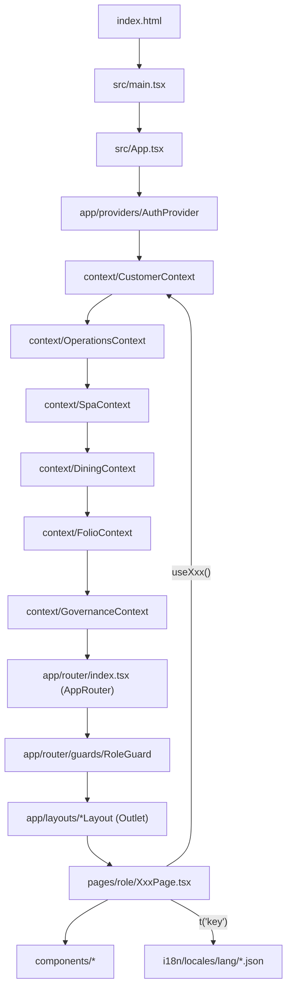
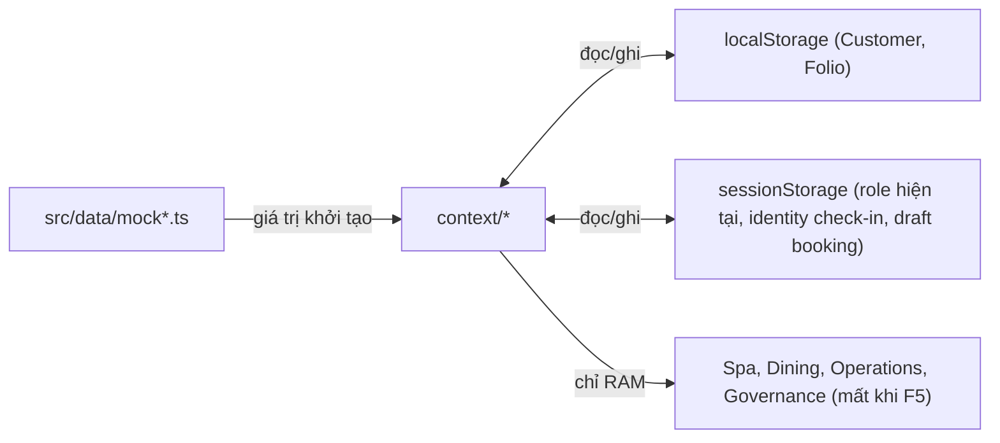
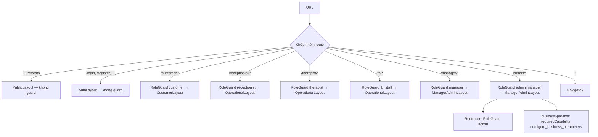
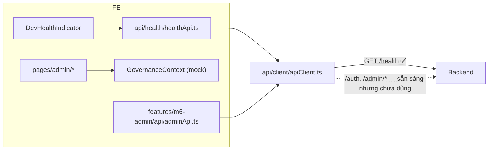

# 02 — Luồng chạy giữa các folder (Folder Flow)

## 1. Frontend: từ lúc mở trình duyệt tới khi render màn hình



### Thứ tự Provider quan trọng
Provider bên trong được phép gọi hook của provider bên ngoài:

| Provider | Phụ thuộc vào |
|---|---|
| `AuthProvider` | — |
| `CustomerProvider` | — |
| `OperationsProvider` | — |
| `SpaProvider` | `useCustomer()` (lấy wellnessProfile cho therapist view) |
| `DiningProvider` | `useCustomer()` (lấy dị ứng / chế độ ăn) |
| `FolioProvider` | `useCustomer()`, `useSpa()`, `useDining()`, `useOperations()` |
| `GovernanceProvider` | `useAuth()` |

→ **FolioContext là điểm hội tụ**: đọc booking (M2), phiên spa (M3), order F&B (M4), villa (M2) để dựng folio & chặn checkout.

### Nguồn dữ liệu & lưu trữ



| Key | Nơi ghi | Ý nghĩa |
|---|---|---|
| `hswrms_active_role` (session) | AuthProvider | Persona đang đóng vai |
| `hsw_customer_*_v1` (local) | CustomerContext | Hồ sơ, wellness, bookings, yêu cầu xóa |
| `hsw_settled_*`, `hsw_checkout_records_v1`, `hsw_stay_reviews_v1`, `hsw_payment_transactions_v1` (local) | FolioContext | Trạng thái thanh toán / checkout / review |
| `hsw_draft_booking` (session) | RetreatBookingPage → BookingSummaryPage | Nháp booking giữa 2 bước |
| transient identity (session) | OperationsContext | Thông tin giấy tờ khi check-in (không lưu local) |

> Reset demo: DevTools → Application → xóa Local/Session Storage rồi F5.

### Định tuyến & phân quyền



`RoleGuard` ([RoleGuard.tsx](../../05_Development/frontend/src/app/router/guards/RoleGuard.tsx)):
1. Chưa đăng nhập → `/login?redirect=...`
2. Sai role **hoặc** thiếu capability → hiển thị thẻ "Access Restricted (RBAC)"
3. `hasCapability()` trong GovernanceContext: role có grant **hoặc** Manager có ủy quyền còn hiệu lực.

### Đăng nhập trong prototype
- `LoginPage` **không gọi backend**: sau 600 ms gọi `loginAs('customer')`.
- Nhân viên được demo bằng **RoleSwitcher** (nút nổi góc phải dưới) → `loginAs(role)` → điều hướng tới dashboard của role.
- `DevHealthIndicator` (góc trái dưới) là chỗ duy nhất gọi BE: `api/health/healthApi.ts` → `GET /api/v1/health`.

---

## 2. Backend: vòng đời một request

```mermaid
sequenceDiagram
    participant FE as Client
    participant CORS as CorsConfig
    participant JWT as JwtAuthenticationFilter
    participant SEC as SecurityConfig rules
    participant CTRL as Controller
    participant PERM as PermissionEvaluator (@perm)
    participant SVC as Service
    participant REPO as Repository/JPA
    participant AUD as AuditLogService
    FE->>CORS: HTTP + Authorization: Bearer <jwt>
    CORS->>JWT: allowed origin :5173
    JWT->>JWT: validate token, set SecurityContext (userId, roles)
    JWT->>SEC: /health, /auth/**, /packages/** = permitAll; còn lại authenticated
    SEC->>CTRL: dispatch
    CTRL->>PERM: @PreAuthorize("@perm.has('S52','C')")
    PERM->>SVC: user active + có quyền (role hoặc delegation)?
    alt bị từ chối
        PERM->>AUD: ghi "Access Denied"
        PERM-->>FE: 403 (RestAccessDeniedHandler)
    else được phép
        CTRL->>SVC: gọi nghiệp vụ
        SVC->>REPO: đọc/ghi
        SVC->>AUD: ghi audit
        CTRL-->>FE: 200 ApiResponse<T>
    end
```

- Lỗi nghiệp vụ → `BusinessRuleException` / `ConflictException` / `ResourceNotFoundException` → `GlobalExceptionHandler` → JSON `ApiError`.
- Chưa có token / token sai → `RestAuthenticationEntryPoint` → 401.

### Khởi động backend
1. `application.yml` → profile mặc định `local` → `application-local.yml` (H2, `create-drop`).
2. Hibernate tạo bảng từ entity M1 + M6.
3. `M6DataInitializer` (ApplicationRunner): seed roles → permissions (`PermissionCatalog`) → role-permission → business parameters → 5 tài khoản mặc định → (thử) master data.
4. Scheduler: `AccountUnlockJob`, `DelegationExpiryJob`, `AuditLogCleanupJob`.

---

## 3. Điểm nối FE ↔ BE (hiện trạng)



Để nối thật một màn hình Admin: page → `adminApi.*` → `apiClient` (tự gắn JWT từ `hswrms_jwt_token`) → controller M6. Cần thêm bước login thật lưu token bằng `setAuthToken()`.
