# 03 — Luồng nghiệp vụ (Business Flow)

> Mỗi bước ghi rõ **màn hình (page)** → **hàm xử lý (context/service)** → **quy tắc được kiểm tra**.
> Đường dẫn tương đối từ `05_Development/frontend/src/` (FE) và `.../hswrms/` (BE).

## 0. Hành trình tổng thể của Customer

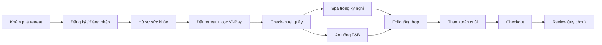

| Giai đoạn | Actor                                | Module | Context chính                        |
| ----------- | ------------------------------------ | ------ | ------------------------------------- |
| A–C        | Customer                             | M1     | CustomerContext                       |
| D           | Customer                             | M2     | CustomerContext                       |
| E           | Receptionist                         | M2     | OperationsContext                     |
| F           | Customer / Receptionist / Therapist  | M3     | SpaContext                            |
| G           | Customer / F&B Staff                 | M4     | DiningContext                         |
| H–K        | Customer / Receptionist              | M5     | FolioContext                          |
| Báo cáo   | Manager                              | M5     | FolioContext (analytics)              |
| Quản trị  | Admin (+ Manager được ủy quyền) | M6     | GovernanceContext (FE) / m6admin (BE) |

---

## 1. M1 — Identity & Customer Profile

| Bước                              | Page                                                        | Xử lý                                      | Ghi chú                                                                                                                                      |
| ----------------------------------- | ----------------------------------------------------------- | -------------------------------------------- | --------------------------------------------------------------------------------------------------------------------------------------------- |
| Đăng ký → OTP                   | `pages/auth/RegisterPage` → `EmailOtpVerificationPage` | mô phỏng UI                                | Không gọi BE                                                                                                                                |
| Đăng nhập                        | `pages/auth/LoginPage`                                    | `AuthProvider.loginAs('customer')`         | Bất kỳ email/mật khẩu đều vào được (demo)                                                                                           |
| Quên mật khẩu                    | `PasswordResetPage`                                       | mô phỏng UI                                |                                                                                                                                               |
| Hồ sơ / sức khỏe                | `customer/AccountSettingsPage`, `HealthProfilePage`     | `updateProfile`, `updateWellnessProfile` | Lưu localStorage                                                                                                                             |
| Yêu cầu xóa dữ liệu sức khỏe | `customer/HealthDataDeletionPage`                         | `CustomerContext.submitDeletionRequest`    | Có booking`upcoming`/`in_stay` → trạng thái **`deferred_active_retreat`** (hoãn tới sau checkout); ngược lại `pending` |

**Backend M1 (thật)** — `m1identity/controller/AuthController`:

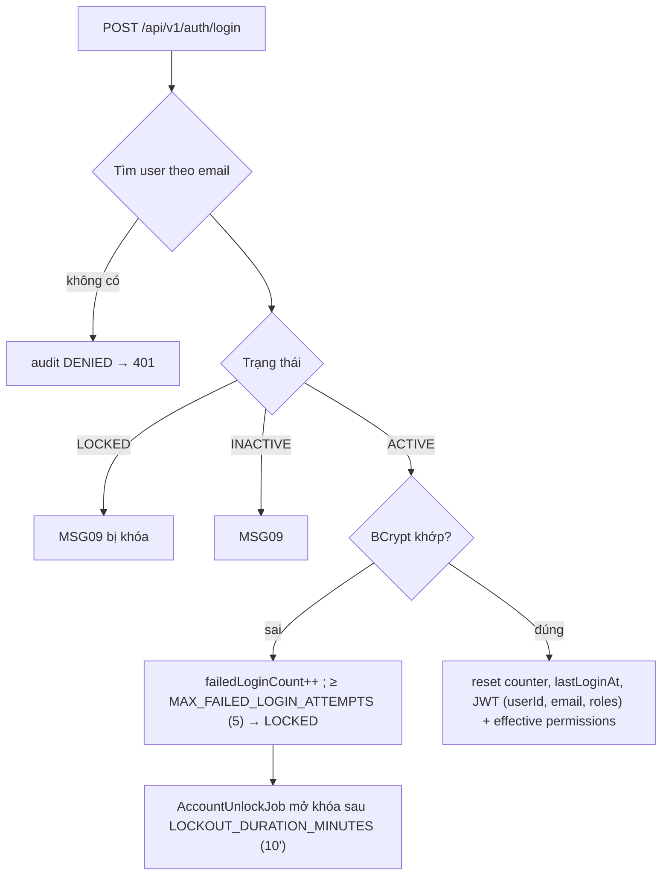

---

## 2. M2 — Đặt retreat & Front Desk

### 2.1 Đặt retreat + đặt cọc (Customer)

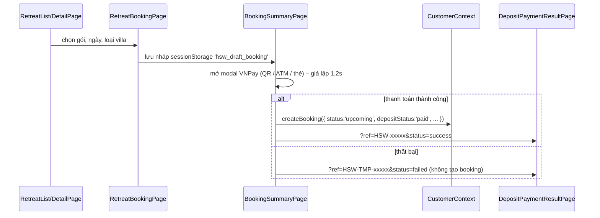

- Booking chỉ được tạo khi cọc thành công → **booking hợp lệ luôn có cọc**.
- Tham số `DEPOSIT_PERCENTAGE = 30%` tồn tại ở BE (M6) nhưng FE dùng `draft.depositAmount` tính sẵn.
- Xem lại: `MyBookingsPage`, `BookingDetailPage` → `getBookingById`.

### 2.2 Check-in (Receptionist)

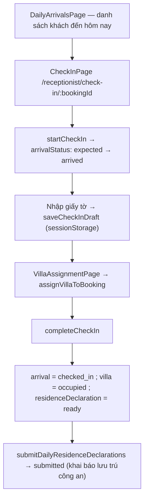

Quy tắc trong `OperationsContext`:

| Hàm                     | Quy tắc                                                                                                                                          |
| ------------------------ | ------------------------------------------------------------------------------------------------------------------------------------------------- |
| `assignVillaToBooking` | Villa không`maintenance`; không `occupied` bởi booking khác; `capacity ≥ partySize`; villa cũ của booking được trả về `ready` |
| `completeCheckIn`      | **Cọc phải `paid`**; villa phải tồn tại, không `maintenance`, không `cleaning`                                                 |
| `updateVillaStatus`    | Cấm`occupied → ready` trực tiếp (phải qua `cleaning`)                                                                                    |
| Lưu trữ giấy tờ      | Chỉ`sessionStorage` (giảm thiểu lưu dữ liệu nhạy cảm)                                                                                   |

**Vòng đời villa:**

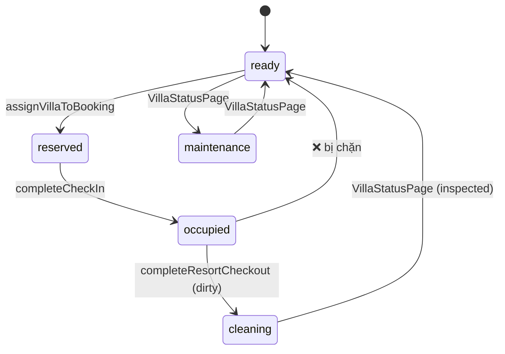

> `updateVillaStatus` chỉ chặn duy nhất `occupied → ready`; các chuyển trạng thái thủ công khác trên `VillaStatusPage` đều được phép.

---

## 3. M3 — Spa & Therapy

### 3.1 Đặt lịch spa (Customer hoặc Receptionist)

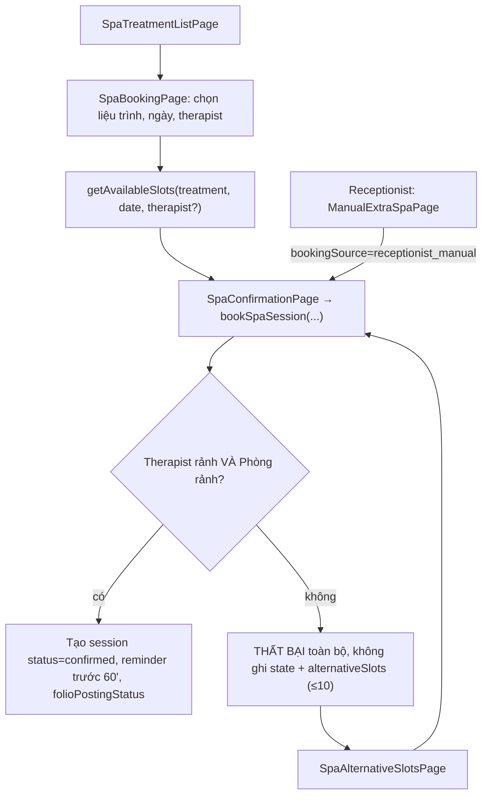

**Quy tắc atomic** (`SpaContext.bookSpaSession`) — đúng yêu cầu *"Spa booking chỉ confirm khi cả Therapist và Treatment Room cùng rảnh"*:

1. Bắt buộc chọn therapist cụ thể (không `any`) và phòng cụ thể.
2. Kiểm tra trùng giờ (`sessionsOverlap`) của therapist **và** phòng trong ngày (bỏ qua `cancelled`, `no_show`).
3. Phòng `maintenance` → từ chối; therapist `off_duty`/`on_leave` → từ chối.
4. Khung giờ hoạt động: slot bắt đầu từ danh sách cố định, kết thúc ≤ 19:00.
5. `chargeType='included'` → giá 0 (nằm trong gói); `'extra'` → giá liệu trình, chờ vào folio.

### 3.2 Thực hiện liệu trình (Therapist)

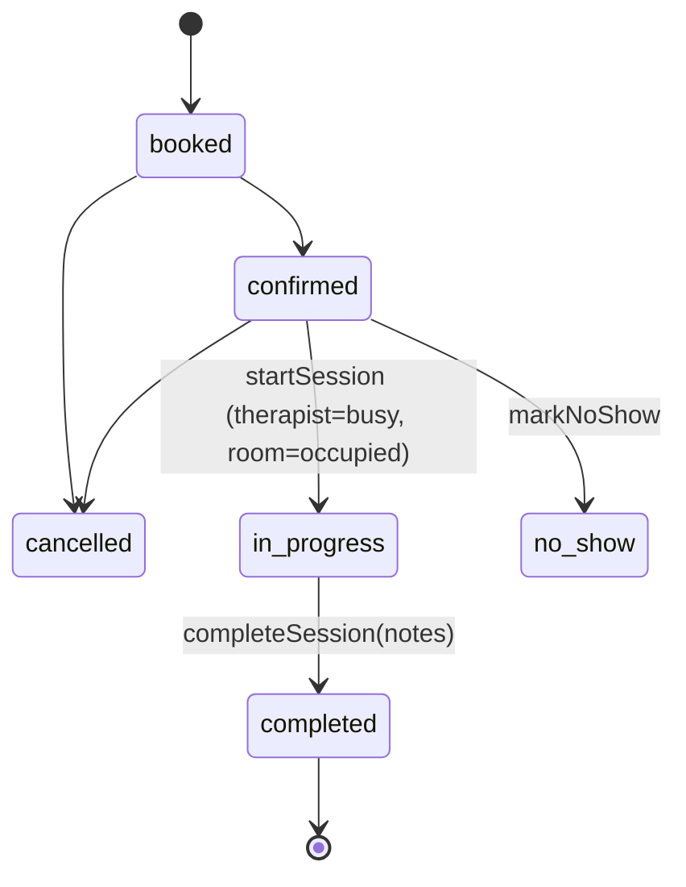

- Page: `therapist/TherapistDashboardPage`, `TherapistSchedulePage`, `TherapistSessionDetailPage`.
- **Bảo vệ dữ liệu sức khỏe**: `getTherapistRelevantWellnessInfo(customerId, treatmentId)` chỉ trả về **tên (first name)** + bệnh lý/lưu ý **liên quan đến loại liệu trình** (massage → lưng; hydrotherapy → huyết áp; facial → không có ghi chú lưng...). Không có DOB, địa chỉ, dị ứng thực phẩm, giấy tờ, thanh toán.

---

## 4. M4 — Dining / F&B

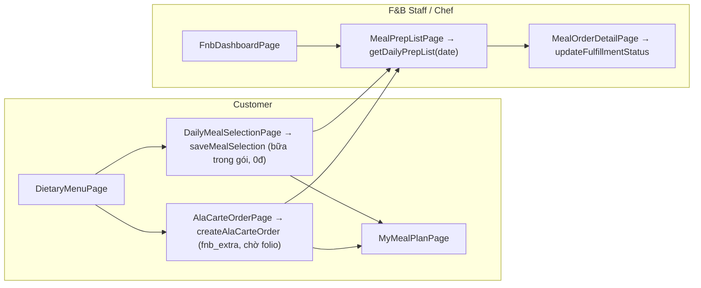

- **Mỗi booking/ngày/bữa chỉ 1 lựa chọn**: `saveMealSelection` ghi đè lựa chọn cũ cùng `(bookingId, date, mealPeriod)`.
- **Bữa trong gói ≠ chi phí phát sinh**: chỉ `AlaCarteOrder` (`chargeType='fnb_extra'`) được tính vào folio.
- **Dữ liệu cho bếp**: `getDietaryProjection` chỉ đưa **dị ứng + chế độ ăn** (không có ghi chú y khoa/spa).

---

## 5. M5 — Folio, Thanh toán, Checkout, Review, Báo cáo

### 5.1 Tổng hợp folio — `FolioContext.getFolioForBooking(bookingRef)`

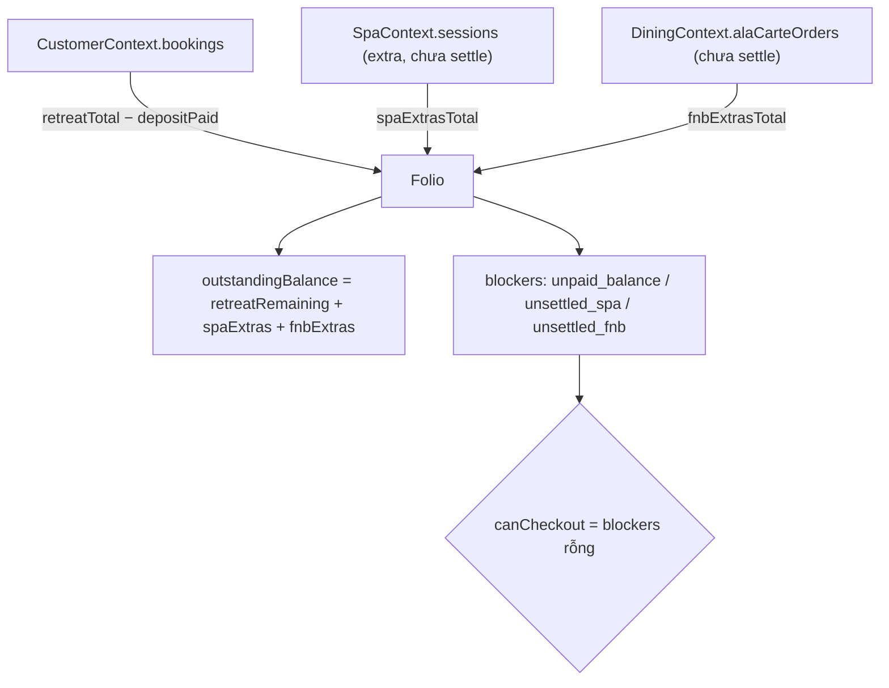

- Liệu trình spa trong gói hiển thị `included` (không cộng tiền) → tránh tính trùng.

### 5.2 Thanh toán → Checkout → Review

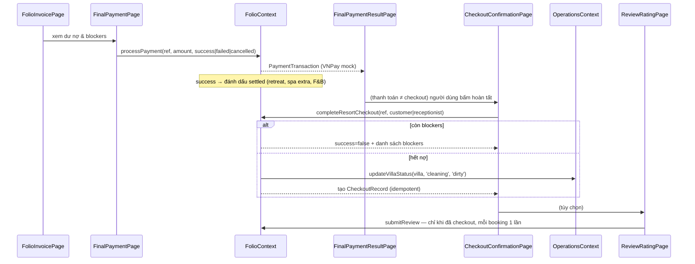

Quy tắc bắt buộc (theo AGENTS.md / SRS) và nơi thực thi:

| Quy tắc                                                           | Nơi thực thi                                                                                    |
| ------------------------------------------------------------------ | ------------------------------------------------------------------------------------------------- |
| Checkout**không thể hoàn tất** khi còn nợ Spa/F&B/gói | `completeResortCheckout` kiểm `folio.canCheckout`                                            |
| **Thanh toán thành công ≠ checkout hoàn tất**          | 2 bước riêng:`processPayment` → `completeResortCheckout`; 2 page riêng                   |
| Review là**tùy chọn & sau checkout**                      | `submitReview` kiểm `isStayCheckedOut` + chặn review trùng                                 |
| Checkout idempotent                                                | Đã có`checkoutRecords[ref]` → trả success, không ghi lại                                 |
| Receptionist hỗ trợ checkout                                     | Route`/receptionist/folio/:bookingId`, `/receptionist/checkout/:bookingId/*` dùng chung page |

### 5.3 Báo cáo Manager (read-only, không lộ dữ liệu cá nhân)

- `manager/RevenueDashboardPage` → `getRevenueAnalytics()`
- `manager/OccupancyReportPage` → `getOccupancyAnalytics()` (đếm villa theo trạng thái, bảng chi tiết có lọc + phân trang)
- `manager/TherapistUtilizationReportPage` → `getTherapistUtilizationAnalytics()`

---

## 6. M6 — Admin, Phân quyền, Ủy quyền, Audit

### 6.1 Trên FE (mock — `GovernanceContext`)

| Màn hình                                  | Hàm                                        | Quy tắc                                                                                    |
| ------------------------------------------- | ------------------------------------------- | ------------------------------------------------------------------------------------------- |
| `admin/BusinessParametersPage`            | `updateParameter`                         | Kiểm kiểu số/%, min/max, định dạng`HH:MM`; ghi audit                                |
| `admin/FeatureFlagsPage`                  | `toggleFeatureFlag`                       | Ghi audit                                                                                   |
| `admin/PermissionMatrixPage`              | `updatePermissionGrant`                   | Quyền`isImmutableBoundary` **không được sửa**                                 |
| `admin/AdminDelegationPage`               | `createDelegation` / `revokeDelegation` | Chỉ quyền`isDelegableToManager`; `expiresAt > startsAt`; chặn leo thang đặc quyền |
| `admin/SensitiveAuditLogPage`             | `auditEvents`                             | Audit chỉ lưu metadata                                                                    |
| `common/SystemOverviewPage`               | —                                          | Dùng chung Manager & Admin                                                                 |
| `admin/StaffAccount*`, `MasterDataPage` | mock data                                   |                                                                                             |

**Manager không phải Admin**: `/admin/*` cho phép manager vào layout, nhưng mọi route con (trừ `system-overview`) yêu cầu `admin`; riêng `business-params` mở cho manager **khi có capability** (grant hoặc ủy quyền còn hạn).

### 6.2 Trên BE (thật — `m6admin`)

| Endpoint                                              | Quyền (`@perm.has`) |
| ----------------------------------------------------- | ---------------------- |
| `GET/POST/... /api/v1/admin/staff`                  | `S10`, `S11`       |
| `/api/v1/admin/master-data/{group}`                 | `S12` V/C/U/D        |
| `/api/v1/admin/parameters`                          | `S50` V/U            |
| `/api/v1/admin/permissions/matrix` (+ `/preview`) | `S51` V/G            |
| `/api/v1/admin/delegations` (+ `/{id}/revoke`)    | `S52` V/C/D          |
| `/api/v1/admin/audit-logs` (+ `/export`)          | `S53` V/E            |

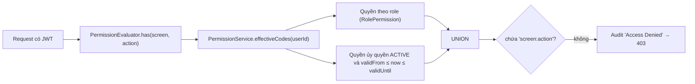

- Quyền được tính lại **mỗi request** → sửa ma trận/thu hồi ủy quyền có hiệu lực ngay.
- `DelegationExpiryJob` (60 giây) chuyển ủy quyền hết hạn; `AuditLogCleanupJob` (02:00) xóa log quá `AUDIT_LOG_RETENTION_DAYS` (90).
