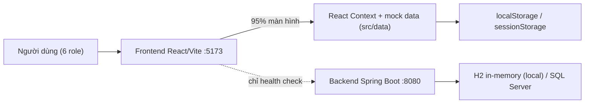

# HSWRMS — Code Tracing (Truy vết mã nguồn)

> Phạm vi: `05_Development/` (frontend + backend + database) — trạng thái code tại 2026-10-12.
> Mục tiêu: giúp thành viên mới hiểu **code được tổ chức thế nào**, **dữ liệu chảy qua các folder ra sao**, và **luồng nghiệp vụ** được hiện thực ở đâu.

| # | Tài liệu | Nội dung |
|---|---|---|
| 1 | [01_Code_Organization.md](01_Code_Organization.md) | Cây thư mục, vai trò từng folder (FE + BE), quy ước đặt tên |
| 2 | [02_Folder_Flow.md](02_Folder_Flow.md) | Luồng chạy giữa các folder: bootstrap → router → guard → layout → page → context → mock data; luồng request BE |
| 3 | [03_Business_Flow.md](03_Business_Flow.md) | Luồng nghiệp vụ theo module M1–M6, quy tắc nghiệp vụ & vị trí code thực thi |
| 4 | [04_Findings_And_Gaps.md](04_Findings_And_Gaps.md) | Khoảng trống FE↔BE, rủi ro/bug tiềm ẩn phát hiện khi trace |

## Tóm tắt 30 giây

- **Frontend** là prototype demo: toàn bộ nghiệp vụ M1–M6 chạy **trong trình duyệt** bằng React Context + dữ liệu mock.
- **Backend** mới hiện thực **M1 (đăng nhập/JWT)** và **M6 (Admin: staff, quyền, ủy quyền, tham số, audit log, master data)**. M2–M5 mới là thư mục rỗng.
- FE **chưa gọi** API nghiệp vụ của BE (ngoại trừ `/health`). Lớp `features/m6-admin/api/adminApi.ts` đã viết sẵn nhưng chưa page nào dùng.
