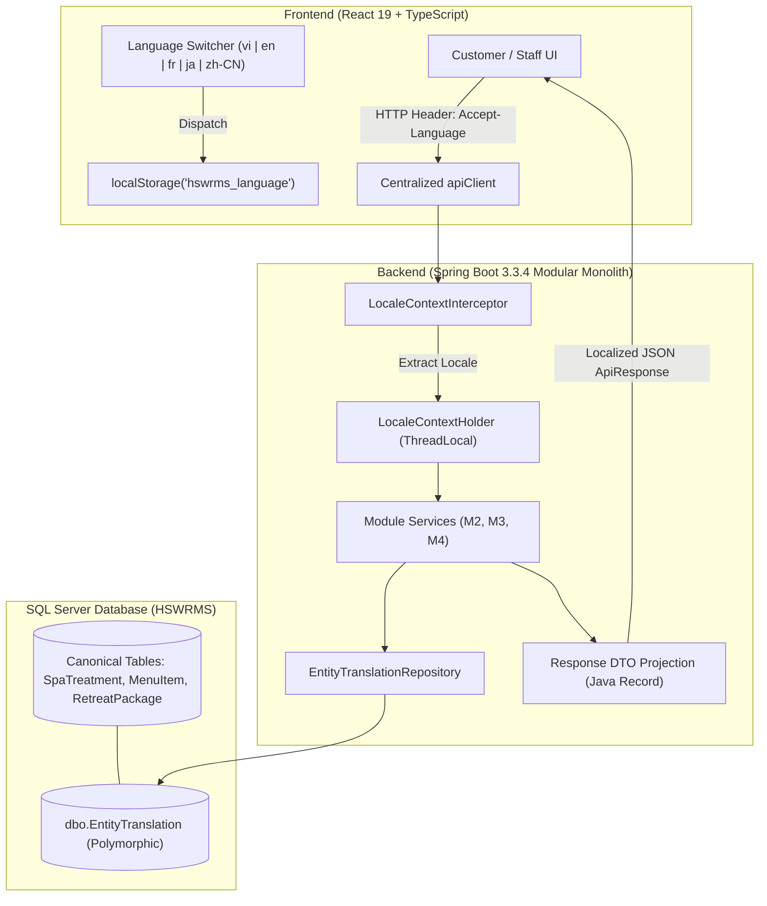
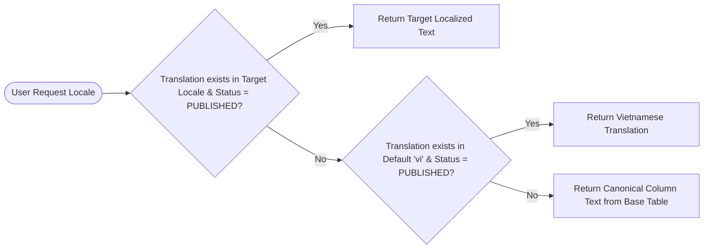
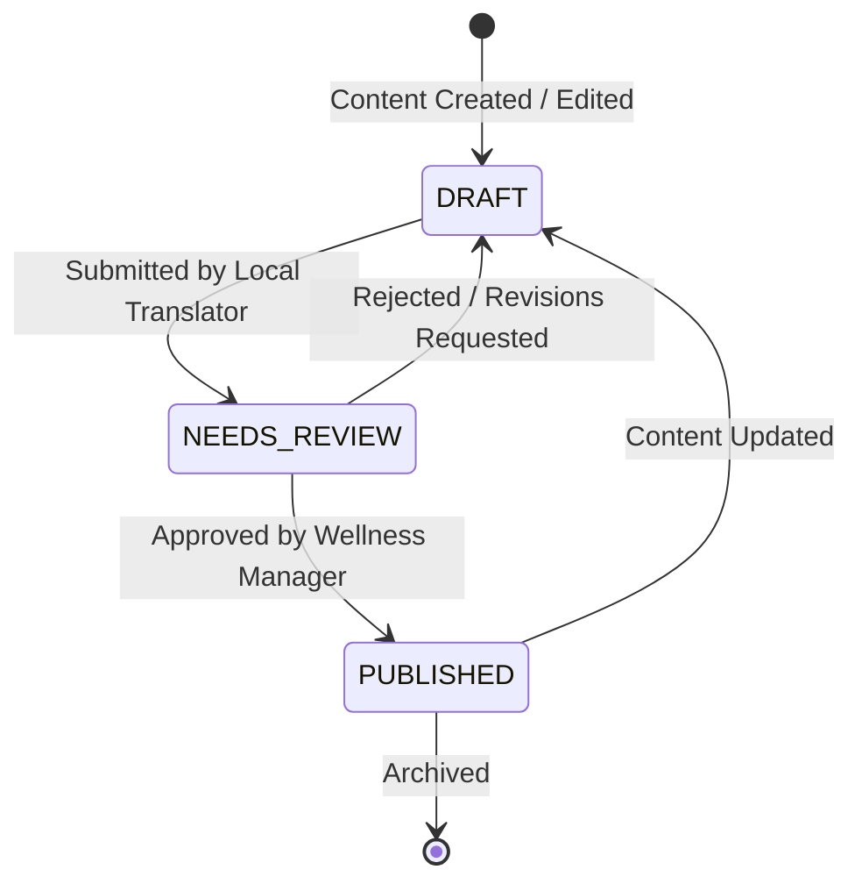

# HSWRMS — Centralized Multilingual Content Management Architecture & Implementation Blueprint

**Document Version:** 1.0.0  
**Project:** HeavenStay Wellness Resort Management System (HSWRMS)  
**Modules Addressed:** M1 (Identity), M2 (Retreat Booking), M3 (Spa & Wellness), M4 (Dietary Dining & Kitchen), M5 (Billing & Folio), M6 (Admin & Operations)  
**Supported Locales:** Vietnamese (`vi` - Canonical), English (`en`), French (`fr`), Japanese (`ja`), Simplified Chinese (`zh-CN`)

---

## 1. Executive Summary & Problem Analysis

In a luxury 5-star international wellness resort, guests from Vietnam, Europe, Japan, China, and North America interact with dynamic content (Retreat Packages, Spa Treatments, Ayurvedic Therapies, Mindfulness Workshops, Organic Culinary Menus, and Villa Suites).

### Current Limitations Identified
1. **Monolingual Database Schema:** Core operational tables (`dbo.RetreatPackage`, `dbo.SpaTreatment`, `dbo.MenuItem`, `dbo.VillaCategory`) historically store a single canonical string (`package_name`, `treatment_name`, `item_name`).
2. **Hardcoded Frontend Dictionaries:** Expanding client-side JSON dictionary files (`locales/{lang}/*.json`) indefinitely for dynamic business data creates deployment coupling—adding a seasonal spa treatment or modifying a culinary ingredient requires frontend code commits and redeployment.
3. **Vietnamese Fallback Leakage:** When an entity is queried from the backend without localized attributes, fallback logic historically displayed Vietnamese strings in English, French, Japanese, or Chinese views.

### Architectural Solution
We specify a **Centralized Translation Entity Pattern** with a polymorphic relational schema, transparent Spring Boot DTO projection via `Accept-Language`, a deterministic fallback chain, and an operational Admin Translation Management workflow.



---

## 2. Target Database Design: Polymorphic Translation Entity Pattern

### 2.1 Schema Definition (`dbo.EntityTranslation`)

To support arbitrary translatable entities without schema alterations to existing production tables, we establish a dedicated polymorphic translation table:

```sql
-- Flyway Migration: V1_9__create_entity_translation_table.sql
CREATE TABLE dbo.EntityTranslation (
    translation_id       BIGINT IDENTITY(1,1) NOT NULL,
    entity_type          VARCHAR(50) NOT NULL,       -- 'RETREAT_PACKAGE', 'SPA_TREATMENT', 'MENU_ITEM', 'VILLA_CATEGORY', 'INGREDIENT'
    entity_id            BIGINT NOT NULL,            -- Primary key of target record in canonical table
    locale               VARCHAR(10) NOT NULL,       -- 'vi', 'en', 'fr', 'ja', 'zh-CN'
    field_name           VARCHAR(50) NOT NULL,       -- 'name', 'description', 'wellness_goal', 'benefits'
    translated_text      NVARCHAR(MAX) NOT NULL,     -- Localized unicode string
    translation_status   VARCHAR(20) NOT NULL CONSTRAINT DF_EntityTranslation_Status DEFAULT 'PUBLISHED', -- 'DRAFT', 'PUBLISHED', 'NEEDS_REVIEW'
    created_at           DATETIME2(7) NOT NULL CONSTRAINT DF_EntityTranslation_CreatedAt DEFAULT SYSUTCDATETIME(),
    updated_at           DATETIME2(7) NOT NULL CONSTRAINT DF_EntityTranslation_UpdatedAt DEFAULT SYSUTCDATETIME(),
    updated_by           VARCHAR(100) NULL,

    CONSTRAINT PK_EntityTranslation PRIMARY KEY CLUSTERED (translation_id ASC),
    CONSTRAINT CK_EntityTranslation_Locale CHECK (locale IN ('vi', 'en', 'fr', 'ja', 'zh-CN')),
    CONSTRAINT CK_EntityTranslation_Status CHECK (translation_status IN ('DRAFT', 'PUBLISHED', 'NEEDS_REVIEW'))
);

-- Unique index enforcing exactly one active translation per entity field locale
CREATE UNIQUE NONCLUSTERED INDEX UQ_EntityTranslation_Key 
ON dbo.EntityTranslation (entity_type, entity_id, locale, field_name);

-- Covering index optimized for high-throughput localized retrieval
CREATE NONCLUSTERED INDEX IX_EntityTranslation_Lookup
ON dbo.EntityTranslation (entity_type, entity_id, locale)
INCLUDE (field_name, translated_text, translation_status);
```

### 2.2 Entity Relationship & Data Dictionary

| Column | Type | Nullable | Purpose / Description |
| :--- | :--- | :---: | :--- |
| `translation_id` | `BIGINT IDENTITY` | No | Surrogate primary key. |
| `entity_type` | `VARCHAR(50)` | No | Discriminator identifying parent module entity (`SPA_TREATMENT`, `MENU_ITEM`, etc.). |
| `entity_id` | `BIGINT` | No | ID referencing parent entity (`treatment_id`, `item_id`, etc.). |
| `locale` | `VARCHAR(10)` | No | BCP 47 locale code (`vi`, `en`, `fr`, `ja`, `zh-CN`). |
| `field_name` | `VARCHAR(50)` | No | Attribute key (`name`, `description`, `preparation_note`). |
| `translated_text` | `NVARCHAR(MAX)` | No | Target translated text with full Unicode support. |
| `translation_status` | `VARCHAR(20)` | No | Editorial state (`DRAFT`, `PUBLISHED`, `NEEDS_REVIEW`). |

---

## 3. Backend Service Layer & DTO Projection

### 3.1 HTTP Header Context Resolution

Spring Boot automatically captures the client's `Accept-Language` header via an interceptor:

```java
@Component
public class LocaleHeaderInterceptor implements HandlerInterceptor {
    @Override
    public boolean preHandle(HttpServletRequest request, HttpServletResponse response, Object handler) {
        String langHeader = request.getHeader("Accept-Language");
        Locale resolvedLocale = resolveSupportedLocale(langHeader);
        LocaleContextHolder.setLocale(resolvedLocale);
        return true;
    }

    @Override
    public void afterCompletion(HttpServletRequest request, HttpServletResponse response, Object handler, Exception ex) {
        LocaleContextHolder.resetLocaleContext();
    }

    private Locale resolveSupportedLocale(String header) {
        if (header == null || header.isBlank()) return Locale.forLanguageTag("vi");
        String primaryTag = header.split(",")[0].trim().split(";")[0].trim();
        return switch (primaryTag.toLowerCase()) {
            case "en", "en-us", "en-gb" -> Locale.ENGLISH;
            case "fr", "fr-fr" -> Locale.FRENCH;
            case "ja", "ja-jp" -> Locale.JAPANESE;
            case "zh", "zh-cn", "zh-hans" -> Locale.SIMPLIFIED_CHINESE;
            default -> Locale.forLanguageTag("vi");
        };
    }
}
```

### 3.2 Deterministic Fallback Strategy

The service layer implements a strict 3-tier fallback chain:



1. **Tier 1 (Target Locale):** Localized string matching requested locale with `translation_status = 'PUBLISHED'`.
2. **Tier 2 (Canonical Locale `vi`):** If missing, return the Vietnamese translation from `EntityTranslation`.
3. **Tier 3 (Base Entity Column):** If missing, return raw entity column value (`treatment_name`, `item_name`).

### 3.3 Immutable Java DTO Record Projection

```java
public record SpaTreatmentResponseDto(
    Long treatmentId,
    String treatmentCode,
    String treatmentName,       // Localized dynamically
    String category,            // Localized dynamically
    String description,         // Localized dynamically
    Integer durationMinutes,
    BigDecimal basePrice,
    Boolean isIncluded,
    String imageUrl,
    Map<String, String> localizedNames // Optional: full dictionary for client-side switching
) {}
```

---

## 4. Admin Content Management & Editorial Workflow

Resort marketing specialists and concierges manage translations through the Admin Portal (`/admin/translations`):



### Key Administrative Capabilities
1. **Side-by-Side Translation Matrix:** Display original Vietnamese content next to draft target language boxes.
2. **Completeness Audit Grid:** Real-time visibility into translation completion percentage per module (e.g., M3 Spa: 100%, M4 Dining: 100%, M2 Retreats: 100%).
3. **Single-Click Bulk Import/Export:** Export standard JSON or Excel templates for external professional localization agencies.

---

## 5. Non-Destructive Phased Migration Plan

| Phase | Milestone | Operational Impact | Risk Level |
| :---: | :--- | :--- | :---: |
| **Phase 1** *(Current)* | **Frontend Dynamic Content Resolvers:** Standardized `dynamicContent.ts` and `mockDining.ts` provide full 5-language coverage for 18 Spa treatments, 8 Retreat packages, 6 Villa categories, and 14 Menu items without database downtime. | Zero database modifications. Client-side verified. | **Zero** |
| **Phase 2** *(Scheduled)* | **Flyway Schema Migration:** Execute `V1_9__create_entity_translation_table.sql` on SQL Server. Seed canonical translations from existing dictionaries into `dbo.EntityTranslation`. | Read-only additions. Non-breaking to existing queries. | **Very Low** |
| **Phase 3** *(Scheduled)* | **Service Projection Hardening:** Update Spring Boot repository queries to join `EntityTranslation` when `Accept-Language` is present. | Existing endpoints return localized DTOs while preserving response shape. | **Low** |
| **Phase 4** *(Handover)* | **Admin UI Delivery:** Implement `/admin/translations` workspace with role-based permissions (`ADMIN`, `MANAGER`). | Provides non-technical staff full self-service content localization. | **Low** |

---

## 6. Verification Summary of Phase 1 Deliverables

The Phase 1 dynamic content localization and UI hardening have been verified across all 5 supported languages and roles:

1. **Zero Vietnamese Leakage in Spa Catalog:**
   - English: `Himalayan Hot Stone Massage`, `Deep Tissue & Trigger Point Massage`, `Manual Lymphatic Drainage Therapy`, `Traditional Vietnamese Acupressure`.
   - French: `Massage aux Pierres Chaudes de l'Himalaya`, `Massage des Tissus Profonds & Points Gâchettes`.
   - Japanese: `ヒマラヤホットストーンマッサージ`, `ディープティシュー＆トリガーポイント指圧`.
   - Chinese: `喜马拉雅火山热石按摩`, `深层肌肉组织指压理疗按摩`.
2. **Customer Dining Menu:** All 14 database items loaded from SQL Server without "No items found" alert, with dual-language rendering (`Abalone & Shiitake Mushroom Beauty Soup` / `Súp Bào Ngư & Nấm Đông Cô Dưỡng Nhan`).
3. **F&B Staff Authentication:** Corrected credential mapping to `fnb@heavenstay.dev`, eliminating 401 Unauthorized errors and restoring kitchen meal orders and ingredient demand for scheduled stays.
4. **Clean Topbar Responsive Fit:** Validated zero horizontal scroll across 1440px, 1280px, 1024px, 768px, and 390px viewports with dynamic API health indicators.

