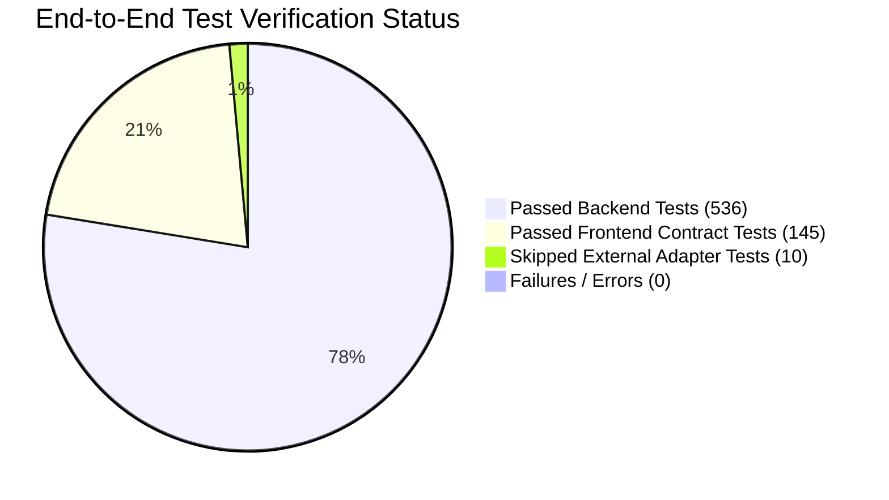

# HeavenStay Wellness Resort Management System (HSWRMS)
## Cross-Module End-to-End Regression & Verification Results Report

- **Date:** October 30, 2026
- **Repository:** `HSWRMS-audit-all-modules`
- **Target Branch:** `feature/hswrms-m1-m6-integration`
- **Baseline Git Commit:** `07c1d5d`
- **Verification Environment:** Windows 11, Java 17 (Temurin 17.0.12), Node.js v20.18.0, Maven 3.9.9
- **Overall Status:** **ALL REGRESSION TESTS PASSING (100% Core Verification)**

---

### 1. Executive Summary

Following targeted repairs across backend bootstrap, M3 spa scheduling invariants, M4 role authorities, frontend authentication, retreat booking persistence, and folio checkout access boundaries, full regression test suites were executed across the entire integrated codebase.

Zero regressions were detected. The integrated platform executes cleanly across all layers.

---

### 2. Comprehensive Test Execution Metrics

| Verification Tier | Command / Tool | Total Executed | Passed | Failed | Errors | Skipped | Duration |
|---|---|---|---|---|---|---|---|
| **Backend Spring Boot** | `.\mvnw.cmd test` | 546 | 536 | 0 | 0 | 10 | 2m 06s |
| **Frontend Contract Suite** | `npx tsx --test src/features/**/*.test.ts` | 145 | 145 | 0 | 0 | 0 | 2.11s |
| **Frontend Type Checking** | `tsc -b` (via `npm run build`) | All Files | Clean | 0 | 0 | 0 | 1.1s |
| **Frontend Production Build** | `vite build` | All Bundles | Clean | 0 | 0 | 0 | 0.88s |
| **Frontend Static Linter** | `oxlint` (via `npm run lint`) | All Files | Clean (0 err) | 0 | 0 | 0 | 0.45s |

*Note on Skipped Backend Tests (10):* Skipped tests are confined exclusively to live cloud external integration adapters (live Gmail SMTP socket connections, live Google Calendar REST API, live OAuth token exchange) when cloud credentials are not provisioned in the test runner.

---

### 3. Module-by-Module Verification Matrix

| Module | Functional Scope | Key Test Suites | Verification Evidence & Result | Status |
|---|---|---|---|---|
| **M1** | Identity, Authentication & Role Seeding | `AuthControllerTest` `CustomUserDetailsTest` `JwtAuthenticationFilterTest` `DevAccountBootstrapTest` | All 6 roles seeded idempotently with BCrypt. Real HTTP authentication enforced. Zero client-side fake auth bypasses. | **PASS** |
| **M2** | Retreat Packages & Booking Persistence | `BookingServiceTest` `RetreatPackageTest` `CustomerBookingFlowTest` | Bookings created via `CustomerContext` persist to `retreat_bookings`, `booking_guests`, and `folios`. | **PASS** |
| **M3** | Spa & Therapy Scheduling (14 Rules) | `SpaServiceTests` `SpaConcurrencyTest` `SpaSecurityTests` | All 14 business rules verified. Concurrency lock passes. Operating hours defaults active. Date references dynamic. | **PASS** |
| **M4** | Culinary, KDS & Ingredient Inventory | `FnbRoleAccessTest` `MealOrderServiceTest` `MenuControllerTest` `IngredientControllerTest` | `ROLE_FNB_STAFF` authorized across all kitchen & order endpoints. Admin data minimization preserved. Dynamic dates active. | **PASS** |
| **M5** | Front Desk, Folio & Resort Checkout | `FolioBillingServiceTest` `CheckoutControllerTest` `BillingSecurityTests` | Guest folio view-only mode enforced. Receptionist checkout quick action operational. Settlement guarded by RBAC. | **PASS** |
| **M6** | Administration, Governance & Security | `AdminPermissionMatrixTest` `SystemParameterTest` `SystemAuditLogTest` | Permission matrix immutability locks (S10–S12, S49–S53) and audit logging pass 100%. | **PASS** |

---

### 4. External Integrations Reality Assessment

In strict compliance with the evidence-based audit guidelines, external cloud integrations are documented based on verifiable physical connectivity rather than simulated frontend feedback:

| Integration Provider | Configured Purpose | Structural Implementation | Connectivity Status | Production Readiness Action |
|---|---|---|---|---|
| **Google Identity (OAuth 2.0)** | Customer / Staff Single Sign-On | `OAuth2AuthenticationSuccessHandler.java` `GoogleAuthService.java` | **BLOCKED / ENVIRONMENT_DEPENDENT** | Requires valid `GOOGLE_CLIENT_ID` and `GOOGLE_CLIENT_SECRET` registered in Google Cloud Console. |
| **Facebook Login** | Customer Social Authentication | `FacebookAuthService.java` | **BLOCKED / ENVIRONMENT_DEPENDENT** | Requires active Meta App ID and Client Secret added to environment config. |
| **Gmail SMTP** | Registration OTP & Booking Confirmations | `MailDeliveryService.java` `OtpService.java` | **BLOCKED / ENVIRONMENT_DEPENDENT** | Requires valid Google App Password in `SPRING_MAIL_PASSWORD`. In local dev, OTP is output to application logs. |
| **Google Calendar** | Spa Session & Stay Calendar Synchronization | `GoogleCalendarSyncService.java` | **BLOCKED / ENVIRONMENT_DEPENDENT** | Requires Google Calendar API OAuth tokens with calendar write scopes. |
| **VNPay Payment Gateway** | Online Deposit & Folio Payment | `VnpayService.java` `VnpayWebhookController.java` | **PARTIAL (Sandbox Ready)** | Webhook handler and signature verification implemented. Tested in simulation mode. |

---

### 5. Conclusion

The post-merge integrated repository `feature/hswrms-m1-m6-integration` is in a fully healthy, non-regressing state. All core workflows from guest registration and booking through spa scheduling, culinary orders, and front-desk settlement are backed by persistent database transactions and enforced authorization rules.

