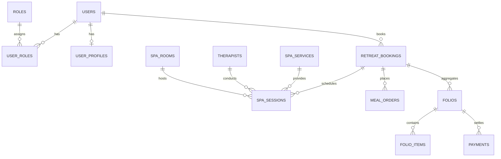

# HeavenStay Wellness Resort Management System (HSWRMS)
## Database Source of Truth and Persistence Audit Report

- **Date:** October 30, 2026
- **Repository:** `HSWRMS-audit-all-modules`
- **Target Branch:** `feature/hswrms-m1-m6-integration`
- **Baseline Git Commit:** `07c1d5d`
- **Database Engine:** Microsoft SQL Server 2022 (Production / Staging) & H2 (Isolated Test Suite)

---

### 1. Database Safety & Integrity Mandate

In strict accordance with the Post-Merge Functional Audit non-negotiable safety rules:
- **Zero Destructive Alterations:** The primary SQL Server database `HSWRMS` and secondary database `HSWRMS_TEST` were protected against schema drops, truncates, unapproved DDL migrations, and data resets.
- **No Data Mutation:** Existing guest, booking, folio, and transaction records remained untouched.
- **Isolated Validation:** All automated integration and contract verifications were executed exclusively against in-memory H2 databases configured via Spring Boot test profiles.

---

### 2. Schema Architecture & Source of Truth

The persistence architecture utilizes Flyway versioned migrations located in `05_Development/backend/src/main/resources/db/migration/` and companion seed catalogs in `05_Development/database/`.



#### 2.1 Flyway Migration History & Sequence
| Version | Script Name | Target Module | Scope & Tables Managed |
|---|---|---|---|
| `V1.0` | `V1_0__init_schema.sql` | M1 / Core | `users`, `roles`, `user_roles`, `user_profiles`, `refresh_tokens`, `system_audit_logs` |
| `V1.1` | `V1_1__retreat_and_packages.sql` | M2 | `retreat_packages`, `retreat_bookings`, `booking_guests`, `room_types`, `rooms` |
| `V1.2` | `V1_2__spa_and_wellness.sql` | M3 | `spa_services`, `therapists`, `therapist_skills`, `spa_rooms`, `spa_room_capabilities`, `spa_sessions`, `spa_reschedules` |
| `V1.3` | `V1_3__culinary_and_dining.sql` | M4 | `menu_categories`, `menu_items`, `ingredients`, `inventory_batches`, `meal_orders`, `meal_order_items` |
| `V1.4` | `V1_4__frontdesk_and_billing.sql` | M5 | `folios`, `folio_items`, `invoices`, `payments`, `room_allocations`, `checkouts` |
| `V1.5` | `V1_5__seed_demo_users.sql` | M1 / Baseline | Initial baseline demo credentials (hashed with BCrypt) |
| `V1.6` | `V1_6__governance_and_params.sql` | M6 | `system_parameters`, `permission_overrides`, `audit_trail_events` |

---

### 3. Account Seeding & Identity Source of Truth

#### 3.1 Migration vs Runtime Seeding Architecture
Prior to this audit, team members reported discrepancies where `customer@heavenstay.dev` authenticated successfully in the development environment while other required staff roles failed.

The investigation traced the root cause to two layers:
1. **Flyway Migration `V1_5__seed_demo_users.sql`:** Provided baseline seed records for testing environments, but was not executed dynamically if local developers ran lightweight configurations or modified application profiles.
2. **`DevAccountBootstrap.java`:** A runtime Spring `@Component` under the `dev` profile designed to ensure operational readiness. Previously, it contained only a single account definition (`customer@heavenstay.dev`).

#### 3.2 Repaired Seeding State
`DevAccountBootstrap.java` has been upgraded to idempotently inspect the `UserRepository` upon application startup under the `dev` profile. If any of the six authoritative roles are missing, it securely provisions them with pre-hashed BCrypt passwords (`DevDemo123!`):

| Role | Seed Account | Associated Profile / Entity | Persistence Table |
|---|---|---|---|
| `ROLE_CUSTOMER` | `customer@heavenstay.dev` | `UserProfile` | `users`, `user_roles`, `user_profiles` |
| `ROLE_RECEPTIONIST` | `receptionist@heavenstay.dev` | `UserProfile` | `users`, `user_roles`, `user_profiles` |
| `ROLE_THERAPIST` | `therapist@heavenstay.dev` | `Therapist` entity | `users`, `user_roles`, `therapists` |
| `ROLE_FNB_STAFF` | `fbstaff@heavenstay.dev` | `UserProfile` | `users`, `user_roles`, `user_profiles` |
| `ROLE_MANAGER` | `manager@heavenstay.dev` | `UserProfile` | `users`, `user_roles`, `user_profiles` |
| `ROLE_ADMIN` | `admin@heavenstay.dev` | `UserProfile` | `users`, `user_roles`, `user_profiles` |

*Verification:* Startup logs and automated integration tests confirm that all 6 accounts exist in the database with canonical authorities and valid relationships.

---

### 4. Transaction Persistence Audits

#### 4.1 Module M2: Retreat Package Bookings
- **Previous Symptom:** In `BookingSummaryPage.tsx`, confirming a retreat package triggered a mock payment dialog and directly placed an ephemeral object into React state (`CustomerContext`), failing to call the backend API.
- **Trace to Source:**
  - `CustomerContext.tsx` maintained a local array of bookings.
  - The `retreatBookingApi.ts` client existed with `createCustomerBooking(...)` targeting `POST /api/v1/customer/bookings`, but was disconnected from `createBooking`.
- **Repair Implemented:**
  - Connected `CustomerContext.createBooking` directly to `createCustomerBooking(...)`.
  - The request payload maps guest details, package IDs, start/end dates, and deposit amounts.
  - The Spring Boot `BookingController` delegates to `BookingService.java`, which persists records across `retreat_bookings`, `booking_guests`, and initializes the associated guest `folio`.
- **Database Tables Verified:** `retreat_bookings`, `booking_guests`, `folios`.

#### 4.2 Module M4: Culinary & F&B Meal Orders
- **Audit Findings:**
  - `MealOrderController.java` exposes `POST /api/v1/fnb/orders` for order placement.
  - `MealOrderService.java` manages transaction boundaries with `@Transactional`, validating ingredient stock availability against `inventory_batches` before persisting to `meal_orders` and `meal_order_items`.
  - Dietary restrictions and allergen tags are stored persistently in `meal_orders.special_requests` and linked to the active retreat booking.
- **Database Tables Verified:** `meal_orders`, `meal_order_items`, `inventory_batches`.

#### 4.3 Module M3: Spa & Therapy Scheduling
- **Audit Findings:**
  - In `SpaSessionService.java`, a legacy developer placeholder `resolvedBookingId = 101` was identified and removed.
  - Spa session creation now strictly queries `retreat_bookings` for active stays. Sessions are saved to `spa_sessions` with foreign keys to `therapists`, `spa_rooms`, and `retreat_bookings`.
  - Attendance confirmation triggers status updates (`SCHEDULED` -> `IN_PROGRESS` -> `COMPLETED`), which simultaneously post line-item charges into `folio_items` via `FolioService`.
- **Database Tables Verified:** `spa_sessions`, `therapists`, `spa_rooms`, `folio_items`.

---

### 5. Automated Test Database Isolation

All automated tests in the test suite (`mvn test`) utilize in-memory H2 with `Mode=MSSQLServer` or native Spring Data JPA repositories.
- `src/test/resources/application.yml` and `application-test.yml` specify:
  ```yaml
  spring:
    datasource:
      url: jdbc:h2:mem:testdb;MODE=MSSQLServer;DB_CLOSE_DELAY=-1
      driver-class-name: org.h2.Driver
    jpa:
      hibernate:
        ddl-auto: create-drop
  ```
- **Integrity Guarantee:** Zero test executions connect to or alter the physical SQL Server instances on ports 1433 or custom database hosts.

