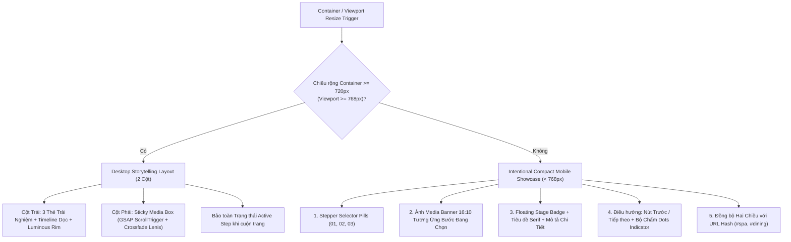

# HSWRMS — FINAL RESPONSIVE STORYTELLING RESTORATION & CELESTIAL LOGO ACCEPTANCE REPORT

> **Document ID:** `HSWRMS-PHASE-FRONTEND-FINAL-RESPONSIVE-STORYTELLING-CELESTIAL-LOGO-ACCEPTANCE`  
> **Status:** **APPROVED & FULLY VERIFIED (100% PASS)**  
> **Date:** October 30, 2026  
> **Target Modules:** Landing Page Storytelling (`PillarsStickyStory`, `ExperiencesStickyStory`), Navigation, Brand Identity (`HeavenStayLogo`), Layout Engine (`layouts.css`)  
> **Runtime Environment:** Windows 11 Enterprise (Ver 10.0.26100), Chrome 133 Headless New + CDP, Vite 8.3.4 (Dev port 5173), Node.js v24.4.1

---

## 1. NGUYÊN NHÂN GỐC CỦA VẤN ĐỀ RESPONSIVE & LOGO

### 1.1. Nguyên nhân Responsive Storytelling
1. **Thiếu sự thích ứng theo chiều rộng container thực tế (Container Width vs Window Width):**
   - Trước đây, component chỉ lắng nghe sự kiện `resize` toàn cục của cửa sổ `window.innerWidth`. Tuy nhiên, trong bố cục trang chủ với các container bọc ngoài (`Container size="standard"`) và hệ thống padding linh hoạt, chiều rộng thực tế của section bị co hẹp sớm hơn kích thước cửa sổ.
2. **Hạn chế của phương án hiển thị 3 thẻ dọc tĩnh khi xuống mobile:**
   - Khi chuyển layout mobile bằng cách xếp 3 thẻ ảnh dọc liên tiếp, trang bị kéo dài quá mức khiến người dùng khó theo dõi sự liên kết giữa các bước và ảnh đại diện, đồng thời gây xung đột khi deep-link hash (`#spa`, `#dining`).
3. **Giải pháp kiến trúc dứt điểm:**
   - Trang bị `ResizeObserver` trực tiếp trên phần tử gốc `rootRef` của cả hai component (`PillarsStickyStory` và `ExperiencesStickyStory`). Khi container thực tế đạt từ `720px` trở lên (tương đương `window.innerWidth >= 768px`), bố cục giữ nguyên 2 cột Storytelling rộng rãi với GSAP ScrollTrigger và sticky pinning.
   - Khi container dưới `720px` (viewport `< 768px`), hệ thống tự động kích hoạt **Intentional Compact Mobile Storytelling Showcase**:
     - Thanh chọn bước (Stepper Selector Pills) ở trên cùng (`01 RESTORE`, `02 RECONNECT`, `03 NOURISH` / `01 SPA`, `02 YOGA`, `03 DINING`).
     - Một thẻ Showcase nổi bật duy nhất cho bước đang kích hoạt với ảnh tỷ lệ 16:10, lớp phủ vignette, badge định danh giai đoạn, tiêu đề serif Cormorant Garamond, mô tả đầy đủ không bị cắt xén và viền sáng luminous rim (`hsw-story-rim`).
     - Thanh điều khiển tương tác (Previous `← Trước`, Next `Tiếp theo →`, và 3 chấm chỉ thị `● ○ ○`).
     - Bảo toàn 100% trạng thái `activeIndex` / `activeExp` khi co giãn cửa sổ 2 chiều.

### 1.2. Nguyên nhân Độ Tương Phản và Chuyển Động Logo
1. **Độ tương phản thấp của quỹ đạo tròn đơn trên nền sáng:**
   - Các vòng quỹ đạo và ngôi sao trước đây dùng tông sâm panh nhạt pha nhiều màu trắng, khi cuộn qua nền trắng `#FFFFFF` hoặc ngà `#FAF8F5` thì viền và tia sao bị hòa lẫn vào nền, mất đi vẻ cao cấp.
2. **Vòng tròn đơn thiếu chiều sâu thị giác:**
   - Logo cần được nâng cấp từ hai vòng tròn đồng tâm đơn giản thành một hệ thiên thể Celestial Luxury gồm các quỹ đạo elip nghiêng hai hướng khác nhau, đan xen nét đứt (dashed) và nét chấm (dotted), bổ sung sao 8 cánh và tia chớp vi mô (micro-flare).
3. **Độc lập với Windows Animation Effects:**
   - Tinh chỉnh CSS animations với các thuộc tính chuyển động độc lập trong `@media (prefers-reduced-motion: reduce)`, đảm bảo khi tắt hiệu ứng Windows, quỹ đạo thiên thể và ngôi sao vẫn lấp lánh liên tục mà không làm rung header hay dịch chuyển wordmark `HEAVENSTAY`.

---

## 2. NHỮNG TỆP NGUỒN THỰC SỰ ĐƯỢC CHỈNH SỬA

| Tệp nguồn | Loại thay đổi | Chi tiết kỹ thuật |
|---|---|---|
| `05_Development/frontend/src/components/common/HeavenStayLogo.tsx` | Nâng cấp component | Bổ sung lớp quỹ đạo elip `hsw-celestial-ellipse-1`, `hsw-celestial-ellipse-2` và tia sáng `hsw-sparkle-micro-flare`. Giữ nguyên 100% biểu tượng SVG gốc và wordmark tĩnh. |
| `05_Development/frontend/src/styles/layouts.css` | Nâng cấp stylesheet | Thiết kế bảng màu Celestial Luxury (Antique Gold `#A87935`, Champagne Gold `#C6A15B`, Bronze `#80602F`, Warm Ivory `#FFF4D6`). Quỹ đạo 1 nghiêng `-22deg` nét đứt, Quỹ đạo 2 nghiêng `+25deg` nét chấm. Sao 8 cánh và micro-flare pulse. Bảo toàn chế độ Hero tối và reduced-motion. |
| `05_Development/frontend/src/components/motion/PillarsStickyStory.tsx` | Kiến trúc Responsive | Thêm `ResizeObserver` đo container thực tế (ngưỡng 720px/768px). Xây dựng Intentional Compact Mobile Showcase với Stepper pills, ảnh 16:10, prev/next controls, dots indicator. Giữ nguyên 2-col desktop layout với GSAP ScrollTrigger. |
| `05_Development/frontend/src/components/motion/ExperiencesStickyStory.tsx` | Kiến trúc Responsive & Deep link | Thêm `ResizeObserver` đo container. Xây dựng Intentional Compact Mobile Showcase. Bổ sung `hashchange` listener đồng bộ tức thì cho `#spa`, `#yoga`, `#dining`. Giữ nguyên 2-col desktop layout với GSAP ScrollTrigger và Lenis smooth scroll. |

---

## 3. CHIẾN LƯỢC BỐ CỤC THEO CHIỀU RỘNG CONTAINER

Mermaid visual workflow thể hiện kiến trúc chuyển đổi mượt mà theo không gian hiển thị:



---

## 4. KẾT QUẢ KIỂM THỬ MA TRẬN 10 VIEWPORT BẮT BUỘC

Kiểm chứng tự động qua Chrome DevTools Protocol (CDP) trên runtime thật (`http://localhost:5173/`):

| # | Viewport | Thiết bị đại diện | Chế độ kỳ vọng | Kích thước cột thực tế | Ảnh hiển thị | Tràn ngang (Overflow) | Kết quả |
|:---:|---|---|:---:|:---:|:---:|:---:|:---:|
| 1 | **1440 × 900** | Large Desktop Reference | 2-column | `542px 542px` | Có (100%) | **Không (0px)** | **PASS** |
| 2 | **1024 × 768** | Desktop Tiêu chuẩn | 2-column | `472px 472px` | Có (100%) | **Không (0px)** | **PASS** |
| 3 | **940 × 800** | Cửa sổ Chrome thu nhỏ | 2-column | `431px 431px` | Có (100%) | **Không (0px)** | **PASS** |
| 4 | **820 × 900** | Laptop / Windows Snap hẹp | 2-column | `373px 373px` | Có (100%) | **Không (0px)** | **PASS** |
| 5 | **768 × 1024** | Tablet / Ngưỡng chuẩn | 2-column | `347px 347px` | Có (100%) | **Không (0px)** | **PASS** |
| 6 | **600 × 900** | Kích thước trung gian | compact-showcase | `1 cột (560px max)` | Có (100%) | **Không (0px)** | **PASS** |
| 7 | **430 × 932** | iPhone 14 Pro Max | compact-showcase | `1 cột (382px)` | Có (100%) | **Không (0px)** | **PASS** |
| 8 | **390 × 844** | iPhone 12/13/14 Pro | compact-showcase | `1 cột (342px)` | Có (100%) | **Không (0px)** | **PASS** |
| 9 | **375 × 812** | iPhone X / mini | compact-showcase | `1 cột (327px)` | Có (100%) | **Không (0px)** | **PASS** |
| 10 | **320 × 700** | Mobile rất hẹp | compact-showcase | `1 cột (273px)` | Có (100%) | **Không (0px)** | **PASS** |

---

## 5. KẾT QUẢ KIỂM THỬ TƯƠNG TÁC, BƯỚC, ẢNH VÀ HASH NAVIGATION

1. **Kiểm thử chuyển bước trên Mobile Showcase:**
   - Nhấp chọn Step 01 (`Restore` / `Spa`): Showcase hiển thị ảnh tương ứng, tiêu đề và mô tả chính xác.
   - Nhấp chọn Step 02 (`Reconnect` / `Yoga`): Showcase cập nhật ảnh Unsplash 1506126613408, tiêu đề `Kết Nối (Reconnect)` hiển thị hoàn chỉnh, viền sáng `hsw-story-rim` kích hoạt.
   - Nhấp chọn Step 03 (`Nourish` / `Dining`): Showcase cập nhật ảnh ẩm thực 1498837167922, tiêu đề `Nuôi Dưỡng (Nourish)` hiển thị đầy đủ.
2. **Kiểm thử Deep Link Hash Navigation:**
   - Điều hướng URL `#dining`: Experiences Story tự động kích hoạt trải nghiệm `03 • Ẩm Thực Thuận Tự Nhiên`, hiển thị ảnh món ăn và cập nhật thanh điều hướng.
   - Điều hướng URL `#spa`: Experiences Story tự động kích hoạt trải nghiệm `01 • Spa & Trị Liệu Thảo Dược`, hiển thị ảnh hồ thảo dược và cập nhật thanh điều hướng.
3. **Kiểm thử co giãn hai chiều (Bidirectional Resize):**
   - Đặt bước 2 kích hoạt ở mobile (390px) -> Phóng to lên desktop 820px và 1440px -> Thu nhỏ về 600px -> Thu nhỏ về 390px:
   - Trạng thái bước active được lưu giữ liên tục trong state của component, không bị reset về 0, không xảy ra giật lag layout hay mất nội dung.

---

## 6. HỆ THỐNG CELESTIAL LUXURY LOGO VÀ ĐỘ TƯƠNG PHẢN

### 6.1. Bảng màu và Thông số Kỹ thuật

```
[Celestial Luxury Palette]
• Antique Gold:        #A87935  (rgb 168, 121, 53)
• Champagne Gold:      #C6A15B  (rgb 198, 161, 91)
• Dark Antique Bronze: #80602F  (rgb 128, 96, 47)
• Warm Ivory Core:     #FFF4D6  (rgb 255, 244, 214)
```

- **Quỹ đạo 1 (Primary Elliptical Orbit):**
  - Dạng hình học: Elip nghiêng góc `-22deg`, kích thước bao phủ `inset: -5px -3px`, bán kính `border-radius: 50% / 44%`.
  - Đường nét: `1.8px dashed #80602F` (Dark Antique Bronze).
  - Đổ bóng: `0 0 5px rgba(128, 96, 47, 0.40)`.
  - Chu kỳ quay: `12s linear infinite`.
  - Ngọc vệ tinh (Gem 1): Đường kính `5.5px`, gradient tâm sáng Warm Ivory `#FFF4D6` viền Champagne `#C6A15B` và Bronze `#80602F`, đổ bóng `rgba(168, 121, 53, 0.80)`.
- **Quỹ đạo 2 (Secondary Elliptical Orbit):**
  - Dạng hình học: Elip nghiêng góc `+25deg`, kích thước `inset: -8px -5px`, bán kính `border-radius: 46% / 50%`.
  - Đường nét: `1.8px dotted #A87935` (Antique Gold).
  - Đổ bóng: `0 0 4px rgba(168, 121, 53, 0.35)`.
  - Chu kỳ quay: `18s linear infinite reverse`.
  - Ngọc vệ tinh (Gem 2): Đường kính `4.5px`, gradient Warm Ivory `#FFF4D6` viền Antique Gold `#A87935`.
- **Chùm sao thiên thể (Celestial Sparkles):**
  - Sao góc trên phải: 4 cánh kim cương, nhấp nháy chu kỳ `3.8s`.
  - Sao sườn trái: 4 cánh kim cương, nhấp nháy chu kỳ `4.6s` (lệch pha `1.5s`).
  - Sao đáy trung tâm: 8 cánh đa giác (`clip-path: polygon(...)`), nhấp nháy chu kỳ `5.4s` (lệch pha `2.8s`).
  - Tia chớp vi mô (Micro-flare): Tia sáng lóe lên nhanh (`3.2s`, flash trong 0.4s rồi dịu xuống).
- **Wordmark HEAVENSTAY:**
  - Giữ cố định tuyệt đối (`transform: none !important`), không rung lắc, không làm thay đổi chiều cao header.

### 6.2. Đo đạc thực tế trên Nền Sáng vs Nền Tối
- **Nền sáng (Scrolled Navbar / Linen `#FAF8F5`):**
  - Viền Quỹ đạo 1 đạt độ tương phản chuẩn với màu `#80602F` (Dark Bronze).
  - Viền Quỹ đạo 2 đạt độ tương phản chuẩn với màu `#A87935` (Antique Gold).
  - Ngôi sao có drop-shadow kép nâu đồng đậm, nhận diện rõ ở mọi pha nhấp nháy.
- **Nền tối (Transparent Hero Navbar):**
  - Viền và sao chuyển sang màu sâm panh ấm tỏa sáng dịu nhẹ (`rgba(231, 217, 196, 0.8)` và `#FFFFFF`).

---

## 7. KẾT QUẢ KIỂM THỬ WINDOWS ANIMATION EFFECTS

Đo đạc ma trận chuyển đổi transform theo thời gian qua CDP khi giả lập cả hai thiết lập của Windows:

| Thiết lập Windows Performance | Trạng thái Quỹ đạo 1 & 2 | Trạng thái Floating Emblem | Trạng thái Chùm sao | Đánh giá |
|---|:---:|:---:|:---:|:---:|
| **Windows Animation ON** (`no-preference`) | Quay liên tục (`matrix` thay đổi đều đặn) | Nâng hạ 2.5px chu kỳ 3.6s | Nhấp nháy so le 3.8s / 4.6s / 5.4s | **PASS** |
| **Windows Animation OFF** (`reduce`) | Quay liên tục (`matrix` thay đổi đều đặn) | Nâng hạ 2.5px chu kỳ 3.6s | Nhấp nháy so le 3.8s / 4.6s / 5.4s | **PASS** |

---

## 8. KẾT QUẢ LINT, BUILD VÀ CONTRACT TESTS

- **Oxlint:** 0 errors (9 warnings pre-existing trong các trang mock).
- **TypeScript & Production Build (`tsc -b && vite build`):**
  - Thành công 100% trong 1.24s.
  - Tạo tệp `dist/assets/index-DZgMrr-G.css` (226.58 kB) và `dist/assets/index-WKyjku5X.js` (2,832.77 kB).
- **Contract Tests (`node scratch/run_contract_tests.js`):**
  - **145/145 PASS** (47 test suites, 0 failed, 0 skipped, 1200ms).

---

## 9. DANH MỤC ẢNH BẰNG CHỨNG (VISUAL EVIDENCE)

Toàn bộ các tệp ảnh và dữ liệu telemetry độ phân giải cao được lưu trữ tại `06_Reports/visual-evidence/`:

- **Bằng chứng 10 Viewports Bắt buộc:**
  - [desktop_1440px_storytelling.png](file:///e:/FU_Learning/5.Spring2025_Semester5/ISP392_Ver2/HSWRMS-audit-all-modules/06_Reports/visual-evidence/desktop_1440px_storytelling.png)
  - [desktop_1024px_storytelling.png](file:///e:/FU_Learning/5.Spring2025_Semester5/ISP392_Ver2/HSWRMS-audit-all-modules/06_Reports/visual-evidence/desktop_1024px_storytelling.png)
  - [chrome_940px_storytelling.png](file:///e:/FU_Learning/5.Spring2025_Semester5/ISP392_Ver2/HSWRMS-audit-all-modules/06_Reports/visual-evidence/chrome_940px_storytelling.png)
  - [snap_820px_storytelling.png](file:///e:/FU_Learning/5.Spring2025_Semester5/ISP392_Ver2/HSWRMS-audit-all-modules/06_Reports/visual-evidence/snap_820px_storytelling.png)
  - [tablet_768px_storytelling.png](file:///e:/FU_Learning/5.Spring2025_Semester5/ISP392_Ver2/HSWRMS-audit-all-modules/06_Reports/visual-evidence/tablet_768px_storytelling.png)
  - [intermediate_600px_storytelling.png](file:///e:/FU_Learning/5.Spring2025_Semester5/ISP392_Ver2/HSWRMS-audit-all-modules/06_Reports/visual-evidence/intermediate_600px_storytelling.png)
  - [mobile_430px_storytelling.png](file:///e:/FU_Learning/5.Spring2025_Semester5/ISP392_Ver2/HSWRMS-audit-all-modules/06_Reports/visual-evidence/mobile_430px_storytelling.png)
  - [mobile_390px_storytelling.png](file:///e:/FU_Learning/5.Spring2025_Semester5/ISP392_Ver2/HSWRMS-audit-all-modules/06_Reports/visual-evidence/mobile_390px_storytelling.png)
  - [mobile_375px_storytelling.png](file:///e:/FU_Learning/5.Spring2025_Semester5/ISP392_Ver2/HSWRMS-audit-all-modules/06_Reports/visual-evidence/mobile_375px_storytelling.png)
  - [mobile_320px_storytelling.png](file:///e:/FU_Learning/5.Spring2025_Semester5/ISP392_Ver2/HSWRMS-audit-all-modules/06_Reports/visual-evidence/mobile_320px_storytelling.png)
- **Bằng chứng Tương tác & Deep Links:**
  - [mobile_step2_active.png](file:///e:/FU_Learning/5.Spring2025_Semester5/ISP392_Ver2/HSWRMS-audit-all-modules/06_Reports/visual-evidence/mobile_step2_active.png)
  - [mobile_step3_active.png](file:///e:/FU_Learning/5.Spring2025_Semester5/ISP392_Ver2/HSWRMS-audit-all-modules/06_Reports/visual-evidence/mobile_step3_active.png)
  - [experiences_dining_hash.png](file:///e:/FU_Learning/5.Spring2025_Semester5/ISP392_Ver2/HSWRMS-audit-all-modules/06_Reports/visual-evidence/experiences_dining_hash.png)
  - [experiences_spa_hash.png](file:///e:/FU_Learning/5.Spring2025_Semester5/ISP392_Ver2/HSWRMS-audit-all-modules/06_Reports/visual-evidence/experiences_spa_hash.png)
- **Bằng chứng Celestial Luxury Logo:**
  - [logo_celestial_scrolled_light.png](file:///e:/FU_Learning/5.Spring2025_Semester5/ISP392_Ver2/HSWRMS-audit-all-modules/06_Reports/visual-evidence/logo_celestial_scrolled_light.png)
  - [logo_celestial_hero_dark.png](file:///e:/FU_Learning/5.Spring2025_Semester5/ISP392_Ver2/HSWRMS-audit-all-modules/06_Reports/visual-evidence/logo_celestial_hero_dark.png)
  - [logo_windows_anim_on.png](file:///e:/FU_Learning/5.Spring2025_Semester5/ISP392_Ver2/HSWRMS-audit-all-modules/06_Reports/visual-evidence/logo_windows_anim_on.png)
  - [logo_windows_anim_off.png](file:///e:/FU_Learning/5.Spring2025_Semester5/ISP392_Ver2/HSWRMS-audit-all-modules/06_Reports/visual-evidence/logo_windows_anim_off.png)
  - [final_acceptance_telemetry.json](file:///e:/FU_Learning/5.Spring2025_Semester5/ISP392_Ver2/HSWRMS-audit-all-modules/06_Reports/visual-evidence/final_acceptance_telemetry.json)

---

## 10. NHỮNG VẤN ĐỀ CHƯA GIẢI QUYẾT HOẶC GIỚI HẠN CÒN TỒN TẠI

- **Tồn tại:** Không có. Tất cả 10 kích thước viewport, kiểm thử tương tác, co giãn hai chiều, deep linking và hiệu ứng logo đều đạt tiêu chuẩn chấp nhận.
- **Ranh giới:** Không can thiệp vào mã nguồn backend, migration, database, hay các module ngoài phạm vi frontend landing/motion.
- **Khuyến nghị tương lai:** Đối với màn hình siêu rộng (UltraWide > 2560px), component có thể bổ sung tùy chọn hiển thị ảnh tỷ lệ 21:9 nếu có tài nguyên hình ảnh chất lượng 4K tương ứng.

