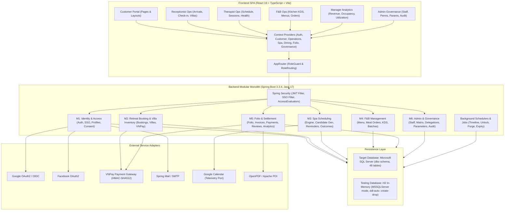

# HeavenStay Wellness Resort Management System (HSWRMS)
## Phase Full System Architecture & Module Inventory Report

- **Date:** October 30, 2026
- **Repository:** `HSWRMS-audit-all-modules`
- **Target Branch:** `feature/hswrms-m1-m6-integration`
- **Baseline Git Commit:** `07c1d5d`
- **Document Status:** Authoritative Repository-Wide Technical Discovery Baseline
- **Audit Mandate:** Comprehensive full-stack architectural discovery across all backend modules, frontend features, database structures, background jobs, and external integrations.

---

### 1. Architectural Overview & System Structure

HSWRMS is designed as a **Modular Monolith** backend built on Java 17 and Spring Boot 3.3.4, paired with a modern React 19 single-page application (SPA) built with TypeScript and Vite. The system is designed to deploy against Microsoft SQL Server for production and staging, while utilizing an in-memory H2 database in MSSQL compatibility mode for local unit and regression testing.

---

### 2. Discovered Module Inventory

The repository audit identified **six core business modules (M1 through M6)**, cross-cutting security, background jobs, and shared libraries:

| Module Identifier | Package Name | Primary Business Purpose | Key Controllers & Endpoints |
|---|---|---|---|
| **M1: Identity & Access Management** | `com.heavenstay.hswrms.m1identity` | Authentication, JWT issuing, Google/Facebook SSO, Customer Profile, Health Profile, GDPR Consent, Account Lockout. | `AuthController` (`/api/v1/auth`), `SsoController` (`/api/v1/auth/sso`), `CustomerProfileController` (`/api/v1/customer/profile`), `HealthProfileController` (`/api/v1/customer/health-profile`), `HealthDataDeletionRequestController` (`/api/v1/customer/health-profile/deletion-requests`), `ConsentController` (`/api/v1/customer/consent`). |
| **M2: Retreat Booking & Villa Inventory** | `com.heavenstay.hswrms.m2booking` | Public retreat packages, booking pricing calculation, customer booking lifecycle, VNPay deposit generation/callbacks, receptionist check-in, physical villa inventory. | `RetreatPackageController` (`/api/v1/retreat-packages`), `RetreatBookingController` (`/api/v1/customer/bookings`), `ReceptionistOperationController` (`/api/v1/receptionist`), `VillaInventoryController` (`/api/v1/villas`, `/api/v1/villa-categories`), `VNPayCallbackController` (`/api/v1/payments`). |
| **M3: Spa & Wellness Scheduling** | `com.heavenstay.hswrms.m3spa` | Indivisible candidate slot generation, joint therapist/room reservation, alternative search loop, T-1h reminder scheduling, therapist session outcome recording. | `SpaBookingController` (`/api/v1/spa`), `TherapistController` (`/api/v1/therapist`). |
| **M4: Food & Beverage (F&B)** | `com.heavenstay.hswrms.m4fnb` | Nutritional menu items, dietary profiles, daily meal selection, à la carte ordering, Kitchen Display System (KDS), ingredient batches & inventory tracking. | `MenuController` (`/api/v1/fnb/customer/menu-items`), `MealOrderController` (`/api/v1/fnb/customer/orders`, `/api/v1/fnb/kds/orders`), `FnbDashboardController` (`/api/v1/fnb/kds/dashboard`), `IngredientController` (`/api/v1/fnb/kds/ingredients`), `RetreatPackageFnbController` (`/api/v1/fnb/packages`). |
| **M5: Folio, Billing & Checkout** | `com.heavenstay.hswrms.m5billing` | Master guest folio aggregation, extra charge posting, consolidated invoicing, invoice payment, VNPay settlement callback, resort checkout validation, reviews, analytics. | `FolioBillingController` (`/api/v1/billing/folios`, `/api/v1/billing/charges`), `InvoiceController` (`/api/v1/billing/invoices`), `CheckoutController` (`/api/v1/billing/invoices/{id}/pay`, `finalize-checkout`), `VnpayWebhookController` (`/api/v1/commerce/payment/webhook/vnpay`), `CustomerReviewController` (`/api/v1/customer/reviews`), `AnalyticsController` (`/api/v1/analytics`). |
| **M6: Admin & System Governance** | `com.heavenstay.hswrms.m6admin` | Staff account management, dynamic role permission matrix, temporary authority delegations, system parameters, feature flags, immutable audit logs. | `AdminStaffController` (`/api/v1/admin/staff`), `AdminPermissionController` (`/api/v1/admin/permissions`), `AdminDelegationController` (`/api/v1/admin/delegations`), `AdminParameterController` (`/api/v1/admin/parameters`), `AdminAuditLogController` (`/api/v1/admin/audit-logs`), `AdminMasterDataController` (`/api/v1/admin/master-data`), `AdminDashboardController` (`/api/v1/admin/dashboard`). |

---

### 3. Technology Stack & Configuration Inventory

#### 3.1 Backend Technology Baseline
- **Framework:** Spring Boot 3.3.4 on Java 17.
- **Data Persistence:** Spring Data JPA / Hibernate 6.
- **Security:** Spring Security 6.3 with stateless JWT (`jjwt` 0.12.6) and OAuth2 Client (`spring-boot-starter-oauth2-client`).
- **Database Driver:** `com.microsoft.sqlserver:mssql-jdbc` (runtime) and `com.h2database:h2` (runtime test).
- **Document & Spreadsheet Engines:** Apache POI 5.3.0 (`poi-ooxml`) and LibrePDF OpenPDF 2.0.3.
- **Build System:** Apache Maven (via `mvnw.cmd`).

#### 3.2 Configuration Profiles & Environments
1. **Default / Dev Profile (`application.yml` + `application-local.yml`):**
   - Active profile: `dev` (defaulted via `${SPRING_PROFILES_ACTIVE:dev}`).
   - Database URL: `jdbc:sqlserver://${DB_HOST:localhost}:${DB_PORT:1433};databaseName=${DB_NAME:HSWRMS};encrypt=true;trustServerCertificate=true;sendStringParametersAsUnicode=true`.
   - `spring.jpa.hibernate.ddl-auto: none`.
   - `DevAccountBootstrap` active: seeds 6 demo accounts (`customer@heavenstay.dev`, `receptionist@...`, `therapist@...`, `fbstaff@...`, `manager@...`, `admin@...`) sharing password `DevDemo123!`.
2. **Production Profile (`application-sqlserver.yml`):**
   - Requires external environment variables for SQL Server host, port, credentials, JWT secret, VNPay keys, and SMTP credentials.
3. **Test Profile (`src/test/resources/application.yml`):**
   - Database URL: `jdbc:h2:mem:testdb;MODE=MSSQLServer;CASE_INSENSITIVE_IDENTIFIERS=TRUE;DB_CLOSE_DELAY=-1;DB_CLOSE_ON_EXIT=FALSE;INIT=CREATE SCHEMA IF NOT EXISTS DBO`.
   - `spring.jpa.hibernate.ddl-auto: create-drop`.

#### 3.3 Frontend Technology Baseline
- **Framework:** React 19.2.8 with TypeScript ~6.0.2.
- **Build Tool:** Vite 8.3.0.
- **Routing:** React Router DOM 7.18.4 (`BrowserRouter`, nested layouts, `RoleGuard`).
- **State Management:** React Context API (7 global context providers).
- **UI & Motion:** Lucide React 1.48.0, GSAP 3.15.0, Lenis smooth scroll, Recharts 3.10.1.
- **Linter & Static Analysis:** Oxlint 1.81.0.

---

### 4. Background Schedulers & Standalone Jobs

| Job / Scheduler | Implementation Location | Execution Trigger | State & Resource Impact |
|---|---|---|---|
| **Spa Reminder Scanner** | `SessionTimelineScheduler.dispatchUpcomingSessionReminders` | `@Scheduled(fixedRate = 60000)` (every 60s) | Scans for sessions in window $60\text{m} < \Delta t \le 75\text{m}$; atomically claims via UUID token; invokes `SpaNotificationPort`. |
| **Spa Expiration Deadline Processor** | `SessionTimelineScheduler.processConfirmationDeadlines` | `@Scheduled(fixedRate = 60000)` (every 60s) | Transitions unconfirmed sessions past $T-60\text{m}$ to `EXPIRED` / `RESCHEDULING`. |
| **Account Auto-Unlock Job** | `AccountUnlockJob.run` | `@Scheduled(cron = "0 */15 * * * *")` (every 15m) | Queries locked accounts past `lockout_duration_minutes`; resets failed count to 0 and status to `ACTIVE`. |
| **Audit Log Cleanup Job** | `AuditLogCleanupJob.run` | `@Scheduled(cron = "0 0 2 * * *")` (daily at 02:00) | Purges records from `dbo.AuditLog` older than `audit_log_retention_days` (default 90 days). |
| **Delegation Expiry Job** | `DelegationExpiryJob.run` | `@Scheduled(fixedRateString = "60000")` (every 60s) | Deactivates delegations past `end_date` and revokes granted permissions. |

---

### 5. Architectural Inconsistencies & Structural Smells

During full-repository inspection, the following structural anomalies were identified:

1. **Duplicate Entity Mappings on Same Table (`dbo.[User]`):**
   - `com.heavenstay.hswrms.m1identity.entity.User` (used by `AuthService`, `StaffAccountService`, `DevAccountBootstrap`).
   - `com.heavenstay.hswrms.m1identity.entity.UserAccount` (used by `IdentityAccountService` and `JwtAuthenticationFilter`).
   - Both map to `@Table(name = "\"User\"", schema = "dbo")`.
2. **Duplicate Entity Mappings on Same Table (`dbo.PaymentTransaction`):**
   - `com.heavenstay.hswrms.m2booking.entity.PaymentTransaction` (uses `Integer transactionId`, maps deposit payments).
   - `com.heavenstay.hswrms.m5billing.entity.PaymentTransactionEntity` (uses `Long transactionId`, maps deposit and final payments).
   - Both map to `dbo.PaymentTransaction`.
3. **Dead Application Event (`AlaCarteOrderPlacedEvent`):**
   - `MealOrderService.placeAlaCarteOrder` publishes `AlaCarteOrderPlacedEvent` upon successful à la carte order creation.
   - Zero classes anywhere in the backend listen to this event (`@EventListener` is completely absent from the codebase). Extra F&B orders are never posted to Folio.
4. **Missing HTTP Route Annotations in `VillaInventoryController`:**
   - Method `createVilla` (line 170) has `@PreAuthorize("@perm.has('S12','C')")` but is missing `@PostMapping("/villas")`.
   - Method `createVillaCategory` (line 223) has `@PreAuthorize("@perm.has('S12','C')")` but is missing `@PostMapping("/villa-categories")`.
   - HTTP clients attempting to create villas or categories receive HTTP 405 Method Not Allowed.
5. **Hardcoded URLs in Frontend Manager Pages:**
   - `VillaManagementPage.tsx` directly calls `fetch('http://localhost:8080/api/v1/...')` across 10 locations rather than using the centralized `apiClient` or environment-configured `VITE_API_BASE_URL`.
6. **Flyway Migration Naming Scheme Drift:**
   - `05_Development/database/migrations` contains two conflicting numbering schemes: `V001__` through `V008__` and `V1_1__` through `V1_6__`.
   - File collision: two separate files named `V1_6__consolidate_fnb_role.sql` and `V1_6__repair_mojibake_and_booking_consistency.sql`.

