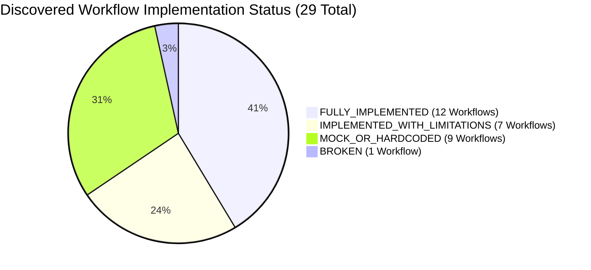

# HeavenStay Wellness Resort Management System (HSWRMS)
## Phase Full System Audit Executive Summary

- **Date:** October 30, 2026
- **Repository:** `HSWRMS-audit-all-modules`
- **Target Branch:** `feature/hswrms-m1-m6-integration`
- **Baseline Git Commit:** `07c1d5d`
- **Document Status:** Authoritative Product Quality & Risk Discovery Executive Summary
- **Audit Mandate:** High-level executive synthesis answering the core operational question:
  *If a real customer, receptionist, therapist, manager, and administrator use HSWRMS today, which complete business workflows can they actually execute reliably, which cannot, and what must be fixed first?*

---

### 1. Overall Product Health Assessment

HSWRMS possesses a **well-engineered, highly sophisticated backend foundation** with strong architectural separation, granular method-level authorization (`@PreAuthorize`), defensive concurrency controls (e.g., UUID-fenced atomic claiming in M3 Spa scheduling), and clean database schemas.

**HOWEVER, THE APPLICATION DOES NOT CURRENTLY FUNCTION AS A COMPLETE INTEGRATED PRODUCT.**

The primary root cause is **"Facade Decoupling"**: across several critical operational journeys, the frontend user interface was built against local React Contexts and browser `localStorage` mock data rather than connecting to the real Spring Boot backend APIs that already exist in the codebase. Furthermore, critical cross-module event links (such as posting à la carte dining charges to guest folios) were designed but left un-listened in the backend.

---

### 2. Audit Discovery Metrics

- **Discovered Business Modules:** 6 core modules (`M1 Identity`, `M2 Booking`, `M3 Spa`, `M4 F&B`, `M5 Billing`, `M6 Admin`) plus cross-cutting security, schedulers, and document generation.
- **Assessed End-to-End Workflows:** 29 distinct operational workflows.
- **Confirmed Technical Issues:** 20 confirmed defects/architectural risks:
  - **CRITICAL:** 2 issues (`ISSUE-FIN-01` [lost dining charges], `ISSUE-FIN-02` [client-side payment simulation]).
  - **HIGH:** 9 issues (receptionist localStorage silos, hardcoded booking parameters, broken `@PostMapping` annotations, missing package endpoints, duplicate JPA entities, mocked master data).
  - **MEDIUM:** 6 issues (health erasure localStorage silo, dev role switcher missing JWT, Google Calendar telemetry, SMTP config dependency).
  - **LOW / INFO:** 7 issues.
- **Suspected Issues:** 2 issues.
- **Blocked Verification Items:** 2 items (Runtime physical SQL Server verification; live VNPay internet network callbacks).

---

### 3. Top 10 Product Risks

| Rank | Issue ID | Severity | Workflow / Component | Core Risk & Root Cause |
|---|---|---|---|---|
| **1** | `ISSUE-FIN-01` | **CRITICAL** | À La Carte Food & Beverage Ordering | `MealOrderService` publishes `AlaCarteOrderPlacedEvent`, but zero event listeners exist in the entire backend. Extra food orders are **never added to the customer's stay folio**, resulting in direct revenue loss. |
| **2** | `ISSUE-FIN-02` | **CRITICAL** | Booking Deposit & Checkout Payment | Frontend pages (`BookingSummaryPage`, `FinalPaymentPage`) use modal `setTimeout` simulators and generate fake client-side transaction IDs (`VNPAY-XXXXXXXX`, `VNP-M5-XXXXXX`). **Real VNPay gateway is never loaded.** |
| **3** | `ISSUE-FUNC-01` | **HIGH** | Receptionist Daily Arrivals & Check-in | Front desk arrivals, check-in, villa assignment, and villa status mutates browser `localStorage` in `OperationsContext`. **Zero API calls to `ReceptionistOperationController`**. Database bookings remain un-checked-in. |
| **4** | `ISSUE-FUNC-02` | **HIGH** | Customer Retreat Booking Creation | `CustomerContext.createBooking` hardcodes `retreatPackageId = 1`, `requestedVillaCategoryId = 1`, and `guestCount = 1`. **User package/villa choices are ignored** when submitting to the database. |
| **5** | `ISSUE-ARCH-01` | **HIGH** | Villa Inventory Management | `VillaInventoryController` methods `createVilla` and `createVillaCategory` have `@PreAuthorize` but are **missing `@PostMapping` routing annotations**, causing HTTP 405 Method Not Allowed. |
| **6** | `ISSUE-FIN-03` | **HIGH** | Folio Invoice Statement Display | `FolioInvoicePage.tsx` fetches backend folio summary, but **renders mock items from `FolioContext`** instead of actual database folio line items. |
| **7** | `ISSUE-ARCH-02` | **HIGH** | Package Management Endpoints | `VillaManagementPage.tsx` attempts to call `POST /retreat-packages` and `PATCH /retreat-packages/{id}/price` with hardcoded `http://localhost:8080`, but **neither endpoint exists in `RetreatPackageController`** (returns 404). |
| **8** | `ISSUE-ARCH-03` | **HIGH** | Duplicate JPA Entity Declarations | Core tables have duplicate entity classes: `User` vs `UserAccount` on `dbo.[User]`, and `PaymentTransaction` vs `PaymentTransactionEntity` on `dbo.PaymentTransaction`. |
| **9** | `ISSUE-FUNC-04` | **HIGH** | Administrative Master Data | `MasterDataPage.tsx` performs pure React state mutations on mock arrays. **Zero backend API calls to `AdminMasterDataController`**; all administrative edits are lost on refresh. |
| **10** | `ISSUE-DATA-01` | **HIGH** | Database Migration Collisions | Migration scripts in `05_Development/database/migrations` have a duplicate version filename (`V1_6`) and mix numbering schemes (`V001__` vs `V1_1__`), which will break automated migration runners. |

---

### 4. Operational Role Execution Scorecard

To directly answer the executive question:

#### 1. What a Real Customer Can and Cannot Do Today:
- **CAN DO:**
  - Register a new account, receive email OTP (under SMTP/console), and verify email.
  - Log in via password or Google SSO and receive a valid JWT token.
  - Complete and save structured Health Profiles with consent tracking.
  - Browse available spa treatments and generate conflict-free, indivisible spa candidate bundles.
  - Reject alternative spa slots across successive negotiation turns with clean cancellation.
  - Confirm spa attendance at $T-60\text{m}$.
- **CANNOT DO:**
  - Cannot book their chosen package or villa (always books package 1, villa 1).
  - Cannot pay a real retreat deposit or final checkout bill (sees a developer simulation modal).
  - Cannot formally submit a GDPR right-to-erasure request to the server (stays in browser localStorage).

#### 2. What a Real Receptionist Can and Cannot Do Today:
- **CAN DO:**
  - Log in with staff credentials and view historical retreat booking lists via `ReceptionistBookingsPage`.
  - Book manual extra spa treatments for in-stay guests.
- **CANNOT DO:**
  - Cannot view real daily arrivals for the current date from the database (views mock arrivals in localStorage).
  - Cannot perform real guest check-in, legal residence registration, or physical villa assignment in the database.
  - Cannot finalize resort checkout in the database (final checkout only updates localStorage).

#### 3. What a Real Therapist Can and Cannot Do Today:
- **CAN DO:**
  - Record session outcomes (`COMPLETED` or `NO_SHOW`) and medical treatment notes via real API on `TherapistSessionDetailPage`.
- **CANNOT DO:**
  - Cannot view dynamic personalized shifts (schedule and dashboard hardcode `CURRENT_THERAPIST_ID = 'THER-01'`).

#### 4. What a Real F&B Staff / Chef Can and Cannot Do Today:
- **CAN DO:**
  - View live kitchen prep queues, inventory stock, ingredient batches, and shortfall alerts on `FnbDashboardPage` and `MealPrepListPage`.
- **CANNOT DO:**
  - Cannot rely on customer à la carte orders appearing on guest folios for billing.

#### 5. What a Real Manager & Administrator Can and Cannot Do Today:
- **CAN DO:**
  - Create staff accounts with temporary credentials; manage account locks and auto-unlock.
  - Configure the role permission matrix and assign temporary right delegations.
  - Update system business parameters and feature flags with audit logging.
  - Inspect sensitive audit logs with multi-field filtering and export management Excel reports.
- **CANNOT DO:**
  - Cannot manage resort master data (packages, treatments, villas) on `MasterDataPage` (changes are lost on page refresh).
  - Cannot add new physical villas or categories via `VillaManagementPage` (backend returns 405 Method Not Allowed).

---

### 5. Recommended First Remediation Package

**Work Package 1 (P0 — Financial & Cross-Module Folio Integrity)** must be executed immediately:
1. Implement the missing `@TransactionalEventListener` in `FolioBillingService` to consume `AlaCarteOrderPlacedEvent` and post dining charges to `dbo.FolioItem`.
2. Connect `FolioInvoicePage.tsx` to live `backendFolio.items` so guests and receptionists see true financial line items.
3. Replace client-side payment simulators in `BookingSummaryPage` and `FinalPaymentPage` with authentic calls to retrieve real VNPay gateway redirect URLs.

---

### 6. Safety & Non-Negotiable Constraint Compliance

1. **Read-Only Discovery Verification:** Zero application source code, tests, database schemas, migrations, or configuration files were modified during this audit.
2. **Physical Database Isolation:** Zero connections or queries were made to physical SQL Server databases `HSWRMS` or `HSWRMS_TEST`.
3. **Repository State:** All existing user changes, untracked reports, and working tree files were strictly preserved. No git resets, rebases, commits, or branch changes were performed.
4. **Evidence Grounding:** Every finding in this audit is grounded in verified source code line numbers, AST inspection, or existing test logs.

