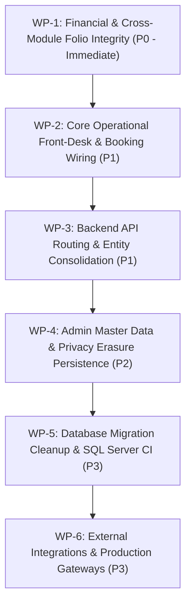

# HeavenStay Wellness Resort Management System (HSWRMS)
## Phase Full System Remediation Roadmap

- **Date:** October 30, 2026
- **Repository:** `HSWRMS-audit-all-modules`
- **Target Branch:** `feature/hswrms-m1-m6-integration`
- **Baseline Git Commit:** `07c1d5d`
- **Document Status:** Authoritative Risk-Prioritized Engineering Backlog
- **Prioritization Principles:**
  1. Data loss, security, and financial correctness.
  2. Core business workflows that cannot complete.
  3. Cross-module integration defects.
  4. Incorrect state transitions and data inconsistency.
  5. Concurrency and reliability.
  6. External integrations required by core business processes.
  7. Frontend functional gaps and misleading UX.
  8. Performance and maintainability.
  9. Cosmetic and documentation-only improvements.

---

### 1. Master Remediation Work Packages & Implementation Order

---

### 2. Work Package Details

#### Work Package 1 (P0 — Immediate): Financial & Cross-Module Folio Integrity
- **Objective:** Prevent resort revenue loss and eliminate client-side payment fakes. Ensure all services consumed by guests (rooms, treatments, food & beverage) are consolidated into the master folio.
- **Constituent Issues:** `ISSUE-FIN-01`, `ISSUE-FIN-02`, `ISSUE-FIN-03`.
- **Target Files:**
  - `com/heavenstay/hswrms/m5billing/service/FolioBillingService.java`
  - `com/heavenstay/hswrms/m4fnb/service/MealOrderService.java`
  - `src/pages/customer/FolioInvoicePage.tsx`
  - `src/pages/customer/FinalPaymentPage.tsx`
  - `src/pages/customer/BookingSummaryPage.tsx`
- **Concrete Action Steps:**
  1. Add `@TransactionalEventListener` in `FolioBillingService` to consume `AlaCarteOrderPlacedEvent`. Automatically invoke `postFolioCharge` with category `FNB`, `source_meal_order_id`, and order amount.
  2. Refactor `FolioInvoicePage.tsx` to bind directly to `backendFolio.items` instead of `folioData.lineItems` from `FolioContext`.
  3. Replace client-side simulation modal in `BookingSummaryPage.tsx` with a call to `POST /api/v1/customer/bookings/{id}/vnpay-url` to retrieve the authentic payment gateway URL.
  4. Replace client-side transaction manufacturing in `FinalPaymentPage.tsx` with real payment gateway invocation.
- **Dependencies:** None. This must be executed first.
- **Required Verification:**
  - New integration test: `AlaCarteOrderFolioIntegrationTest` verifying that placing an à la carte order adds an F&B item to `dbo.FolioItem`.
  - Frontend test verifying `FolioInvoicePage` renders backend items.

---

#### Work Package 2 (P1 — High): Core Operational Front-Desk & Booking Wiring
- **Objective:** Connect front-desk receptionist operations and customer booking workflows to the real SQL Server backend, eliminating browser `localStorage` silos.
- **Constituent Issues:** `ISSUE-FUNC-01`, `ISSUE-FUNC-02`, `ISSUE-FUNC-03`.
- **Target Files:**
  - `src/pages/receptionist/DailyArrivalsPage.tsx`
  - `src/pages/receptionist/CheckInPage.tsx`
  - `src/pages/receptionist/VillaAssignmentPage.tsx`
  - `src/pages/receptionist/VillaStatusPage.tsx`
  - `src/context/OperationsContext.tsx`
  - `src/context/CustomerContext.tsx`
  - `src/context/DiningContext.tsx`
- **Concrete Action Steps:**
  1. Refactor `OperationsContext.tsx` to fetch arrivals from `GET /api/v1/receptionist/arrivals` and execute check-in via `POST /api/v1/receptionist/check-in/{id}/assign-villa`.
  2. Wire `VillaStatusPage.tsx` to `PATCH /api/v1/receptionist/villas/{id}/status`.
  3. Fix `CustomerContext.createBooking` to pass dynamic `retreatPackageId`, `requestedVillaCategoryId`, and `guestCount` from user input instead of hardcoded `1, 1, 1`.
  4. Remove artificial `bookingId < 1000` clamping in `DiningContext.tsx`; display user-facing error toast and roll back local state on API error.
- **Dependencies:** Dependent on WP-1.
- **Required Verification:**
  - End-to-end test verifying front-desk check-in updates `dbo.RetreatBooking.booking_status` to `CHECKED_IN` and `dbo.PhysicalVilla.villa_status` to `OCCUPIED`.

---

#### Work Package 3 (P1 — High): Backend API Routing & Entity Consolidation
- **Objective:** Fix broken backend controller mappings, remove duplicate JPA entity declarations, and eliminate hardcoded local URLs.
- **Constituent Issues:** `ISSUE-ARCH-01`, `ISSUE-ARCH-02`, `ISSUE-ARCH-03`, `ISSUE-SEC-01`.
- **Target Files:**
  - `com/heavenstay/hswrms/m2booking/controller/VillaInventoryController.java`
  - `com/heavenstay/hswrms/m2booking/controller/RetreatPackageController.java`
  - `com/heavenstay/hswrms/m1identity/entity/UserAccount.java` (deprecate/remove)
  - `com/heavenstay/hswrms/security/JwtAuthenticationFilter.java` (update to `User`)
  - `com/heavenstay/hswrms/m2booking/entity/PaymentTransaction.java` (consolidate)
  - `src/pages/manager/VillaManagementPage.tsx` (replace hardcoded `http://localhost:8080`)
  - `src/app/providers/AuthProvider.tsx` (Dev RoleSwitcher JWT acquisition)
- **Concrete Action Steps:**
  1. Add `@PostMapping("/villas")` and `@PostMapping("/villa-categories")` to `VillaInventoryController.java`.
  2. Implement `POST /api/v1/retreat-packages` and `PATCH /api/v1/retreat-packages/{id}/price` in `RetreatPackageController.java`.
  3. Consolidate `UserAccount` into `User.java` and update `JwtAuthenticationFilter`.
  4. Consolidate `PaymentTransaction` into a unified entity.
  5. Refactor `VillaManagementPage.tsx` to use `apiClient` with relative paths instead of hardcoded `http://localhost:8080`.
  6. Update `RoleSwitcher.tsx` in dev mode to automatically authenticate via `POST /auth/login` using seeded demo accounts to supply a real JWT.
- **Dependencies:** None (can be executed in parallel with WP-2).
- **Required Verification:**
  - HTTP test asserting `POST /api/v1/villas` returns 201 Created instead of 405 Method Not Allowed.

---

#### Work Package 4 (P2 — Medium): Admin Master Data & Privacy Erasure Persistence
- **Objective:** Enable real administrative master data management and ensure GDPR / Decree 13 right-to-erasure requests are persisted.
- **Constituent Issues:** `ISSUE-FUNC-04`, `ISSUE-FUNC-05`.
- **Target Files:**
  - `src/pages/admin/MasterDataPage.tsx`
  - `src/pages/customer/HealthDataDeletionPage.tsx`
  - `src/context/CustomerContext.tsx`
- **Concrete Action Steps:**
  1. Wire `MasterDataPage.tsx` to `AdminMasterDataController.java` (`GET /api/v1/admin/master-data/{group}`, `POST`, `PUT`, `PATCH /deactivate`).
  2. Update `CustomerContext.submitDeletionRequest` to call `POST /api/v1/customer/health-profile/deletion-requests`.
- **Dependencies:** Dependent on WP-3.
- **Required Verification:**
  - UI test verifying that adding a retreat package on `MasterDataPage` persists across browser refresh.

---

#### Work Package 5 (P3 — Medium): Database Migration Standardization & SQL Server CI
- **Objective:** Ensure automated migrations succeed cleanly on physical Microsoft SQL Server.
- **Constituent Issues:** `ISSUE-DATA-01`, `BLK-01`.
- **Target Files:**
  - `05_Development/database/migrations/`
  - `pom.xml` (add Flyway dependency)
- **Concrete Action Steps:**
  1. Standardize all migration scripts into a single sequential Flyway version directory (`V001__` through `V020__`).
  2. Resolve collision between `V1_6__consolidate_fnb_role.sql` and `V1_6__repair_mojibake_and_booking_consistency.sql`.
  3. Configure Flyway in `pom.xml`.
  4. Create a disposable containerized SQL Server test harness in GitHub Actions / CI pipeline.
- **Dependencies:** Independent infrastructure task.
- **Required Verification:**
  - Clean Flyway execution from V001 to latest against a freshly initialized SQL Server 2022 instance.

---

#### Work Package 6 (P3 — Low): External Integrations & Production Gateways
- **Objective:** Move external integrations from local telemetry/mock mode to production-grade connectivity.
- **Constituent Issues:** `ISSUE-INT-01`, `ISSUE-INT-02`, `BLK-02`.
- **Target Files:**
  - `com/heavenstay/hswrms/m3spa/port/DefaultSpaNotificationAdapter.java`
  - `src/main/resources/application.yml`
- **Concrete Action Steps:**
  1. Implement Google Calendar OAuth2 service adapter in M3 to sync spa appointments to guest calendars.
  2. Standardize production SMTP deployment checklist and automated credential health check on startup.
  3. Validate live VNPay webhook callbacks using approved sandbox test merchant credentials.
- **Dependencies:** Dependent on WP-1.
- **Required Verification:**
  - Successful calendar event creation and live VNPay sandbox transaction verification.

---

### 3. Suggested Implementation Schedule

| Sprint / Phase | Scope | Primary Deliverable | Risk Reduced |
|---|---|---|---|
| **Phase 1 (Sprint 1)** | **Work Package 1** | Event listener connecting F&B orders to Folio; real folio lines in UI; authentic payment gateway URLs. | Eliminates revenue leakage and fake client-side payments. |
| **Phase 2 (Sprint 2)** | **Work Package 2 & 3** | Front-desk check-in and arrivals API wiring; `@PostMapping` repairs; JPA entity consolidation. | Eliminates receptionist localStorage silos; fixes booking package selection. |
| **Phase 3 (Sprint 3)** | **Work Package 4 & 5** | Admin Master Data persistence; GDPR erasure persistence; Flyway migration reconciliation. | Resolves admin configuration loss and deployment migration risks. |
| **Phase 4 (Sprint 4)** | **Work Package 6** | Google Calendar sync; live SMTP check; VNPay sandbox certification. | Completes external cloud integrations. |

