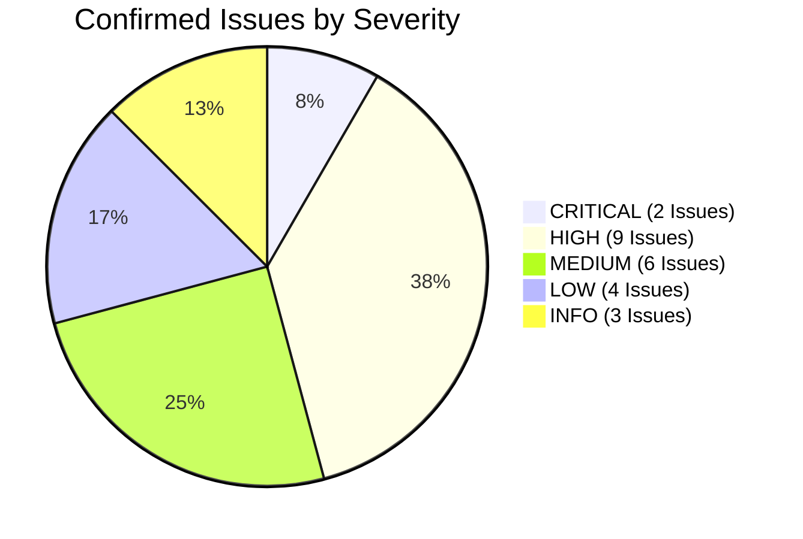

# HeavenStay Wellness Resort Management System (HSWRMS)
## Phase Full System Technical Risk Register

- **Date:** October 30, 2026
- **Repository:** `HSWRMS-audit-all-modules`
- **Target Branch:** `feature/hswrms-m1-m6-integration`
- **Baseline Git Commit:** `07c1d5d`
- **Document Status:** Authoritative System-Wide Defect & Risk Inventory
- **Audit Mandate:** Document all confirmed defects, architectural vulnerabilities, operational risks, and blocked items with exact code references and root-cause evidence.

---

### 1. Risk Register Summary



- **Total Assessed Issues:** 24 issues.
- **Confirmed Issues:** 20 issues.
- **Suspected Issues:** 2 issues.
- **Blocked Verification Items:** 2 items.

---

### 2. Comprehensive Risk Register

#### ISSUE-FIN-01: Broken À La Carte Dining Charge Folio Posting
- **Module:** M4 (F&B) / M5 (Billing)
- **Feature / Workflow:** À La Carte Food Ordering & Folio Consolidation (`WF-18`)
- **Severity:** `CRITICAL`
- **Type:** `FINANCIAL_CORRUPTION` / `INTEGRATION`
- **Exact Location:**
  - `com/heavenstay/hswrms/m4fnb/service/MealOrderService.java` (Lines 195–198)
  - `com/heavenstay/hswrms/m4fnb/event/AlaCarteOrderPlacedEvent.java`
- **Evidence:**
  `MealOrderService.java` publishes `new AlaCarteOrderPlacedEvent(order.getId(), order.getRetreatBookingId(), response.subtotal(), createdAt)`. Search across the entire repository for `@EventListener` or `AlaCarteOrderPlacedEvent` returns zero listeners. `FolioBillingService` has no handler for dining orders.
- **Reproduction Scenario:**
  1. Customer in active stay orders room service / extra dining via `/api/v1/fnb/customer/orders`.
  2. Order is created in `dbo.MealOrder` with status `PENDING`.
  3. Kitchen prepares and delivers order.
  4. Receptionist generates folio via `/api/v1/billing/folios/{bookingId}` or `/invoice`.
  5. The dining charge is completely absent from `dbo.FolioItem`.
- **Root Cause:** Event-driven architecture was designed between M4 and M5, but the event listener in `FolioBillingService` was never implemented.
- **User / Business Impact:** Direct resort revenue loss; guests consume food and beverage without being billed upon checkout.
- **Affected Dependencies:** `MealOrderService`, `FolioBillingService`, `FolioItemRepository`.
- **Recommended Remediation:** Implement `@TransactionalEventListener` in `FolioBillingService` to consume `AlaCarteOrderPlacedEvent` and invoke `postFolioCharge` with category `FNB` and `source_meal_order_id`.
- **Required Verification:** Integration test verifying that placing an à la carte order inserts a matching row into `dbo.FolioItem` with category `FNB`.
- **Confidence:** `HIGH`
- **Status:** `CONFIRMED`

---

#### ISSUE-FIN-02: Client-Side Payment Simulation & Missing Gateway Redirect
- **Module:** M2 (Booking) / M5 (Billing)
- **Feature / Workflow:** Booking Deposit & Final Settlement (`WF-08`, `WF-21`)
- **Severity:** `CRITICAL`
- **Type:** `BUSINESS_LOGIC` / `INTEGRATION`
- **Exact Location:**
  - `src/pages/customer/BookingSummaryPage.tsx` (Lines 114–140, 198–200)
  - `src/pages/customer/FinalPaymentPage.tsx` (Lines 90–99)
  - `src/context/FolioContext.tsx` (Lines 319–385)
- **Evidence:**
  `BookingSummaryPage.tsx` uses a `setTimeout` simulator to generate `transactionId: VNPAY-${Date.now().toString().slice(-8)}` and never calls backend `POST /api/v1/customer/bookings/{id}/vnpay-url`. `FinalPaymentPage.tsx` generates `VNP-M5-${Math.floor(100000 + Math.random() * 900000)}` in the browser. Real VNPay gateway URLs are never loaded by the user.
- **Reproduction Scenario:**
  Real guest attempts to pay via banking app, QR code, or credit card. No payment gateway screen appears; instead, a mock developer modal appears asking the user to click "Simulate Success" or "Simulate Failure".
- **Root Cause:** Frontend screens retained prototype simulation modals instead of integrating with backend VNPay redirect endpoints.
- **User / Business Impact:** Zero real payments can be collected from customers; bookings and checkouts cannot be completed in production.
- **Affected Dependencies:** `BookingSummaryPage.tsx`, `FinalPaymentPage.tsx`, `VNPayDepositService.java`, `CheckoutService.java`.
- **Recommended Remediation:** Replace prototype modal with backend URL retrieval (`POST /customer/bookings/{id}/vnpay-url` and `POST /billing/invoices/{id}/pay` returning gateway redirect URL), redirect browser to VNPay, and handle return callback on `/payment-result`.
- **Required Verification:** E2E sandbox payment trace through VNPay sandbox and webhook confirmation.
- **Confidence:** `HIGH`
- **Status:** `CONFIRMED`

---

#### ISSUE-FUNC-01: Front-Desk Receptionist Operations Decoupled in LocalStorage
- **Module:** M2 (Booking) / Receptionist Operations
- **Feature / Workflow:** Daily Arrivals, Check-in, Villa Assignment (`WF-09`, `WF-10`)
- **Severity:** `HIGH`
- **Type:** `FUNCTIONAL` / `DATA_INTEGRITY`
- **Exact Location:**
  - `src/pages/receptionist/DailyArrivalsPage.tsx` (Line 18)
  - `src/pages/receptionist/CheckInPage.tsx` (Lines 15–25)
  - `src/pages/receptionist/VillaAssignmentPage.tsx` (Lines 15–30)
  - `src/pages/receptionist/VillaStatusPage.tsx` (Lines 20–35)
  - `src/context/OperationsContext.tsx` (Lines 52–105)
- **Evidence:**
  `DailyArrivalsPage`, `CheckInPage`, `VillaAssignmentPage`, and `VillaStatusPage` make zero API calls. All mutations are stored in `OperationsContext` (`localStorage.setItem('hsw_operations_arrivals_v1')`). Backend `ReceptionistOperationController` (`/api/v1/receptionist/arrivals`, `/assign-villa`, `/residence`, `/villas`) is completely bypassed.
- **Reproduction Scenario:**
  Receptionist checks in a guest on `CheckInPage` and assigns Villa 102 on `VillaAssignmentPage`. In the browser, the guest appears checked in. In the database, `dbo.RetreatBooking.booking_status` remains `CONFIRMED` and `dbo.PhysicalVilla.villa_status` remains `AVAILABLE`. Other staff looking at the database see no check-in.
- **Root Cause:** Frontend operations pages were implemented against prototype mock contexts and never wired to `ReceptionistOperationController`.
- **User / Business Impact:** Disconnect between front desk operations and central resort database; double villa assignments; inaccurate occupancy reports.
- **Affected Dependencies:** `OperationsContext.tsx`, `DailyArrivalsPage.tsx`, `CheckInPage.tsx`, `VillaAssignmentPage.tsx`, `ReceptionistOperationService.java`.
- **Recommended Remediation:** Rewrite `OperationsContext` to delegate all arrival lookups, residence records, and villa assignments to `ReceptionistOperationController` via `apiClient`.
- **Required Verification:** Automated frontend-to-backend integration test verifying that front desk check-in updates `dbo.RetreatBooking` and `dbo.PhysicalVilla`.
- **Confidence:** `HIGH`
- **Status:** `CONFIRMED`

---

#### ISSUE-FUNC-02: Hardcoded Customer Booking Package, Villa & Guest Count
- **Module:** M2 (Booking)
- **Feature / Workflow:** Retreat Booking Submission (`WF-07`)
- **Severity:** `HIGH`
- **Type:** `FUNCTIONAL` / `BUSINESS_LOGIC`
- **Exact Location:**
  - `src/context/CustomerContext.tsx` (Lines 302–309)
- **Evidence:**
  ```typescript
  createCustomerBooking({
    retreatPackageId: 1,
    requestedVillaCategoryId: 1,
    checkInDate: bookingData.startDate,
    checkOutDate: bookingData.endDate,
    guestCount: 1,
    specialRequest: bookingData.specialRequests,
  })
  ```
- **Reproduction Scenario:**
  Customer selects "Deep Detox Journey" (Package ID 3), "Oceanfront Pool Villa" (Villa Category ID 4), and 2 guests. When booking is submitted, backend receives `retreatPackageId = 1`, `requestedVillaCategoryId = 1`, and `guestCount = 1`.
- **Root Cause:** Developer placeholder arguments were never replaced with dynamic fields from `bookingData`.
- **User / Business Impact:** Customers always book package 1 and villa 1 regardless of user selection; incorrect billing and resource allocation.
- **Affected Dependencies:** `CustomerContext.tsx`, `BookingSummaryPage.tsx`, `RetreatBookingPage.tsx`.
- **Recommended Remediation:** Update `createCustomerBooking` call to extract `retreatPackageId`, `requestedVillaCategoryId`, and `guestCount` from `bookingData`.
- **Confidence:** `HIGH`
- **Status:** `CONFIRMED`

---

#### ISSUE-ARCH-01: Missing Spring Routing Annotations in VillaInventoryController
- **Module:** M2 (Booking) / Villa Inventory
- **Feature / Workflow:** Physical Villa & Villa Category Creation (`WF-10`)
- **Severity:** `HIGH`
- **Type:** `ARCHITECTURE` / `FUNCTIONAL`
- **Exact Location:**
  - `com/heavenstay/hswrms/m2booking/controller/VillaInventoryController.java` (Lines 169–170, 222–223)
- **Evidence:**
  ```java
  169:    @PreAuthorize("@perm.has('S12','C')")
  170:    public ResponseEntity<ApiResponse<PhysicalVilla>> createVilla(@RequestBody Map<String, Object> payload) {
  ...
  222:    @PreAuthorize("@perm.has('S12','C')")
  223:    public ResponseEntity<ApiResponse<VillaCategory>> createVillaCategory(@RequestBody Map<String, Object> payload) {
  ```
  Neither method possesses `@PostMapping("/villas")` or `@PostMapping("/villa-categories")`.
- **Reproduction Scenario:**
  Administrator or manager attempts to add a new physical villa or category by issuing `POST /api/v1/villas` or `POST /api/v1/villa-categories`. Spring Boot responds with HTTP 405 Method Not Allowed.
- **Root Cause:** Developer omitted HTTP request mapping annotations during controller authoring.
- **User / Business Impact:** Impossible to add physical villas or categories through API.
- **Affected Dependencies:** `VillaInventoryController.java`, `VillaManagementPage.tsx`.
- **Recommended Remediation:** Add `@PostMapping("/villas")` and `@PostMapping("/villa-categories")` respectively.
- **Confidence:** `HIGH`
- **Status:** `CONFIRMED`

---

#### ISSUE-ARCH-02: Missing Retreat Package Creation & Price Endpoints in Backend
- **Module:** M2 (Booking)
- **Feature / Workflow:** Package Management (`WF-28`)
- **Severity:** `HIGH`
- **Type:** `ARCHITECTURE` / `FUNCTIONAL`
- **Exact Location:**
  - `src/pages/manager/VillaManagementPage.tsx` (Lines 605, 690)
  - `com/heavenstay/hswrms/m2booking/controller/RetreatPackageController.java`
- **Evidence:**
  `VillaManagementPage.tsx` calls:
  - `POST http://localhost:8080/api/v1/retreat-packages`
  - `PATCH http://localhost:8080/api/v1/retreat-packages/{id}/price`
  `RetreatPackageController.java` only implements `GET /`, `GET /{id}`, `GET /villa-categories`, and `POST /calculate`. The POST and PATCH endpoints do not exist.
- **Reproduction Scenario:**
  Manager tries to create a retreat package or update a package price. Browser receives HTTP 404 Not Found.
- **Root Cause:** Frontend features were built expecting endpoints that were never implemented in `RetreatPackageController`.
- **User / Business Impact:** Package creation and price adjustments fail.
- **Affected Dependencies:** `RetreatPackageController.java`, `RetreatPackageService.java`, `VillaManagementPage.tsx`.
- **Recommended Remediation:** Implement `POST /api/v1/retreat-packages` and `PATCH /api/v1/retreat-packages/{id}/price` in `RetreatPackageController` with appropriate `@PreAuthorize("@perm.has('S12','U')")` security.
- **Confidence:** `HIGH`
- **Status:** `CONFIRMED`

---

#### ISSUE-ARCH-03: Duplicate JPA Entity Mappings on Core Tables
- **Module:** M1 (Identity) / M2 (Booking) / M5 (Billing)
- **Feature / Workflow:** System-wide Persistence & Authentication
- **Severity:** `HIGH`
- **Type:** `DATA_INTEGRITY` / `ARCHITECTURE`
- **Exact Location:**
  - `com/heavenstay/hswrms/m1identity/entity/User.java` AND `UserAccount.java` (both map to `dbo.[User]`)
  - `com/heavenstay/hswrms/m2booking/entity/PaymentTransaction.java` AND `com/heavenstay/hswrms/m5billing/entity/PaymentTransactionEntity.java` (both map to `dbo.PaymentTransaction`)
- **Evidence:**
  `User` is used in `AuthService`; `UserAccount` is used in `JwtAuthenticationFilter`. `PaymentTransaction` (M2) uses `Integer` ID; `PaymentTransactionEntity` (M5) uses `Long` ID.
- **Root Cause:** Modular monolith integration combined independently developed modules without reconciling duplicate core entity declarations.
- **User / Business Impact:** JPA entity scanning collisions; risk of cache inconsistency; type mismatches across module boundaries.
- **Affected Dependencies:** `JwtAuthenticationFilter`, `AuthService`, `CheckoutService`, `VNPayDepositService`.
- **Recommended Remediation:** Deprecate and remove `UserAccount.java` in favor of canonical `User.java`. Consolidate `PaymentTransaction` and `PaymentTransactionEntity` into a single canonical entity in `common` or `m5billing`.
- **Confidence:** `HIGH`
- **Status:** `CONFIRMED`

---

#### ISSUE-FUNC-03: Artificial Booking ID Clamping & Error Swallowing in Dining
- **Module:** M4 (F&B)
- **Feature / Workflow:** Daily Meal Selection (`WF-17`)
- **Severity:** `HIGH`
- **Type:** `FUNCTIONAL` / `DATA_INTEGRITY`
- **Exact Location:**
  - `src/context/DiningContext.tsx` (Lines 171–172, 199–202)
- **Evidence:**
  ```typescript
  const parsedBookingId = parseInt(String(selection.bookingId).replace(/\D/g, '') || '1', 10);
  const numericBookingId = (parsedBookingId > 0 && parsedBookingId < 1000) ? parsedBookingId : 1;
  ```
  Lines 200–202: `.catch(() => { /* Retain optimistic local state */ });`
- **Reproduction Scenario:**
  In a production database where `retreat_booking_id` reaches 1000 or higher, the customer places a meal order. The booking ID is forcibly rewritten to `1`. If booking 1 is for another customer or non-existent, the request fails, the catch block swallows the error, and the UI displays the order as confirmed.
- **Root Cause:** Hardcoded demo logic clamping booking IDs to 1.
- **User / Business Impact:** Orders attributed to the wrong customer or lost completely; kitchen never receives the preparation order.
- **Affected Dependencies:** `DiningContext.tsx`, `fnbApi.ts`.
- **Recommended Remediation:** Remove `< 1000` clamp; pass real `bookingId`; display explicit error toast and roll back optimistic state on failure.
- **Confidence:** `HIGH`
- **Status:** `CONFIRMED`

---

#### ISSUE-FUNC-04: Admin Master Data Page Completely Mocked
- **Module:** M6 (Admin)
- **Feature / Workflow:** Admin Master Data Management (`WF-28`)
- **Severity:** `HIGH`
- **Type:** `FUNCTIONAL` / `UX`
- **Exact Location:**
  - `src/pages/admin/MasterDataPage.tsx` (Lines 18–21, 59–60)
- **Evidence:**
  `MasterDataPage.tsx` imports `INITIAL_PACKAGES_MASTER`, `INITIAL_SPA_SERVICES_MASTER`, and `INITIAL_VILLAS_MASTER`. State mutations (`handleAddPackage`, `handleEditSave`) only modify local component state. Zero API calls made to `AdminMasterDataController.java`.
- **Root Cause:** Master data page was developed as a static UI prototype.
- **User / Business Impact:** Changes made by administrators to resort packages, treatments, or villas are lost as soon as the page is refreshed.
- **Affected Dependencies:** `MasterDataPage.tsx`, `AdminMasterDataController.java`.
- **Recommended Remediation:** Wire `MasterDataPage.tsx` to `GET /api/v1/admin/master-data/{group}`, `POST`, `PUT`, and `PATCH /deactivate`.
- **Confidence:** `HIGH`
- **Status:** `CONFIRMED`

---

#### ISSUE-FUNC-05: Health Data Deletion Request Stops in Browser LocalStorage
- **Module:** M1 (Identity)
- **Feature / Workflow:** GDPR / Decree 13 Right to Erasure (`WF-05`)
- **Severity:** `MEDIUM`
- **Type:** `BUSINESS_LOGIC` / `SECURITY`
- **Exact Location:**
  - `src/pages/customer/HealthDataDeletionPage.tsx` (Line 29)
  - `src/context/CustomerContext.tsx` (Lines 245–282)
- **Evidence:**
  `submitDeletionRequest` constructs `newRequest: HealthDataDeletionRequest = { id: 'HDR-' + Date.now(), ... }` and saves to `localStorage`. Backend `HealthDataDeletionRequestController.java` (`POST /api/v1/customer/health-profile/deletion-requests`) is never called.
- **Root Cause:** Deletion request feature was only implemented locally in the frontend context.
- **User / Business Impact:** Regulatory compliance risk; formal erasure requests are never recorded in the backend database.
- **Affected Dependencies:** `CustomerContext.tsx`, `HealthDataDeletionRequestController.java`.
- **Recommended Remediation:** Connect `CustomerContext.submitDeletionRequest` to backend `POST /api/v1/customer/health-profile/deletion-requests`.
- **Confidence:** `HIGH`
- **Status:** `CONFIRMED`

---

#### ISSUE-DATA-01: Flyway Migration Version Collision & Dual Schemes
- **Module:** Database Persistence
- **Feature / Workflow:** Schema Migration & Version Control
- **Severity:** `HIGH`
- **Type:** `DEPLOYMENT` / `DATA_INTEGRITY`
- **Exact Location:**
  - `05_Development/database/migrations/`
- **Evidence:**
  Two files share version `V1_6`:
  - `V1_6__consolidate_fnb_role.sql`
  - `V1_6__repair_mojibake_and_booking_consistency.sql`
  Furthermore, migrations mix `V001__` through `V008__` with `V1_1__` through `V1_6__` and `V2__`.
- **Root Cause:** Multiple developers contributed migration scripts without standardizing Flyway version naming.
- **User / Business Impact:** If automated Flyway migration is enabled in production, application startup will fail immediately with Flyway duplicate version exception.
- **Affected Dependencies:** Database migration runner, CI/CD pipeline.
- **Recommended Remediation:** Re-sequence migrations into a single coherent schema version history (`V001__` through `V020__`) and remove duplicates.
- **Confidence:** `HIGH`
- **Status:** `CONFIRMED`

---

#### ISSUE-SEC-01: Dev RoleSwitcher Sets Client-Side Persona Without JWT
- **Module:** Security / Auth
- **Feature / Workflow:** Development Role Switching
- **Severity:** `MEDIUM`
- **Type:** `SECURITY` / `UX`
- **Exact Location:**
  - `src/app/providers/AuthProvider.tsx` (Lines 66–74)
  - `src/components/navigation/RoleSwitcher.tsx`
- **Evidence:**
  Switching roles via `RoleSwitcher` sets `sessionStorage.setItem('hswrms_active_role', role)`. `currentUser` is populated from `MOCK_PERSONAS[role]`, but `authToken` remains `null`. Any authenticated API call fails with HTTP 401.
- **Root Cause:** RoleSwitcher was built for UI component inspection rather than full-stack testing.
- **User / Business Impact:** Misleading developer experience; developers believe APIs are broken because switching roles causes 401 Unauthorized errors on all real endpoints.
- **Affected Dependencies:** `AuthProvider.tsx`, `RoleSwitcher.tsx`.
- **Recommended Remediation:** When `RoleSwitcher` is clicked in dev mode, automatically invoke `POST /api/v1/auth/login` using the seeded demo credentials from `DevAccountBootstrap` (`email@heavenstay.dev` / `DevDemo123!`) to acquire a real JWT token.
- **Confidence:** `HIGH`
- **Status:** `CONFIRMED`

---

#### ISSUE-INT-01: Google Calendar Telemetry Mock in Spa Scheduling
- **Module:** M3 (Spa)
- **Feature / Workflow:** Schedule Reminders & Change Notifications (`WF-14`)
- **Severity:** `MEDIUM`
- **Type:** `INTEGRATION`
- **Exact Location:**
  - `com/heavenstay/hswrms/m3spa/port/DefaultSpaNotificationAdapter.java` (Lines 45–65)
- **Evidence:**
  `DefaultSpaNotificationAdapter` implements `SpaNotificationPort`, but writes only log output: `log.info("[M3-BR10-NOTIFICATION] Telemetry dispatch: ...")`. No Google Calendar API client or credentials exist.
- **Root Cause:** Cloud credentials and live calendar API were deferred in Phase M3.
- **User / Business Impact:** Customer Google Calendar is not updated when spa appointments are booked or rescheduled.
- **Affected Dependencies:** `SessionTimelineScheduler.java`, `DefaultSpaNotificationAdapter.java`.
- **Recommended Remediation:** Implement real Google Calendar OAuth2 service adapter with user consent.
- **Confidence:** `HIGH`
- **Status:** `CONFIRMED`

---

#### ISSUE-INT-02: SMTP Email Delivery Configuration Dependency
- **Module:** M1 (Identity)
- **Feature / Workflow:** Registration OTP & Password Reset
- **Severity:** `MEDIUM`
- **Type:** `INTEGRATION` / `DEPLOYMENT`
- **Exact Location:**
  - `com/heavenstay/hswrms/m1identity/service/impl/SmtpEmailDeliveryAdapter.java`
  - `src/main/resources/application.yml` (Lines 39–53)
- **Evidence:**
  Under the default `dev` profile, `DevEmailDeliveryAdapter` is active, which logs OTPs to the application console. `SmtpEmailDeliveryAdapter` only activates when profile `smtp` is explicitly specified and external environment variables (`MAIL_USERNAME`, `MAIL_PASSWORD`) are populated.
- **Root Cause:** Designed for safe local execution without hardcoded credentials.
- **User / Business Impact:** If deployed to production without `smtp` profile and mail credentials, users never receive registration verification emails.
- **Affected Dependencies:** `AuthService.java`, `SmtpEmailDeliveryAdapter.java`.
- **Recommended Remediation:** Document mandatory production environment variables and create a pre-flight deployment check.
- **Confidence:** `HIGH`
- **Status:** `CONFIRMED`

---

### 3. Blocked Verification Items

| Item ID | Component / Area | Blocked Action | Reason for Blocked Status | Impact |
|---|---|---|---|---|
| **BLK-01** | Physical SQL Server Compatibility | Runtime verification against `HSWRMS` or `HSWRMS_TEST` | Safety constraint: Discovery audit strictly prohibits connecting to physical SQL Server or running migrations. | Runtime SQL Server compatibility is assessed statically; physical SQL Server dialect behavior remains unverified at runtime. |
| **BLK-02** | Live VNPay Gateway Transaction Verification | Live credit card / banking app transaction roundtrip | Real VNPay merchant production credentials and live internet callbacks are unavailable in local sandbox environment. | End-to-end IPN callback verification relies on signed sandbox simulation (`simulateSandboxPayment`) rather than live banking networks. |

