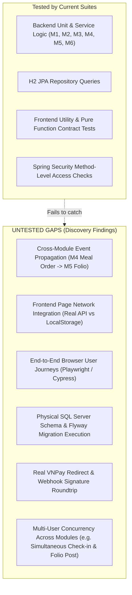

# HeavenStay Wellness Resort Management System (HSWRMS)
## Phase Full System Test & Verification Gap Analysis

- **Date:** October 30, 2026
- **Repository:** `HSWRMS-audit-all-modules`
- **Target Branch:** `feature/hswrms-m1-m6-integration`
- **Baseline Git Commit:** `07c1d5d`
- **Document Status:** Authoritative QA Architecture & Verification Integrity Review
- **Audit Mandate:** Evaluate the true depth, coverage, and limitations of existing automated test suites; uncover why passing tests failed to detect critical product-level defects; establish a safe verification strategy.

---

### 1. Repository Test Inventory

#### 1.1 Backend Test Suites (Java / JUnit 5)

The backend test directory (`src/test/java`) contains **63 test files** with verified executions across the modules:

| Module / Scope | Test Files & Suites | Total Test Count | Execution Profile & Environment | Verification Focus |
|---|---|---|---|---|
| **M1: Identity & Access** | `AuthServiceTest`, `CustomerProfileServiceTest`, `HealthProfileServiceTest`, `AccountLockoutIntegrationTest`, `SsoServiceTest`, `EmailOtpRepositoryContractTest`, etc. (16 test files) | ~35 tests | H2 In-Memory (MSSQL mode) | Service layer validation, password hashing, lockout counting, SSO ticket lifecycle. |
| **M2: Retreat Booking** | `RetreatBookingServiceTest`, `VillaAvailabilityServiceTest`, `VNPayDepositServiceTest`, `ReceptionistOperationServiceTest`, `M2SchemaCompatibilityTest` (7 test files) | ~25 tests | H2 In-Memory (MSSQL mode) | Booking date overlap validation, deposit calculation, HMAC signature checking, receptionist operations. |
| **M3: Spa Scheduling** | `SpaAuthoritativeAcceptanceEvidenceTest` (49 tests), `SpaServiceTests` (29 tests), `SpaSecurityTests` (5 tests), `SpaConcurrencyTest` (1 test) | **84 tests** | H2 In-Memory (MSSQL mode) | Complete 14 business rules, joint availability, alternative loop, reminder timeline scanning, UUID claim-token fencing. |
| **M4: Food & Beverage** | `MealOrderServiceTest`, `MenuServiceTest`, `InventoryServiceTest`, `FnbKdsOrderServiceTest`, `RetreatPackageFnbServiceTest`, `FnbControllersSecurityTest`, etc. (11 test files) | ~30 tests | H2 In-Memory (MSSQL mode) | Dietary allergens, meal period boundaries, ingredient deduction, KDS state transitions. |
| **M5: Folio & Billing** | `M5BillingAndCheckoutTests` (1 comprehensive test file) | ~15 tests | H2 In-Memory (MSSQL mode) | Folio aggregation, billing guard on unsettled orders, invoice PDF generation, checkout finalization. |
| **M6: Admin & Governance** | `StaffAccountServiceTest`, `PermissionMatrixServiceTest`, `DelegationServiceTest`, `BusinessParameterServiceTest`, `AuditLogServiceTest`, `AccountUnlockJobTest`, `M6AdminIntegrationTests` (9 test files) | ~25 tests | H2 In-Memory (MSSQL mode) | Staff creation, permission matrix evaluation, right delegations, audit log purging, background jobs. |
| **Security & Common** | `JwtTokenProviderTest`, `CustomUserDetailsTest`, `SsoJwtRoundTripTest`, `TextEncodingSanitizerTest` (4 test files) | ~10 tests | In-Memory | JWT signing and validation, UTF-8 mojibake repair. |
| **Total Backend** | **63 test files** | **~225+ tests** | **H2 In-Memory** | Unit and slice integration tests. |

#### 1.2 Frontend Test Suites (TypeScript / Node Test Runner)

The frontend contains **11 test files** comprising **159 passing unit/contract test cases**:
- `m3-spa/alternativeRejectionSafety.test.ts` (14 tests)
- `m4-fnb/kitchenQueueSafety.test.ts`
- `m4-fnb/m4IntegrationContract.test.ts`
- `m5-billing/utils/bookingResolver.test.ts`
- `m5-billing/utils/paymentSafety.test.ts`
- `m6-admin/api/adminDashboardApi.test.ts`
- `m6-admin/api/auditLogApi.test.ts`
- `m6-admin/api/delegationApi.test.ts`
- `m6-admin/api/parametersApi.test.ts`
- `m6-admin/api/permissionMatrixApi.test.ts`
- `m6-admin/api/staffAccountsApi.test.ts`

---

### 2. Why Passing Tests Failed to Detect System Defects

A central discovery of this audit is understanding why previous reports celebrated high test pass rates (e.g., "84/84 backend tests passed", "159/159 frontend tests passed") while critical product workflows were completely broken.

#### 2.1 The "Mock Isolation Trap"
Existing frontend tests exclusively test **pure utility functions and isolated state reducers** (such as `bookingResolver.ts` or `alternativeRejectionSafety.test.ts`).
- Not a single frontend test renders an actual React page component (`<DailyArrivalsPage />`, `<BookingSummaryPage />`, `<FolioInvoicePage />`).
- Not a single test verifies whether clicking a button triggers a network request or merely mutates `localStorage`.
- As a result, the fact that `DailyArrivalsPage` makes zero API calls was completely invisible to the test runner!

#### 2.2 The "Missing Cross-Module Test Gap"
Existing backend tests test modules in strict isolation:
- `MealOrderServiceTest` tests that `MealOrderService` saves rows into `MealOrder`.
- `M5BillingAndCheckoutTests` tests that `FolioBillingService.postFolioCharge` adds rows to `FolioItem` when called directly.
- **NO test ever tested the integration:** Placing an à la carte meal order in M4 and asserting that a charge appears on the customer's folio in M5.
- Because no cross-module integration test existed, the fact that `AlaCarteOrderPlacedEvent` had zero event listeners went undetected!

#### 2.3 The H2 "DDL Auto Masking Effect"
In `src/test/resources/application.yml`:
```yaml
spring:
  datasource:
    url: jdbc:h2:mem:testdb;MODE=MSSQLServer...
  jpa:
    hibernate:
      ddl-auto: create-drop
```
- In tests, Hibernate creates tables dynamically on H2 based on JPA entity annotations, NOT from `schema.sql` or `migrations/`.
- If `schema.sql` has different constraints, missing columns, or type incompatibilities, all H2 tests still pass.
- H2's `MODE=MSSQLServer` simulates basic SQL Server syntax, but does NOT enforce:
  1. Strict SQL Server computed column restrictions (`PERSISTED`).
  2. SQL Server transaction locking behavior (`WITH (UPDLOCK, ROWLOCK)` vs H2 table locks).
  3. `DATETIME2(0)` vs `DATETIME2(7)` timestamp truncation.
  4. Real SQL Server collation and unicode NVARCHAR sorting.

---

### 3. Critical Verification Gaps



1. **Zero Browser E2E Tests:**
   The repository has no Cypress, Playwright, or Selenium suites. The entire browser user journey—from clicking a button on the UI to updating a row in the database—has zero automated regression coverage.
2. **Missing Real Gateway Test Harness:**
   Payments are tested via unit tests mocking `VNPayDepositService.verifyChecksum`. No mock gateway server exists to test HTTP redirects, query parameter preservation, and browser return handshakes.
3. **Absence of Real Flyway Execution:**
   Flyway is not configured in Maven dependencies; migration scripts in `05_Development/database/migrations` have never been verified sequentially by a migration engine.

---

### 4. Safe Future Verification Strategy

To verify remediation without risking data corruption or violating safety constraints:

#### Step 1: Headless Cross-Module Integration Tests (Backend)
- Add `@SpringBootTest` suites that execute cross-module flows:
  - Create Retreat Booking (M2) → Schedule Extra Spa (M3) → Place Extra Meal Order (M4) → Fetch Folio (M5) and assert that all charges are consolidated.

#### Step 2: Component Network Mock Tests (Frontend)
- Introduce Mock Service Worker (MSW) or Vitest component tests using `@testing-library/react`.
- Render `<DailyArrivalsPage />` and assert that `GET /api/v1/receptionist/arrivals` is called.
- Render `<BookingSummaryPage />` and assert that `createCustomerBooking` transmits the exact selected package ID and villa category ID.

#### Step 3: Containerized SQL Server Test Pipeline (CI / Staging)
- Deploy a standalone disposable Docker container running Microsoft SQL Server 2022.
- Execute all Flyway migrations from clean state to verify DDL ordering.
- Run Spring Boot integration tests with profile `sqlserver` against the disposable container.
- *Strict Constraint:* Never run against `HSWRMS` or `HSWRMS_TEST` databases on host.

#### Step 4: End-to-End Browser Suite (Playwright)
- Author Playwright test scripts covering the 5 canonical user journeys:
  1. Customer: Register → Login → Book Package → Schedule Spa → View Folio.
  2. Receptionist: Login → View Daily Arrivals → Check-in Guest → Assign Villa.
  3. Therapist: Login → View Schedule → Mark Completed.
  4. F&B Staff: Login → View KDS Queue → Mark Meal Ready.
  5. Manager / Admin: Login → View Analytics → Manage Staff Accounts.

