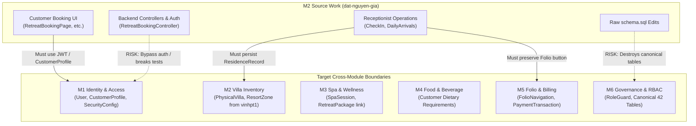
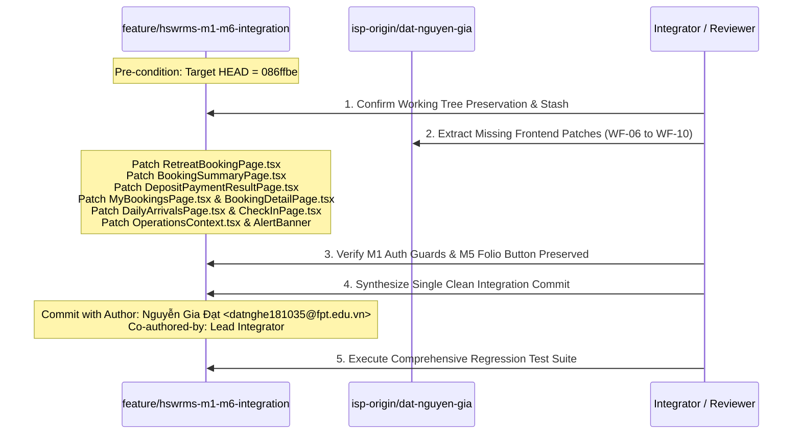

# HSWRMS — M2 SOURCE BRANCH HISTORY PRESERVATION & CONTROLLED INTEGRATION PLAN

**Document ID**: `HSWRMS-PLAN-M2-INTEGRATION-20261031`  
**Repository**: `E:\FU_Learning\5.Spring2025_Semester5\ISP392_Ver2\HSWRMS-audit-all-modules`  
**Source Branch**: `isp-origin/dat-nguyen-gia` (`52a6bd9ed819e956208cf4495811683e4ea1cbfa`)  
**Target Branch**: `feature/hswrms-m1-m6-integration` (`086ffbe8ceae602594efd064079b793dcdc2365e`)  
**Status**: READ-ONLY AUDIT & INTEGRATION SPECIFICATION  
**Authoritative Checkpoint**: `086ffbe`  

---

## 1. EXECUTIVE SUMMARY & OBJECTIVE

The project owner requires the preservation of the complete existing commit history of `feature/hswrms-m1-m6-integration` while integrating missing original functionality and contributions from `dat-nguyen-gia` (Module 2: Retreat Booking & Receptionist Operations, authored by **Nguyễn Gia Đạt** / `Datnghe181035`).

### Core Directives:
1. **Preserve Target History**: Do not rebase, reset, or alter any of the existing 40+ integration and cross-module commits on `feature/hswrms-m1-m6-integration`.
2. **Preserve Authorship & Intent**: Identify original commits missing from target ancestry and reuse original commits or attribution through cherry-pick / authored patch ports where safe.
3. **Prevent System Regressions**: Avoid regressions in M1 (Identity/Security), M3 (Spa), M4 (F&B), M5 (Folio & Billing), and M6 (Governance). Specifically safeguard M1 authentication requirements and M5 Folio check-out navigation.
4. **Guard Database Schema**: Enforce strict protection of the canonical 42-table SQL Server database schema (`schema.sql` and migrations `V001`–`V010`). Completely exclude raw, uncoordinated schema modifications present on the source branch.
5. **Close Functionality Gaps**: Port the missing real-API customer booking flows and receptionist daily arrivals/check-in residence record operations (currently relying on mock data / `mockRetreats.ts`).

---

## 2. PHASE A — CHECKPOINT & WORKING-TREE VERIFICATION

A comprehensive read-only inspection was executed against local and remote references on October 31, 2026:

```powershell
git branch -vv
git rev-parse HEAD
git status
```

### Reference Verification Findings:

| Property | Verified Value | Status / Note |
| :--- | :--- | :--- |
| **Current Branch** | `feature/hswrms-m1-m6-integration` | Correctly active and checked out |
| **Current Local HEAD** | `086ffbe8ceae602594efd064079b793dcdc2365e` | `docs(reports): record git temporary checkpoint and push report` |
| **Expected Checkpoint** | `086ffbe` | **Confirmed exact match** — target has not advanced |
| **Remote Target HEAD** | `isp-origin/feature/hswrms-m1-m6-integration` (`086ffbe`) | Local is exactly up to date with GitLab `isp-origin` |
| **Secondary Remote** | `origin/feature/hswrms-m1-m6-integration` (`07c1d5d`) | Local is ahead of GitHub `origin` by 9 commits |
| **Source Branch Tip** | `refs/remotes/isp-origin/dat-nguyen-gia` (`52a6bd9`) | Exists as remote tracking ref (no local branch) |
| **Common Merge Base** | `582cab31240d038680c267ff022d112360565d48` | `Merge branch 'sync/global-ui-freeze' into 'main'` |
| **Ancestry Exit Code** | `1` (via `git merge-base --is-ancestor`) | Source tip is **NOT** an ancestor of target |

### Target Commits Ahead of GitHub Remote (`07c1d5d`):
1. `f826d47` — `feat(database): add migrations V008-V010 and update master schema`
2. `fea9244` — `feat(m3): implement spa reminder worker fencing and scheduling hardening`
3. `6ce8253` — `feat(m4): defer F&B folio charge until delivery and publish delivery event`
4. `b942ff8` — `feat(m5): strengthen folio billing integrity, event consumer and checkout guard`
5. `ccc7127` — `wip(m5): implement manager-approved F&B void and credit note workflow (WP-1B checkpoint)`
6. `a56bbe0` — `feat(frontend): integrate spa scheduling, dining context and folio adjustment management`
7. `e249e90` — `chore(config): synchronize dev account bootstrap and application settings`
8. `36a8e76` — `docs(reports): document full system discovery audit, WP-1A and WP-1B implementation`
9. `086ffbe` — `docs(reports): record git temporary checkpoint and push report`

### Working-Tree Status:
> [!IMPORTANT]
> The working tree currently holds uncommitted modifications in Module 5 Billing (`AdjustmentController`, `AdjustmentServiceImpl`, `CreditNoteEntity`, `FolioEntity`, `FolioItemEntity`, `V010__m5_fnb_void_and_credit_note.sql`, `FolioInvoicePage.tsx`, etc.). All steps in this integration plan are strictly READ-ONLY and require that the active working tree remain untouched until formal execution authorization is given.

---

## 3. PHASE B — SOURCE COMMIT MAPPING & CLASSIFICATION

All 8 source commits between merge base `582cab3` and source tip `52a6bd9` were inspected for author metadata, parentage, patch contents, and equivalence on `feature/hswrms-m1-m6-integration`.

### Commit Classification Taxonomy:
- **A. SAFE TO CHERRY-PICK**: Entire commit can be cherry-picked cleanly without conflicts or regressions.
- **B. ALREADY INTEGRATED EQUIVALENTLY**: Code payload is 100% active in target via an earlier squashed or ported commit.
- **C. PARTIALLY INTEGRATED — REQUIRES PATCH EXTRACTION**: Core parts are integrated, but critical UI or logic improvements were omitted and must be selectively ported.
- **D. DEPENDENCY REQUIRED**: Requires predecessor commits to function.
- **E. UNSAFE / INCOMPATIBLE**: Modifies canonical schema destructively or breaks cross-module security contracts.
- **F. DOCUMENTATION ONLY**: Non-code markdown or design documentation.

---

### Source Commits Inventory & Mapping Table

| # | Commit SHA | Date & Author | Commit Message & Summary | Classification | Equivalent Target Commit | Recommendation |
| :-: | :--- | :--- | :--- | :-: | :--- | :--- |
| **1** | `230dbfe` | 2026-10-18 23:22<br>`Datnghe181035` | `docs(m2): add detailed implementation plan for module 2 retreat booking`<br>Added 797 lines in `04_Implement/HSWRMS_MODULE_2_RETREAT_BOOKING_IMPLEMENTATION_PLAN.md`. | **B / F** | `8f90ab0` | **Skip** (100% identical in target; cherry-pick would be an empty commit). |
| **2** | `1619ebe` | 2026-10-18 23:27<br>`Datnghe181035` | `feat(database): import database schema, migrations, and seeds from branch vinhpt1`<br>Altered `schema.sql` (+274/-14) and added legacy draft migrations `V1_1`–`V1_5`. | **E** | `39b086f` (via `vinhpt1` merge) | **Exclude** (Overwrites canonical 42-table schema; redundant with `vinhpt1` merge commit `39b086f`). |
| **3** | `4bd4ecd` | 2026-10-19 00:15<br>`Datnghe181035` | `feat(m2-booking): implement full Module 2 backend and frontend API client in 05_Development`<br>Added 32 backend files in `m2booking` and `retreatBookingApi.ts` (+3,417 lines). | **B** | `8f90ab0` | **Skip** (100% of the 33 files were imported into target baseline via `8f90ab0`). |
| **4** | `d2d36de` | 2026-10-19 00:32<br>`Datnghe181035` | `feat(database): execute schema and seeds into SQL Server HSWRMS and connect backend`<br>Added seeds `V1_5`, `V1_6`, raw `schema.sql` edits, and physical `SqlServerDatabaseConnectionTest`. | **E** | `0f257ad` (partially for seeds) | **Exclude** (Seed scripts already in target; direct physical SQL connection test and raw schema edits violate CI test isolation). |
| **5** | `d173542` | 2026-10-19 00:57<br>`Datnghe181035` | `fix(database): fix UTF-8 encoding across all seed scripts`<br>Sanitized Vietnamese diacritics in `V1_4__seed_spa_packages_v3.sql`. | **B** | `62e72e6` (via `9668586` XH merge) | **Skip** (File is 100% identical in target; already reconciled during Phase 5.8.3.118). |
| **6** | `3cc1a46` | 2026-10-26 11:57<br>`Datnghe181035` | `update code`<br>56 files (+5,523/-1,642 lines). M2 backend concurrency, DTOs, tests, plus customer booking UI pages. | **C** | `0f257ad` (backend only) | **Extract Patches** (Backend & DTOs already in `0f257ad`; extract missing customer UI pages). |
| **7** | `aacfd2f` | 2026-10-26 22:58<br>`Datnghe181035` | `fix bug customer can not book room and added a feature for receptionists to check booking history`<br>32 files (+2,244/-85 lines). `ReceptionistBookingsPage.tsx`, real API booking wireup. | **C** | `0f257ad` (receptionist page only) | **Extract Patches** (`ReceptionistBookingsPage` in target; extract remaining customer booking flow wireups). |
| **8** | `52a6bd9` | 2026-10-27 22:21<br>`Datnghe181035` | `fix bug db can not save customer information`<br>18 files (+405/-206 lines). Residence declaration persistence, walk-in modal, VNPay return verification. | **C** | `0f257ad` (API client only) | **Extract Patches** (Extract check-in residence declaration, daily arrivals walk-in modal, and VNPay return verification). |

---

## 4. PHASE C — CROSS-MODULE IMPACT ANALYSIS

Cherry-picking or porting changes from `dat-nguyen-gia` intersects multiple system boundaries. The following matrix details each touchpoint, potential regression hazards, and required safeguards:



### Module-by-Module Impact Breakdown:

### 1. M1 Identity & Access
- **Risk**: In commit `52a6bd9`, the author modified `RetreatBookingController.java` to allow anonymous guests to create bookings by auto-generating customer profiles from request body strings (`fullName`, `email`, `phone`).
- **Target Constraint**: The target branch enforces strict authentication on customer booking endpoints (`@AuthenticationPrincipal CustomUserDetails userDetails`), verified by `RetreatBookingSecurityTest` and `RetreatBookingServiceAuthorizationTest`.
- **Safeguard**: Do NOT port the controller authentication bypass. The customer frontend pages must utilize the authenticated `useAuth()` session, sending JWT bearer tokens. For walk-in guests, receptionists must utilize the dedicated `/receptionist/walk-in` endpoint.

### 2. M2 Villa Inventory & Master Data
- **Risk**: Commit `39b086f` previously merged `vinhpt1`, introducing `VillaInventoryController`, `ResortZone`, `VillaFunctionalArea`, and `VillaInventoryDataInitializer`.
- **Target Constraint**: Any modifications to `PhysicalVilla.java`, `VillaCategory.java`, or `PhysicalVillaRepository.java` must preserve `vinhpt1`'s functional areas and inventory models.
- **Safeguard**: Backend M2 inventory code in target is already fully unified. Do not overwrite backend entities with earlier versions from `dat-nguyen-gia`.

### 3. M3 Spa & Wellness Scheduling
- **Risk**: Spa package seed data in `V1_3` and `V1_4` references retreat packages and treatment IDs.
- **Target Constraint**: Target already possesses the authoritative `V1_4__seed_spa_packages_v3.sql` (reconciled in `62e72e6`) and migrations `V001`–`V002` / `V008`.
- **Safeguard**: Exclude `dat-nguyen-gia` database seeds to prevent re-introducing encoding discrepancies or duplicate treatment keys.

### 4. M4 Food & Beverage
- **Risk**: Customer allergies and meal selections depend on valid `CustomerProfile` records.
- **Target Constraint**: M4 orders reference room/villa numbers and guest IDs established at check-in.
- **Safeguard**: When `CheckInPage.tsx` records residence declarations, it must correctly populate `dbo.ResidenceRecord` so M4 room-delivery orders can locate active resident guests.

### 5. M5 Folio, Billing & Checkout
- **Risk 1 (UI Overwrite)**: In `feature/hswrms-m1-m6-integration`, `ReceptionistBookingsPage.tsx` (line 543) contains an M5 integration button:
  ```tsx
  {b.bookingStatus === 'CHECKED_IN' && (
    <button onClick={() => navigate('/customer/folio/' + b.bookingReference)}>
      Folio & Check-out <ArrowRight size={11} />
    </button>
  )}
  ```
  Overwriting `ReceptionistBookingsPage.tsx` with source commit `52a6bd9` would delete this critical link.
- **Risk 2 (Payment Transaction Identity)**: Both M2 (deposit) and M5 (folio settlement) write to `dbo.PaymentTransaction`. Target uses `@Qualifier("bookingPaymentTransactionRepository")` in `ReceptionistOperationService`.
- **Safeguard**: Maintain the M5 Folio navigation button and avoid touching backend repository qualifiers.

### 6. M6 Admin, Governance & Schema
- **Risk**: Source commits `1619ebe` and `d2d36de` modify `05_Development/database/schema.sql`.
- **Target Constraint**: The target branch maintains the authoritative 42-table schema with Flyway migrations `V001`–`V010`.
- **Safeguard**: `schema.sql` and all Flyway migration scripts are frozen from source-branch modifications.

---

## 5. PHASE D — CONTROLLED INTEGRATION STRATEGY

### Architectural Conclusion on Cherry-Picking:
Direct `git cherry-pick` of the 8 source commits cannot be executed without severe disruption:
- Commits `230dbfe`, `4bd4ecd`, `d173542` are no-ops (empty commits) because their exact contents are already present in target.
- Commits `1619ebe`, `d2d36de` introduce corrupting database schema alterations.
- Commits `3cc1a46`, `aacfd2f`, `52a6bd9` are composite commits mixing backend changes (already ported in `0f257ad`), destructive controller edits, and the desired frontend UI wireups.

### Recommended 3-Step Integration Workflow:



---

## 6. PHASE E — MISSING FUNCTIONALITY & SELECTIVE-PORT SPECIFICATION

The following 11 files represent the exact set of missing or mock-bound components to be updated from `dat-nguyen-gia`:

### 1. `05_Development/frontend/src/pages/customer/RetreatBookingPage.tsx`
- **Current Target State**: Hardcodes `MOCK_RETREAT_PACKAGES` from `mockRetreats.ts`; hardcodes `guestCount=1`; lacks dynamic price calculation.
- **Source Feature to Port**: Dynamic package loading via `getRetreatPackages()`, category loading via `getVillaCategories()`, live quotation via `calculateBooking()`, and draft creation via `createCustomerBooking()`.
- **Integration Rule**: Ensure booking creation passes the authenticated user context from `useAuth()` / `useCustomer()`.

### 2. `05_Development/frontend/src/pages/customer/BookingSummaryPage.tsx`
- **Current Target State**: Simulated modal with `setTimeout` generating fake `VNPAY-XXXXXXXX` references; bypasses backend payment endpoint.
- **Source Feature to Port**: Integration with `generateVNPayDepositUrl(bookingId, returnUrl)` to redirect guests to the authentic VNPay sandbox gateway.

### 3. `05_Development/frontend/src/pages/customer/DepositPaymentResultPage.tsx`
- **Current Target State**: Reads mock state from `localStorage`; lacks digital signature verification.
- **Source Feature to Port**: Parses `vnp_SecureHash`, `vnp_TxnRef`, and `vnp_ResponseCode` from search params; calls `verifyVNPayReturn(params)` and loads authoritative summary via `getCustomerBookingDetail(id)`.

### 4. `05_Development/frontend/src/pages/customer/MyBookingsPage.tsx` & `BookingDetailPage.tsx`
- **Current Target State**: Reads static mock list from `CustomerContext`.
- **Source Feature to Port**: Live customer booking list retrieval via `getCustomerBookings()` and detailed view via `getCustomerBookingDetail(id)`.

### 5. `05_Development/frontend/src/pages/public/LandingPage.tsx`, `RetreatListPage.tsx`, `RetreatDetailPage.tsx`
- **Current Target State**: Bound to static mock arrays in `mockRetreats.ts`.
- **Source Feature to Port**: Fetch active packages from backend `getRetreatPackages()`, falling back gracefully to mock catalog only if the backend is unreachable.

### 6. `05_Development/frontend/src/pages/receptionist/DailyArrivalsPage.tsx`
- **Current Target State**: Static array in `OperationsContext`; no walk-in creation capability.
- **Source Feature to Port**: Walk-in modal allowing receptionists to select packages, categories, dates, guest counts, payment methods (Cash/POS/VNPay), and invoke `createWalkInBooking()`.

### 7. `05_Development/frontend/src/pages/receptionist/CheckInPage.tsx`
- **Current Target State**: Draft data saved only to browser memory.
- **Source Feature to Port**: Invokes `recordResidenceDeclaration(numBookingId, declarationData)` to store CCCD/Passport, nationality, DOB, and address into `dbo.ResidenceRecord`.

### 8. `05_Development/frontend/src/context/OperationsContext.tsx` & `OperationalAlertBanner.tsx`
- **Current Target State**: Pure client-side mock store without remote refresh.
- **Source Feature to Port**: `refreshOperationsData()` method and status synchronizer.

---

## 7. FILES TO EXCLUDE (SAFETY GUARDS)

To prevent severe regressions, the following source files must be **strictly excluded** from porting:

| Excluded Source File | Why Excluded | Consequence If Accidentally Ported |
| :--- | :--- | :--- |
| `05_Development/database/schema.sql` | Contains obsolete draft schema from `dat-nguyen-gia` | Destroys canonical 42-table schema and Flyway alignment |
| `05_Development/database/migrations/*` | Obsolete draft migrations (`V1_1`–`V1_5`) | Flyway checksum validation failures on startup |
| `05_Development/backend/.../RetreatBookingController.java` | Bypasses M1 auth guards via unauthenticated fallback | Breaks `RetreatBookingSecurityTest` and M1 access control |
| `05_Development/backend/.../SqlServerDatabaseConnectionTest.java` | Directly connects to local `localhost:1433` with hardcoded credentials | Breaks build and test pipeline when physical DB is offline |
| `05_Development/backend/.../security/AuthController.java` | Duplicate auth controller created in M2 | Conflicts with canonical `m1identity.controller.AuthController` |
| `05_Development/frontend/.../ReceptionistBookingsPage.tsx` (raw overwrite) | Missing target's M5 Folio check-out button | Breaks M2 → M5 Folio navigation workflow |

---

## 8. REGRESSION TEST PLAN

Upon receiving user approval and executing the selective integration, the following automated and manual test protocol must be conducted:

### Step 1: Backend Automated Test Suite
Execute all M2 unit, integration, and security tests in the backend:
```powershell
Set-Location '05_Development/backend'
mvn test -Dtest=RetreatBookingServiceTest,ReceptionistOperationServiceTest,VNPayDepositServiceTest,VillaAvailabilityServiceTest,RetreatBookingSecurityTest,RetreatBookingServiceAuthorizationTest,M2SchemaCompatibilityTest
```
*Pass Criteria*: 100% tests pass (0 failures, 0 errors).

### Step 2: Cross-Module Regression Verification
Verify M1, M3, M4, and M5 test suites:
```powershell
mvn test -Dtest=AuthServiceTest,SpaServiceTests,FnbFolioIntegrationTest,AdjustmentServiceTest
```
*Pass Criteria*: No cross-module regression.

### Step 3: Frontend Build & Typecheck
Verify frontend TypeScript compilation and bundle integrity:
```powershell
Set-Location '05_Development/frontend'
npm run build
```
*Pass Criteria*: Zero TypeScript errors; build completes successfully.

### Step 4: End-to-End Workflow Validation
Verify the closed gaps in a running browser session:
1. **WF-06**: Open `/retreats` → verify packages are loaded dynamically.
2. **WF-07**: Open `/customer/retreat-booking` → select package & villa → verify price calculation via backend API.
3. **WF-08**: Complete draft booking → click payment → verify VNPay URL generation.
4. **WF-09**: Open `/receptionist/daily-arrivals` → verify live arrivals and test walk-in modal.
5. **WF-10**: Open `/receptionist/check-in` → save residence declaration → verify `dbo.ResidenceRecord` is populated in the database.

---

## 9. STOP CONDITIONS & UNRESOLVED QUESTIONS

### Stop Conditions:
- If executing any patch produces an unresolvable TypeScript compilation failure in shared contexts (`CustomerContext`, `OperationsContext`).
- If Flyway reports schema checksum mismatch on `schema.sql` or `V001`–`V010`.
- If `RetreatBookingSecurityTest` fails due to auth context mismatches.

### Unresolved Design Decisions for Project Owner:
1. **Anonymous Guest Booking Policy**:
   - `dat-nguyen-gia` (`52a6bd9`) attempted to allow completely unauthenticated guests to book from the landing page by auto-creating customer profiles from name/email/phone.
   - `feature/hswrms-m1-m6-integration` currently enforces mandatory login prior to booking draft creation.
   - *Recommendation*: Maintain mandatory login for customer self-booking to respect M1 GDPR/consent contracts, while allowing receptionists to book on behalf of unauthenticated guests via the walk-in booking endpoint.

---

## 10. EXPLICIT RECOMMENDATION

### **VERDICT: PROCEED WITH LIMITATIONS**

1. **Do NOT attempt a full branch merge (`git merge isp-origin/dat-nguyen-gia`)**: It will produce 123+ conflicts and corrupt the canonical 42-table database schema.
2. **Do NOT attempt direct commit-by-commit cherry-picking**: 5 of the 8 commits are either already integrated or destructive to schema and security.
3. **PROCEED with Controlled Selective Patch Porting**: Extract the 11 missing frontend workflow files (closing gaps `WF-06` through `WF-10`), apply proper author attribution to **Nguyễn Gia Đạt** (`Datnghe181035 <datnghe181035@fpt.edu.vn>`), and preserve the existing `feature/hswrms-m1-m6-integration` commit graph intact.

---
*End of Integration Plan. Awaiting Project Owner Review and Execution Authorization.*

