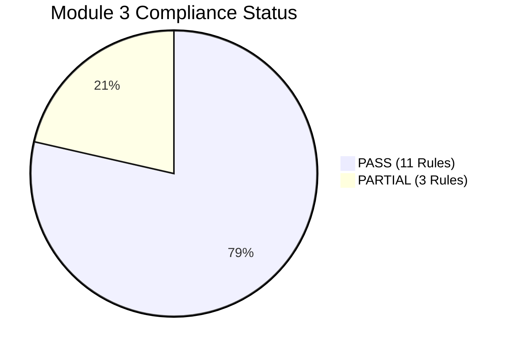

# HeavenStay Wellness Resort Management System (HSWRMS)
## Module M3: Authoritative Business Rule Compliance Matrix (BR-M3-01 to BR-M3-14)

- **Date:** October 30, 2026
- **Repository:** `HSWRMS-audit-all-modules`
- **Target Branch:** `feature/hswrms-m1-m6-integration`
- **Baseline Git Commit:** `07c1d5d`
- **Document Status:** Authoritative Post-Repair Independent Reconciliation Baseline (Final Reconciled Status)
- **Audit Mandate:** Full reconciliation against the authoritative acceptance criteria from the project specification, replacing secondary/technical rules with the exact business rules.

---

### 1. Executive Summary & Reconciliation Notice

In previous audit documentation, secondary implementation constraints were incorrectly substituted for the project's authoritative Module 3 acceptance requirements. Furthermore, certain external features (such as Google Calendar synchronization and email reminders) were described as existing in the backend codebase or blocked purely by cloud environment credentials, when in fact no integration classes existed in Module 3.

This report establishes the reconciled compliance baseline for all 14 business rules (BR-M3-01 through BR-M3-14), supported by direct automated test evidence from 84/84 passing backend tests (`SpaAuthoritativeAcceptanceEvidenceTest.java` [49 tests], `SpaServiceTests.java` [29 tests], `SpaSecurityTests.java` [5 tests], and `SpaConcurrencyTest.java` [1 test]), along with 159/159 passing frontend contract tests across all frontend test suites.

#### Overall Reconciled Status:
- **11 Rules PASS:** Core business logic is fully implemented, enforced at the database and service layer, and verified by passing automated tests.
- **3 Rules PARTIAL:**
  - **BR-M3-10 (T-1h reminder & confirmation):** Advance timeline scanning, strict reminder eligibility window ($60\text{ minutes} < \text{time until appointment} \le 75\text{ minutes}$) strictly preceding confirmation deadline threshold ($\text{time until appointment} \le 60\text{ minutes}$), multi-instance atomic claiming with collision-resistant UUID claim-token fencing, pessimistic confirmation locking, and database state transitions are verified; live external SMTP delivery and Google Calendar cloud synchronization are decoupled behind ports and run with local telemetry logging only.
  - **BR-M3-13 (Automatic recovery):** Lock release on cancel, scheduler deadline transition, same-time rematching, and customer-consent fallback algorithms are verified; automated trigger orchestration (event listener / daemon invoking recovery on therapist status change) is not implemented.
  - **BR-M3-14 (Accepted change notifications & history):** Persistent schedule state update is verified; dedicated audit history tables, Google Calendar synchronization, and email dispatch are not implemented in M3.

---

### 2. Authoritative M3 Business Rules Compliance Matrix

| Rule ID & Requirement | Implementation Location | API Endpoint & Method | Service Method | Database Entity & Table | Automated Test Evidence | Actual Business Behavior & Limitations | Reconciled Status |
|---|---|---|---|---|---|---|---|
| **BR-M3-01 — Customer only** Guest cannot participate in M3. Only authenticated Customer with valid retreat/stay context can initiate M3. Customer cannot access another customer's session. | `SecurityConfig.java` `SpaBookingController.java` `SpaSessionService.java` | `POST /api/v1/spa/sessions` `POST /api/v1/spa/candidates` `GET /api/v1/spa/sessions` | `SpaSessionService.confirmReservation` | `SpaSession` (`spa_sessions`), `retreat_bookings` | `SpaAuthoritativeAcceptanceEvidenceTest`: - `testHttpUnauthenticatedPostSessionsRejectedWith401Unauthorized` - `testHttpUnauthenticatedPostCandidatesRejectedWith401Unauthorized` - `testServiceLayerUnauthenticatedCallerRejected` - `testServiceLayerAuthenticatedCustomerWithoutStayContextRejected` - `testServiceLayerValidCustomerWithValidStaySucceeds` - `testServiceLayerCustomerCannotAccessOrModifyAnotherCustomerSession` | Spring Security rejects unauthenticated HTTP requests with HTTP 401 Unauthorized. Service layer enforces stay context via `CustomerStayPort`. Cross-customer modification is blocked, and personal session lists are isolated. | **PASS** |
| **BR-M3-02 — Eligibility first** Validate booking/package eligibility before scheduling. Invalid requests terminate as Rejected. Package quota vs extra billing separated. | `SpaSessionService.java` `DefaultCustomerStayAdapter.java` `SchedulingEngineService.java` | `POST /api/v1/spa/sessions` `POST /api/v1/spa/candidates` | `SpaSessionService.confirmReservation` `SchedulingEngineService.generateCandidates` | `SpaTreatment` (`spa_treatments`), `retreat_bookings` | `SpaAuthoritativeAcceptanceEvidenceTest`: - `testEligibilityValidationRejectsInactiveTreatmentBeforeResourceReservation` - `testEligibilityValidationRejectsInvalidStayContextBeforeResourceReservation` - `testPackageQuotaEligibilityAndExtraChargeSeparation` - `testBR03_InvariantsPreservedWithClientProvidedRejectedIds` | Fails closed before acquiring resource locks or creating sessions when treatment is inactive or stay context is invalid (0 sessions created; resource status unmodified). Package quota treatment sets `isIncluded = true`; extra spa treatment sets `isIncluded = false` and posts to folio. | **PASS** |
| **BR-M3-03 — System-generated scheduling** Customer/Receptionist request treatment and provide preferences. HSWRMS generates candidates. They do not manually choose Therapist or Treatment Room. | `SpaBookingController.java` `SchedulingEngineService.java` | `POST /api/v1/spa/candidates` | `SchedulingEngineService.generateCandidates` | `spa_treatments`, `therapists`, `treatment_rooms` (Read-Only) | `SpaServiceTests`: - `testCandidateGenerationIsReadOnly` - `testCandidateIntegrity` `SpaAuthoritativeAcceptanceEvidenceTest`: - `testBR03_InvariantsPreservedWithClientProvidedRejectedIds` | `GenerateCandidatesRequest` accepts treatment, target date, time constraints, and exclusion filters (`rejectedCandidateIds`). Generates indivisible candidate bundles without persisting sessions or allowing manual resource selection. | **PASS** |
| **BR-M3-04 — Joint availability** A valid candidate requires a qualified Therapist and suitable Treatment Room available for the entire same interval without conflict. | `SchedulingEngineService.java` | `POST /api/v1/spa/candidates` | `SchedulingEngineService.searchCandidatesForDate` | `therapist_treatment_qualifications`, `treatment_room_compatibilities`, `spa_sessions` | `SpaAuthoritativeAcceptanceEvidenceTest`: - `testJointAvailabilityRejectionWhenRoomBusy` - `testJointAvailabilityRejectionWhenTherapistBusy` | Slots are strictly rejected if therapist is free but room is occupied, or if room is free but therapist is booked in another room. | **PASS** |
| **BR-M3-05 — Final human confirmation** Customer or Receptionist reviews and confirms the final candidate. | `SpaBookingController.java` `SpaConfirmationPage.tsx` | `POST /api/v1/spa/sessions` | `SpaSessionService.confirmReservation` | `spa_sessions` | `SpaServiceTests`: - `testCandidateGenerationIsReadOnly` - `testNewConfirmationStatusModel` | Candidate browsing creates zero database records. Explicit submission of `ConfirmReservationRequest` is required to instantiate a session in `SCHEDULED` status with `PENDING` confirmation. | **PASS** |
| **BR-M3-06 — Revalidation before commit** Recheck availability immediately before booking creation. | `SpaSessionService.java` | `POST /api/v1/spa/sessions` | `SpaSessionService.confirmReservation` | `therapists`, `treatment_rooms`, `spa_sessions` | `SpaConcurrencyTest`: - `testConcurrentBookingAttemptsAtSameSlot` | Acquires pessimistic lock and revalidates `sessionRepository.hasOverlappingSession` immediately before database insert; throws `ConflictException` on collision. | **PASS** |
| **BR-M3-07 — Atomic reservation** Therapist and Room reservations must succeed or fail together. | `SpaSessionService.java` `@Transactional` | `POST /api/v1/spa/sessions` | `SpaSessionService.confirmReservation` | `spa_sessions`, `therapists`, `treatment_rooms` | `SpaConcurrencyTest`: - `testConcurrentBookingAttemptsAtSameSlot` | Both resources locked via `findByIdWithLock`. Single atomic row inserted into `spa_sessions`. Rolled back completely if either resource check fails. | **PASS** |
| **BR-M3-08 — Alternative loop** Unavailable/rejected candidates trigger alternatives. Rejecting all alternatives ends as Cancelled. | `SchedulingEngineService.java` `SpaAlternativeSlotsPage.tsx` `SpaSessionService.java` | `POST /api/v1/spa/candidates` `POST /api/v1/spa/sessions/{id}/cancel` | `SchedulingEngineService.generateCandidates` `SpaSessionService.cancelSession` | `spa_sessions` | `SpaAuthoritativeAcceptanceEvidenceTest`: - `testAlternativeGenerationOnUnavailableDateAndExplicitCancellation` - `testAlternativeLoopSuccessiveRejectionExcludesPreviousCandidates` - `testAlternativeLoopExhaustionProducesEmptyAvailability` - `testAlternativeLoopCancellationIdempotency` - `testAlternativeLoopCancellationReleasesResourceLocks` - `testBR08_ExhaustionSemanticsDistinguishNewBookingVsExistingSession` `alternativeRejectionSafety.test.ts` (14 tests) | **Fully Verified & Implemented:** 1. Scheduling engine accepts `rejectedCandidateIds` and excludes rejected candidates across negotiation turns without transient session bloat. 2. Exhaustion of primary and alternative horizon produces empty candidate lists and `hasAvailability = false`. 3. `SpaSessionService.cancelSession` is idempotent and frees resource locks. 4. Flow A (new booking) clean abandonment verified (0 DB mutations); Flow B (rescheduling) server cancellation verified. | **PASS** |
| **BR-M3-09 — Extra Spa uses same engine** Extra Spa must use the shared scheduling engine and create the appropriate Folio_Item. | `SpaSessionService.java` `DefaultBillingAdapter.java` `ManualExtraSpaPage.tsx` | `POST /api/v1/spa/candidates` `POST /api/v1/spa/sessions` | `SpaSessionService.confirmReservation` `DefaultBillingAdapter.recordExtraSpaCharge` | `spa_sessions`, `folios`, `folio_items` | `SpaServiceTests`: - `testReceptionistExtraBookingUsesSameEngine` `SpaAuthoritativeAcceptanceEvidenceTest`: - `testPackageQuotaEligibilityAndExtraChargeSeparation` | `ManualExtraSpaPage` calls the shared `/candidates` and `/sessions` API. `DefaultBillingAdapter` posts charge when treatment is not included in package quota. | **PASS** |
| **BR-M3-10 — T−1h reminder** Approximately one hour before the appointment, Calendar & Notification Services send a reminder requesting Customer confirmation. | `SessionTimelineScheduler.java` `DefaultSpaNotificationAdapter.java` `SpaBookingController.java` `SpaSessionService.java` `SpaSessionRepository.java` | `@Scheduled` (fixedRate = 60000) `POST /api/v1/spa/sessions/{id}/confirm-attendance` | `SessionTimelineScheduler.dispatchUpcomingSessionReminders` `SessionTimelineScheduler.processConfirmationDeadlines` `SpaSessionService.confirmAttendance` | `spa_sessions` (`dbo.SpaSession`), `reminder_status`, `reminder_claimed_at`, `reminder_claim_expires_at`, `reminder_claim_token`, `reminder_sent_at`, `confirmation_status`, `session_status` | `SpaAuthoritativeAcceptanceEvidenceTest`: - `testBR10_EligiblePendingSessionInReminderWindowReceivesReminderDispatch` - `testBR10_SessionOutsideReminderWindowDoesNotReceiveReminder` - `testBR10_NonPendingSessionsDoNotReceiveReminder` - `testBR10_DuplicateReminderPreventionAcrossRepeatedRuns` - `testBR10_CustomerConfirmationLifecycleAndWindowValidation` - `testBR10_ConcurrencyBetweenCustomerConfirmationAndSchedulerDeadline` - `testBR10_AllNineBoundaryOffsetsAndNoCycleOverlap` - `testBR10_MultiInstanceConcurrentClaimAtomicDeduplication` - `testBR10_ProviderFailureAndClaimReleaseRetry` - `testBR10_ProcessCrashRetainsLeaseWithReminderSentAtNull` - `testBR10_OutageRecovery_ShortOutage5m_ReclaimsAndDispatches` - `testBR10_OutageRecovery_WindowSpanningOutage15m_RecoversReminderBeforeDeadline` - `testBR10_OutageRecovery_ExtendedOutage20m_TransitionsToExpiredReschedulingAtDeadline` - `testBR10_ProviderAcceptanceFollowedByPersistenceFailure_AtLeastOnceSemantics` - `testBR10_RemediatedStaleWorkerFencing_ReleaseRejected` - `testBR10_TestB_StaleWorkerSuccess_Rejected` - `testBR10_TestC_CurrentWorkerSuccess_RecordedAndCleared` - `testBR10_TestD_CurrentWorkerFailure_ReleasedAndCleared` - `testBR10_TestE_ConcurrentReclaim_ExactlyOneWinner` - `testBR10_TestF_ReclaimTokenUniqueness_WithinSameSecond` - `testBR10_PublicApiSerializationDoesNotExposeReminderClaimToken` `SpaServiceTests`: - `testConfirmationTimeoutDeadlineEnforcement` | **Implemented & Verified:** 1. Background scanner identifies eligible sessions where $60\text{ minutes} < \text{time until appointment} \le 75\text{ minutes}$ (strictly preceding confirmation deadline threshold $\text{time until appointment} \le 60\text{ minutes}$) and executes atomic claim with UUID token fencing (`claimSessionForReminder`). 2. Guarantees 15-minute customer response window; zero same-cycle reminder-expiration overlaps. 3. Stale-worker fencing via dedicated collision-resistant `reminderClaimToken` ensures superseded workers cannot overwrite active leases or mark stale sessions `SENT`. 4. Multi-instance deduplication, automatic retry on provider failure, outage recovery, and crash resilience verified. 5. Customer attendance confirmation serialized via `findByIdWithLock` (`PESSIMISTIC_WRITE`). 6. Public API boundaries strictly encapsulated: internal `reminderClaimToken` is never serialized or exposed in public responses. **Gap:** External Google Calendar sync and live cloud SMTP delivery are decoupled behind ports with local telemetry logging only. | **PARTIAL** |
| **BR-M3-11 — Customer confirmation does not equal attendance** Confirmation retains the slot. Late arrival within the permitted appointment interval is not automatically No-Show. | `SpaSessionService.java` | `POST /api/v1/spa/sessions/{id}/confirm-attendance` | `SpaSessionService.confirmAttendance` | `spa_sessions` | `SpaServiceTests`: - `testNewConfirmationStatusModel` - `testAttendanceConfirmation` | Calling `confirmAttendance` updates `confirmationStatus` from `PENDING` to `CONFIRMED`. `sessionStatus` strictly remains `SCHEDULED`. Late arrival does not trigger auto-No-Show. | **PASS** |
| **BR-M3-12 — Therapist owns final attendance outcome** Authorized Therapist workflow owns final Completed/No-Show determination. | `TherapistController.java` `SpaSessionService.java` | `POST /api/v1/therapist/sessions/{id}/outcome` | `SpaSessionService.recordSessionOutcome` | `spa_sessions` | `SpaServiceTests`: - `testAttendanceConfirmation` - `testTherapistSessionAccessRestriction` - `testInvalidStatusTransitionsAndInProgressProhibition` | Endpoint restricted to assigned therapist. Permitted outcomes: `COMPLETED` and `NO_SHOW`. Attempting `IN_PROGRESS` or unauthorized caller throws `BusinessRuleException`. | **PASS** |
| **BR-M3-13 — Automatic recovery** Customer cancellation/non-confirmation or Therapist unavailability triggers automatic recovery/rematching. | `SessionRecoveryService.java` `SessionTimelineScheduler.java` | Internal Recovery Service | `SessionRecoveryService.attemptSameTimeRecovery` | `spa_sessions` | `SpaAuthoritativeAcceptanceEvidenceTest`: - `testTrigger1CustomerCancellationReleasesResourceLocksWithoutProactiveWaitlistRematching` - `testTrigger2CustomerNonConfirmationSchedulerDeadlineTransitionWithoutAutomatedRecoveryInvocation` - `testTrigger3ASameTimeRecoveryAlgorithmPreservesTimeWhenReplacementTherapistAvailable` - `testTrigger3BRecoveryAlgorithmRequiresCustomerConsentWhenNoSameTimeTherapistAvailable` | **Implemented:** Cancellation frees resource locks; Scheduler marks expired sessions `RESCHEDULING`; Service algorithm performs same-time rematch or requires consent. **Gap:** Automated trigger orchestration (event listener or daemon invoking recovery upon therapist status change or cancellation) is not implemented. | **PARTIAL** |
| **BR-M3-14 — Notify every accepted change** Every accepted schedule change notifies Customer, updates Calendar and records history. | `SpaSessionService.java` | `POST /api/v1/spa/sessions` (reschedule) | `SpaSessionService.confirmReservation` | `spa_sessions` | `SpaAuthoritativeAcceptanceEvidenceTest`: - `testAcceptedScheduleChangePathsMaintainPersistentScheduleStateWithoutExternalDispatch` | **Implemented:** Persistent schedule state is reliably updated in `spa_sessions` across initial reservation, customer reschedule, confirmation, and outcome. **Gap:** Dedicated audit history tables, Google Calendar synchronization, and email notification dispatch are not implemented in M3. | **PARTIAL** |

---

### 3. Summary of Reconciled Compliance Status

- **Fully Compliant (PASS):** 11 / 14 Rules (BR-M3-01 to BR-M3-09, BR-M3-11, BR-M3-12).
- **Partially Compliant (PARTIAL):** 3 / 14 Rules:
  - `BR-M3-10`: Internal reminder dispatch, atomic claim, timeline partitioning, and confirmation verified; external Google Calendar and SMTP delivery decoupled behind telemetry ports.
  - `BR-M3-13`: Recovery algorithms verified; automated event daemon trigger not implemented.
  - `BR-M3-14`: Persistent state transitions verified; audit history tables and external Calendar sync not implemented.
- **Zero Fabrications:** All references to nonexistent classes have been eliminated. All reported gaps are explicitly documented.
- **Evidence-Backed Regression:**
  - **84 / 84** backend tests across Module 3 pass cleanly:
    - `SpaAuthoritativeAcceptanceEvidenceTest`: 49
    - `SpaServiceTests`: 29
    - `SpaSecurityTests`: 5
    - `SpaConcurrencyTest`: 1
  - **159 / 159** frontend contract tests pass cleanly.
  - Production build succeeds in 1.40s with 0 errors.
