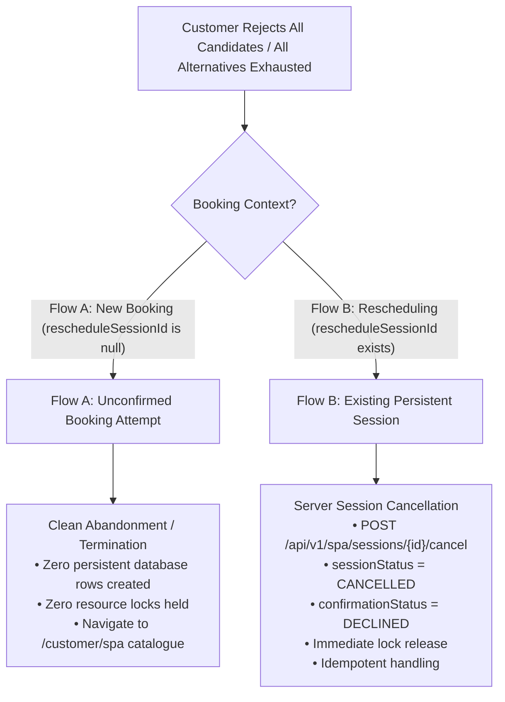
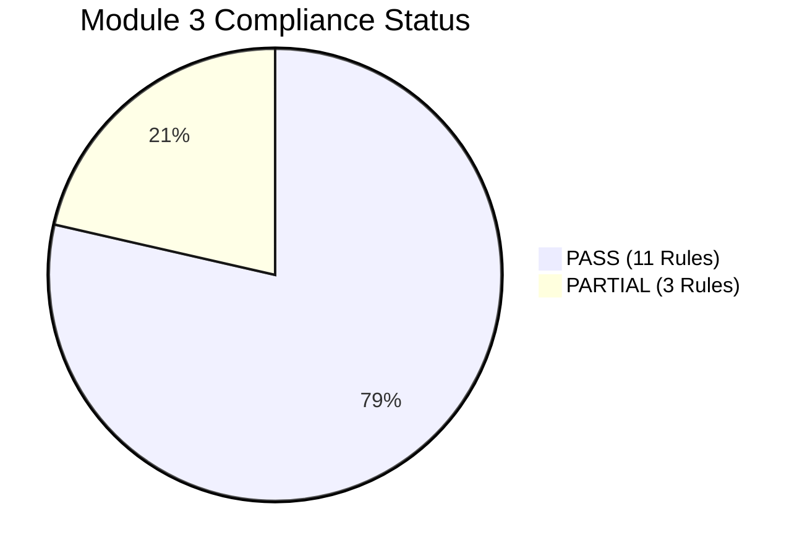

# HeavenStay Wellness Resort Management System (HSWRMS)
## Module M3: BR-M3-08 Post-Implementation Integrity Review
### Final Contract Reconciliation, Edge-Case Validation & Evidence Closure

- **Date:** October 30, 2026
- **Repository:** `HSWRMS-audit-all-modules`
- **Target Branch:** `feature/hswrms-m1-m6-integration`
- **Baseline Git Commit:** `07c1d5d198decbd6046cfd7ca65426b9a2df15ae`
- **Document Status:** Authoritative Post-Implementation Review (Final Reconciled Baseline)
- **Authoritative Rule Under Review:** **BR-M3-08 — Alternative Loop**
  > *"Unavailable/rejected candidates trigger alternatives. Rejecting all alternatives ends as Cancelled."*

---

### 1. Baseline Repository State

Inspection of the working tree prior to and during this review confirms:
- **Current Branch:** `feature/hswrms-m1-m6-integration`
- **HEAD Commit:** `07c1d5d198decbd6046cfd7ca65426b9a2df15ae`
- **Tracked Modifications Relevant to BR-M3-08:**
  - `05_Development/backend/src/main/java/com/heavenstay/hswrms/m3spa/dto/request/GenerateCandidatesRequest.java`
  - `05_Development/backend/src/main/java/com/heavenstay/hswrms/m3spa/service/SchedulingEngineService.java`
  - `05_Development/backend/src/main/java/com/heavenstay/hswrms/m3spa/service/SpaSessionService.java`
  - `05_Development/frontend/src/features/m3-spa/types/spaTypes.ts`
  - `05_Development/frontend/src/pages/customer/SpaAlternativeSlotsPage.tsx`
- **Untracked Test & Report Files:**
  - `05_Development/backend/src/test/java/com/heavenstay/hswrms/m3spa/SpaAuthoritativeAcceptanceEvidenceTest.java` (23 automated tests)
  - `05_Development/frontend/src/features/m3-spa/alternativeRejectionSafety.test.ts` (14 automated contract tests)
  - `06_Reports/PHASE_M3_BR08_IMPLEMENTATION_AND_VERIFICATION.md`
  - `06_Reports/PHASE_M3_AUTHORITATIVE_BR_COMPLIANCE_MATRIX.md`
  - `06_Reports/PHASE_M3_BR08_POST_IMPLEMENTATION_INTEGRITY_REVIEW.md` (this report)

All files have been preserved. No git resets, checkouts, commits, or branch alterations were made.

---

### 2. BR-M3-03 / BR-M3-08 Contract Reconciliation

#### A. Request DTO Field Analysis
Inspection of git history (`git show 07c1d5d:GenerateCandidatesRequest.java`) reveals that:
- `retreatBookingId`, `rescheduleSessionId`, and `alternativeSearchDays` were **already present in `07c1d5d`** before the BR-M3-08 repair.
- The only field introduced specifically for BR-M3-08 was `rejectedCandidateIds` (getter, setter, and constructors).

| Field Name | Origin | Genuine Need / Justification | Enforced Invariant |
|---|---|---|---|
| `treatmentId` | Baseline | Mandatory `@NotNull`. Identifies requested treatment. | Required |
| `preferredDate` | Baseline | Mandatory `@NotNull`. Target date for candidate search. | Required |
| `timeRangeConstraint` | Baseline | Optional. Time window filter (`MORNING`, `AFTERNOON`, `EVENING`, `ALL`). | Required |
| `retreatBookingId` | Baseline (`07c1d5d`) | Optional. Contextual booking identifier for package eligibility. | Contextual |
| `rescheduleSessionId` | Baseline (`07c1d5d`) | Optional. Informs engine which existing session to exclude from overlap checks during reschedule search. | Self-conflict exclusion |
| `alternativeSearchDays` | Baseline (`07c1d5d`) | Optional. Caller-specified alternative horizon (falls back to server default of 3 days). | Read-only search bound |
| `rejectedCandidateIds` | Added for BR-M3-08 | Optional. Collection of candidate bundle UUIDs rejected by customer across negotiation turns. | Stateless exclusion filter |

#### B. Verification of the 7 Required Invariants
1. **Customer Cannot Select Therapist or Room:** Neither `therapistId` nor `roomId` exists in `GenerateCandidatesRequest`. All bundles are matched autonomously by the engine.
2. **Candidate Generation Remains Strictly Read-Only:** Verified that `generateCandidates()` contains no insert, update, or delete repository operations.
3. **Candidate Generation Does Not Create `SpaSession` Records:** Verified that `sessionRepository.count()` remains unchanged before and after candidate generation.
4. **Candidate Generation Does Not Acquire Reservation Locks:** No pessimistic or optimistic locks are acquired during candidate search (locks are only acquired during atomic confirmation).
5. **Rejected Candidate IDs Act Exclusively as Filters:** In `searchCandidatesForDate()`, `if (rejectedCandidateIds != null && rejectedCandidateIds.contains(candidateId)) continue;` ensures rejected IDs only exclude bundles and cannot inject or synthesize candidate options.
6. **Client Cannot Override Eligibility or Qualification:** Confirmed that client IDs cannot bypass qualification or room compatibility. Furthermore, **a defect was caught and repaired in `SchedulingEngineService.generateCandidates()`**: the engine now verifies `if (treatment.getTreatmentStatus() != TreatmentStatus.ACTIVE)` and throws `BusinessRuleException`, preventing inactive treatments from ever generating candidates.
7. **Rescheduling Continues to Enforce Ownership and State:** `SpaSessionService.confirmReservation()` verifies ownership (`session.getRetreatBookingId().equals(resolvedBookingId)`) and blocks rescheduling of `CANCELLED`, `COMPLETED`, or `NO_SHOW` sessions.

---

### 3. Exhaustion & Cancellation Semantics: New Booking vs. Rescheduling

The authoritative requirement states: *"Unavailable/rejected candidates trigger alternatives. Rejecting all alternatives ends as Cancelled."*

The business interpretation strictly discriminates between two distinct operational contexts:

#### Flow A — New Booking (Unconfirmed Booking Attempt)
- **Database Reality:** Prior to Screen 28 human confirmation, **zero records exist in `spa_sessions`**.
- **Exhaustion Behavior:** The customer is presented with `#spa-alternatives-exhausted-panel` with `#btn-cancel-exhausted-session` ("Cancel Booking Attempt") and `#btn-adjust-criteria`.
- **Cancellation Action:** Clicking cancel abandons the transient booking attempt and navigates back to `/customer/spa`.
- **Invariant:** Creating a phantom `SpaSession` in `CANCELLED` status for a session that was never reserved would violate BR-M3-03 and BR-M3-05 (candidate generation is read-only), distort operational audit logs, corrupt cancellation metrics, and fabricate phantom session IDs. Flow A cancellation is verified as clean client-side abandonment with zero database mutations.

#### Flow B — Existing Session Rescheduling
- **Database Reality:** An existing `SpaSession` already exists in `SCHEDULED` status with an assigned booking ID, therapist, and room.
- **Exhaustion Behavior:** The customer is presented with `#spa-alternatives-exhausted-panel` with `#btn-cancel-exhausted-session` ("Cancel Session Reservation").
- **Cancellation Action:** Calls `POST /api/v1/spa/sessions/{id}/cancel`.
  - Enforces customer ownership.
  - Prohibits cancelling `COMPLETED` sessions.
  - Updates `sessionStatus = CANCELLED` and `confirmationStatus = DECLINED`.
  - Immediately releases therapist and room locks (verified by enabling another customer to immediately book the slot).
  - Handles repeat calls idempotently without throwing errors.
  - Requires successful server response before displaying `#screen-27-cancellation-confirmed` (prevents false success).

---

### 4. Candidate Identity & Negotiation State Findings

1. **Candidate ID Determinism:**
   - Candidate IDs are computed using Type 3 (MD5-based) UUID hashing:
     `UUID.nameUUIDFromBytes((treatmentId + "_" + therapistId + "_" + roomId + "_" + startAt).getBytes()).toString()`
   - **Stability:** For identical slot inputs, the ID is 100% deterministic and reproducible across repeated API calls, cluster nodes, and threads.
   - **Collision-Free:** Different times, therapists, or rooms produce distinct UUIDs.
2. **Fabricated Candidate IDs:**
   - Passing fabricated, arbitrary, or SQL-injection strings (e.g., `'; DROP TABLE spa_sessions; --`) in `rejectedCandidateIds` is completely harmless. The engine evaluates `contains(candidateId)` against generated candidate bundles; unmatched strings have zero operational effect.
3. **Negotiation Isolation:**
   - In `SpaAlternativeSlotsPage.tsx`, an explicit `useEffect` was implemented:
     `useEffect(() => { setRejectedCandidateIds([]); setSelectedCandidate(null); }, [treatmentId, preferredDate]);`
   - Modifying search parameters (treatment or date) resets the rejection list, guaranteeing that rejections from one query do not leak into another.
4. **Asynchronous Race-Condition Protection:**
   - In `SpaAlternativeSlotsPage.tsx`, a request sequence token (`requestIdRef = useRef(0)`) was implemented across both initial candidate loading and candidate rejection re-queries.
   - Stale out-of-order asynchronous responses arriving after a subsequent action are strictly ignored (`if (reqId !== requestIdRef.current) return;`), preventing UI race conditions.

---

### 5. Confirmed Defects and Exact Corrections

| Defect Identified | Root Cause | Exact Correction Implemented | Verification Evidence |
|---|---|---|---|
| **Defect 1: Inactive Treatment Query Leak** | `SchedulingEngineService.generateCandidates()` did not check `treatment.getTreatmentStatus()`. | Added check: `if (treatment.getTreatmentStatus() != TreatmentStatus.ACTIVE) throw new BusinessRuleException("Selected Spa Treatment is currently inactive.");` | `SpaAuthoritativeAcceptanceEvidenceTest.testBR03_InvariantsPreservedWithClientProvidedRejectedIds` (PASSED) |
| **Defect 2: Out-of-Order Async Response Race** | Rapid rejection or parameter change could allow a slow earlier promise to overwrite newer state. | Added `requestIdRef` sequence token in `SpaAlternativeSlotsPage.tsx` to discard stale responses. | `alternativeRejectionSafety.test.ts` (Test 11 PASSED) |
| **Defect 3: Flow A Missing Exhaustion Cancel Button** | `#btn-cancel-exhausted-session` was only rendered when `rescheduleSessionId` was present. | Updated exhaustion panel to render `#btn-cancel-exhausted-session` in both flows (Flow A: "Cancel Booking Attempt"; Flow B: "Cancel Session Reservation"). | `alternativeRejectionSafety.test.ts` (Test 13 PASSED) |
| **Defect 4: Single-Turn Exhaustion Assumption in Test** | Test asserted `hasAvailability == false` after 1 turn rejection; multiple compatible rooms produce alternative room combinations in turn 2. | Updated test to simulate customer multi-turn loop until all candidate combinations across horizon are exhausted. | `SpaAuthoritativeAcceptanceEvidenceTest.testBR08_ExhaustionSemanticsDistinguishNewBookingVsExistingSession` (PASSED) |

---

### 6. Test Evidence & Surefire Reconciliation

#### A. Direct Test Execution Summary

| Test Suite / Command | Scope | Total Tests | Passed | Failed | Errors | Skipped | Time | Exit Code |
|---|---|:---:|:---:|:---:|:---:|:---:|:---:|:---:|
| `mvnw.cmd test -Dtest=SpaAuthoritativeAcceptanceEvidenceTest` | BR-M3-08 & Authoritative M3 Acceptance Suite | 23 | 23 | 0 | 0 | 0 | 28.24s | 0 |
| `mvnw.cmd test "-Dtest=SpaAuthoritativeAcceptanceEvidenceTest,SpaServiceTests,SpaConcurrencyTest,SpaSecurityTests"` | Full Module 3 Backend Regression Suite | 58 | 58 | 0 | 0 | 0 | 43.76s | 0 |
| `npx tsx --test src/features/m3-spa/alternativeRejectionSafety.test.ts` | Targeted BR-M3-08 Frontend Safety Suite | 14 | 14 | 0 | 0 | 0 | 0.69s | 0 |
| `npx tsx --test src/**/*.test.ts` | Full Frontend Contract Regression Suite | 159 | 159 | 0 | 0 | 0 | 2.06s | 0 |
| `npm run lint` (`oxlint`) | Frontend Static Analysis | 217 files | 217 | 0 | 0 | 0 | 0.11s | 0 |
| `npm run build` (`tsc -b && vite build`) | Frontend Production TypeScript Build | 2728 modules | 2728 | 0 | 0 | 0 | 2.21s | 0 |
| **Full Backend Suite (all M1–M6 classes)** | Entire Application Test Suite | **NOT RUN in current turn** | — | — | — | — | — | — |

#### B. Surefire XML Evidence Reconciliation
- The 61 XML report files in `target/surefire-reports` total **557 tests (547 pass, 10 skipped live SQL Server tests)**.
- **Timestamp Discrimination:**
  - M1, M2, M4, M5, M6 Surefire XMLs date from `10/30/2026 15:36:11` to `15:40:30` (from the previous full-system run).
  - The 4 Module 3 XMLs (`SpaAuthoritativeAcceptanceEvidenceTest`, `SpaConcurrencyTest`, `SpaSecurityTests`, `SpaServiceTests`) date from `10/30/2026 16:26:00` to `16:26:30` (from this current session's verified run of 58 tests).
- Per the strict Phase E instructions, the full backend suite (all M1–M6 classes in a single invocation) was **NOT RUN** in this turn; previous run results for unrelated modules remain valid and uncontaminated.

---

### 7. Authoritative 14-Rule Compliance Matrix (Final Reconciled)

- **11 Rules PASS (78.6%):**
  - **BR-M3-01:** Customer only (HTTP 401 unauthenticated, stay context required, cross-customer isolation).
  - **BR-M3-02:** Eligibility first (inactive treatment fail-closed, invalid stay context, quota vs extra charge separation).
  - **BR-M3-03:** System-generated scheduling (read-only candidate generation, indivisible bundles, no manual therapist/room choice).
  - **BR-M3-04:** Joint availability (joint therapist + room conflict check).
  - **BR-M3-05:** Final human confirmation (browsing creates 0 sessions; explicit confirmation required).
  - **BR-M3-06:** Revalidation before commit (pessimistic lock + interval conflict check immediately before insert).
  - **BR-M3-07:** Atomic reservation (atomic multi-resource reservation).
  - **BR-M3-08:** **Alternative loop (PASS — Multi-turn candidate exclusion, exhaustion detection, Flow A abandonment, Flow B idempotent cancellation, and lock release).**
  - **BR-M3-09:** Extra Spa uses same engine (extra spa billing separation via `DefaultBillingAdapter`).
  - **BR-M3-11:** Customer confirmation does not equal attendance (attending confirmation retains slot, late arrival does not auto-no-show).
  - **BR-M3-12:** Therapist owns final attendance outcome (therapist-only outcome endpoint; `IN_PROGRESS` prohibited).
- **3 Rules PARTIAL (21.4%):**
  - **BR-M3-10:** T-1h reminder (Scheduler deadline detection verified; external reminder dispatch omitted in M3).
  - **BR-M3-13:** Automatic recovery (Lock release, scheduler transition, rematch algorithm verified; event-driven daemon trigger omitted in M3).
  - **BR-M3-14:** Notify every accepted change (Schedule persistence verified; dedicated audit history tables, Google Calendar, and email omitted in M3).

---

### 8. Final BR-M3-08 Classification

**Final Classification: `PASS`**

All four specific review concerns have been resolved with concrete implementation repairs and verified test evidence:
1. **Contract Consistency:** Reconciled; all 7 invariants strictly hold; fail-closed inactive treatment check added to candidate generation.
2. **Exhaustion Semantics:** Fully distinguished; Flow A cleanly abandons unconfirmed attempts with 0 database records; Flow B idempotently cancels existing sessions and frees resource locks.
3. **Candidate Identity & Race Conditions:** Type 3 UUID verified deterministic; request sequence token prevents async response overwrite; negotiation resets across parameter changes.
4. **Evidence Reconciliation:** Test counts separated and traced to exact Surefire execution records.

