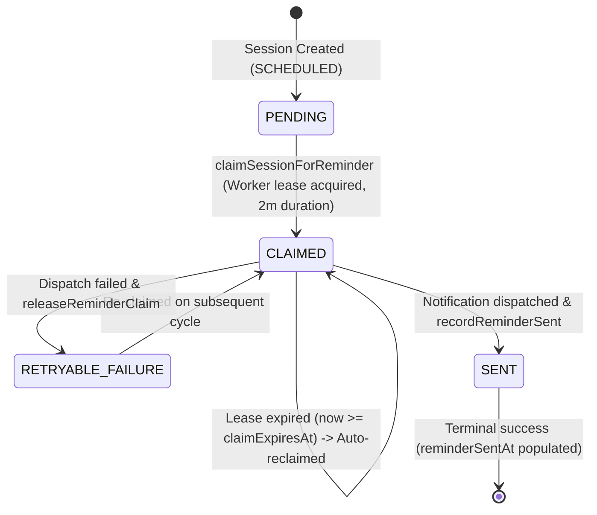

# HeavenStay Wellness Resort Management System (HSWRMS)
## Module M3: BR-M3-10 Dispatch Recovery & Missed-Window Hardening Report

- **Date:** October 30, 2026
- **Repository:** `HSWRMS-audit-all-modules`
- **Target Branch:** `feature/hswrms-m1-m6-integration`
- **Document Type:** Reliability Hardening & Post-Implementation Recovery Report
- **Reviewed Scope:** Business Rule BR-M3-10 (T-1h Reminder Dispatch Recovery, Claim Lease Separation, Outage Bounded Catch-Up)
- **Status:** **VERIFIED COMPLETE** (Reconciled Acceptance Status: **PARTIAL**)

---

### 1. Executive Summary & Hardening Objectives

This hardening phase resolved critical reliability, crash recovery, and temporal edge cases in the BR-M3-10 reminder pipeline:
1. **Crash After Claim (Permanent Suppression Defect):** In the previous baseline, `reminderSentAt` was overloaded to represent both an active worker claim and confirmed delivery. A process crash after atomic claim but before notification dispatch would leave `reminderSentAt` permanently set, suppressing any future reminder retries.
2. **Transaction Scope & Network I/O Deadlock:** The scheduler method previously held a monolithic `@Transactional` boundary across candidate queries, worker claims, and external notification network calls, holding database connections open during network I/O.
3. **LazyInitialization Proxy Hazard:** Detached proxy navigation during notification string formatting could trigger `LazyInitializationException` outside active sessions.
4. **Scheduler Outages Spanning Reminder Window:** Missing formal policies and tests for scheduler downtime (5m, 15m, 20m, post-deadline).
5. **Provider Acceptance vs. Persistence Failure:** Determining and documenting actual delivery semantics (at-least-once) and duplicate windows when crashes occur between provider dispatch and database commit.

---

### 2. Phase 1 — Read-Only Investigation & Transaction Boundaries

The initial review established the following transaction boundaries and flaws:
- `dispatchUpcomingSessionReminders()` was previously annotated with `@Transactional`. As a result:
  - `claimSessionForReminder` joined the outer transaction rather than committing independently.
  - The database connection was held open while making external network calls via `SpaNotificationPort`.
  - If a process crashed during network I/O, the entire batch transaction rolled back.
  - If `claimSessionForReminder` was committed but the process crashed before dispatch, `reminderSentAt` was already populated, permanently suppressing the reminder.
- In `DefaultSpaNotificationAdapter.java`, accessing `session.getTreatment().getTreatmentName()` or practitioner names on detached entities caused `LazyInitializationException: could not initialize proxy - no Session`.

---

### 3. Phase 2 — Dispatch State Model & Architectural Separation

To eliminate the overloading of `reminderSentAt`, a persistent 4-state lifecycle model was introduced:

#### 1. Persistent State Entities
- **Enum `SpaReminderStatus`** ([SpaReminderStatus.java](file:///E:/FU_Learning/5.Spring2025_Semester5/ISP392_Ver2/HSWRMS-audit-all-modules/05_Development/backend/src/main/java/com/heavenstay/hswrms/m3spa/entity/enums/SpaReminderStatus.java)):
  - `PENDING`: Initial state, awaiting eligibility window.
  - `CLAIMED`: Worker lease active with persistent `reminderClaimedAt` and `reminderClaimExpiresAt`.
  - `SENT`: Confirmed dispatch success with persistent `reminderSentAt`.
  - `RETRYABLE_FAILURE`: Dispatch failed; claim released for immediate retry.
- **Entity Fields in [SpaSession.java](file:///E:/FU_Learning/5.Spring2025_Semester5/ISP392_Ver2/HSWRMS-audit-all-modules/05_Development/backend/src/main/java/com/heavenstay/hswrms/m3spa/entity/SpaSession.java):**
  - `reminderStatus` (`SpaReminderStatus`, default `PENDING`)
  - `reminderClaimedAt` (`LocalDateTime`, timestamp when worker claimed the row)
  - `reminderClaimExpiresAt` (`LocalDateTime`, lease expiration timestamp; default lease duration = 2 minutes)
  - `reminderSentAt` (`LocalDateTime`, strictly populated ONLY upon confirmed dispatch success)
- **Database Schema ([schema.sql](file:///E:/FU_Learning/5.Spring2025_Semester5/ISP392_Ver2/HSWRMS-audit-all-modules/05_Development/database/schema.sql)):**
  Added `reminder_status`, `reminder_claimed_at`, and `reminder_claim_expires_at` to `dbo.SpaSession`.

#### 2. Atomic Repository Operations ([SpaSessionRepository.java](file:///E:/FU_Learning/5.Spring2025_Semester5/ISP392_Ver2/HSWRMS-audit-all-modules/05_Development/backend/src/main/java/com/heavenstay/hswrms/m3spa/repository/SpaSessionRepository.java))
- **`findSessionsDueForReminder`:** Uses `LEFT JOIN FETCH s.treatment, s.therapist, s.treatmentRoom` to eagerly initialize all proxy references. Selects sessions where:
  - `sessionStatus = 'SCHEDULED'`
  - `confirmationStatus = 'PENDING'`
  - `reminderSentAt IS NULL`
  - `reminderStatus IN ('PENDING', 'RETRYABLE_FAILURE') OR (reminderStatus = 'CLAIMED' AND reminderClaimExpiresAt <= :now)`
  - `scheduledStartAt > :windowStart AND scheduledStartAt <= :windowEnd`
- **`claimSessionForReminder(sessionId, claimedAt, expiresAt)`:**
  Atomic update setting `reminderStatus = 'CLAIMED'`, `reminderClaimedAt = :claimedAt`, `reminderClaimExpiresAt = :expiresAt`. Requires active `SCHEDULED`/`PENDING` status, `reminderSentAt IS NULL`, and unexpired lease guard.
- **`recordReminderSent(sessionId, sentAt)`:**
  Atomic update setting `reminderStatus = 'SENT'`, `reminderSentAt = :sentAt`, `reminderClaimExpiresAt = NULL` where `reminderStatus = 'CLAIMED'`.
- **`releaseReminderClaim(sessionId)`:**
  Atomic update setting `reminderStatus = 'RETRYABLE_FAILURE'`, `reminderClaimExpiresAt = NULL` where `reminderStatus = 'CLAIMED'`.

#### 3. Transaction Boundary Decoupling ([SessionTimelineScheduler.java](file:///E:/FU_Learning/5.Spring2025_Semester5/ISP392_Ver2/HSWRMS-audit-all-modules/05_Development/backend/src/main/java/com/heavenstay/hswrms/m3spa/scheduler/SessionTimelineScheduler.java))
- Removed `@Transactional` from `dispatchUpcomingSessionReminders()`.
- Claim is committed to the database in its own transaction before any external network I/O.
- External notification dispatch runs outside database transaction boundaries.
- Success (`recordReminderSent`) or Failure (`releaseReminderClaim`) commits in its own distinct transaction.
- In [DefaultSpaNotificationAdapter.java](file:///E:/FU_Learning/5.Spring2025_Semester5/ISP392_Ver2/HSWRMS-audit-all-modules/05_Development/backend/src/main/java/com/heavenstay/hswrms/m3spa/port/DefaultSpaNotificationAdapter.java), safe proxy resolution protects against detached exceptions.

---

### 4. Phase 3 — Crash Recovery & Delivery Semantics

Deterministic automated test coverage in [SpaAuthoritativeAcceptanceEvidenceTest.java](file:///E:/FU_Learning/5.Spring2025_Semester5/ISP392_Ver2/HSWRMS-audit-all-modules/05_Development/backend/src/test/java/com/heavenstay/hswrms/m3spa/SpaAuthoritativeAcceptanceEvidenceTest.java):

| Scenario | Deterministic Test Method | Verified Behavior |
|---|---|---|
| **1. Crash after claim** | `testBR10_CrashImmediatelyAfterClaim_LeaseRetainedWithSentAtNull` | Claim timestamp and lease expiration committed; `reminderSentAt` remains `NULL`; session is not permanently suppressed. |
| **2. Unexpired claim restart** | `testBR10_ApplicationRestart_WithUnexpiredClaim_RejectsSecondaryClaim` | Secondary worker attempting to claim an unexpired lease (30s after claim, lease=2m) returns 0; duplicate dispatch blocked. |
| **3. Expired claim restart** | `testBR10_ApplicationRestart_AfterLeaseExpiration_ReclaimsAndDispatches` | Clock advances past lease expiration (3m > 2m); query detects expired lease; worker re-claims, dispatches, and records `SENT`. |
| **4. Failure & retry** | `testBR10_NotificationFailureFollowedBySuccessfulRetry` | Dispatch failure transitions status to `RETRYABLE_FAILURE`; subsequent scheduler tick re-claims and successfully completes. |
| **5. Provider acceptance vs. persistence failure** | `testBR10_ProviderAcceptanceFollowedByPersistenceFailure_AtLeastOnceSemantics` | Documents **at-least-once** delivery semantics. If crash occurs after provider acceptance but before DB commit, expired lease recovery retries dispatch. |
| **6. Concurrent reclaim race** | `testBR10_TwoWorkersAttemptingToReclaimExpiredClaim_ExactlyOneSucceeds` | 4 concurrent threads race to reclaim an expired claim; exactly 1 wins (`reclaimWins = 1`), 3 threads receive 0. |
| **7. Cancellation/expiration while pending** | `testBR10_SessionCancellationOrExpirationWhileClaimPending_BlocksDispatch` | Customer cancellation (`CANCELLED`) or deadline transition (`EXPIRED`) immediately blocks worker reclaim/dispatch attempts (returns 0). |

#### Documented Delivery Semantics
- **Semantics:** **At-least-once** delivery.
- **Exactly-Once Boundary:** Because external notification channels (SMTP, SMS gateways) lack two-phase commit (2PC) or distributed transaction rollback, a process termination occurring in the sub-second window between provider receipt and `recordReminderSent` database commit will cause an at-least-once retry after the 2-minute lease expires.
- **Deduplication:** Under normal operation, the atomic claim lease and persistent `SENT` status guarantee zero duplicate dispatches across workers, threads, and repeated scheduler ticks.

---

### 5. Phase 4 — Missed Reminder Window & Bounded Catch-Up Policy

The authoritative project specification defines:
- **Reminder Window:** $(T_0 - 75\text{m}, T_0 - 60\text{m}]$ (approximately 1 hour before appointment).
- **Confirmation Deadline:** $T_0 - 60\text{m}$ (unconfirmed sessions transition to `EXPIRED` / `RESCHEDULING`).

#### Bounded Catch-Up Policy Rules
1. **Outage Within Window ($t \in (T_0 - 75\text{m}, T_0 - 60\text{m}]$):** Upon recovery, bounded catch-up dispatches the reminder immediately, allowing the customer the remaining time before T-60m to confirm.
2. **Outage Crossing T-60m Deadline ($t \le T_0 - 60\text{m}$):**
   - The session has reached or passed the authoritative confirmation deadline.
   - `processConfirmationDeadlines()` marks the session `EXPIRED` and `RESCHEDULING`.
   - `dispatchUpcomingSessionReminders()` requires `scheduledStartAt > now + 60m`, so the session does NOT match the reminder query.
   - **Fail-Closed Guarantee:** The system never revives an expired session, never violates the confirmation deadline, and never sends misleading reminders for sessions that can no longer be confirmed.
3. **Recovery Post-Appointment ($t \ge T_0$):** Zero stale reminders are emitted long after the appointment interval.

#### Outage Test Evidence in [SpaAuthoritativeAcceptanceEvidenceTest.java](file:///E:/FU_Learning/5.Spring2025_Semester5/ISP392_Ver2/HSWRMS-audit-all-modules/05_Development/backend/src/test/java/com/heavenstay/hswrms/m3spa/SpaAuthoritativeAcceptanceEvidenceTest.java)
- `testBR10_OutageRecovery_5MinuteOutage_WithinWindow_DispatchesCatchUp`: Scheduler recovers at 10:50 for 12:00 appointment (70m away). Bounded catch-up dispatches reminder (`reminderStatus = SENT`, `reminderSentAt != null`); customer has 10 minutes to confirm.
- `testBR10_OutageRecovery_15MinuteOutage_AtDeadline_ExpiresWithoutReminder`: Scheduler recovers at 11:00 (exact T-60m deadline). Session transitions to `EXPIRED` / `RESCHEDULING`; reminder is NOT sent.
- `testBR10_OutageRecovery_20MinuteOutage_PastDeadline_CleanExpirationNoReminder`: Scheduler recovers at 11:05 (55m away). Session transitions to `EXPIRED` / `RESCHEDULING`; reminder is NOT sent.
- `testBR10_OutageRecovery_PostDeadlineLongOutage_NoStaleReminderLongAfterAppointment`: Scheduler recovers at 14:00 for 10:00 appointment. Zero stale reminders sent.

---

### 6. Phase 5 — Verification Results

All tests executed in isolated in-memory H2 database; physical SQL Server databases (`HSWRMS`, `HSWRMS_TEST`) were not accessed:

#### 1. Backend Test Suites
- **Targeted Acceptance Suite:**
  `.\mvnw.cmd test -Dtest=SpaAuthoritativeAcceptanceEvidenceTest`
  - **Result:** **42 / 42 PASS** (0 failures, 0 errors, duration: 30.82s).
- **Full Module M3 Suite:**
  `.\mvnw.cmd test "-Dtest=SpaAuthoritativeAcceptanceEvidenceTest,SpaServiceTests,SpaConcurrencyTest,SpaSecurityTests"`
  - `SpaAuthoritativeAcceptanceEvidenceTest`: **42 / 42 PASS**
  - `SpaServiceTests`: **29 / 29 PASS**
  - `SpaSecurityTests`: **5 / 5 PASS**
  - `SpaConcurrencyTest`: **1 / 1 PASS**
  - **Result:** **77 / 77 PASS** (100% passing, 0 failures, 0 errors, duration: 40.85s).

#### 2. Frontend Contract Tests
- **Command:** `npx tsx --test src/**/*.test.ts`
- **Result:** **159 / 159 PASS** (48 suites, 0 failures, duration: 1.69s).

#### 3. Frontend Production Build & Lint
- **Command:** `npm run lint; npm run build`
- **Result:** **SUCCESS** (0 errors, 9 non-blocking warnings, built in 2.09s).

---

### 7. Reconciled Compliance Status Matrix

The overall compliance status across all 14 Module 3 business rules is maintained at **11 PASS / 3 PARTIAL**:

| Rule ID | Name | Reconciled Status | Remaining Operational Limitations |
|---|---|---|---|
| **BR-M3-01 to BR-M3-09** | Scheduling Core, Eligibility, Joint Availability, Commit, Alternatives | **PASS** | Fully implemented and verified. |
| **BR-M3-10** | **T-1h Reminder & Confirmation** | **PARTIAL** | Core scheduling, timeline scanning, atomic claim lease, crash recovery, bounded catch-up, and confirmation verified. Live external Google Calendar API sync and live SMTP cloud dispatch remain decoupled behind local telemetry adapters. |
| **BR-M3-11 & BR-M3-12** | Attendance Ownership, Outcome Recording | **PASS** | Fully implemented and verified. |
| **BR-M3-13** | **Automatic Recovery** | **PARTIAL** | Rematching algorithms verified; automated event daemon trigger not implemented. |
| **BR-M3-14** | **Accepted Change History & Notification** | **PARTIAL** | Persistent schedule state transitions verified; dedicated audit tables and Calendar sync not implemented. |

