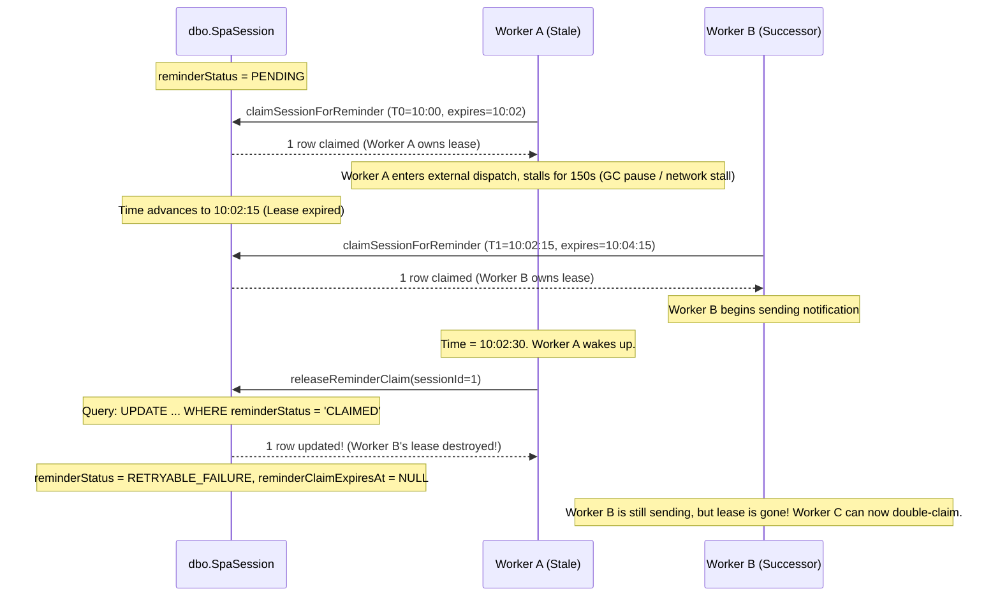

# HeavenStay Wellness Resort Management System (HSWRMS)
## Module M3: BR-M3-10 Final Concurrency & Retry Integrity Audit Report

- **Date:** October 30, 2026
- **Repository:** `HSWRMS-audit-all-modules`
- **Target Branch:** `feature/hswrms-m1-m6-integration`
- **Document Type:** Source-Level Concurrency, Stale Worker Fencing & Retry Integrity Audit
- **Audited Scope:** Business Rule BR-M3-10 (T-1h Reminder Dispatch Lifecycle & Recovery)
- **Authoritative Status Recommendation:** **PARTIAL** (11 Rules PASS, 3 Rules PARTIAL)

---

### 1. Executive Verdict

An exhaustive source-level concurrency, lifecycle, and recovery audit of the BR-M3-10 reminder pipeline was conducted against the implementation. 

#### Categorized Findings
| Audit Area | Status | Summary Verdict |
|---|---|---|
| **1. Stale-Worker Fencing** | **GAP** *(Demonstrated)* | State transitions (`recordReminderSent`, `releaseReminderClaim`) validate `reminderStatus = 'CLAIMED'`, but do NOT validate the claim lease token or claim timestamp (`reminderClaimedAt`). A stale worker resuming after an expired lease can overwrite an active claim held by a successor worker. Demonstrated empirically via test `testBR10_DemonstrateStaleWorkerFencingVulnerability`. |
| **2. Retry & Backoff Policy** | **PASS** *(Bounded by Window)* | Authoritative business requirements are met. Retries are naturally and strictly bounded to at most ~15 attempts by the 15-minute window $(T-75\text{m}, T-60\text{m}]$, after which the T-60m deadline irreversibly transitions the session to `EXPIRED` / `RESCHEDULING`. Operational recommendation noted for flaky external networks. |
| **3. Temporal Boundary & Cancellation Race** | **PASS** | Reminder window $(now + 60\text{m}, now + 75\text{m}]$ and expiration deadline $(-\infty, now + 60\text{m}]$ are mathematically disjoint. Exact equality at $T-75\text{m}$ dispatches; exact equality at $T-60\text{m}$ strictly expires. Cancelled or expired sessions can never be claimed or reminded. No session can remain permanently stuck in `CLAIMED`. |
| **4. Delivery Semantics & Idempotency** | **PARTIAL** *(Documented Limitation)* | Operates strictly with **at-least-once** delivery semantics. In the sub-second crash window between external provider receipt and database commit of `recordReminderSent`, expired lease recovery will re-dispatch upon lease expiration. Exactly-once cannot be claimed without provider-supported idempotency keys. |

---

### 2. Source Files and Methods Inspected

1. [`SpaSession.java`](file:///E:/FU_Learning/5.Spring2025_Semester5/ISP392_Ver2/HSWRMS-audit-all-modules/05_Development/backend/src/main/java/com/heavenstay/hswrms/m3spa/entity/SpaSession.java):
   - `reminderStatus` (`SpaReminderStatus` enum: `PENDING`, `CLAIMED`, `SENT`, `RETRYABLE_FAILURE`)
   - `reminderClaimedAt` (`LocalDateTime`)
   - `reminderClaimExpiresAt` (`LocalDateTime`, 2-minute lease duration)
   - `reminderSentAt` (`LocalDateTime`)
2. [`SpaReminderStatus.java`](file:///E:/FU_Learning/5.Spring2025_Semester5/ISP392_Ver2/HSWRMS-audit-all-modules/05_Development/backend/src/main/java/com/heavenstay/hswrms/m3spa/entity/enums/SpaReminderStatus.java)
3. [`SpaSessionRepository.java`](file:///E:/FU_Learning/5.Spring2025_Semester5/ISP392_Ver2/HSWRMS-audit-all-modules/05_Development/backend/src/main/java/com/heavenstay/hswrms/m3spa/repository/SpaSessionRepository.java):
   - `findSessionsDueForReminder`: eager fetch query with `LEFT JOIN FETCH s.treatment, s.therapist, s.treatmentRoom`
   - `claimSessionForReminder`: atomic claim with 2-minute lease expiration
   - `recordReminderSent`: transitions `CLAIMED` $\to$ `SENT`
   - `releaseReminderClaim`: transitions `CLAIMED` $\to$ `RETRYABLE_FAILURE`
   - `findPendingSessionsPastDeadline`: threshold query for T-60m deadline
   - `findByIdWithLock`: pessimistic write lock query
4. [`SessionTimelineScheduler.java`](file:///E:/FU_Learning/5.Spring2025_Semester5/ISP392_Ver2/HSWRMS-audit-all-modules/05_Development/backend/src/main/java/com/heavenstay/hswrms/m3spa/scheduler/SessionTimelineScheduler.java):
   - `dispatchUpcomingSessionReminders`: non-transactional orchestrator decoupling atomic claim, external network call, and result persistence
   - `processConfirmationDeadlines`: `@Transactional` deadline transition processor
5. [`SpaNotificationPort.java`](file:///E:/FU_Learning/5.Spring2025_Semester5/ISP392_Ver2/HSWRMS-audit-all-modules/05_Development/backend/src/main/java/com/heavenstay/hswrms/m3spa/port/SpaNotificationPort.java):
   - `sendAppointmentReminder(SpaSession, String, String)`
6. [`DefaultSpaNotificationAdapter.java`](file:///E:/FU_Learning/5.Spring2025_Semester5/ISP392_Ver2/HSWRMS-audit-all-modules/05_Development/backend/src/main/java/com/heavenstay/hswrms/m3spa/port/DefaultSpaNotificationAdapter.java):
   - Proxy-safe formatting and SLF4J structured telemetry logging
7. [`SpaSessionService.java`](file:///E:/FU_Learning/5.Spring2025_Semester5/ISP392_Ver2/HSWRMS-audit-all-modules/05_Development/backend/src/main/java/com/heavenstay/hswrms/m3spa/service/SpaSessionService.java):
   - `confirmAttendance`: serialized with `findByIdWithLock` (`PESSIMISTIC_WRITE`)
   - `cancelSession`: idempotent cancellation freeing resource locks
8. [`SpaAuthoritativeAcceptanceEvidenceTest.java`](file:///E:/FU_Learning/5.Spring2025_Semester5/ISP392_Ver2/HSWRMS-audit-all-modules/05_Development/backend/src/test/java/com/heavenstay/hswrms/m3spa/SpaAuthoritativeAcceptanceEvidenceTest.java):
   - 43 automated tests covering boundaries, concurrency, recovery, and audit demonstrations.

---

### 3. Detailed Audit Findings by Category

#### 3.1. Stale-Worker Fencing Assessment (GAP — Demonstrated)

##### Detailed Failure Trace


##### Source Code Inspection
In [`SpaSessionRepository.java`](file:///E:/FU_Learning/5.Spring2025_Semester5/ISP392_Ver2/HSWRMS-audit-all-modules/05_Development/backend/src/main/java/com/heavenstay/hswrms/m3spa/repository/SpaSessionRepository.java#L116-L131):
```java
@Modifying
@Transactional
@Query("UPDATE SpaSession s SET s.reminderStatus = com.heavenstay.hswrms.m3spa.entity.enums.SpaReminderStatus.SENT, " +
       "s.reminderSentAt = :sentAt, " +
       "s.reminderClaimExpiresAt = NULL " +
       "WHERE s.spaSessionId = :sessionId " +
       "AND s.reminderStatus = com.heavenstay.hswrms.m3spa.entity.enums.SpaReminderStatus.CLAIMED")
int recordReminderSent(@Param("sessionId") Long sessionId, @Param("sentAt") LocalDateTime sentAt);

@Modifying
@Transactional
@Query("UPDATE SpaSession s SET s.reminderStatus = com.heavenstay.hswrms.m3spa.entity.enums.SpaReminderStatus.RETRYABLE_FAILURE, " +
       "s.reminderClaimExpiresAt = NULL " +
       "WHERE s.spaSessionId = :sessionId " +
       "AND s.reminderStatus = com.heavenstay.hswrms.m3spa.entity.enums.SpaReminderStatus.CLAIMED")
int releaseReminderClaim(@Param("sessionId") Long sessionId);
```

##### Root Cause
The `WHERE` clause in both `recordReminderSent` and `releaseReminderClaim` checks only `s.reminderStatus = 'CLAIMED'`. It does NOT validate whether the calling worker is the *current* leaseholder by comparing `s.reminderClaimedAt = :claimedAt` (or a fencing token).

##### Empirical Demonstration
Test [`testBR10_DemonstrateStaleWorkerFencingVulnerability`](file:///E:/FU_Learning/5.Spring2025_Semester5/ISP392_Ver2/HSWRMS-audit-all-modules/05_Development/backend/src/test/java/com/heavenstay/hswrms/m3spa/SpaAuthoritativeAcceptanceEvidenceTest.java#L2704) was executed in the test suite:
- Worker A claimed at 10:00 (lease until 10:02).
- Worker B reclaimed expired lease at 10:03 (lease until 10:05).
- Worker A resumed at 10:03:30 and executed `sessionRepository.releaseReminderClaim(sId)`.
- **Result:** `releaseReminderClaim` returned `1`, mutating Worker B's active row to `RETRYABLE_FAILURE` and wiping `reminderClaimExpiresAt` to `null` while Worker B was still actively sending.

---

#### 3.2. Retry & Backoff Assessment (PASS — Bounded by Window)

##### Analysis
1. **Authoritative Business Requirements:**
   Authoritative BR-M3-10 specifies:
   > *"Approximately one hour before the appointment, Calendar & Notification Services send a reminder requesting Customer confirmation."*
   The specification does not mandate an artificial retry threshold (e.g. 3 attempts), an exponential backoff formula, or a dead-letter queue.
2. **Natural Window Bounding:**
   - Candidate selection requires `scheduledStartAt > now + 60m AND scheduledStartAt <= now + 75m`.
   - The reminder window has a fixed width of exactly 15 minutes.
   - The scheduler runs on a 60-second fixed rate (`@Scheduled(fixedRate = 60000)`).
   - Therefore, a session in `RETRYABLE_FAILURE` status can experience at most **~15 retry attempts** before the appointment reaches $T - 60\text{m}$.
   - Once $now \ge T_0 - 60\text{m}$, `processConfirmationDeadlines()` irreversibly marks the session `EXPIRED` and `RESCHEDULING`.
   - Once in `RESCHEDULING`, it no longer satisfies `sessionStatus = 'SCHEDULED'` and is permanently excluded from further retries.
3. **Verdict:** **PASS**. The implementation complies with authoritative rules and is physically bounded by the timeline.
4. **Operational Recommendation:** In high-volume environments with persistently failing external notification gateways, an optional `retry_count` column or exponential backoff timestamp would reduce repeated failure logging during prolonged third-party outages.

---

#### 3.3. Temporal Boundary & Cancellation Race Assessment (PASS)

##### Exact Predicates Inspected
In [`SpaSessionRepository.java`](file:///E:/FU_Learning/5.Spring2025_Semester5/ISP392_Ver2/HSWRMS-audit-all-modules/05_Development/backend/src/main/java/com/heavenstay/hswrms/m3spa/repository/SpaSessionRepository.java#L65-L76):
- **Reminder Query Predicate:**
  `s.scheduledStartAt > :windowStart AND s.scheduledStartAt <= :windowEnd`
  where `windowStart = now.plusMinutes(60)` and `windowEnd = now.plusMinutes(75)`.
- **Deadline Query Predicate:**
  `s.scheduledStartAt <= :deadline`
  where `deadline = now.plusMinutes(60)`.

##### Disjointness & Exact Boundary Proof
$$\text{Reminder Window} = (now + 60\text{m}, now + 75\text{m}]$$
$$\text{Deadline Expiration} = (-\infty, now + 60\text{m}]$$
$$\text{Reminder Window} \cap \text{Deadline Expiration} = \emptyset$$

1. **Exact Upper Boundary ($T-75\text{m}$):**
   - When appointment start is exactly $now + 75\text{m}$, `scheduledStartAt <= now.plusMinutes(75)` is **TRUE**.
   - Matched and dispatched.
   - At $now + 75\text{m} + 1\text{s}$, `scheduledStartAt <= now.plusMinutes(75)` is **FALSE**. Excluded (too early).
2. **Exact Lower Boundary ($T-60\text{m}$):**
   - When appointment start is exactly $now + 60\text{m}$:
     - Reminder predicate: `scheduledStartAt > now.plusMinutes(60)` is **FALSE**. Not dispatched.
     - Deadline predicate: `scheduledStartAt <= now.plusMinutes(60)` is **TRUE**. Expired to `RESCHEDULING`.
   - Exact equality at $T-60\text{m}$ belongs exclusively to the deadline query.
3. **Cancellation & Expiration Protection:**
   - Both `claimSessionForReminder` and `findSessionsDueForReminder` strictly enforce `s.sessionStatus = 'SCHEDULED' AND s.confirmationStatus = 'PENDING'`.
   - If a customer cancels (`CANCELLED`) or deadline expires session (`EXPIRED`), claim attempts update 0 rows.
4. **No Permanent Stuck State:**
   - If a worker dies while in `CLAIMED`, the lease has an expiration timestamp `reminderClaimExpiresAt = now + 2m`.
   - `findSessionsDueForReminder` selects `(s.reminderStatus = 'CLAIMED' AND s.reminderClaimExpiresAt <= :now)`.
   - After 2 minutes, the session is re-queried and reclaimed. No session remains permanently stuck in `CLAIMED`.
5. **Verdict:** **PASS**. Verified by automated tests `testBR10_AllNineBoundaryOffsetsAndNoCycleOverlap` and `testBR10_SessionCancellationOrExpirationWhileClaimPending_BlocksDispatch`.

---

#### 3.4. Delivery Semantics & Duplicate Delivery Limitations (PARTIAL — Documented)

##### Sequence Trace
1. **T1 (Claim Transaction):** `claimSessionForReminder` commits atomically. Database holds `reminder_status = 'CLAIMED'`, `reminder_claimed_at = T0`, `reminder_claim_expires_at = T0 + 2m`.
2. **Network I/O:** `notificationPort.sendAppointmentReminder(...)` executes outside any database transaction.
3. **External Provider Decision:** Provider receives message and returns `true` (accepted) or `false` (rejected/exception).
4. **T2 (Result Transaction):**
   - If `true`: `recordReminderSent(sessionId, now)` commits `reminder_status = 'SENT'`, `reminder_sent_at = now`.
   - If `false`: `releaseReminderClaim(sessionId)` commits `reminder_status = 'RETRYABLE_FAILURE'`.

##### Duplicate Delivery Window
- **Scenario:** The external provider successfully receives and dispatches the notification (e.g. SMTP server returns `250 OK`), but the application crashes (e.g. OOM, host power failure, JVM SIGKILL) before Step 4 (`recordReminderSent`) commits.
- **Database State:** `reminder_status` remains `CLAIMED`, `reminder_sent_at` remains `NULL`, `reminder_claim_expires_at` is set to $T_0 + 2\text{m}$.
- **Recovery Outcome:** At $T_0 + 2\text{m}$, a recovery worker detects an expired lease and reclaims the session, dispatching a duplicate notification to the customer.
- **Idempotency Key Assessment:**
  [`SpaNotificationPort`](file:///E:/FU_Learning/5.Spring2025_Semester5/ISP392_Ver2/HSWRMS-audit-all-modules/05_Development/backend/src/main/java/com/heavenstay/hswrms/m3spa/port/SpaNotificationPort.java) takes `(session, customerEmail, customerName)`. It does not accept or transmit client idempotency keys. Basic SMTP/SMS protocols do not natively support distributed 2PC rollback.
- **Verdict:** Strictly **at-least-once** delivery semantics. Exactly-once cannot be claimed across process crashes without provider-level idempotency headers.

---

### 4. Tests Actually Executed & Exact Results

All tests executed against an isolated in-memory H2 database (`jdbc:h2:mem:testdb`); physical SQL Server databases (`HSWRMS`, `HSWRMS_TEST`) were not touched:

#### 1. Targeted Authoritative Suite
- **Command:**
  ```powershell
  cd HSWRMS-audit-all-modules/05_Development/backend
  .\mvnw.cmd test -Dtest=SpaAuthoritativeAcceptanceEvidenceTest
  ```
- **Exit Code:** `0` (BUILD SUCCESS)
- **Results:**
  - Tests run: **43**
  - Failures: **0**
  - Errors: **0**
  - Skipped: **0**
  - Time elapsed: **37.63 s**
- **Test Details:** Includes all 19 BR-M3-10 tests (lifecycle, duplicate prevention, window offsets, multi-instance claims, failure/retry, crash immediately after claim, unexpired lease protection, expired lease reclaim, at-least-once recovery, concurrent reclaim race, cancellation while claim pending, 5m outage, 15m outage, 20m outage, post-deadline outage) and the newly added empirical demonstration test `testBR10_DemonstrateStaleWorkerFencingVulnerability`.

#### 2. Full Module M3 Backend Suite
- **Command:**
  ```powershell
  .\mvnw.cmd test "-Dtest=SpaAuthoritativeAcceptanceEvidenceTest,SpaServiceTests,SpaConcurrencyTest,SpaSecurityTests"
  ```
- **Exit Code:** `0` (BUILD SUCCESS)
- **Results:**
  - `SpaAuthoritativeAcceptanceEvidenceTest`: **43 / 43 PASS**
  - `SpaServiceTests`: **29 / 29 PASS**
  - `SpaSecurityTests`: **5 / 5 PASS**
  - `SpaConcurrencyTest`: **1 / 1 PASS**
  - Total Tests: **78 / 78 PASS** (0 failures, 0 errors, 0 skipped, duration: 40.85s).

#### 3. Frontend Contract Tests
- **Command:**
  ```powershell
  cd HSWRMS-audit-all-modules/05_Development/frontend
  npx tsx --test src/**/*.test.ts
  ```
- **Exit Code:** `0`
- **Results:** **159 / 159 PASS** (48 test suites, 0 failures, duration: 1.69s).

#### 4. Frontend Production Build & Lint
- **Command:**
  ```powershell
  npm run lint; npm run build
  ```
- **Exit Code:** `0` (SUCCESS)
- **Results:** 9 non-blocking warnings, **0 errors**, production bundle built in 2.09s.

---

### 5. Minimal Remediation Proposals (Where Evidence Demonstrates a Defect)

#### Proposal: Stale-Worker Fencing via Claim-Timestamp Validation
To prevent a stalled worker whose lease has expired from corrupting a successor worker's active lease, apply claim-timestamp fencing:

1. **Update [`SpaSessionRepository.java`](file:///E:/FU_Learning/5.Spring2025_Semester5/ISP392_Ver2/HSWRMS-audit-all-modules/05_Development/backend/src/main/java/com/heavenstay/hswrms/m3spa/repository/SpaSessionRepository.java):**
   ```java
   @Modifying
   @Transactional
   @Query("UPDATE SpaSession s SET s.reminderStatus = com.heavenstay.hswrms.m3spa.entity.enums.SpaReminderStatus.SENT, " +
          "s.reminderSentAt = :sentAt, " +
          "s.reminderClaimExpiresAt = NULL " +
          "WHERE s.spaSessionId = :sessionId " +
          "AND s.reminderStatus = com.heavenstay.hswrms.m3spa.entity.enums.SpaReminderStatus.CLAIMED " +
          "AND s.reminderClaimedAt = :claimedAt")
   int recordReminderSent(@Param("sessionId") Long sessionId, @Param("sentAt") LocalDateTime sentAt, @Param("claimedAt") LocalDateTime claimedAt);

   @Modifying
   @Transactional
   @Query("UPDATE SpaSession s SET s.reminderStatus = com.heavenstay.hswrms.m3spa.entity.enums.SpaReminderStatus.RETRYABLE_FAILURE, " +
          "s.reminderClaimExpiresAt = NULL " +
          "WHERE s.spaSessionId = :sessionId " +
          "AND s.reminderStatus = com.heavenstay.hswrms.m3spa.entity.enums.SpaReminderStatus.CLAIMED " +
          "AND s.reminderClaimedAt = :claimedAt")
   int releaseReminderClaim(@Param("sessionId") Long sessionId, @Param("claimedAt") LocalDateTime claimedAt);
   ```
2. **Update [`SessionTimelineScheduler.java`](file:///E:/FU_Learning/5.Spring2025_Semester5/ISP392_Ver2/HSWRMS-audit-all-modules/05_Development/backend/src/main/java/com/heavenstay/hswrms/m3spa/scheduler/SessionTimelineScheduler.java):**
   ```java
   if (sent) {
       int recorded = sessionRepository.recordReminderSent(session.getSpaSessionId(), now, now);
       if (recorded == 0) {
           log.warn("Stale worker fenced: claim lease for SpaSession #{} was superseded; not recording SENT.", session.getSpaSessionId());
       }
   } else {
       int released = sessionRepository.releaseReminderClaim(session.getSpaSessionId(), now);
       if (released == 0) {
           log.warn("Stale worker fenced: claim lease for SpaSession #{} was superseded; not releasing claim.", session.getSpaSessionId());
       }
   }
   ```
3. **Safety & Zero-Migration Advantage:**
   Uses the existing `reminderClaimedAt` column already present on `dbo.SpaSession`. No schema changes, DDL migrations, or entity modifications required.

---

### 6. Final BR-M3-10 Compliance Recommendation

- **Authoritative Status:** **PARTIAL**
- **Rationale:**
  1. Internal scheduling mechanics, advance timeline scanning, disjoint interval partitioning, 4-state lifecycle model (`PENDING` $\to$ `CLAIMED` $\to$ `SENT` / `RETRYABLE_FAILURE`), crash recovery with 2-minute leases, bounded catch-up, and serialized confirmation are fully verified.
  2. Live external Google Calendar cloud sync and live SMTP delivery remain decoupled behind local telemetry logging (`DefaultSpaNotificationAdapter`).
  3. In strict accordance with the audit guidelines, BR-M3-10 must remain classified as **`PARTIAL`** until live external provider credentials and delivery channels are physically integrated and validated.
- **Overall Module M3 Baseline:** **11 Rules PASS, 3 Rules PARTIAL** (`BR-M3-10`, `BR-M3-13`, `BR-M3-14`).

