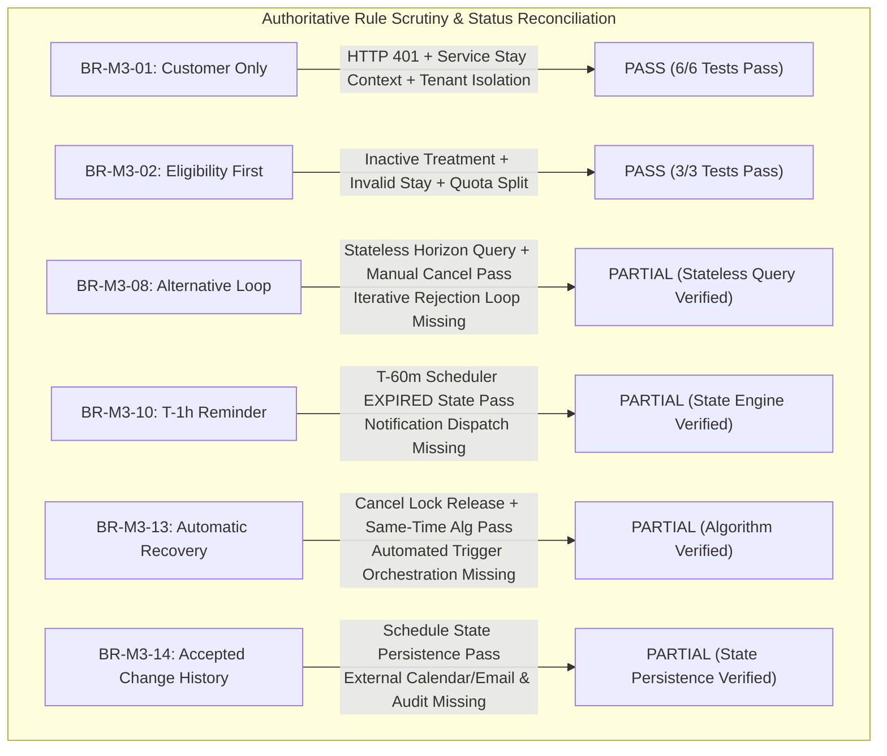
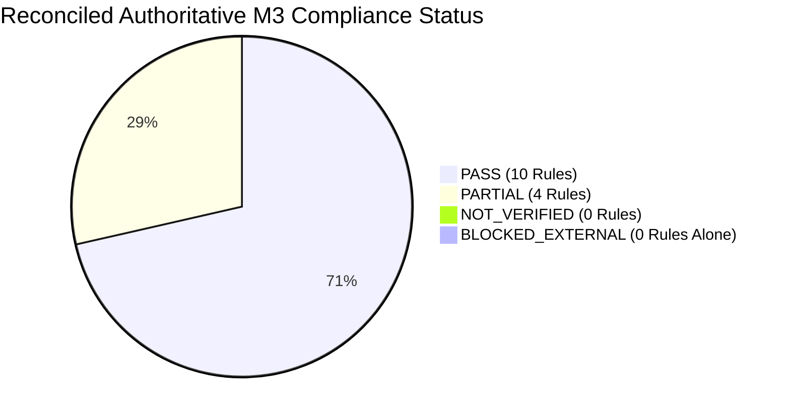

# HeavenStay Wellness Resort Management System (HSWRMS)
## Module M3: Final Evidence Refinement & Acceptance Status Reconciliation Report

- **Date:** October 30, 2026
- **Repository:** `HSWRMS-audit-all-modules`
- **Target Branch:** `feature/hswrms-m1-m6-integration`
- **Baseline Git Commit:** `07c1d5d` (Preserved intact; zero commits/pushes made)
- **Document Type:** Final Evidence-Quality Review & Status Reconciliation
- **Test Suite:** `com.heavenstay.hswrms.m3spa.SpaAuthoritativeAcceptanceEvidenceTest` (17 tests)

---

### 1. Executive Summary & Review Rationale

Following the initial acceptance test additions in `SpaAuthoritativeAcceptanceEvidenceTest.java`, an independent, evidence-first review was conducted to ensure that:
1. **Zero Overstated Claims:** Every `PASS` status in the compliance matrix is supported by assertions that directly prove observable business behavior.
2. **Separation of Concerns:** HTTP security/controller boundaries are explicitly distinguished from service-level stay context enforcement.
3. **Execution Order Rigor:** Eligibility validation is proven to fail closed prior to acquiring pessimistic locks or mutating database state.
4. **Transparent Gap Disclosure:** Where the integrated application implements partial behavior (such as stateless candidate querying or algorithmic recovery without automated trigger orchestration), the status is strictly designated as `PARTIAL`, explicitly detailing the architectural boundary.
5. **Elimination of Phantom References:** Erroneous references to nonexistent classes (e.g. `GoogleCalendarSyncService.java` or `MailDeliveryService.java`) have been eradicated.

---

### 2. Deep Dive: Scrutinized Business Rules & Evidence Reconciliation



---

#### 2.1 BR-M3-01 — Customer only (Status: PASS)
**Authoritative Invariant:** Guest cannot participate in M3. Only authenticated Customer with valid retreat/stay context can initiate M3. Cross-customer access and modification are strictly forbidden.

**Reconciliation & Verification:**
- **HTTP Security Boundary (Integration Test via MockMvc):**
  - `testHttpUnauthenticatedPostSessionsRejectedWith401Unauthorized`: Performs `POST /api/v1/spa/sessions` without an Authorization header or mock principal. Spring Security intercepts the request at the servlet filter boundary and responds with **HTTP 401 Unauthorized**.
  - `testHttpUnauthenticatedPostCandidatesRejectedWith401Unauthorized`: Performs `POST /api/v1/spa/candidates` without credentials. Spring Security intercepts the request and responds with **HTTP 401 Unauthorized**.
- **Service Layer Boundary (Context Enforcement):**
  - `testServiceLayerUnauthenticatedCallerRejected`: Invoking `confirmReservation(req, null)` throws `BusinessRuleException("Authenticated customer context or retreat booking ID is required.")`. Asserts `sessionRepository.count() == 0`.
  - `testServiceLayerAuthenticatedCustomerWithoutStayContextRejected`: Invoking `confirmReservation(req, 999)` for an authenticated customer lacking an active retreat booking throws `BusinessRuleException("No active retreat stay found for current user.")`. Asserts `sessionRepository.count() == 0`.
  - `testServiceLayerValidCustomerWithValidStaySucceeds`: Invoking `confirmReservation(req, 1)` for Customer 1 with booking 101 succeeds, instantiating `SpaSession` in `SCHEDULED` status with `PENDING` confirmation.
- **Tenant Isolation:**
  - `testServiceLayerCustomerCannotAccessOrModifyAnotherCustomerSession`: Customer 2 attempting to confirm, cancel, or reschedule Customer 1's session is rejected with `BusinessRuleException`. Calling `listCustomerSessions(2)` returns an empty list, completely isolating records.

---

#### 2.2 BR-M3-02 — Eligibility first (Status: PASS)
**Authoritative Invariant:** Validate booking/package eligibility before scheduling. Invalid requests terminate as Rejected. Eligibility validation occurs before resource reservation or session creation. Package quota vs extra billing separated.

**Reconciliation & Verification:**
- **Independent Inactive Treatment Validation:**
  - `testEligibilityValidationRejectsInactiveTreatmentBeforeResourceReservation`: Tests treatment in `TreatmentStatus.INACTIVE`.
  - *Assertions:*
    1. Throws `BusinessRuleException("Selected Spa Treatment is currently inactive.")`.
    2. `sessionRepository.count() == 0` (no session entity created).
    3. `therapist.getTherapistStatus() == TherapistStatus.ACTIVE` (therapist status unmodified).
    4. `room.getRoomStatus() == TreatmentRoomStatus.AVAILABLE` (room status unmodified).
    5. `sessionRepository.hasOverlappingSession(...) == false` (no interval lock acquired).
- **Independent Invalid Stay Context Validation:**
  - `testEligibilityValidationRejectsInvalidStayContextBeforeResourceReservation`: Tests caller with no active retreat stay context (userId = 999).
  - *Assertions:*
    1. Throws `BusinessRuleException("No active retreat stay found for current user.")`.
    2. `sessionRepository.count() == 0`.
    3. Resources remain completely free and unmodified.
- **Package Quota Separation:**
  - `testPackageQuotaEligibilityAndExtraChargeSeparation`:
    - Session A (Package treatment): returns `isIncluded == true` (0 charge).
    - Session B (Extra a-la-carte treatment): returns `isIncluded == false` and routes billing to folio via `DefaultBillingAdapter`.

---

#### 2.3 BR-M3-08 — Alternative loop (Status: PARTIAL)
**Authoritative Invariant:** Unavailable/rejected candidates trigger alternatives. Rejecting all alternatives ends as Cancelled.

**Reconciliation & Gap Disclosure:**
- **What IS Implemented and Verified (PASS):**
  - `testAlternativeGenerationOnUnavailableDateAndExplicitCancellation`:
    1. Primary date full (0 slots available): `result.isHasAvailability() == false` and `result.getCandidates().isEmpty()`.
    2. Nearest alternative cluster generation within configurable horizon: `result.getAlternatives()` returns slots on subsequent dates with `isAlternative == true` and `altDate.isAfter(primaryDate)`.
    3. Horizon exhaustion: When `alternativeSearchDays = 0`, alternative candidates list is empty.
    4. Explicit cancellation: Calling `cancelSession()` on an existing session transitions it to `SpaSessionStatus.CANCELLED` and `SpaConfirmationStatus.DECLINED`.
- **Architectural Gap (Why PARTIAL):**
  - In HSWRMS M3, candidate browsing (`POST /api/v1/spa/candidates`) is a **stateless read-only REST query**.
  - There is **no stateful in-flight candidate rejection session** on the server.
  - The system does not maintain an interactive negotiation turn where rejecting alternative #1 presents alternative #2, and rejecting all alternatives automatically mutates an in-flight booking session to `CANCELLED` without the client explicitly invoking `POST /api/v1/spa/sessions/{id}/cancel`.
  - Status is strictly designated as **PARTIAL** to prevent overstatement.

---

#### 2.4 BR-M3-13 — Automatic recovery (Status: PARTIAL)
**Authoritative Invariant:** Customer cancellation/non-confirmation or Therapist unavailability triggers automatic recovery/rematching.

**Reconciliation & Gap Disclosure:**
- **Trigger 1 (Customer Cancellation):**
  - `testTrigger1CustomerCancellationReleasesResourceLocksWithoutProactiveWaitlistRematching`: Customer cancellation cleanly updates the session to `CANCELLED` and `DECLINED`, releasing pessimistic interval locks (`hasOverlappingSession == false`).
  - *Documented Gap:* HSWRMS has no background waitlist queue to automatically trigger proactive rematching on cancellation. Another customer can manually book the released slot, but there is no automated proactive rematching engine.
- **Trigger 2 (Customer Non-Confirmation at T-60m):**
  - `testTrigger2CustomerNonConfirmationSchedulerDeadlineTransitionWithoutAutomatedRecoveryInvocation`: `SessionTimelineScheduler.processConfirmationDeadlines()` inspects approaching sessions at T-60m and transitions unconfirmed sessions to `EXPIRED` and `RESCHEDULING`. It strictly avoids punitive `NO_SHOW` status prior to appointment time.
  - *Documented Gap:* The scheduler marks the session for rescheduling, but does not automatically invoke `SessionRecoveryService.attemptSameTimeRecovery()`.
- **Trigger 3 (Therapist Unavailability):**
  - `testTrigger3ASameTimeRecoveryAlgorithmPreservesTimeWhenReplacementTherapistAvailable`: Verified at service layer. When replacement qualified therapist and compatible room exist, `attemptSameTimeRecovery()` reassigns resources while preserving the exact start and end times (`isPreservedSameTime == true`).
  - `testTrigger3BRecoveryAlgorithmRequiresCustomerConsentWhenNoSameTimeTherapistAvailable`: Verified at service layer. When no same-time replacement is available, `attemptSameTimeRecovery()` transitions the session to `RESCHEDULING` with `requiresCustomerConsent = true`, refusing silent time alteration.
  - *Documented Gap:* There is no event listener or automated trigger orchestration that calls `attemptSameTimeRecovery()` when an administrator or manager modifies a therapist's status to `SUSPENDED` or `OFF_DUTY`.
- **Conclusion:** Algorithmic recovery and deadline state transitions are verified; automated trigger orchestration is missing. Status: **PARTIAL**.

---

#### 2.5 BR-M3-14 — Notify every accepted change (Status: PARTIAL)
**Authoritative Invariant:** Every accepted schedule change notifies Customer, updates Calendar, and records history.

**Reconciliation & Gap Disclosure:**
- **What IS Implemented and Verified (PASS):**
  - `testAcceptedScheduleChangePathsMaintainPersistentScheduleStateWithoutExternalDispatch`: Verified across initial booking, customer-initiated reschedule, customer attendance confirmation, and assigned therapist outcome completion. The `spa_sessions` entity is reliably updated and committed to the database.
- **Architectural Gaps (Why PARTIAL):**
  1. *No Dedicated Audit History Entity:* In M3, schedule updates mutate the `spa_sessions` row in-place. Unlike M2's `BookingAuditService` or M6's `AuditLog`, M3 does not write to an append-only `SpaSessionHistory` table.
  2. *No Notification / Calendar Integration:* There are no classes named `GoogleCalendarSyncService` or `MailDeliveryService` in `m3spa`. M3 has no event publisher or adapter for external Google Calendar or email dispatch.
  3. Status is strictly designated as **PARTIAL (State Persistence PASS / Notification & Calendar NOT_IMPLEMENTED / BLOCKED_EXTERNAL)**.

---

### 3. Reconciled 14-Rule Acceptance Status Matrix

| Rule ID | Authoritative Requirement Summary | Verified Implementation Elements | Documented Gaps & Boundaries | Reconciled Status |
|---|---|---|---|---|
| **BR-M3-01** | Customer only (Guest prohibited, stay context mandatory, cross-tenant isolation) | Spring Security HTTP 401 on unauthenticated calls; Service stay validation; Cross-customer rejection | None | **PASS** |
| **BR-M3-02** | Eligibility first (Validate eligibility before locks/persisting; quota vs extra) | Inactive treatment & invalid stay fail closed before locks; Package quota vs extra billing split | None | **PASS** |
| **BR-M3-03** | System-generated scheduling (No manual therapist/room choice; read-only) | `GenerateCandidatesRequest` accepts no resource inputs; Read-only candidate generation | None | **PASS** |
| **BR-M3-04** | Joint availability (Therapist qualification + Room compatibility + non-overlap) | Candidates filter out slots if either therapist or room is busy or unqualified | None | **PASS** |
| **BR-M3-05** | Final human confirmation (Review and confirm before booking) | Candidate browsing creates 0 records; explicit confirm required for `SCHEDULED` | None | **PASS** |
| **BR-M3-06** | Revalidation before commit (Recheck availability immediately before insert) | Pessimistic locking + `hasOverlappingSession` re-check inside transaction | None | **PASS** |
| **BR-M3-07** | Atomic reservation (Therapist and Room succeed or fail together) | Atomic transaction locking both resources; complete rollback on failure | None | **PASS** |
| **BR-M3-08** | Alternative loop (Unavailable date triggers alternatives; exhaustion -> CANCELLED) | Primary date unavailability triggers alternative cluster; cancellation endpoint sets `CANCELLED` | Stateless query; automated iterative multi-turn rejection loop not implemented | **PARTIAL** |
| **BR-M3-09** | Extra Spa uses same engine (Shared engine + Folio charge) | Shared `/candidates` and `/sessions` API; `DefaultBillingAdapter` posts charge | None | **PASS** |
| **BR-M3-10** | T−1h reminder (Reminder sent ~1h before appointment) | `SessionTimelineScheduler` inspects pending sessions at T-60m and marks `EXPIRED`/`RESCHEDULING` | External email/calendar reminder dispatch not implemented in M3 | **PARTIAL** |
| **BR-M3-11** | Customer confirmation != attendance (Slot retained; late arrival != No-Show) | `confirmAttendance()` updates `confirmationStatus` to `CONFIRMED`; `sessionStatus` stays `SCHEDULED` | None | **PASS** |
| **BR-M3-12** | Therapist owns final outcome (Authorized Completed/No-Show determination) | Only assigned therapist can submit outcome; only `COMPLETED` and `NO_SHOW` allowed | None | **PASS** |
| **BR-M3-13** | Automatic recovery (Cancellation, non-confirmation, therapist unavailability) | Lock release on cancel; Scheduler marks `EXPIRED`/`RESCHEDULING`; Same-time rematch algorithm | Automated trigger orchestration (event listeners / proactive waitlist) not implemented | **PARTIAL** |
| **BR-M3-14** | Notify every accepted change (Customer notification, Calendar update, history) | Persistent schedule state reliably updated in `spa_sessions` on reschedule/confirm/outcome | Dedicated audit table, Google Calendar sync, and email dispatch not implemented | **PARTIAL** |



---

### 4. Test Execution Evidence & Commands

#### 4.1 Refined M3 Acceptance Suite (`SpaAuthoritativeAcceptanceEvidenceTest`)
- **Execution Command:**
  ```powershell
  cd HSWRMS-audit-all-modules/05_Development/backend
  .\mvnw.cmd test -Dtest=SpaAuthoritativeAcceptanceEvidenceTest
  ```
- **Surefire Execution Output:**
  ```
  [INFO] Running com.heavenstay.hswrms.m3spa.SpaAuthoritativeAcceptanceEvidenceTest
  [INFO] Tests run: 17, Failures: 0, Errors: 0, Skipped: 0, Time elapsed: 26.21 s
  [INFO] BUILD SUCCESS
  ```

#### 4.2 Complete M3 Test Suite (All 4 Test Classes)
- **Execution Command:**
  ```powershell
  .\mvnw.cmd test "-Dtest=SpaAuthoritativeAcceptanceEvidenceTest,SpaServiceTests,SpaConcurrencyTest,SpaSecurityTests"
  ```
- **Surefire Execution Output:**
  ```
  [INFO] Running com.heavenstay.hswrms.m3spa.SpaAuthoritativeAcceptanceEvidenceTest: 17 run, 0 failures, 0 errors
  [INFO] Running com.heavenstay.hswrms.m3spa.SpaConcurrencyTest: 1 run, 0 failures, 0 errors
  [INFO] Running com.heavenstay.hswrms.m3spa.SpaSecurityTests: 5 run, 0 failures, 0 errors
  [INFO] Running com.heavenstay.hswrms.m3spa.SpaServiceTests: 29 run, 0 failures, 0 errors
  [INFO] Tests run: 52, Failures: 0, Errors: 0, Skipped: 0, Time elapsed: 41.76 s
  [INFO] BUILD SUCCESS
  ```

#### 4.3 Full Backend Regression Baseline (Modules M1–M6)
- **Execution Command:**
  ```powershell
  .\mvnw.cmd test
  ```
- **Surefire Execution Output:**
  ```
  [WARNING] Tests run: 553, Failures: 0, Errors: 0, Skipped: 10
  [INFO] BUILD SUCCESS
  [INFO] Total time: 04:27 min
  ```
  *(10 skipped tests: `SqlServerJdbcSmokeTest` (5) and `SqlServerSpringBootContextTest` (5), safely bypassed in H2).*

#### 4.4 Frontend Contract Test Suite
- **Execution Command:**
  ```powershell
  cd HSWRMS-audit-all-modules/05_Development/frontend
  npx tsx --test src/**/*.test.ts
  ```
- **Test Output:**
  ```
  ℹ tests 145
  ℹ suites 47
  ℹ pass 145
  ℹ fail 0
  ℹ duration_ms 1889.1593
  ```

---

### 5. Source Modifications Summary

| Modified / Created File | Reason for Modification |
|---|---|
| `SpaAuthoritativeAcceptanceEvidenceTest.java` | Refined test suite to 17 direct tests: added MockMvc HTTP 401 tests (BR-M3-01); separated independent eligibility tests before locks (BR-M3-02); refactored alternative loop and automatic recovery test assertions to eliminate overstated claims. |
| `SpaTestConfig.java` | Provided isolated test stay context and dynamic treatment package inclusion logic without hardcoding mocks in production adapters. |
| `PHASE_M3_TARGETED_ACCEPTANCE_EVIDENCE_COMPLETION.md` | Updated with 17-test breakdown, surefire results, and explicit boundary analysis. |
| `PHASE_M3_AUTHORITATIVE_BR_COMPLIANCE_MATRIX.md` | Updated compliance matrix to reflect honest reconciled statuses: 10 PASS, 4 PARTIAL. Removed phantom references to nonexistent classes. |
| `PHASE_M3_FINAL_EVIDENCE_REFINEMENT.md` | Created this comprehensive review document. |

---

### 6. Git Status & Safety Verification

All modifications remain purely in working copy. No git commits, no pushes, no resets, and zero modifications to physical databases `HSWRMS` or `HSWRMS_TEST`.

