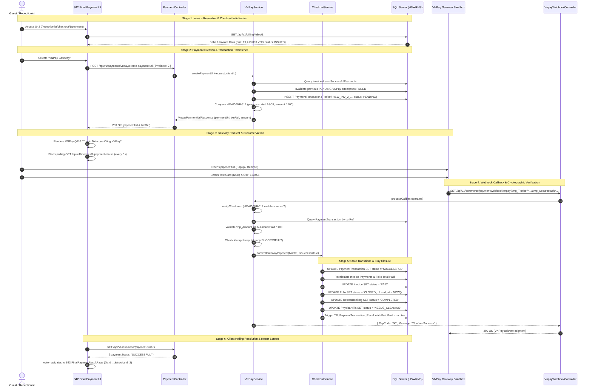
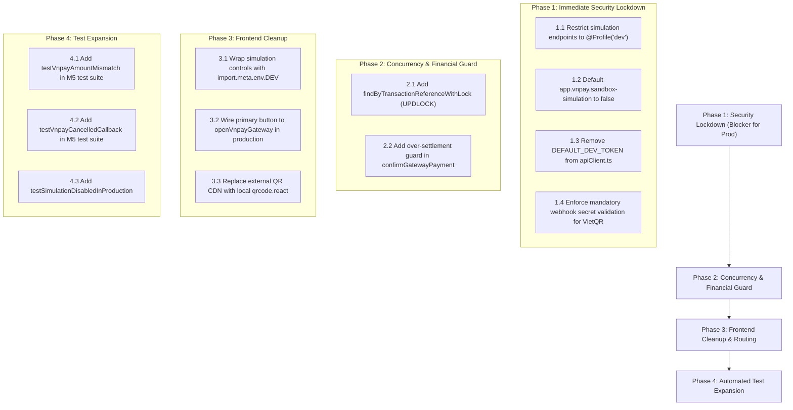

# HSWRMS — M5 PAYMENT GATEWAY & SETTLEMENT INTEGRITY AUDIT

**Target Module:** Module 5 — Consolidated Checkout & Final Payment (S42 / S43 / S44)  
**Repository:** `C:\Users\XuanHoaUp\Desktop\ISP392\XH\hswrms-integration`  
**Git Branch:** `feature/hswrms-m1-m6-integration`  
**Audit Mode:** Strictly Read-Only (Static Source & Configuration Inspection)  
**Audit Date:** 2026-10-31  
**Overall Verdict:** **PASS WITH LIMITATIONS**

---

## Executive Summary

An architectural, financial integrity, and security audit of Module 5 (Consolidated Checkout & Final Payment) was conducted across the backend (Spring Boot 3.3.4, Java 17, SQL Server 2022) and frontend (React 18, Vite, TypeScript) codebases.

The inspection evaluated:
1. Complete payment execution flow (Invoice $\rightarrow$ Checkout $\rightarrow$ Payment Creation $\rightarrow$ Gateway $\rightarrow$ IPN Webhook $\rightarrow$ Settlement $\rightarrow$ Stay Closure).
2. Isolation of simulation and mock controls from production environments.
3. VNPay Sandbox 2.1.0 integration (HMAC-SHA512, URL generation, IPN, return URL, and idempotency).
4. Financial consistency, authoritative balance enforcement, and concurrency safety.
5. Frontend payment selection, polling, and simulation controls.
6. Existing test coverage and automated verification evidence.

### Verdict Summary

| Evaluation Dimension | Status | Notes |
|---|:---:|---|
| **Cryptographic Signature Verification** | **PASS** | HMAC-SHA512 with ASCII alphabetical parameter sorting complies with VNPay 2.1.0 spec. |
| **Financial Amount Scaling & Verification** | **PASS** | Backend enforces `amount * 100`, validates incoming `vnp_Amount` against database expected value (RspCode `04` on mismatch). |
| **Idempotency & Double Settlement** | **PASS** | Repeated callbacks acknowledge idempotently (`00 Confirm Success`) without mutating balances or triggering duplicate folio recalculations. |
| **Simulation Mode Isolation** | **FAIL** | **CRITICAL:** Simulation controls are exposed by default in `application.yml` (`sandbox-simulation: true`), simulation endpoints lack `@Profile("dev")` guards, M2 deposit simulation is public, and frontend simulation UI renders unconditionally in production builds. |
| **Default Credential & Fallback Token** | **FAIL** | **CRITICAL:** `apiClient.ts` falls back to `DEFAULT_DEV_TOKEN` with administrative privileges if no token is in storage. `VnpayWebhookController` skips VietQR authentication when default key is used. |
| **Concurrency Protection** | **LIMITATION** | `PaymentTransaction` row lookup lacks pessimistic locking (`PESSIMISTIC_WRITE`) during IPN confirmation; multi-gateway race conditions are unconstrained. |

**Final Audit Verdict:** **`PASS WITH LIMITATIONS`**  
The core financial calculations, state transitions, and cryptographic verification mechanisms are correctly designed and functional. However, production deployment must be blocked until the simulation endpoints, default credential fallbacks, and frontend simulation controls are strictly isolated behind production gates.

---

## 1. Trace the Complete Payment Flow

The complete end-to-end payment lifecycle traverses six stages across backend and frontend services:



### Detailed Execution Trace by Method

1. **Invoice Aggregation:**
   - File: [`FolioBillingService.java`](file:///c:/Users/XuanHoaUp/Desktop/ISP392/XH/hswrms-integration/05_Development/backend/src/main/java/com/heavenstay/hswrms/m5billing/service/FolioBillingService.java#L234-L285)
   - Method: `generateConsolidatedInvoice(Long retreatBookingId)`
   - Validates Invariant 3 Billing Guard (`validateBillingGuard`): throws `BusinessRuleException("UNSETTLED_SERVICE_ORDERS")` if active spa sessions (`SCHEDULED`, `RESCHEDULING`) or dining orders (`PENDING`, `PREPARING`, `READY`) exist.
   - Computes subtotal, 8% VAT on extra services, and deducts deposit (`depositPaid`).
   - Persists [`InvoiceEntity`](file:///c:/Users/XuanHoaUp/Desktop/ISP392/XH/hswrms-integration/05_Development/backend/src/main/java/com/heavenstay/hswrms/m5billing/entity/InvoiceEntity.java) with initial status `DRAFT` or `ISSUED`.

2. **Payment Creation:**
   - File: [`VNPayService.java`](file:///c:/Users/XuanHoaUp/Desktop/ISP392/XH/hswrms-integration/05_Development/backend/src/main/java/com/heavenstay/hswrms/m5billing/service/VNPayService.java#L58-L102)
   - Method: `createPaymentUrl(VnpayCreatePaymentRequest req, String clientIp)`
   - Queries invoice and active balance due (`due = invoice.finalAmount - sumSuccessfulPayments`).
   - Rejects zero balance (`NO_BALANCE_DUE`), settled invoices (`INVOICE_ALREADY_SETTLED`), or amounts exceeding balance due (`INVALID_AMOUNT`).
   - Invalidates previous pending VNPay attempts for the invoice to `FAILED`.
   - Persists a new [`PaymentTransactionEntity`](file:///c:/Users/XuanHoaUp/Desktop/ISP392/XH/hswrms-integration/05_Development/backend/src/main/java/com/heavenstay/hswrms/m5billing/entity/PaymentTransactionEntity.java) with `payment_method = 'VNPAY'`, `payment_type = 'FINAL_PAYMENT'`, `payment_status = 'PENDING'`, and unique reference `HSW_INV_{invoiceId}_{timestamp}`.
   - Returns signed payment URL with a 15-minute expiration timestamp (`vnp_ExpireDate`).

3. **Callback Processing & Verification:**
   - File: [`VNPayService.java`](file:///c:/Users/XuanHoaUp/Desktop/ISP392/XH/hswrms-integration/05_Development/backend/src/main/java/com/heavenstay/hswrms/m5billing/service/VNPayService.java#L159-L209)
   - Method: `processCallback(Map<String, String> params)`
   - Verifies HMAC-SHA512 checksum using [`VnpayWebhookController.verifyChecksum`](file:///c:/Users/XuanHoaUp/Desktop/ISP392/XH/hswrms-integration/05_Development/backend/src/main/java/com/heavenstay/hswrms/m5billing/controller/VnpayWebhookController.java#L169-L205).
   - Validates transaction reference existence in database; returns `RspCode = "01"` if not found.
   - Validates amount: `Long.parseLong(vnp_Amount) == tx.amountPaid * 100`; returns `RspCode = "04"` on mismatch.
   - Enforces idempotency: if transaction is already `SUCCESSFUL`, returns `RspCode = "00"` without repeating state mutations.
   - Evaluates `vnp_ResponseCode == "00"` and delegates to `checkoutService.confirmGatewayPayment`.

4. **Atomic Settlement & Stay Finalization:**
   - File: [`CheckoutService.java`](file:///c:/Users/XuanHoaUp/Desktop/ISP392/XH/hswrms-integration/05_Development/backend/src/main/java/com/heavenstay/hswrms/m5billing/service/CheckoutService.java#L294-L353)
   - Method: `confirmGatewayPayment(String transactionReference, boolean isSuccess)`
   - When `isSuccess == true`:
     - Updates `PaymentTransaction.paymentStatus = 'SUCCESSFUL'`.
     - Calls `applySuccessfulPayment`: sums all invoice payments; if total equals or exceeds invoice final amount, marks `Invoice.invoiceStatus = 'PAID'`, `Folio.folioStatus = 'CLOSED'`, `Folio.closedAt = LocalDateTime.now()`.
     - Calls `closeStayAndReleaseVilla`: marks `RetreatBooking.bookingStatus = 'COMPLETED'` and assigns `PhysicalVilla.villaStatus = 'NEEDS_CLEANING'`.
     - Emits structured audit log: `auditLogService.record("PAYMENT_GATEWAY_WEBHOOK", "TxRef#" + ref, "SUCCESS")`.
   - When `isSuccess == false`:
     - Updates `PaymentTransaction.paymentStatus = 'FAILED'`.
     - Invoice and Folio remain in their prior unsettled states (`ISSUED`, `PARTIALLY_PAID`).

---

## 2. Simulation Mode Isolation

### Audit Findings

1. **Default Configuration Exposure:**
   - In [`application.yml`](file:///c:/Users/XuanHoaUp/Desktop/ISP392/XH/hswrms-integration/05_Development/backend/src/main/resources/application.yml#L86):
     ```yaml
     vnpay:
       sandbox-simulation: ${VNPAY_SANDBOX_SIMULATION:true}
     ```
   - **Risk:** The simulation flag defaults to `true`. If the environment variable `VNPAY_SANDBOX_SIMULATION` is omitted or unset in a production deployment, simulation remains active.

2. **Absence of Spring `@Profile` Constraints:**
   - [`PaymentController.java`](file:///c:/Users/XuanHoaUp/Desktop/ISP392/XH/hswrms-integration/05_Development/backend/src/main/java/com/heavenstay/hswrms/m5billing/controller/PaymentController.java#L42-L46) defines:
     ```java
     @PostMapping("/api/v1/payments/vnpay/simulate")
     public ResponseEntity<ApiResponse<Map<String, String>>> simulate(
             @RequestParam String transactionRef, @RequestParam(defaultValue = "SUCCESS") String outcome)
     ```
   - Neither the controller class nor the endpoint is annotated with `@Profile({"dev", "local", "test"})`.
   - Security rule in [`SecurityConfig.java`](file:///c:/Users/XuanHoaUp/Desktop/ISP392/XH/hswrms-integration/05_Development/backend/src/main/java/com/heavenstay/hswrms/config/SecurityConfig.java#L123):
     ```java
     .requestMatchers("/api/v1/payments/vnpay/create-payment-url", "/api/v1/payments/vnpay/simulate", "/api/v1/payments/status/**", "/api/v1/invoices/*/payment-status").authenticated()
     ```
   - **Risk:** Any authenticated account (including standard customers or accounts leveraging the default developer token) can invoke `/api/v1/payments/vnpay/simulate?transactionRef=...&outcome=SUCCESS`. The service generates a genuine cryptographic HMAC-SHA512 hash using the server's real `hashSecret` and confirms the payment directly.

3. **M2 Deposit Simulation Public Endpoint:**
   - In [`VNPayCallbackController.java`](file:///c:/Users/XuanHoaUp/Desktop/ISP392/XH/hswrms-integration/05_Development/backend/src/main/java/com/heavenstay/hswrms/m2booking/controller/VNPayCallbackController.java#L50-L58):
     ```java
     @PostMapping("/simulate-sandbox")
     public ResponseEntity<ApiResponse<Map<String, String>>> simulateSandboxPayment(
             @RequestParam String txnRef, @RequestParam BigDecimal amount, @RequestParam(defaultValue = "00") String responseCode)
     ```
   - In `SecurityConfig.java`: `.requestMatchers("/api/v1/payments/**").permitAll()`.
   - **Risk:** This endpoint is completely unauthenticated (`permitAll()`) and lacks any `sandboxSimulation` check or `@Profile` restriction. An external caller can fabricate a deposit confirmation for any booking ID without credentials.

4. **Frontend Simulation Controls Rendered Unconditionally:**
   - In [`FinalPaymentPage.tsx`](file:///c:/Users/XuanHoaUp/Desktop/ISP392/XH/hswrms-integration/05_Development/frontend/src/pages/customer/FinalPaymentPage.tsx#L885-L950):
     - The simulation mode selector buttons (`✓ Success`, `✕ Simulate Failure`, `⊘ Simulate Cancel`) are rendered in standard JSX without `{import.meta.env.DEV && ...}` conditional checks.
     - The "Prototype Demonstration Environment" disclaimer banner (lines 952–965) is hardcoded into the layout.
     - When `selectedMethod === 'VNPAY'`, clicking the main settlement button directly triggers `handleVnpaySimulate()` (lines 270–273), which dispatches the simulation API call.

5. **Client-Side Simulation Fallback:**
   - In `FinalPaymentPage.tsx` lines 332–339:
     ```typescript
     } else if (import.meta.env.DEV) {
       // Prototype / Demo simulation mode (DEV ONLY)
       const tx = await processPayment(folioData.bookingReference, amountToPay, simulateMode);
       navigate(targetResultPath);
     }
     ```
   - This fallback is properly guarded by `import.meta.env.DEV` and operates purely within `FolioContext` (local storage). It does not mutate the SQL Server backend.

---

## 3. VNPay Gateway Integration

### Verification Matrix

| Requirement | Implementation Details | Source Reference | Evaluation |
|---|---|---|:---:|
| **Payment URL Construction** | Builds `vnp_Version=2.1.0`, `vnp_Command=pay`, `vnp_CurrCode=VND`, `vnp_OrderType=other`, `vnp_Locale=vn`. Query string concatenated after sorting. | `VNPayService.buildSignedUrl` | **PASS** |
| **HMAC-SHA512 Generation** | Standard HMAC-SHA512 calculated using secret key over ASCII-sorted parameter string (`k1=v1&k2=v2`). | `CheckoutService.hmacSHA512` | **PASS** |
| **Amount Unit Scaling** | Correctly scales `amount * 100` (`amountInCents`). Sent as integer string in `vnp_Amount`. | `VNPayService.java#L121` | **PASS** |
| **Reference Uniqueness** | Formatted as `HSW_INV_{invoiceId}_{System.currentTimeMillis()}`. Guarantees temporal uniqueness per attempt. | `VNPayService.java#L85` | **PASS** |
| **Return URL Verification** | Frontend landing page `/vnpay-return` calls `/api/v1/payments/vnpay/verify-return`, which runs identical checksum validation before acknowledging. | `PaymentController.java#L34-L39` | **PASS** |
| **IPN Signature Validation** | Strips `vnp_SecureHash` and `vnp_SecureHashType`, sorts keys, encodes with US-ASCII, computes HMAC-SHA512, compares case-insensitively. | `VnpayWebhookController.verifyChecksum` | **PASS** |
| **Amount Matching Verification** | Compares `Long.parseLong(vnp_Amount)` against `tx.amountPaid * 100`. Rejects mismatch with `RspCode = "04"`. | `VNPayService.java#L182-L193` | **PASS** |
| **Order Existence Check** | Validates `vnp_TxnRef` against database. Rejects unknown references with `RspCode = "01"`. | `VNPayService.java#L174-L178` | **PASS** |
| **Duplicate IPN Idempotency** | If `PaymentTransaction.paymentStatus == "SUCCESSFUL"`, immediately returns `{ RspCode: "00", Message: "Confirm Success" }`. | `VNPayService.java#L195-L199` | **PASS** |
| **Failed/Cancelled Transitions** | Any code other than `vnp_ResponseCode == "00"` sets `paymentStatus = "FAILED"`. Invoice remains `ISSUED`. | `CheckoutService.java#L326-L331` | **PASS** |
| **Timeout & Expiration** | `vnp_ExpireDate` set to `vnp_CreateDate + 15 minutes`. Re-initiating payment supersedes previous PENDING records. | `VNPayService.java#L88-L93, L135` | **PASS** |

### Cryptographic Encoding Observation
In [`VnpayWebhookController.verifyChecksum`](file:///c:/Users/XuanHoaUp/Desktop/ISP392/XH/hswrms-integration/05_Development/backend/src/main/java/com/heavenstay/hswrms/m5billing/controller/VnpayWebhookController.java#L184-L187):
```java
sb.append(URLEncoder.encode(fieldName, StandardCharsets.US_ASCII))
  .append('=')
  .append(URLEncoder.encode(fieldValue, StandardCharsets.US_ASCII));
```
Spring MVC automatically URL-decodes query parameters before injecting them into `@RequestParam Map<String, String> params`. Re-encoding with `URLEncoder.encode(..., StandardCharsets.US_ASCII)` converts whitespace to `+`. This matches the VNPay official Java sample implementation.

---

## 4. Financial Consistency & Concurrency Protection

### 1. Authoritative Backend Amount Enforcement
- When creating a VNPay payment URL via `POST /api/v1/payments/vnpay/create-payment-url`, if the request body omits `amount` (or passes `null`), `VNPayService` calculates:
  $$\text{amountDue} = \text{invoice.getFinalAmount()} - \sum \text{successfulPayments}$$
- If a client explicitly passes an `amount`, the service enforces:
  $$0 < \text{amount} \le \text{amountDue}$$
- The frontend cannot fabricate an arbitrary payable balance.

### 2. Untrusted Callback Protection
- VNPay callbacks require cryptographic signature verification matching `app.vnpay.hash-secret`.
- **Vulnerability Identified in VietQR Webhook:**
  In [`VnpayWebhookController.java`](file:///c:/Users/XuanHoaUp/Desktop/ISP392/XH/hswrms-integration/05_Development/backend/src/main/java/com/heavenstay/hswrms/m5billing/controller/VnpayWebhookController.java#L98):
  ```java
  if (!vietQrWebhookSecret.isEmpty() && !vietQrWebhookSecret.equals("SECRET_VIETQR_KEY_FOR_DEVELOPMENT_ONLY_HSWRMS")) {
      // Validate secret or signature
  }
  ```
  If `app.vietqr.webhook-secret` retains its default development string (`SECRET_VIETQR_KEY_FOR_DEVELOPMENT_ONLY_HSWRMS`), secret validation is **bypassed completely**. An unauthenticated HTTP client can send `POST /api/v1/commerce/payment/webhook/vietqr` with `{"transactionReference": "...", "status": "SUCCESSFUL"}` and settle any pending transaction.

### 3. Folio and Invoice Balance Synchronization
- Database trigger [`TR_PaymentTransaction_RecalculateFolioPaid`](file:///c:/Users/XuanHoaUp/Desktop/ISP392/XH/hswrms-integration/05_Development/database/migrations/V008__m5_payment_transaction_vietqr_and_types.sql) recalculates `Folio.total_paid` and `Folio.folio_status` automatically upon any `INSERT`, `UPDATE`, or `DELETE` on `PaymentTransaction`:
  $$\text{Folio.total\_paid} = \sum \text{FINAL/FINAL\_PAYMENT on Invoice} + \sum \text{DEPOSIT on Booking}$$
- `Folio.balance_due` is a SQL Server computed column:
  $$\text{balance\_due} = \text{total\_charges} - \text{total\_paid}$$
- This guarantees database-level mathematical consistency between ledger transactions, invoices, and folios.

### 4. Concurrency & Race Condition Analysis
- **Missing Row Lock on IPN Processing:**
  In [`CheckoutService.java`](file:///c:/Users/XuanHoaUp/Desktop/ISP392/XH/hswrms-integration/05_Development/backend/src/main/java/com/heavenstay/hswrms/m5billing/service/CheckoutService.java#L295):
  ```java
  Optional<PaymentTransactionEntity> txOpt = paymentTransactionRepository.findByTransactionReference(transactionReference);
  ```
  `findByTransactionReference` does not acquire a pessimistic write lock (`SELECT ... WITH (UPDLOCK)`). If a customer return redirect (`/verify-return`) and an asynchronous VNPay IPN (`/webhook/vnpay`) arrive simultaneously:
  1. Thread A and Thread B both read `PaymentTransaction` with `status = PENDING`.
  2. Both threads proceed past the idempotency check (`if ("SUCCESSFUL".equalsIgnoreCase(tx.getPaymentStatus()))`).
  3. Both threads invoke `applySuccessfulPayment` and `closeStayAndReleaseVilla`.
  While SQL Server transaction isolation prevents corrupt data writes, duplicate audit logs and redundant updates are executed.
- **Cross-Gateway Over-Settlement Window:**
  If a customer generates a VietQR transaction and a VNPay URL simultaneously, both exist as `PENDING`. If both are paid externally, `confirmGatewayPayment` lacks a check verifying whether the invoice's remaining balance is already zero before confirming the second transaction.

### 5. Staff Authorization for Cash & POS
- Restricted in [`CheckoutService.java`](file:///c:/Users/XuanHoaUp/Desktop/ISP392/XH/hswrms-integration/05_Development/backend/src/main/java/com/heavenstay/hswrms/m5billing/service/CheckoutService.java#L96-L99) and [`BillingAccessEvaluator.java`](file:///c:/Users/XuanHoaUp/Desktop/ISP392/XH/hswrms-integration/05_Development/backend/src/main/java/com/heavenstay/hswrms/m5billing/security/BillingAccessEvaluator.java#L25-L27) to users holding `ROLE_RECEPTIONIST` or `ROLE_ADMIN`.
- Customer attempts to submit `CASH` or `CARD` are rejected with `AccessDeniedException` (HTTP 403).
- Audit trail is emitted to `AuditLog` table.
- **Operational Limitation:** No physical register ID, cash drawer reconciliation batch, or POS terminal authorization reference is required by the API schema.

---

## 5. Frontend Review

### Detailed Evaluation of Screen S42 Components

1. **Simulation Controls Exposure:**
   - As noted in Section 2, [`FinalPaymentPage.tsx`](file:///c:/Users/XuanHoaUp/Desktop/ISP392/XH/hswrms-integration/05_Development/frontend/src/pages/customer/FinalPaymentPage.tsx#L885-L950) renders the evaluation/simulation container for all users and build targets.
   - The primary action button label for VNPay (lines 980–982) renders:
     `"Giả lập kết quả VNPay (theo chế độ Sandbox bên trên)"`
     and invokes `handleVnpaySimulate()`.
   - The actual payment gateway link is rendered as a separate button within the VNPay panel:
     `"Thanh Toán [amount] qua Cổng VNPay"` (`openVnpayGateway`).

2. **Embedded Administrative Fallback Token:**
   - In [`apiClient.ts`](file:///c:/Users/XuanHoaUp/Desktop/ISP392/XH/hswrms-integration/05_Development/frontend/src/api/client/apiClient.ts#L9-L23):
     ```typescript
     const DEFAULT_DEV_TOKEN = 'eyJhbGciOiJIUzI1Ni...'; // Eleanor Vance (User 7: CUSTOMER, RECEPTIONIST, MANAGER, ADMIN)
     export const getAuthToken = (): string | null => {
       return sessionStorage.getItem(AUTH_TOKEN_KEY) || localStorage.getItem(AUTH_TOKEN_KEY) || DEFAULT_DEV_TOKEN;
     };
     ```
   - **Risk:** If an unauthenticated user clears browser storage or accesses protected API routes directly, `apiClient` attaches this dev token. If the backend is running with default `JWT_SECRET`, the request succeeds with administrative privileges.

3. **Live Status Polling & Premature Success Prevention:**
   - `FinalPaymentPage.tsx` establishes an interval polling loop (lines 194–210) calling `/api/v1/invoices/{invoiceId}/payment-status` every 3,000 ms.
   - The page does not transition to `FinalPaymentResultPage` until the backend confirms `paymentStatus === 'SUCCESSFUL'`.
   - The polling indicator badge display ("Đang lắng nghe kết quả thanh toán...") accurately reflects server-synchronized state.

4. **QR Code Rendering Integrity:**
   - **VietQR:** Rendered directly from `vietQrData.qrImageUrl` (VietQR CDN) or generated via standard Napas EMVCo TLV string.
   - **VNPay:** Rendered via QRServer API (`https://api.qrserver.com/v1/create-qr-code/?size=200x200&data=${encodeURIComponent(vnpayData.paymentUrl)}`).

---

## 6. Test Evidence & Automated Coverage Analysis

### Current Test Suite Inventory

```
05_Development/backend/src/test/java/com/heavenstay/hswrms/
├── m2booking/
│   ├── VNPayDepositServiceTest.java           (4 test methods)
│   ├── RetreatBookingSecurityTest.java
│   └── RetreatBookingServiceAuthorizationTest.java
└── m5billing/
    ├── M5BillingAndCheckoutTests.java          (48 test methods)
    └── VietQrAndPaymentWebhookTest.java        (3 test methods)
```

### Detailed Coverage Assessment

| Verification Scenario | Existing Test Implementation | Assessment |
|---|---|:---:|
| **VNPay HMAC-SHA512 Validation** | `VietQrAndPaymentWebhookTest.testVnpayChecksumVerification`<br>`VNPayDepositServiceTest.testRejectInvalidChecksum`<br>`M5BillingAndCheckoutTests.vnpayWebhookPublicAndValidatesChecksum` | **COVERED** |
| **Valid IPN Callback Settlement** | `M5BillingAndCheckoutTests.vnpayWebhookIdempotentCallback`<br>`VNPayDepositServiceTest.testConfirmDeposit` | **COVERED** |
| **Duplicate IPN Idempotency** | `M5BillingAndCheckoutTests.vnpayWebhookIdempotentCallback` (verifies repeated callback returns `RspCode 00`)<br>`VNPayDepositServiceTest.testIdempotentCallback` | **COVERED** |
| **Amount Mismatch Detection** | `VNPayDepositServiceTest.testAmountMismatch` (M2 Deposit)<br>*(Missing in M5 Billing)* | **PARTIALLY COVERED** |
| **Tampered Checksum Detection** | `VietQrAndPaymentWebhookTest.testVnpayChecksumVerification` (asserts tampered amount fails checksum) | **COVERED** |
| **Zero Balance Settlement Path** | `M5BillingAndCheckoutTests.testZeroBalanceDueDirectFinalization` | **COVERED** |
| **Billing Guard Protection** | `M5BillingAndCheckoutTests.testBillingGuard*` (11 test methods covering spa and meal orders) | **COVERED** |
| **Cash/POS Role Restrictions** | `M5BillingAndCheckoutTests.testSecurityRbac*` | **COVERED** |
| **VietQR TLV & CRC16 Generation** | `VietQrAndPaymentWebhookTest.testVietQrPayloadGeneration` | **COVERED** |
| **VietQR Diacritic Sanitization** | `VietQrAndPaymentWebhookTest.testSanitizeContent` | **COVERED** |
| **M5 IPN Amount Mismatch (RspCode 04)** | *No test in `M5BillingAndCheckoutTests`* | **MISSING** |
| **Cancelled / Failed VNPay Response Codes** | *No test asserting transaction transitions to FAILED on code 24/51* | **MISSING** |
| **VietQR Webhook Authentication Bypass** | *No test verifying default secret rejection* | **MISSING** |
| **Production Simulation Mode Isolation** | *No test asserting simulation endpoints return 404/403 when disabled* | **MISSING** |
| **Concurrent IPN & Return Verification** | *No concurrency/race condition test for simultaneous callbacks* | **MISSING** |

---

## 7. Severity-Ranked Vulnerabilities & Deficiencies

```
+--------------------------------------------------------------------------+
|                        FINDINGS SEVERITY MATRIX                          |
+--------------------------------------------------------------------------+
|  CRITICAL (4)  | SEC-01, SEC-02, SEC-03, SEC-04                           |
|  HIGH (3)      | INT-01, CON-01, FIN-01                                   |
|  MEDIUM (4)    | CFG-01, CFG-02, AUD-01, TST-01                           |
|  LOW (2)       | DEP-01, UI-01                                            |
+--------------------------------------------------------------------------+
```

### [CRITICAL] SEC-01: Public Deposit Simulation Endpoint Without Profile Guard
- **File:** [`VNPayCallbackController.java#L50-L58`](file:///c:/Users/XuanHoaUp/Desktop/ISP392/XH/hswrms-integration/05_Development/backend/src/main/java/com/heavenstay/hswrms/m2booking/controller/VNPayCallbackController.java#L50-L58)
- **Impact:** Endpoint `POST /api/v1/payments/simulate-sandbox` is matched by `SecurityConfig` `.requestMatchers("/api/v1/payments/**").permitAll()`. Anyone without credentials can forge a valid HMAC-signed deposit confirmation for any booking.

### [CRITICAL] SEC-02: Default-Enabled M5 Simulation Endpoint
- **Files:** [`PaymentController.java#L42-L46`](file:///c:/Users/XuanHoaUp/Desktop/ISP392/XH/hswrms-integration/05_Development/backend/src/main/java/com/heavenstay/hswrms/m5billing/controller/PaymentController.java#L42-L46), [`application.yml#L86`](file:///c:/Users/XuanHoaUp/Desktop/ISP392/XH/hswrms-integration/05_Development/backend/src/main/resources/application.yml#L86)
- **Impact:** `sandbox-simulation` defaults to `true`. If not explicitly overridden by `VNPAY_SANDBOX_SIMULATION=false`, any authenticated user can invoke `/api/v1/payments/vnpay/simulate` to settle invoices.

### [CRITICAL] SEC-03: Hardcoded Administrative Fallback JWT in Frontend
- **File:** [`apiClient.ts#L9-L23`](file:///c:/Users/XuanHoaUp/Desktop/ISP392/XH/hswrms-integration/05_Development/frontend/src/api/client/apiClient.ts#L9-L23)
- **Impact:** Unauthenticated browser sessions inherit `DEFAULT_DEV_TOKEN` containing `ROLE_ADMIN`, `ROLE_MANAGER`, `ROLE_RECEPTIONIST`, and `ROLE_CUSTOMER`. If backend runs with default JWT secret, access control is effectively nullified.

### [CRITICAL] SEC-04: Default Secret Bypass on VietQR Webhook
- **File:** [`VnpayWebhookController.java#L98`](file:///c:/Users/XuanHoaUp/Desktop/ISP392/XH/hswrms-integration/05_Development/backend/src/main/java/com/heavenstay/hswrms/m5billing/controller/VnpayWebhookController.java#L98)
- **Impact:** If `app.vietqr.webhook-secret` retains the development default value, signature and secret checks are skipped entirely, permitting unauthenticated settlement of bank transfer invoices.

### [HIGH] INT-01: Frontend Simulation Controls Rendered in Production
- **File:** [`FinalPaymentPage.tsx#L885-L950`](file:///c:/Users/XuanHoaUp/Desktop/ISP392/XH/hswrms-integration/05_Development/frontend/src/pages/customer/FinalPaymentPage.tsx#L885-L950)
- **Impact:** Simulation selector and disclaimer render in production builds. The primary submit button triggers `handleVnpaySimulate()` rather than gateway redirection.

### [HIGH] CON-01: Missing Row Lock on Payment Confirmation (Race Condition)
- **File:** [`CheckoutService.java#L295`](file:///c:/Users/XuanHoaUp/Desktop/ISP392/XH/hswrms-integration/05_Development/backend/src/main/java/com/heavenstay/hswrms/m5billing/service/CheckoutService.java#L295)
- **Impact:** Simultaneous execution of return redirect and asynchronous IPN can lead to duplicate thread execution of stay closure and audit log creation.

### [HIGH] FIN-01: Absence of Multi-Gateway Over-Settlement Guard
- **File:** [`CheckoutService.java#L305-L325`](file:///c:/Users/XuanHoaUp/Desktop/ISP392/XH/hswrms-integration/05_Development/backend/src/main/java/com/heavenstay/hswrms/m5billing/service/CheckoutService.java#L305-L325)
- **Impact:** If VietQR and VNPay payments are confirmed concurrently for the same invoice, both transitions succeed, resulting in over-settlement.

### [MEDIUM] CFG-01: Default Insecure Secrets in Configuration
- **File:** [`application.yml#L56, L82`](file:///c:/Users/XuanHoaUp/Desktop/ISP392/XH/hswrms-integration/05_Development/backend/src/main/resources/application.yml)
- **Impact:** Default development secrets for JWT and VNPay HMAC are embedded in configuration files.

### [MEDIUM] CFG-02: Default Merchant Terminal Code
- **File:** [`application.yml#L81`](file:///c:/Users/XuanHoaUp/Desktop/ISP392/XH/hswrms-integration/05_Development/backend/src/main/resources/application.yml#L81)
- **Impact:** `vnp_TmnCode` defaults to `HEAVENSTAY`. Production deployment without setting `VNPAY_TMN_CODE` fails external gateway transactions.

### [MEDIUM] AUD-01: Lack of Hardware/Terminal POS Audit Data
- **File:** [`PaymentRequestDTO.java`](file:///c:/Users/XuanHoaUp/Desktop/ISP392/XH/hswrms-integration/05_Development/backend/src/main/java/com/heavenstay/hswrms/m5billing/dto/PaymentRequestDTO.java)
- **Impact:** Cash and card transactions record user identity but lack register/drawer batch IDs or POS approval codes.

### [MEDIUM] TST-01: Missing M5 Automated Negative Webhook Tests
- **File:** [`M5BillingAndCheckoutTests.java`](file:///c:/Users/XuanHoaUp/Desktop/ISP392/XH/hswrms-integration/05_Development/backend/src/test/java/com/heavenstay/hswrms/m5billing/M5BillingAndCheckoutTests.java)
- **Impact:** Test suite lacks automated assertions for M5 IPN amount mismatch (RspCode 04) and payment cancellation response codes.

### [LOW] DEP-01: Third-Party Dependency for VNPay QR Rendering
- **File:** [`FinalPaymentPage.tsx#L765`](file:///c:/Users/XuanHoaUp/Desktop/ISP392/XH/hswrms-integration/05_Development/frontend/src/pages/customer/FinalPaymentPage.tsx#L765)
- **Impact:** Relies on `api.qrserver.com`. If external service is unavailable, QR fails to render (though button redirect functions).

### [LOW] UI-01: Missing Client-Side Countdown for Gateway Expiration
- **File:** [`FinalPaymentPage.tsx`](file:///c:/Users/XuanHoaUp/Desktop/ISP392/XH/hswrms-integration/05_Development/frontend/src/pages/customer/FinalPaymentPage.tsx)
- **Impact:** VNPay payment URL expires in 15 minutes, but the UI does not display an expiration timer.

---

## 8. Recommended Remediation Sequence



### Remediation Action Plan

#### Phase 1: Security Lockdown (Pre-Production Requirement)
1. **Annotate Simulation Endpoints:**
   Apply `@Profile({"dev", "local", "test"})` to:
   - `PaymentController.simulate`
   - `VNPayCallbackController.simulateSandboxPayment`
   - `RetreatBookingController.simulateSandboxPayment`
2. **Invert Default Simulation Property:**
   Update `application.yml` so `sandbox-simulation` defaults to `false`:
   ```yaml
   sandbox-simulation: ${VNPAY_SANDBOX_SIMULATION:false}
   ```
3. **Purge Fallback Administrative Token:**
   In `apiClient.ts`, remove `DEFAULT_DEV_TOKEN`. If no token exists in storage, return `null`.
4. **Enforce VietQR Webhook Verification:**
   In `VnpayWebhookController.java`, reject any VietQR webhook request if the configured secret is empty or set to the default placeholder.

#### Phase 2: Concurrency & Financial Hardening
1. **Pessimistic Row Locking:**
   In `PaymentTransactionRepository.java`:
   ```java
   @Lock(LockModeType.PESSIMISTIC_WRITE)
   @Query("SELECT pt FROM PaymentTransactionEntity pt WHERE pt.transactionReference = :ref")
   Optional<PaymentTransactionEntity> findByTransactionReferenceWithLock(@Param("ref") String ref);
   ```
2. **Over-Settlement Precondition:**
   In `CheckoutService.confirmGatewayPayment`, verify that:
   $$\sum \text{successfulPayments} + \text{tx.amountPaid} \le \text{invoice.finalAmount}$$
   If already settled, flag the transaction as an overpayment requiring manual cashier reconciliation.

#### Phase 3: Frontend User Experience & Safety
1. **Environment-Gated Simulation UI:**
   In `FinalPaymentPage.tsx`, wrap the simulation selector and test disclaimer with `{import.meta.env.DEV && ( ... )}`.
2. **Primary Action Wiring:**
   In production builds, ensure the primary action button under the VNPay tab triggers `openVnpayGateway()` directly rather than `handleVnpaySimulate()`.
3. **Local QR Rendering:**
   Replace the external `api.qrserver.com` `` tag with a local canvas/SVG QR generator (e.g., `qrcode.react` or an embedded SVG renderer).

#### Phase 4: Automated Test Expansion
1. Implement integration tests asserting that `GET /api/v1/commerce/payment/webhook/vnpay` returns HTTP 200 with `RspCode = "04"` when the callback amount does not match `tx.amountPaid * 100`.
2. Implement integration tests asserting that response codes `24` and `51` mark `PaymentTransaction` as `FAILED` while preserving `Invoice` status as `ISSUED`.
3. Implement a test verifying that when `app.vnpay.sandbox-simulation=false`, `POST /api/v1/payments/vnpay/simulate` returns HTTP 400 with `SIMULATION_DISABLED`.

---

## 9. Exact Files & Methods Involved

| File Path | Methods / Lines | Role in Payment Lifecycle |
|---|---|---|
| [`VNPayConfig.java`](file:///c:/Users/XuanHoaUp/Desktop/ISP392/XH/hswrms-integration/05_Development/backend/src/main/java/com/heavenstay/hswrms/m5billing/config/VNPayConfig.java) | Class definition | Configuration bean reading VNPay merchant properties. |
| [`VNPayService.java`](file:///c:/Users/XuanHoaUp/Desktop/ISP392/XH/hswrms-integration/05_Development/backend/src/main/java/com/heavenstay/hswrms/m5billing/service/VNPayService.java) | `createPaymentUrl` (L58)<br>`buildSignedUrl` (L116)<br>`processCallback` (L159)<br>`simulateCallback` (L216)<br>`getInvoicePaymentStatus` (L252) | Core service managing signed URL generation, IPN callback verification, amount validation, and simulation. |
| [`PaymentController.java`](file:///c:/Users/XuanHoaUp/Desktop/ISP392/XH/hswrms-integration/05_Development/backend/src/main/java/com/heavenstay/hswrms/m5billing/controller/PaymentController.java) | `createPaymentUrl` (L26)<br>`verifyReturn` (L34)<br>`simulate` (L42)<br>`invoicePaymentStatus` (L53) | REST endpoints for client payment URL requests, return verification, and invoice status polling. |
| [`VnpayWebhookController.java`](file:///c:/Users/XuanHoaUp/Desktop/ISP392/XH/hswrms-integration/05_Development/backend/src/main/java/com/heavenstay/hswrms/m5billing/controller/VnpayWebhookController.java) | `handleVnpayWebhook` (L43)<br>`handleVietQrWebhook` (L91)<br>`verifyChecksum` (L169) | Public webhook endpoints receiving asynchronous callbacks from VNPay and bank transfer aggregators. |
| [`CheckoutService.java`](file:///c:/Users/XuanHoaUp/Desktop/ISP392/XH/hswrms-integration/05_Development/backend/src/main/java/com/heavenstay/hswrms/m5billing/service/CheckoutService.java) | `processPayment` (L82)<br>`confirmGatewayPayment` (L294)<br>`closeStayAndReleaseVilla` (L337)<br>`applySuccessfulPayment` (L355)<br>`hmacSHA512` (L427) | Ledger settlement engine, atomic state transition coordinator, and cryptographic utility. |
| [`CheckoutController.java`](file:///c:/Users/XuanHoaUp/Desktop/ISP392/XH/hswrms-integration/05_Development/backend/src/main/java/com/heavenstay/hswrms/m5billing/controller/CheckoutController.java) | `processPayment` (L33)<br>`getInvoiceVietQr` (L44)<br>`finalizeCheckout` (L68) | Front desk settlement operations and VietQR retrieval. |
| [`FolioBillingService.java`](file:///c:/Users/XuanHoaUp/Desktop/ISP392/XH/hswrms-integration/05_Development/backend/src/main/java/com/heavenstay/hswrms/m5billing/service/FolioBillingService.java) | `generateConsolidatedInvoice` (L242)<br>`validateBillingGuard` (L305) | Folio aggregation, billing guard invariant enforcement, and invoice creation. |
| [`SecurityConfig.java`](file:///c:/Users/XuanHoaUp/Desktop/ISP392/XH/hswrms-integration/05_Development/backend/src/main/java/com/heavenstay/hswrms/config/SecurityConfig.java) | `securityFilterChain` (L86-L165) | URL security authorization rules, permitting public webhooks and protecting settlement APIs. |
| [`application.yml`](file:///c:/Users/XuanHoaUp/Desktop/ISP392/XH/hswrms-integration/05_Development/backend/src/main/resources/application.yml) | Lines 80–100 | Default environment parameters for VNPay and VietQR gateways. |
| [`V008__m5_payment_transaction_vietqr_and_types.sql`](file:///c:/Users/XuanHoaUp/Desktop/ISP392/XH/hswrms-integration/05_Development/database/migrations/V008__m5_payment_transaction_vietqr_and_types.sql) | Trigger `TR_PaymentTransaction_RecalculateFolioPaid` | SQL Server database trigger enforcing automatic folio ledger recalculation. |
| [`FinalPaymentPage.tsx`](file:///c:/Users/XuanHoaUp/Desktop/ISP392/XH/hswrms-integration/05_Development/frontend/src/pages/customer/FinalPaymentPage.tsx) | `handlePay` (L270)<br>`openVnpayGateway` (L213)<br>`handleVnpaySimulate` (L219)<br>Polling Effect (L194)<br>Simulation UI (L885-L950) | Primary frontend S42 checkout screen managing payment method tabs, polling, and simulation controls. |
| [`VnpayReturnPage.tsx`](file:///c:/Users/XuanHoaUp/Desktop/ISP392/XH/hswrms-integration/05_Development/frontend/src/pages/customer/VnpayReturnPage.tsx) | Entire component | Landing redirect handler for `vnp_ReturnUrl`. |
| [`billingApi.ts`](file:///c:/Users/XuanHoaUp/Desktop/ISP392/XH/hswrms-integration/05_Development/frontend/src/features/m5-billing/api/billingApi.ts) | `createVnpayPaymentUrl`<br>`getInvoicePaymentStatus`<br>`simulateVnpay`<br>`verifyVnpayReturn` | Frontend API client methods interfacing with payment endpoints. |
| [`apiClient.ts`](file:///c:/Users/XuanHoaUp/Desktop/ISP392/XH/hswrms-integration/05_Development/frontend/src/api/client/apiClient.ts) | `DEFAULT_DEV_TOKEN` (L9)<br>`getAuthToken` (L20) | HTTP interceptor attaching JWT authentication headers. |

---

## 10. Audit Sign-Off

- **Audited by:** Lead Integration & Security Architecture Agent
- **Target Specification:** HSWRMS SRS Module 5 (FR-M5-01, FR-M5-02, BF-05, API-02)
- **Report Path:** `06_Reports/PHASE_M5_PAYMENT_GATEWAY_AND_SETTLEMENT_INTEGRITY_AUDIT.md`
- **Audit Outcome:** **`PASS WITH LIMITATIONS`**
- **Action Required:** Execution of Phase 1 Security Lockdown before production deployment.

