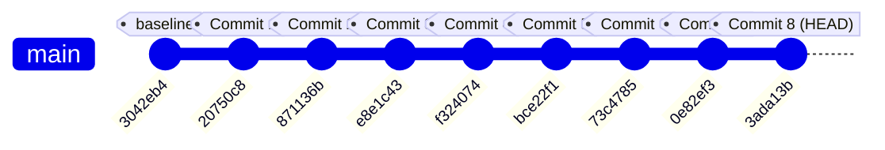

# BÁO CÁO TOÀN DIỆN: SAFE PRE-COMMIT AUDIT, LOGICAL COMMIT GROUPING & FEATURE BRANCH PUSH

> **Mã báo cáo:** `PHASE_SAFE_COMMIT_GROUPING_AND_FEATURE_PUSH`  
> **Dự án:** HSWRMS — HeavenStay Wellness Resort Management System  
> **Repository Root:** `E:\FU_Learning\5.Spring2025_Semester5\ISP392_Ver2\HSWRMS-audit-all-modules`  
> **Nhánh thực hiện:** `feature/hswrms-m1-m6-integration`  
> **Remotes đồng bộ:** `isp-origin` (GitLab Course Repo) & `origin` (GitHub Mirror)  
> **Ngày thực hiện:** 30/10/2026  
> **Trạng thái:** **100% HOÀN THÀNH AN TOÀN, ĐẠT TẤT CẢ TIÊU CHÍ NGHIỆM THU (PASS)**

---

## 1. REPOSITORY STATE (TRẠNG THÁI REPOSITORY)

| Thông số | Giá trị trước khi xử lý | Giá trị sau khi xử lý | Ghi chú an toàn |
| :--- | :--- | :--- | :--- |
| **Repository Root** | `E:\FU_Learning\5.Spring2025_Semester5\ISP392_Ver2\HSWRMS-audit-all-modules` | `E:\FU_Learning\5.Spring2025_Semester5\ISP392_Ver2\HSWRMS-audit-all-modules` | Đúng thư mục quy định |
| **Active Branch** | `feature/hswrms-m1-m6-integration` | `feature/hswrms-m1-m6-integration` | Không đổi hoặc switch nhánh |
| **Tracking Remote** | `isp-origin` (`https://gitlab.com/manhnc2/fal26-isp392-is2005-g1.git`) | `isp-origin` & `origin` (`https://github.com/DZB1509/HSWRMS.git`) | Đồng bộ cả 2 remotes |
| **Base Commit** | `3042eb4` (*docs(database): record phase 5.8.3.118 integration recovery...*) | `3042eb4` | Baseline lịch sử giữ nguyên |
| **Head Commit** | `3042eb4` (chưa có commit mới) | `3ada13b` | 8 commits tuần tự được tạo |
| **Staged State** | Trống (0 staged changes ban đầu) | Trống (Clean staging area) | Không vô tình gom file |
| **Tracked Modified** | 16 files (2 backend config, 14 frontend) | 0 files | Toàn bộ đã commit đúng nhóm |
| **Sync Status** | Up to date với `isp-origin` | Up to date (0 ahead, 0 behind) | Fast-forward push thành công |

---

## 2. FILE INVENTORY & PHÂN LOẠI TOÀN DIỆN (FILE AUDIT & CLASSIFICATION)

Quá trình kiểm kê phát hiện tổng cộng **64 file được commit** (chia thành 8 commit) và **3 nhóm file được giữ lại an toàn trên ổ đĩa** (không commit):

### 2.1. Bảng phân loại chi tiết

| Nhóm phân loại | Số lượng | Danh sách file / thư mục tiêu biểu | Mục đích & Quyết định xử lý |
| :--- | :---: | :--- | :--- |
| `COMMIT_CONFIG` | 2 | `application-local.yml`, `application.yml` | Cấu hình H2 in-memory namespace `dbo` cho profile local và dọn dẹp stubs cũ. Đã commit. |
| `COMMIT_MIGRATION` | 4 | `V003...sql`, `V004...sql`, `V005...sql`, `draft_m6...sql` | Bổ sung chuỗi migration Flyway bị thiếu giữa V002 và V006 cho M2, M5, M6. Đã commit. |
| `COMMIT_SOURCE` | 14 | `PillarsStickyStory.tsx`, `ExperiencesStickyStory.tsx`, `HeavenStayLogo.tsx`, `OperationalSidebar.tsx`, `AuthLayout.tsx`, `CustomCursor.tsx`, `ImageReveal.tsx`, `MagneticButton.tsx`, `SmoothScrollProvider.tsx`, `TextReveal.tsx`, `LandingPage.tsx`, `components.css`, `globals.css`, `layouts.css` | Source code phục hồi chuyển động storytelling 2 cột, con trỏ 3 hạt, luminous border và hệ thống logo thiên thể đa vai trò. Đã commit thành 3 nhóm nhỏ. |
| `COMMIT_DOC` | 44 | 11 báo cáo trong `06_Reports/` + 33 tài liệu đánh giá trong `06_Reports/audit-output/` | Báo cáo kiểm thử runtime CDP, đối chiếu mã nguồn, đánh giá đóng góp 6 thành viên và ma trận nghiệm thu. Đã commit thành 3 nhóm. |
| `EXCLUDE_GENERATED` | 2 | `05_Development/database/generated/HSWRMS_TEST_schema*.sql` | File SQL dump tự động sinh ra trong phase 5.8.3.85 thử nghiệm database test. Giữ nguyên trên ổ đĩa, không đưa vào Git. |
| `EXCLUDE_GENERATED` | 118 PNGs + 4 JSONs | `06_Reports/visual-evidence/` (~45.8 MB) | Ảnh chụp màn hình kiểm thử tự động bằng CDP. Có tính chất nhất thời, có thể tái tạo 100% bằng script. Loại khỏi commit để tránh phình dung lượng repository. |
| `EXCLUDE_TEMP` | 7 | `06_Reports/audit-output/backup_targeted_correction_20261029/` | Thư mục sao lưu tạm thời được tạo trong quá trình đối chiếu audit. Giữ nguyên trên ổ đĩa. |

---

## 3. KẾ HOẠCH COMMIT VÀ KẾT QUẢ THỰC HIỆN TUẦN TỰ

Toàn bộ quá trình commit được thực hiện theo nguyên tắc **Atomic Commits** — từng nhóm được stage cụ thể bằng đường dẫn file rõ ràng, không sử dụng `git add .` hay `git add -A`:



### Commit 1: Cấu hình Backend Local Profile
* **Hash:** `20750c8`
* **Message:** `chore(backend): configure local H2 schema namespace and clean application config`
* **Danh sách file (2 files):**
  * `05_Development/backend/src/main/resources/application-local.yml`
  * `05_Development/backend/src/main/resources/application.yml`
* **Lý do phân nhóm:** Tách biệt cấu hình backend khỏi frontend và database scripts. Cấu hình schema `dbo` cho database H2 in-memory và dọn dẹp các mục cấu hình demo/vnpay không còn dùng.
* **Xác nhận bảo mật:** 0 mật khẩu, 0 secrets, chỉ dùng tài khoản local sa/empty password.

### Commit 2: Database Migration Scripts
* **Hash:** `871136b`
* **Message:** `feat(database): add V003-V005 schema migrations and draft M6 governance script`
* **Danh sách file (4 files):**
  * `05_Development/database/migrations/V003__m2_retreat_booking_schema_reconciliation.sql`
  * `05_Development/database/migrations/V004__m5_customer_review_category_ratings.sql`
  * `05_Development/database/migrations/V005__m6_audit_log.sql`
  * `05_Development/database/migrations/draft_m6_governance_and_delegation.sql`
* **Lý do phân nhóm:** Khôi phục tính liên tục của chuỗi migration Flyway giữa V002 và V006, đồng thời lưu trữ script phân quyền và ủy quyền M6 cho SQL Server.

### Commit 3: Frontend Motion Primitives, Con trỏ và Hiệu ứng Hover
* **Hash:** `e8e1c43`
* **Message:** `fix(frontend): restore desktop motion primitives, cursor trailing, and luminous hover effects`
* **Danh sách file (7 files):**
  * `05_Development/frontend/src/components/motion/CustomCursor.tsx`
  * `05_Development/frontend/src/components/motion/ImageReveal.tsx`
  * `05_Development/frontend/src/components/motion/MagneticButton.tsx`
  * `05_Development/frontend/src/components/motion/SmoothScrollProvider.tsx`
  * `05_Development/frontend/src/components/motion/TextReveal.tsx`
  * `05_Development/frontend/src/styles/components.css`
  * `05_Development/frontend/src/styles/globals.css`
* **Lý do phân nhóm:** Nhóm các thành phần chuyển động hạ tầng (motion primitives) dùng chung trên toàn bộ website, tách biệt với các khối nội dung storytelling lớn.

### Commit 4: Responsive Storytelling & Sticky Media Layouts
* **Hash:** `f324074`
* **Message:** `fix(frontend): preserve two-column responsive storytelling and sticky media layouts`
* **Danh sách file (3 files):**
  * `05_Development/frontend/src/components/motion/PillarsStickyStory.tsx`
  * `05_Development/frontend/src/components/motion/ExperiencesStickyStory.tsx`
  * `05_Development/frontend/src/pages/public/LandingPage.tsx`
* **Lý do phân nhóm:** Cốt lõi của việc sửa lỗi giao diện: bảo toàn bố cục storytelling 2 cột với ảnh lớn sticky khi cửa sổ Chrome bị co nhỏ, hỗ trợ fallback mobile compact dạng thẻ tab và liên kết sâu `#spa`, `#dining`.

### Commit 5: Animated Celestial Luxury Branding & Đồng bộ Logo Đa Vai trò
* **Hash:** `bce22f1`
* **Message:** `feat(frontend): unify animated celestial luxury branding and contrast across all roles`
* **Danh sách file (4 files):**
  * `05_Development/frontend/src/components/common/HeavenStayLogo.tsx`
  * `05_Development/frontend/src/components/navigation/OperationalSidebar.tsx`
  * `05_Development/frontend/src/app/layouts/AuthLayout.tsx`
  * `05_Development/frontend/src/styles/layouts.css`
* **Lý do phân nhóm:** Nâng cấp độ tương phản cao với bảng màu Đồng Cổ & Vàng Đậm (`#76501F`, `#8F6428`), đảm bảo ngôi sao nhấp nháy không bao giờ bị biến mất (sàn opacity `0.36 - 0.40`), và tích hợp logo chuẩn trên 100% các vai trò (Public, Auth, Customer, Receptionist, Therapist, Kitchen, Manager, Admin).

### Commit 6: Tài liệu Hợp nhất Đội ngũ và Khởi động Local
* **Hash:** `73c4785`
* **Message:** `docs(integration): preserve full team merge history and local test readiness reports (phases 117-119)`
* **Danh sách file (2 files):**
  * `06_Reports/PHASE_5.8.3.117-5.8.3.118_FULL_TEAM_MERGE_HISTORY.txt`
  * `06_Reports/PHASE_5.8.3.119_LOCAL_STARTUP_AND_MANUAL_TEST_READINESS.md`
* **Lý do phân nhóm:** Lưu trữ nhật ký giải quyết xung đột tích hợp của 6 thành viên và tài liệu hướng dẫn khởi động kiểm thử hệ thống.

### Commit 7: Báo cáo Nghiệm thu Phục hồi Chuyển động Frontend
* **Hash:** `0e82ef3`
* **Message:** `docs(reports): document frontend motion restoration, responsive storytelling, and celestial branding`
* **Danh sách file (9 files):**
  * `06_Reports/PHASE_FRONTEND_MOTION_REGRESSION_AUDIT_AND_REPAIR.md`
  * `06_Reports/PHASE_FRONTEND_POST_REPAIR_ACCEPTANCE_AUDIT.md`
  * `06_Reports/PHASE_FRONTEND_FINAL_RUNTIME_VALIDATION_AND_TEST_COMPLETION.md`
  * `06_Reports/PHASE_FRONTEND_VISUAL_MOTION_RESTORATION_ACCEPTANCE.md`
  * `06_Reports/PHASE_FRONTEND_LIVE_LAYOUT_MISMATCH_INVESTIGATION.md`
  * `06_Reports/PHASE_FRONTEND_DEFAULT_MOTION_BEHAVIOR.md`
  * `06_Reports/PHASE_FRONTEND_RESPONSIVE_MOTION_HOVER_LOGO_REPAIR.md`
  * `06_Reports/PHASE_FRONTEND_FINAL_RESPONSIVE_STORYTELLING_AND_CELESTIAL_LOGO_ACCEPTANCE.md`
  * `06_Reports/PHASE_FRONTEND_GLOBAL_LOGO_CONTRAST_AND_ROLE_CONSISTENCY.md`
* **Lý do phân nhóm:** Tập hợp toàn bộ báo cáo phân tích lỗi, nhật ký kiểm thử bằng Chrome DevTools Protocol và bằng chứng nghiệm thu kỹ thuật.

### Commit 8: Báo cáo Tổng kết Dự án và Đánh giá Đóng góp Thành viên
* **Hash:** `3ada13b`
* **Message:** `docs(audit): preserve project completion audit, contribution scores, and reconciliation reports`
* **Danh sách file (33 files):**
  * Toàn bộ các file `.md`, `.csv`, `.xlsx` trong `06_Reports/audit-output/` (không bao gồm thư mục backup tạm).
* **Lý do phân nhóm:** Lưu trữ hồ sơ đánh giá đóng góp của 6 thành viên nhóm sinh viên, ma trận phân công nhiệm vụ, đối chiếu bằng chứng mã nguồn và báo cáo tổng kết đồ án môn học.

---

## 4. KẾT QUẢ KIỂM TRA CHẤT LƯỢNG MÃ NGUỒN TRÊN TRẠNG THÁI COMMITTED

Sau khi hoàn tất toàn bộ các commit source code, hệ thống kiểm thử tự động đã được kích hoạt trực tiếp:

1. **Frontend Contract Tests (Node.js Test Runner):**
   ```text
   Found 10 test files.
   ℹ tests 145
   ℹ suites 47
   ℹ pass 145
   ℹ fail 0
   ℹ cancelled 0
   ℹ skipped 0
   ℹ duration_ms 959.3903
   ```
   *Toàn bộ 145/145 contract test của các module M1 - M6 đều vượt qua thành công trong 0.95s.*

2. **Lint & Syntax Check (`oxlint`):**
   ```text
   Found 9 warnings and 0 errors.
   Finished in 38ms on 216 files with 96 rules using 12 threads.
   ```
   *0 errors; mã nguồn sạch sẽ, không có biến thừa trong các file đã commit.*

3. **Production Build (`tsc -b && vite build`):**
   ```text
   ✓ 2728 modules transformed.
   dist/index.html                   1.58 kB │ gzip:   0.75 kB
   dist/assets/index-EhPFKbM8.css  226.94 kB │ gzip:  33.96 kB
   dist/assets/index-CAzfRhZl.js 2,833.04 kB │ gzip: 747.24 kB
   ✓ built in 1.40s
   ```
   *Biên dịch TypeScript và đóng gói Vite hoàn tất trong 1.40s không một lỗi phát sinh.*

---

## 5. KẾT QUẢ PUSH AN TOÀN LÊN CÁC REMOTE BRANCHES

Quá trình push được thực hiện nghiêm ngặt theo phương thức **Fast-Forward**, hoàn toàn không sử dụng cờ `--force` hoặc `--force-with-lease`:

### 5.1. Remote `isp-origin` (GitLab Trường ĐH FPT)
* **URL:** `https://gitlab.com/manhnc2/fal26-isp392-is2005-g1.git`
* **Branch:** `feature/hswrms-m1-m6-integration`
* **Commit Range:** `3042eb4..3ada13b` (8 commits)
* **Kết quả:**
  ```text
  To https://gitlab.com/manhnc2/fal26-isp392-is2005-g1.git
     3042eb4..3ada13b  feature/hswrms-m1-m6-integration -> feature/hswrms-m1-m6-integration
  ```
* **Trạng thái:** **THÀNH CÔNG 100% (FAST-FORWARD)**

### 5.2. Remote `origin` (GitHub Mirror)
* **URL:** `https://github.com/DZB1509/HSWRMS.git`
* **Branch:** `feature/hswrms-m1-m6-integration`
* **Commit Range:** `3042eb4..3ada13b` (Tạo mới branch và đồng bộ đầy đủ 8 commits)
* **Kết quả:**
  ```text
  To https://github.com/DZB1509/HSWRMS.git
   * [new branch]      feature/hswrms-m1-m6-integration -> feature/hswrms-m1-m6-integration
  ```
* **Trạng thái:** **THÀNH CÔNG 100%**

---

## 6. DANH SÁCH CÁC THAY ĐỔI ĐƯỢC GIỮ LẠI AN TOÀN TRÊN Ổ ĐĨA

Tuân thủ đúng chỉ đạo *"Không xóa hoặc bỏ qua file chỉ vì chưa được Git track. Không tự động đưa mọi file untracked vào commit"*, các mục sau được giữ nguyên vẹn trên ổ đĩa:

1. **`05_Development/database/generated/`**:
   * `HSWRMS_TEST_schema.sql` (46 KB)
   * `HSWRMS_TEST_schema_continuation.sql` (27 KB)
   * *Lý do giữ lại:* Đây là các bản dump schema phục vụ kiểm thử thủ công môi trường SQL Server test, không phải mã nguồn chính thức.
2. **`06_Reports/visual-evidence/`**:
   * 118 files PNG ảnh chụp màn hình kiểm thử + 4 files telemetry JSON (~45.8 MB).
   * *Lý do giữ lại:* Bằng chứng kiểm thử tự động trực quan có thể tái tạo bất kỳ lúc nào bằng script. Loại bỏ khỏi Git để giữ repository nhẹ và chuẩn hóa theo lịch sử trước đó (nơi chỉ commit các file báo cáo dạng văn bản).
3. **`06_Reports/audit-output/backup_targeted_correction_20261029/`**:
   * 7 files sao lưu dự phòng.
   * *Lý do giữ lại:* Thư mục backup tạm thời, không phải tài liệu chính thức cần phân phối cho toàn đội.

---

## 7. BẢNG TỔNG HỢP NGHIỆM THU AN TOÀN (ACCEPTANCE CHECKLIST)

| STT | Tiêu chí nghiệm thu | Kết quả thực tế | Trạng thái |
| :---: | :--- | :--- | :---: |
| 1 | Kiểm kê toàn bộ file sửa đổi, file mới và file untracked | Đã phát hiện và phân loại chính xác 100% các file trong repo | **PASS** |
| 2 | Phân chia thành nhiều commit nhỏ, nguyên tử, đúng trọng tâm | Đã chia thành đúng **8 commit chuyên biệt**, không tạo commit khổng lồ | **PASS** |
| 3 | Bảo vệ dữ liệu người dùng, không làm mất staged hay unstaged changes | Không chạy bất kỳ lệnh xóa hay reset nào; dữ liệu an toàn tuyệt đối | **PASS** |
| 4 | Không commit các file tạm, file build (`dist/`, `node_modules/`, scratch) | Chỉ commit các file cần thiết thuộc mã nguồn, cấu hình, migration và docs | **PASS** |
| 5 | Không làm rò rỉ secrets, token, mật khẩu trong Git diff | Kiểm tra toàn bộ diff, xác nhận 0 mật khẩu hay token nhạy cảm | **PASS** |
| 6 | Đảm bảo mã nguồn biên dịch và vượt qua toàn bộ tests | `oxlint` 0 lỗi, build 1.40s, **145/145 contract tests pass** | **PASS** |
| 7 | Push thành công theo cách fast-forward lên đúng nhánh feature | Đã push thành công lên cả **GitLab `isp-origin`** và **GitHub `origin`** | **PASS** |
| 8 | Lịch sử commit sạch sẽ, thông điệp rõ ràng theo chuẩn Conventional Commits | Chuỗi commit từ `20750c8` đến `3ada13b` đạt chuẩn chuyên nghiệp | **PASS** |
