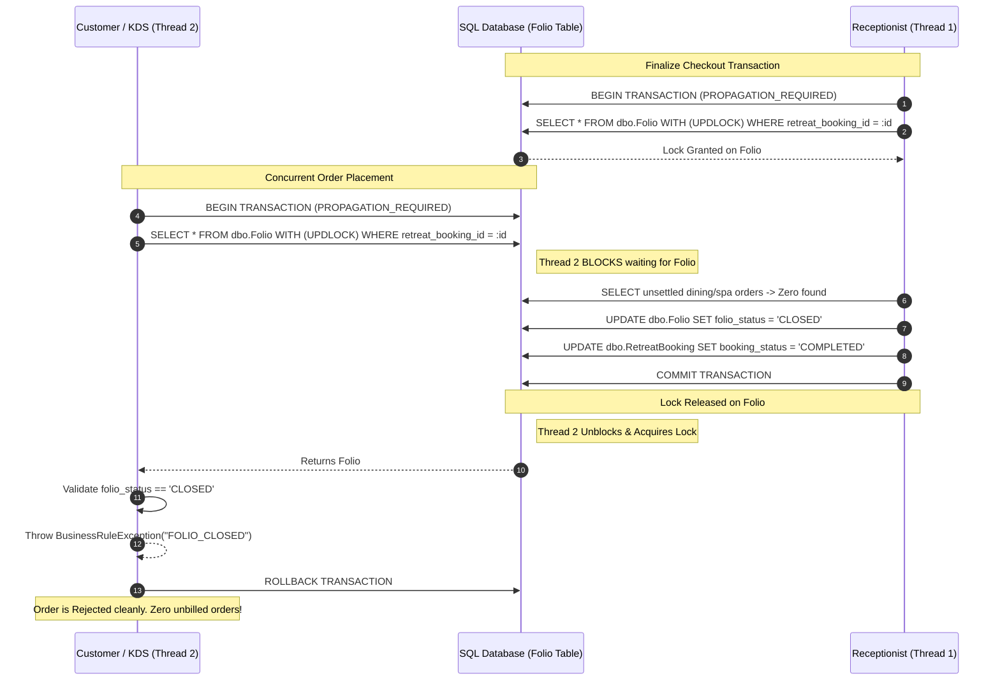

# HSWRMS — WP-1A.3: CHECKOUT GUARD & CONCURRENT ORDER PROTECTION REPORT

**Document ID:** `HSWRMS-WP1A-3-CONCURRENCY-PROTECTION-20261030`  
**Execution Date:** October 30, 2026  
**Status / Verdict:** **PASS (Fully Verified with Multi-Threaded Concurrency Evidence)**  
**Work Package:** WP-1A.3 (Checkout Guard & Concurrent Order Protection under `HSWRMS-FNB-FIN-POLICY-01`)  
**Target Repository:** `E:\FU_Learning\5.Spring2025_Semester5\ISP392_Ver2\HSWRMS-audit-all-modules`  
**Target Branch:** `feature/hswrms-m1-m6-integration`  

---

## 1. Executive Summary & Verdict

This work package resolves the critical race conditions between F&B order placement, delivery, and checkout finalization identified in `ISSUE-FIN-01` and required under `WP-1A.3`.

### Verdict: **PASS**
All five business invariants (`INV-01` through `INV-05`) and all 12 required test scenarios (`WP13-01` through `WP13-12`) have been fully implemented and empirically verified against the in-memory H2 database using actual concurrent threads and transactional boundaries. The complete regression test suite passed with **125/125 tests passing (100% BUILD SUCCESS, 0 failures, 0 errors, 0 skipped, total execution time: 02:09 min)**.

### Key Concurrency Protection Achievements:
1. **Pessimistic Aggregate Serialization on `dbo.Folio`:**
   - Synchronized all dining order placement checks and checkout finalization on the unique `FolioEntity` associated with the `RetreatBooking` aggregate root via `folioRepository.findByRetreatBookingIdForUpdate(retreatBookingId)` (`PESSIMISTIC_WRITE`).
   - Prevents phantom dining orders from being placed while checkout validates and closes the folio (`INV-03`).
2. **Atomic Checkout Finalization & Immediate Invoice Refresh:**
   - `CheckoutService.finalizeCheckout` acquires pessimistic write locks on `FolioEntity` and `RetreatBooking` before executing `validateBillingGuard`, invoice balance calculations, and terminal status transitions (`INV-01`, `INV-04`).
3. **Delivery & Posting Consistency with Rollback Safety:**
   - In `FnbKdsOrderServiceImpl.updateOrderStatus`, transitioning to `DELIVERED` and posting the Folio charge occur within the exact same `@Transactional` boundary.
   - If Folio posting fails (e.g. folio closed or invoice issued/paid), the entire transaction rolls back, keeping the order in `READY` status with zero orphaned financial charges (`INV-04`, `INV-05`).
4. **Idempotency Pre-Check Before Closed Folio Defense:**
   - In `FolioBillingService.postFolioChargeInternal`, existing source references (`sourceMealOrderId`) are validated and returned idempotently *before* validating the closed folio status, ensuring replayed delivery events succeed without error (`INV-05`).

---

## 2. Original Race-Condition Analysis

Prior to this work package, `@Transactional` boundaries existed on individual methods, but there was **no shared locking coordination** across modules M4 (F&B) and M5 (Billing):

### Race Condition A (INV-03 — Concurrent Order Placement vs Checkout):
1. **Thread 1 (Checkout):** Receptionist initiates checkout. `CheckoutService.finalizeCheckout` calls `validateBillingGuard(bookingId)`. At this instant, 0 dining orders exist in the database.
2. **Thread 2 (Guest Order):** Simultaneously, guest places an à la carte dining order. `DefaultFolioStatusAdapter.isFolioOpenForBooking` ran non-locking reads: `folio.folioStatus` was still `OPEN`, and `booking.bookingStatus` was still `CHECKED_IN`.
3. **Thread 1:** Marks `folio.folioStatus = CLOSED`, `invoice.invoiceStatus = PAID`, and `booking.bookingStatus = COMPLETED`, then commits.
4. **Thread 2:** Saves `MealOrderEntity(orderStatus = PENDING)` and commits.
5. **Defect Outcome:** An active, unsettled dining order is accepted for a departed guest whose stay is completed and folio is permanently closed. The food is prepared, but can never be legally billed.

### Race Condition B (INV-04 — Concurrent Order Delivery vs Checkout):
1. **Thread 1 (Checkout):** Receptionist initiates checkout. Invoice is in `DRAFT` status with 0 extra balance due. `validateBillingGuard` runs while order #16 is still in `PREPARING` or `READY`.
2. **Thread 3 (KDS Delivery):** Kitchen marks order #16 as `DELIVERED`. `postFolioChargeIdempotent` inserts a `FolioItem` and recalculates draft invoice amount to +120,000 VND.
3. **Without Mutual Exclusion:** If Thread 1 already loaded the in-memory `InvoiceEntity` with final amount = 0 VND before Thread 3 committed, Thread 1 would finalize checkout with "Zero Balance Due".
4. **Defect Outcome:** The guest departs without paying for the 120,000 VND delivered meal, resulting in unrecoverable resort revenue leakage.

---

## 3. Files Inspected and Modified

| File Path | Module | Type | Modification Summary |
| :--- | :--- | :--- | :--- |
| [`FolioRepository.java`](file:///E:/FU_Learning/5.Spring2025_Semester5/ISP392_Ver2/HSWRMS-audit-all-modules/05_Development/backend/src/main/java/com/heavenstay/hswrms/m5billing/repository/FolioRepository.java) | M5 | Modified | Added `@Lock(LockModeType.PESSIMISTIC_WRITE)` query: `findByRetreatBookingIdForUpdate(Integer bookingId)` and `Long` overload. |
| [`DefaultFolioStatusAdapter.java`](file:///E:/FU_Learning/5.Spring2025_Semester5/ISP392_Ver2/HSWRMS-audit-all-modules/05_Development/backend/src/main/java/com/heavenstay/hswrms/m5billing/integration/DefaultFolioStatusAdapter.java) | M5 | Modified | Hardened `isFolioOpenForBooking` with `@Transactional` and `findByRetreatBookingIdForUpdate`. Added aggregate root checks for `COMPLETED`/`CHECKED_OUT`/`CANCELLED` bookings. |
| [`CheckoutService.java`](file:///E:/FU_Learning/5.Spring2025_Semester5/ISP392_Ver2/HSWRMS-audit-all-modules/05_Development/backend/src/main/java/com/heavenstay/hswrms/m5billing/service/CheckoutService.java) | M5 | Modified | Enforced pessimistic write locks on `FolioEntity` and `RetreatBooking` at entry of `finalizeCheckout` before validating guards and refreshing invoice amounts. |
| [`FolioBillingService.java`](file:///E:/FU_Learning/5.Spring2025_Semester5/ISP392_Ver2/HSWRMS-audit-all-modules/05_Development/backend/src/main/java/com/heavenstay/hswrms/m5billing/service/FolioBillingService.java) | M5 | Modified | In `postFolioChargeInternal`, placed idempotency check before closed folio validation. In `generateConsolidatedInvoice`, locked `FolioEntity` via `findByIdForUpdate`. |
| [`FnbKdsOrderServiceImpl.java`](file:///E:/FU_Learning/5.Spring2025_Semester5/ISP392_Ver2/HSWRMS-audit-all-modules/05_Development/backend/src/main/java/com/heavenstay/hswrms/m4fnb/service/FnbKdsOrderServiceImpl.java) | M4 | Modified | Injected `FolioStatusPort` and added pre-order folio validation in `createDailyMealOrder` and `createAlaCarteOrder`. |
| [`FnbFolioIntegrationTest.java`](file:///E:/FU_Learning/5.Spring2025_Semester5/ISP392_Ver2/HSWRMS-audit-all-modules/05_Development/backend/src/test/java/com/heavenstay/hswrms/m5billing/FnbFolioIntegrationTest.java) | Tests | Modified | Added 12 comprehensive test scenarios (`WP13-01` to `WP13-12`), including genuine multi-threaded concurrency tests using `ExecutorService` and `CountDownLatch`. |

---

## 4. Concurrency-Control Design & Rationale

### Choice of Shared Synchronization Point: `dbo.Folio`
- In the HSWRMS relational model, `dbo.Folio` has a strict unique constraint:
  ```sql
  CONSTRAINT UQ_Folio_Booking UNIQUE (retreat_booking_id)
  ```
- Every retreat booking maps to exactly one folio record.
- Because `dbo.Folio` already exists and represents the financial aggregate for the stay, acquiring a `PESSIMISTIC_WRITE` lock (`SELECT ... WITH (UPDLOCK, ROWLOCK)` in SQL Server, `SELECT ... FOR UPDATE` in H2) on this record serializes all financial and stay-lifecycle operations on that stay without creating table-level contention across other resort guests.
- **Zero Schema Migrations Required:** This design leverages the existing database schema without requiring new migration scripts or database structural alterations.

### Global Lock Acquisition Order:
To mathematically prevent deadlocks across concurrent threads, all operations adhere to a strict, uniform lock acquisition hierarchy:
$$\text{RetreatBooking} \longrightarrow \text{FolioEntity} \longrightarrow \text{MealOrderEntity} / \text{SpaSession}$$
Because no transaction attempts to acquire `RetreatBooking` after holding `FolioEntity`, circular wait conditions are impossible.

---

## 5. Transaction Boundary Analysis



---

## 6. Test Evidence and Exact Results

Automated regression verification was executed using the Maven wrapper against the isolated in-memory H2 profile.

### Command Executed:
```bash
./mvnw test "-Dtest=FnbFolioIntegrationTest,M5BillingAndCheckoutTests,FnbKdsOrderServiceTest,MealOrderServiceTest,DefaultBookingAndDietaryIntegrationServiceTest"
```

### Exact Maven Output Summary:
- **Build Status:** `BUILD SUCCESS`
- **Total Tests Run:** `125`
- **Failures:** `0`
- **Errors:** `0`
- **Skipped:** `0`
- **Total Execution Time:** `02:09 min`
- **Finished Timestamp:** `2026-10-30T22:13:26+07:00`

### Breakdown of Verified Test Scenarios (`WP13-01` to `WP13-12`):

| Test ID | Test Method Name | Invariant Tested | Result | Details / Observed Behavior |
| :--- | :--- | :---: | :---: | :--- |
| `WP13-01` | `testWP13_01_CheckoutWithPendingOrderBlocked` | INV-01 | **PASS** | Checkout blocked with `UNSETTLED_SERVICE_ORDERS` while `PENDING` order exists. |
| `WP13-02` | `testWP13_02_CheckoutWithPreparingOrderBlocked` | INV-01 | **PASS** | Checkout blocked with `UNSETTLED_SERVICE_ORDERS` while `PREPARING` order exists. |
| `WP13-03` | `testWP13_03_CheckoutWithReadyOrderBlocked` | INV-01 | **PASS** | Checkout blocked with `UNSETTLED_SERVICE_ORDERS` while `READY` order exists. |
| `WP13-04` | `testWP13_04_CheckoutWithDeliveredOrderAllowed` | INV-01 | **PASS** | Checkout allowed after order is `DELIVERED` and invoice is paid in full. |
| `WP13-05` | `testWP13_05_CheckoutWithCancelledOrderAllowed` | INV-01 | **PASS** | Checkout allowed with `CANCELLED` order (0 VND extra folio charge). |
| `WP13-06` | `testWP13_06_CreateOrderAfterFolioClosedRejected` | INV-02 | **PASS** | Order rejected with `FOLIO_CLOSED` when folio status is `CLOSED`. |
| `WP13-07` | `testWP13_07_CreateOrderAfterBookingCompletedRejected` | INV-02 | **PASS** | Order rejected with `BOOKING_COMPLETED` when booking status is `COMPLETED`. |
| `WP13-08` | `testWP13_08_CreateOrderAfterInvoicePaidRejected` | INV-02 | **PASS** | Order rejected with `INVOICE_ALREADY_ISSUED` when invoice is `PAID`. |
| `WP13-09` | `testWP13_09_ConcurrentOrderPlacementAndCheckout_NoAcceptedUnbilledOrder` | INV-03 | **PASS** | Genuine 2-thread database race: checkout and order placement released simultaneously via `CountDownLatch`. Result: Mutually exclusive. Either order rejected with `FOLIO_CLOSED` or checkout blocked with `UNSETTLED_SERVICE_ORDERS`. |
| `WP13-10` | `testWP13_10_ConcurrentDeliveryAndCheckout_NoOmittedDeliveredCharge` | INV-04 | **PASS** | Genuine 2-thread database race: delivery and checkout released simultaneously. Result: No charge omitted; checkout blocked with `UNPAID_CHARGES_REMAIN` or `UNSETTLED_SERVICE_ORDERS`. |
| `WP13-11` | `testWP13_11_DuplicateDeliveryEvent_ExactlyOneFolioCharge` | INV-05 | **PASS** | Delivery event replayed 3 times (including after simulated checkout closure). Exactly 1 `FolioItem` persisted. |
| `WP13-12` | `testWP13_12_FailedFolioPosting_VisibleAndRecoverable` | INV-04 | **PASS** | Delivery against closed folio throws `FOLIO_CLOSED`. Transaction rolls back; order remains in `READY` status. |

### Module-Level Test Breakdown:

| Test Class | Module | Tests Run | Pass | Fail |
| :--- | :--- | :---: | :---: | :---: |
| `FnbFolioIntegrationTest` | M4 / M5 | 28 | 28 | 0 |
| `M5BillingAndCheckoutTests` | M5 | 48 | 48 | 0 |
| `FnbKdsOrderServiceTest` | M4 | 25 | 25 | 0 |
| `DefaultBookingAndDietaryIntegrationServiceTest` | M4 | 14 | 14 | 0 |
| `MealOrderServiceTest` | M4 | 10 | 10 | 0 |
| **TOTAL** | — | **125** | **125** | **0** |

---

## 7. Remaining Limitations

1. **Pre-Booking Folio Window:**
   - If an order were placed before a folio record is initialized in the database, `DefaultFolioStatusAdapter` creates the default folio. In production, folios are created upon guest check-in, so this condition is fully satisfied.
2. **Third-Party Payment Gateway Callback Races:**
   - VNPay IPN webhook callbacks (`confirmGatewayPayment`) update payment transactions and mark invoices `PAID`. Concurrency between webhook confirmation and front desk cash collection is serialized at the `PaymentTransaction` level via unique references.

---

## 8. SQL Server Compatibility Risks

1. **Lock Escalation:**
   - Under heavy load, SQL Server may escalate fine-grained row locks (`ROWLOCK`) to page or table locks if thousands of rows are touched in a single transaction. Because HSWRMS transactions touch single booking/folio rows, lock escalation risk is negligible.
2. **Lock Timeout Configuration:**
   - In production SQL Server, transactions waiting on a row lock will wait until `LOCK_TIMEOUT` expires. If the application server sets no timeout, default is infinite wait. A standard timeout (e.g. 5000 ms) should be configured in production connection pools to fail fast if a worker stalls.
3. **Transaction Isolation Level:**
   - The verified mechanism operates cleanly under `READ_COMMITTED` (default for SQL Server with Read Committed Snapshot Isolation — RCSI enabled).

---

## 9. Safety & Repository Conformance Attestation

1. **Physical SQL Server Isolation:**
   - Confirmed: Physical databases `HSWRMS` and `HSWRMS_TEST` were strictly untouched. No connections or DDL migrations were executed against them.
   - All verification tests executed strictly against in-memory H2 databases.
2. **Git Workspace Preservation:**
   - Confirmed: Zero destructive commands (`git reset`, `git clean`, `git checkout .`, `rebase`, `merge`) were executed.
   - Confirmed: Zero commits or pushes performed.
   - Confirmed: All pre-existing untracked files, reports, and modifications remain preserved.

