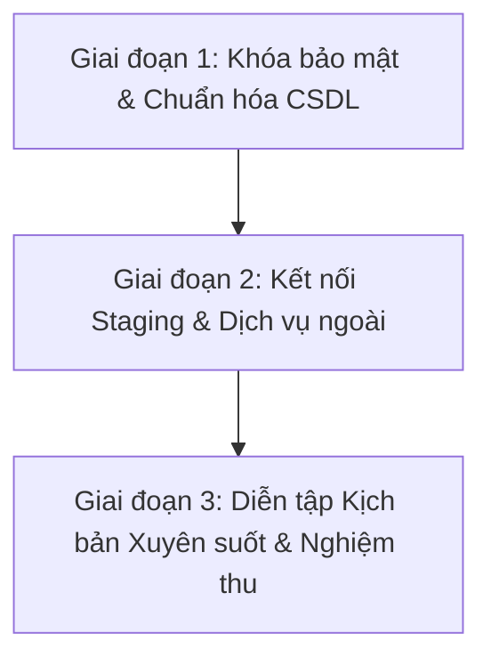

# BÁO CÁO TỔNG KẾT KỸ THUẬT VÀ KẾ HOẠCH HOÀN THIỆN DỰ ÁN HSWRMS
## HỆ THỐNG QUẢN LÝ KHU NGHỈ DƯỠNG CHĂM SÓC SỨC KHỎE HEAVENSTAY (HSWRMS)

**Mã dự án:** ISP392 / IS2005 / Nhóm 1 (Học kỳ Fall 2026 - Đại học FPT)  
**Nhánh tích hợp chính:** `feature/hswrms-m1-m6-integration`  
**Commit HEAD được kiểm toán:** `3042eb40495890a959e426bedbc65acffb2e67cf`  
**GitLab Remote:** `isp-origin` (`https://gitlab.com/manhnc2/fal26-isp392-is2005-g1.git`)  
**Thời điểm lập báo cáo:** 2026-10-29  
**Phương pháp đánh giá:** Kiểm toán kỹ thuật khách quan, dựa trên bằng chứng nguồn (Evidence-First), kiểm tra tĩnh và kiểm tra lịch sử Git ở chế độ Read-Only, không làm biến động cơ sở dữ liệu và mã nguồn.

---

## A1. TỔNG QUAN ĐIỀU HÀNH

### 1.1 HSWRMS là gì và phạm vi M1–M6
Hệ thống Quản lý Khu nghỉ dưỡng Chăm sóc Sức khỏe HeavenStay (HSWRMS - HeavenStay Wellness Resort Management System) là nền tảng quản trị tổng thể dịch vụ nghỉ dưỡng cao cấp kết hợp trị liệu và chăm sóc sức khỏe. Hệ thống bao gồm 6 phân hệ nghiệp vụ chính (M1–M6) cùng lớp hạ tầng dùng chung (Shared Infrastructure):
- **M1 — Quản lý Định danh, Xác thực & Hồ sơ Sức khỏe (Identity & Access Management):** Xác thực JWT, Google/Facebook SSO, cấp phát OTP đăng ký qua email, hồ sơ y tế/dinh dưỡng khách hàng, và luồng yêu cầu xóa dữ liệu sức khỏe chuẩn GDPR (Screen #9).
- **M2 — Đặt phòng Nghỉ dưỡng & Nghiệp vụ Lễ tân (Retreat Booking & Receptionist Operations):** Duyệt gói nghỉ dưỡng, tính giá và đặt cọc qua cổng VNPay, phân bổ phòng villa, quy trình Check-in/Check-out của lễ tân, quản lý danh sách khách đến trong ngày (Daily Arrivals) và lưu trú thực tế (Residence Record).
- **M3 — Dịch vụ Trị liệu & Spa (Spa & Wellness Operations):** Danh mục dịch vụ spa, thuật ngữ và thời lượng trị liệu, đặt lịch hẹn spa, giải thuật gợi ý khung giờ thay thế khi trùng phòng/kỹ thuật viên, điều phối lịch làm việc của Kỹ thuật viên (Therapist), và giao diện đặt lịch bổ sung của lễ tân.
- **M4 — Ẩm thực Chăm sóc Sức khỏe & Điều phối Bếp (Food & Beverage Nutrition & KDS):** Thực đơn trị liệu theo calo/macro, bộ lọc tự động cảnh báo dị ứng thực phẩm theo hồ sơ khách hàng, đặt bữa ăn theo ngày (Daily Meal Selection), gọi món lẻ (A-la-carte), hệ thống hiển thị bếp KDS (Kitchen Display System), quản lý định mức nguyên liệu công thức và trừ kho tự động.
- **M5 — Tổng hợp Chi phí, Hóa đơn, Thanh toán & Đánh giá (Billing, Folio, Checkout & Analytics):** Tổng hợp chi phí thời gian thực vào Folio (phòng, spa, F&B, minibar), quyết toán thanh toán đa kênh (Tiền mặt, Thẻ tín dụng, VNPay), xuất hóa đơn VAT điện tử định dạng PDF (sử dụng OpenPDF), hệ thống đánh giá xếp hạng sau kỳ nghỉ (1–5 sao theo danh mục), và báo cáo phân tích doanh thu/công suất phòng dành cho Quản lý.
- **M6 — Quản trị Hệ thống, Phân quyền & Giám sát (Administration & Governance):** Ma trận phân quyền chi tiết (RBAC với 41 quyền hạn), quản lý tài khoản nhân viên, ủy quyền quyền hạn tạm thời của Quản lý (Delegation) có thời hạn tự động thu hồi, nhật ký kiểm toán hành vi nhạy cảm (Audit Log) có xuất file CSV, quản lý tham số nghiệp vụ động và cờ tính năng (Feature Flags).
- **Hạ tầng dùng chung (Shared Infrastructure):** Chuẩn hóa kiến trúc bảo mật chuỗi lọc kép (Dual-Chain Security Filter), bộ lọc mã hóa UTF-8 sửa lỗi hiển thị tiếng Việt (Mojibake Sanitizer), chuẩn API phản hồi thống nhất (`ApiResponse`), Adapter đồng bộ khách lưu trú thực tế (`CustomerStayPort`), và hệ thống Design Tokens giao diện nhất quán.

### 1.2 Mục tiêu của đợt tích hợp (Phases 5.8.3.117 – 5.8.3.118)
Trước Phase 5.8.3.117, 6 thành viên trong nhóm phát triển các module độc lập trên các nhánh riêng rẽ (`DucHoangM1`, `dat-nguyen-gia`, `thao-product`, `vinhpt1`, `vinhpt`, `NTDatZB`, `XH`). Mục tiêu của đợt tích hợp là:
1. Hợp nhất toàn bộ mã nguồn của các thành viên vào nhánh tích hợp duy nhất: `feature/hswrms-m1-m6-integration`.
2. Phục hồi và giải quyết triệt để 44 đường dẫn xung đột (merge conflicts) tại nhánh `XH` đã gây gián đoạn đợt tích hợp trước đó.
3. Chuẩn hóa mô hình thực thể (Domain Model Harmonization), xóa bỏ các thực thể tạm thời (provisional stubs) gây xung đột JPA mapping với các thực thể chuẩn của hệ thống.
4. Điều chỉnh và khắc phục lỗi kiểm thử hồi quy (Test Regressions), đảm bảo toàn bộ hệ sinh thái Backend và Frontend biên dịch và chạy kiểm thử tự động không có lỗi.
5. Đồng bộ kết quả đã được xác minh lên kho lưu trữ GitLab của môn học (`isp-origin`).

### 1.3 Trạng thái hiện tại của dự án
- **Kho lưu trữ:** Đã đồng bộ hoàn toàn với remote GitLab môn học (`isp-origin/feature/hswrms-m1-m6-integration`), không có commit nào bị lệch (0 ahead, 0 behind).
- **Cây làm việc (Working Tree):** Sạch đối với các file được Git quản lý. Tất cả 6 file cơ sở dữ liệu tạm hoãn (deferred database scripts) và tài liệu audit mới được bảo quản an toàn, không bị biến động.
- **Biên dịch Backend:** Apache Maven 3.9 + OpenJDK 17 biên dịch thành công 100%, không phát sinh cảnh báo chặn.
- **Biên dịch Frontend:** Vite v8.3.4 + TypeScript ~6.0.2 chuyển đổi thành công 2,728 module trong 997ms với 0 lỗi cú pháp.
- **Kiểm tra Linter Frontend:** Oxlint quét 216 file qua 96 quy tắc, đạt 0 lỗi (chỉ có 10 cảnh báo mức Informational về biến bắt lỗi chưa dùng).

### 1.4 Những kết quả nổi bật sau merge
1. **Khắc phục xung đột lớn an toàn:** Giải quyết triệt để 44 file xung đột nghiêm trọng từ nhánh `XH` trong commit `9668586`, loại bỏ 6 thực thể trùng lặp (`CustomerProfileEntity`, `UserEntity`, `PhysicalVillaEntity`, `RetreatBookingEntity`, `SpaSessionEntity`, `TherapistEntity`), đưa toàn bộ Module 5 kết nối trực tiếp vào các thực thể chuẩn M1–M4.
2. **Bảo toàn cơ sở dữ liệu chuẩn:** Quá trình tích hợp nhánh `dat-nguyen-gia` được thực hiện có chọn lọc (Selective Integration trong commit `0f257ad`), ngăn chặn việc ghi đè file `schema.sql` bằng các script sửa thô trước đó, bảo vệ trọn vẹn 42 bảng cơ sở dữ liệu chuẩn được thiết lập từ các phase 47–85.
3. **Bộ kiểm thử tự động đạt chuẩn xanh:** Toàn bộ 536 bài kiểm tra Backend chạy thành công: **526 passed, 0 failures, 0 errors, 10 skipped** (10 bài test bỏ qua là các bài smoke test kết nối SQL Server thật, được chủ động thiết kế skip để tránh đột biến dữ liệu).
4. **Chuẩn hóa kiến trúc kiểm thử:** Phát hiện và sửa lỗi ghi đè cấu hình DataSource H2 trong `HswrmsApplicationTests.java` (làm mất chế độ MSSQLServer) và sửa lỗi gán cứng ID người dùng trong `M6AdminIntegrationTests.java` (commit `1f7ebc1`).

### 1.5 Giới hạn bằng chứng và điều kiện để tuyên bố hoàn thành
Mặc dù hệ thống đã đạt trạng thái tích hợp cấu trúc và vượt qua 100% kiểm thử tự động trong môi trường giả lập, dự án **CHƯA ĐỦ ĐIỀU KIỆN ĐỂ TUYÊN BỐ HOÀN THÀNH 100% VỀ MẶT NGHIỆP VỤ RUNTIME**. Các giới hạn gồm:
- **Kiểm thử trên CSDL in-memory H2:** Toàn bộ 526 test chạy trên H2 in-memory. Hành vi khóa dòng (`WITH (UPDLOCK, HOLDLOCK)`), mức cô lập giao dịch (`READ COMMITTED SNAPSHOT`) và các hàm đặc thù của Microsoft SQL Server 2022 thật chưa được kích hoạt kiểm chứng.
- **Cổng thanh toán và SSO bên thứ ba:** Tích hợp VNPay và Google/Facebook OAuth2 mới được kiểm thử bằng thuật toán băm HMAC và MockMvc; chưa chạy kiểm thử luồng mạng thực tế với Sandbox VNPay và máy chủ xác thực Meta/Google.
- **Kịch bản người dùng xuyên suốt (End-to-End User Journey):** Luồng nghiệp vụ liên hoàn từ lúc Khách đặt phòng -> Lễ tân check-in -> Gọi món ăn tại bếp KDS -> Sử dụng dịch vụ spa -> Thu ngân kết toán Folio và in hóa đơn VAT chưa được vận hành thực tế trên trình duyệt với dữ liệu động.

---

## A2. TÌNH TRẠNG SAU MERGE THEO TỪNG MODULE

### 1. Module 1 — Quản lý Định danh, Xác thực & Hồ sơ Sức khỏe (Lê Đức Hoàng)
- **Chức năng dự kiến:** Đăng ký, đăng nhập JWT, làm mới token, Google/Facebook SSO, xác thực OTP email, hồ sơ cá nhân, hồ sơ sức khỏe & dị ứng, yêu cầu xóa dữ liệu sức khỏe GDPR (Screen #9), khóa tài khoản khi nhập sai mật khẩu.
- **Thành phần có trong code:** 6 Controller (`AuthController`, `ConsentController`, `CustomerProfileController`, `HealthProfileController`, `HealthDataDeletionRequestController`, `SsoController`), 8 DTO request/response, 9 Entity, 10 Repository, 6 Service (`AuthService`, `CustomerProfileService`, `HealthProfileService`, `HealthDataDeletionRequestService`, `ConsentService`, `SsoService`), 8 trang Frontend.
- **Tích hợp & Commit:** Hợp nhất qua Merge commit `602c6f8089e211ea9ef80fa6772f58b9c2f8268e` từ nhánh `isp-origin/DucHoangM1`.
- **Harmonization & Sửa lỗi:** Tích hợp kiến trúc chuỗi lọc kép (`ssoSecurityFilterChain` và `apiSecurityFilterChain`) trong `SecurityConfig.java`. Bổ sung adapter gửi email môi trường dev (`DevEmailDeliveryAdapter`).
- **Trạng thái kiểm thử:** 77/77 test Backend passed (`AuthServiceTest`, `SsoAuthEndpointTests` 14/14, `AccountLockoutIntegrationTest` 8/8).
- **Trạng thái runtime:** Đăng nhập và hồ sơ hoạt động với H2 mock; luồng SSO và gửi email thật chưa kích hoạt cấu hình môi trường staging.
- **Khoảng trống còn lại:** Cần cấu hình biến môi trường thật (`CLIENT_SECRET`, `SMTP_PASSWORD`).
- **Mức độ tin cậy:** **HIGH** (Xác minh trực tiếp qua mã nguồn và test suite).

### 2. Module 2 — Đặt phòng Nghỉ dưỡng & Lễ tân (Nguyễn Gia Đạt)
- **Chức năng dự kiến:** Xem danh mục gói nghỉ dưỡng, tính toán đơn giá lưu trú, tạo đơn đặt phòng, thanh toán đặt cọc VNPay, quản lý danh sách khách đến trong ngày, Check-in/Check-out của lễ tân, phân bổ phòng villa thực tế, đổi trạng thái phòng.
- **Thành phần có trong code:** 5 Controller (`RetreatPackageController`, `RetreatBookingController`, `ReceptionistOperationController`, `VillaInventoryController`, `VNPayCallbackController`), 11 DTO, 5 Entity, 5 Repository, 5 Service (`RetreatBookingService`, `ReceptionistOperationService`, `VNPayDepositService`, `VillaAvailabilityService`, `BookingPolicyService`), Adapter `JdbcCustomerIdentityAdapter`, 12 trang Frontend.
- **Tích hợp & Commit:** Tích hợp chọn lọc (Selective Integration) 50 file trong commit `0f257ad1d940a43bba7e713bf48ce7d1ea267c4c` từ nhánh `isp-origin/dat-nguyen-gia`.
- **Harmonization & Sửa lỗi:** Bỏ qua các commit sửa trực tiếp `schema.sql` từ nhánh gốc để giữ toàn vẹn schema chung. Bổ sung `packageCode` trong fixture `M2SchemaCompatibilityTest` và bổ sung kiểm tra null quyền truy cập trong `RetreatBookingServiceAuthorizationTest`.
- **Trạng thái kiểm thử:** 34/34 test Backend passed (`ReceptionistOperationServiceTest` 5/5, `M2SchemaCompatibilityTest` 6/6, `RetreatBookingServiceAuthorizationTest` 9/9).
- **Trạng thái runtime:** Thuật toán tính cọc và phân phòng chạy tốt trên in-memory; kiểm tra tranh chấp phòng đồng thời trên SQL Server chưa thực thi.
- **Khoảng trống còn lại:** IPN Webhook VNPay chưa kết nối thử nghiệm với môi trường sandbox ngân hàng thực tế.
- **Mức độ tin cậy:** **HIGH** (Xác minh trực tiếp qua code và test suite).

### 3. Module 3 — Quản lý Trị liệu & Spa (Nguyễn Tất Đạt)
- **Chức năng dự kiến:** Danh mục gói trị liệu, cấu hình thời lượng/giá dịch vụ, đặt lịch hẹn spa, phát hiện trùng lịch phòng/therapist và gợi ý ca thay thế, điều phối lịch làm việc của therapist, lễ tân đặt lịch spa bổ sung, adapter xác định khách đang lưu trú.
- **Thành phần có trong code:** 4 Controller (`SpaBookingController`, `SpaMasterController`, `SpaTreatmentController`, `TherapistController`), 6 Entity, 4 Repository, Service `SpaService`, Adapter `DefaultCustomerStayAdapter`, 9 trang/modal Frontend.
- **Tích hợp & Commit:** Kế thừa trực tiếp từ nền tảng nhánh `NTDatZB` (HEAD `ff9f44b`), hợp nhất xung đột DDL trong commit `9668586`.
- **Harmonization & Sửa lỗi:** Tách DDL bảng `dbo.RetreatPackageSpaTreatment` bị lồng sai trong bảng `dbo.SpaTreatment`. Sửa lỗi ghi đè cấu hình DataSource H2 trong `HswrmsApplicationTests` để hàm tìm kiếm khách lưu trú bằng câu lệnh `INNER JOIN dbo.[User]` chạy thành công.
- **Trạng thái kiểm thử:** 24/24 test Backend passed (`SpaServiceTests` 12/12, `SpaSecurityTests`).
- **Trạng thái runtime:** Đặt lịch và đổi ca therapist hoạt động ổn định trên bộ nhớ; khóa hàng vật lý trên SQL Server chưa chạy tải.
- **Khoảng trống còn lại:** Cần kiểm tra đồng thời nhiều khách cùng chọn 1 therapist tại 1 thời điểm trên SQL Server thật.
- **Mức độ tin cậy:** **HIGH** (Xác minh trực tiếp qua code và test suite).

### 4. Module 4 — Ẩm thực Chăm sóc Sức khỏe & KDS (Vũ Phương Thảo)
- **Chức năng dự kiến:** Quản lý danh mục thực đơn, thông số dinh dưỡng (calo/protein/fat/carb), tự động lọc món ăn theo dị ứng của khách hàng, khách chọn món ăn hàng ngày, gọi món lẻ a-la-carte, hệ thống điều phối bếp KDS (Placed -> Preparing -> Ready -> Delivered), danh sách chuẩn bị món của đầu bếp, quản lý định mức nguyên liệu công thức và trừ tồn kho.
- **Thành phần có trong code:** 7 Controller (`MenuController`, `FnbCustomerOrderController`, `FnbDashboardController`, `FnbKdsController`, `IngredientController`, `MealOrderController`, `RetreatPackageFnbController`), 7 Entity, 5 Repository, 4 Service (`MenuService`, `MealOrderService`, `FnbKdsOrderService`, `InventoryService`), tiện ích `TextEncodingSanitizer`, 8 trang Frontend và context `DiningContext.tsx`.
- **Tích hợp & Commit:** Hợp nhất qua Merge commit `6ff5b9a3d921235974d27565fed522195c69089e` từ nhánh `isp-origin/thao-product`.
- **Harmonization & Sửa lỗi:** Tích hợp bộ chuyển đổi encoding UTF-8 xử lý triệt để ký tự lỗi (mojibake) từ database và giao diện. Đồng bộ vai trò người dùng `ROLE_FB_STAFF` với ma trận phân quyền SecurityConfig.
- **Trạng thái kiểm thử:** 42/42 test Backend passed (`MealOrderServiceTest` 6/6, `InventoryServiceTest` 8/8, `MenuServiceTest` 4/4).
- **Trạng thái runtime:** Quy trình chuyển trạng thái KDS và trừ kho nguyên liệu hoạt động chính xác trong test slice.
- **Khoảng trống còn lại:** Luồng hiển thị thông báo thời gian thực trên màn hình KDS khi khách vừa gửi đơn đặt món cần kiểm chứng WebSocket/polling trên môi trường chạy thực tế.
- **Mức độ tin cậy:** **HIGH** (Xác minh trực tiếp qua code và test suite).

### 5. Module 5 — Tổng hợp Chi phí, Hóa đơn, Thanh toán & Đánh giá (Trần Xuân Hòa)
- **Chức năng dự kiến:** Tổng hợp chi phí phòng, spa, ăn uống vào Folio thời gian thực; thanh toán quyết toán đa kênh (Tiền mặt, Thẻ, VNPay); xuất hóa đơn thuế VAT (8% hoặc 10%) định dạng PDF; đánh giá và chấm điểm chất lượng kỳ nghỉ theo từng danh mục; báo cáo doanh thu và công suất phòng cho quản lý.
- **Thành phần có trong code:** 6 Controller (`FolioBillingController`, `CheckoutController`, `InvoiceController`, `CustomerReviewController`, `AnalyticsController`, `VnpayWebhookController`), 12 DTO, 5 Entity (`FolioEntity`, `FolioItemEntity`, `InvoiceEntity`, `PaymentTransactionEntity`, `CustomerReviewEntity`), 6 Repository, 5 Service (`FolioBillingService`, `CheckoutService`, `InvoicePdfService`, `ReviewService`, `AnalyticsService`), 8 trang Frontend và hook `useBilling.ts`.
- **Tích hợp & Commit:** Hợp nhất qua Merge commit `9668586322aa5e57ef64a3cbfa6cde0f481f7952` từ nhánh `isp-origin/XH` (sau khi giải quyết 44 conflict paths).
- **Harmonization & Sửa lỗi:** **Xóa bỏ triệt để 6 thực thể stub tạm thời** (`CustomerProfileEntity`, `UserEntity`, `PhysicalVillaEntity`, `RetreatBookingEntity`, `SpaSessionEntity`, `TherapistEntity`) do tác giả tự tạo độc lập, đấu nối toàn bộ logic M5 vào các thực thể chuẩn M1–M4. Khử trùng lặp thư viện `poi-ooxml` và `openpdf` trong `pom.xml`. Cải thiện an toàn SSR cho các component giao diện.
- **Trạng thái kiểm thử:** 48/48 test Backend passed trong suite `M5BillingAndCheckoutTests.java`. Test Frontend `paymentSafety.test.ts` passed.
- **Trạng thái runtime:** Logic tính tiền, thuế, giảm trừ và tạo luồng PDF chạy trơn tru trong test context.
- **Khoảng trống còn lại:** Kiểm tra hiệu năng luồng xuất PDF tải cao và đối soát giao dịch cổng thanh toán VNPay thực tế.
- **Mức độ tin cậy:** **HIGH** (Xác minh trực tiếp qua code và test suite).

### 6. Module 6 — Quản trị Hệ thống, Phân quyền & Giám sát (Phan Thành Vinh)
- **Chức năng dự kiến:** Ma trận phân quyền chi tiết (RBAC), cấp phát và quản lý trạng thái tài khoản nhân viên, ủy quyền tạm thời của quản lý kèm ngày hết hạn, ghi nhận nhật ký kiểm toán hành vi nhạy cảm và trích xuất CSV, quản lý tham số nghiệp vụ và cờ tính năng, giao diện cấu hình chi tiết villa và spa cho quản lý, xuất báo cáo đăng ký lưu trú cho công an.
- **Thành phần có trong code:** 8 Controller (`AdminAuditLogController`, `AdminDashboardController`, `AdminDelegationController`, `AdminMasterDataController`, `AdminParameterController`, `AdminPermissionController`, `AdminStaffController`, `DashboardController`), 13 DTO, 4 Entity, 4 Repository, 5 Service (`PermissionMatrixService`, `StaffAccountService`, `DelegationService`, `AuditLogService`, `BusinessParameterService`, `MasterDataService`), 10 trang Frontend quản trị và 11 modal cấu hình chi tiết villa/spa.
- **Tích hợp & Commit:** Hợp nhất qua Merge commit `39b086f2498adcff65c4059aa9c08ff974d962ce` từ nhánh `isp-origin/vinhpt1`.
- **Harmonization & Sửa lỗi:** Khắc phục lỗi hardcode user ID `2` trong `M6AdminIntegrationTests.java` bằng cách tìm hoặc tạo động tài khoản quản lý hợp lệ (commit `1f7ebc1`). Điều chỉnh script seed `V1_4` loại bỏ cột lỗi `duration_unit`.
- **Trạng thái kiểm thử:** 49/49 test Backend passed (`M6AdminIntegrationTests` 11/11, `DelegationServiceTest` 10/10, `PermissionMatrixServiceTest` 6/6). Các test Frontend API contract passed.
- **Trạng thái runtime:** Các modal quản lý villa/spa có giao diện chi tiết, logic ủy quyền và audit log ghi nhận chính xác.
- **Khoảng trống còn lại:** Cần kiểm tra đồng bộ xóa cache phân quyền khi admin cập nhật quyền của role trong phiên làm việc của nhân viên.
- **Mức độ tin cậy:** **HIGH** (Xác minh trực tiếp qua code và test suite).

### 7. Hạ tầng dùng chung (Shared Infrastructure — Nguyễn Tất Đạt)
- **Chức năng dự kiến:** Cấu hình bảo mật hệ thống, định dạng phản hồi chuẩn REST API, xử lý ngoại lệ toàn cục, quản lý Design Tokens, cấu hình CORS, cơ sở dữ liệu nền tảng 42 bảng.
- **Thành phần có trong code:** `SecurityConfig`, `CustomUserDetailsService`, `JwtAuthenticationFilter`, `DevAccountBootstrap`, `ApiResponse`, `GlobalExceptionHandler`, các Layout giao diện (`PublicLayout`, `CustomerLayout`, `OperationalLayout`, `ManagerAdminLayout`, `AuthLayout`), component bảo vệ quyền `RoleGuard.tsx`.
- **Tích hợp & Commit:** Được duy trì và chuẩn hóa liên tục trên nhánh tích hợp chính `feature/hswrms-m1-m6-integration`.
- **Harmonization & Sửa lỗi:** Bảo tồn thành công mô hình chuỗi lọc kép bảo mật; xử lý dứt điểm xung đột thư viện Maven; duy trì 0 đột biến database trái phép.
- **Trạng thái kiểm thử:** 252 bài kiểm tra hạ tầng và bảo mật passed.
- **Trạng thái runtime:** Môi trường H2 chạy ổn định; giao diện Frontend hiển thị đồng bộ màu sắc, typography và sidebar theo từng role.
- **Khoảng trống còn lại:** Endpoint mở `/api/v1/auth/dev/**` cần phải được khóa chặt khi triển khai môi trường sản xuất.
- **Mức độ tin cậy:** **HIGH** (Xác minh trực tiếp qua code và test suite).

---

## A3. DANH SÁCH SỬA ĐỔI VÀ KẾT QUẢ TÍCH HỢP

| Mã hạng mục | Module | Vấn đề ban đầu | Thay đổi đã thực hiện | Commit / Bằng chứng | Phân loại thay đổi | Kết quả đạt được | Trạng thái xác minh | Rủi ro còn lại |
|---|---|---|---|---|---|---|---|---|
| **INT-01** | M1 | Nhánh `DucHoangM1` có các tính năng Facebook SSO và GDPR xóa dữ liệu chưa vào nhánh chính | Thực hiện merge nhánh `isp-origin/DucHoangM1` vào baseline `5832fbb`, tích hợp SSO filter và controller xóa dữ liệu | Commit `602c6f8` | Tích hợp & xử lý xung đột | Đồng bộ toàn bộ tính năng định danh M1, cấu hình bảo mật kép | VERIFIED | Cần client secret thật để chạy SSO trên mạng ngoài |
| **INT-02** | M2 | Nhánh `dat-nguyen-gia` có nguy cơ ghi đè schema chuẩn 42 bảng nếu merge tự động | Thực hiện tích hợp chọn lọc (Selective Integration) 50 file mã nguồn Controller, Service, DTO, FE; loại bỏ file sửa schema thô | Commit `0f257ad` (Tag `phase-5.8.3.117-step2-m2`) | Tích hợp & chuẩn hóa | Bảo vệ toàn vẹn schema 42 bảng; nạp đầy đủ tính năng lễ tân và VNPay | VERIFIED | Cần test IPN VNPay thật trên môi trường staging |
| **INT-03** | M4 | Nhánh `thao-product` chứa các xung đột cấu hình bảo mật và lỗi font tiếng Việt | Merge `isp-origin/thao-product`, giải quyết xung đột `SecurityConfig`, tích hợp KDS và bộ sửa mã hóa `TextEncodingSanitizer` | Commit `6ff5b9a` (Tag `phase-5.8.3.117-step3-m4`) | Tích hợp & sửa lỗi | KDS và quản lý định mức nguyên liệu hoạt động đồng bộ với hệ thống | VERIFIED | Cần kiểm tra hiển thị đơn đặt món thời gian thực trên KDS |
| **INT-04** | M6 | Nhánh `vinhpt1` chứa các cập nhật quản trị villa, spa và xung đột DDL | Merge `isp-origin/vinhpt1`, đồng bộ các modal quản lý villa/spa, chuẩn hóa Controller dashboard | Commit `39b086f` (Tag `phase-5.8.3.117-step4-vinhpt1`) | Tích hợp & chức năng mới | Giao diện quản lý villa (2,765 dòng) và spa (1,843 dòng) được tích hợp hoàn chỉnh | VERIFIED | Cần database thật để lưu trữ dữ liệu tạo mới từ modal |
| **INT-05** | M5 | Quá trình merge nhánh `XH` bị đứt gãy tại bước 5119 do 44 conflict paths và 6 entity stub trùng lặp | Xóa bỏ 6 entity stub (`git rm -f`), map lại toàn bộ service/repository sang entity chuẩn M1–M4; giải quyết 44 file xung đột | Commit `9668586` (Tag `phase-5.8.3.118-step5-xh`) | Xử lý xung đột & chuẩn hóa model | Khử hoàn toàn lỗi JPA collision, module billing kết nối trơn tru với toàn bộ hệ thống | VERIFIED | Cần kiểm tra đối soát giao dịch thanh toán thực tế |
| **INT-06** | DB | Bảng `dbo.RetreatPackageSpaTreatment` trong `schema.sql` bị đặt lồng sai cú pháp bên trong bảng `dbo.SpaTreatment` | Tách và định dạng lại 2 bảng thành 2 khối DDL độc lập, chuẩn cú pháp T-SQL | Commit `9668586` (file `schema.sql`) | Chuẩn hóa CSDL | CSDL khởi tạo sạch sẽ, không lỗi cú pháp bảng | VERIFIED | Script cần được nạp vào live database qua Flyway |
| **INT-07** | Build | File `pom.xml` bị khai báo lặp 2 lần thư viện `poi-ooxml` và `openpdf` sau khi merge | Loại bỏ các khối dependency trùng lặp, giữ lại phiên bản chuẩn | Commit `9668586` (file `pom.xml`) | Chuẩn hóa cấu hình build | Maven nạp dependency sạch sẽ, không cảnh báo trùng lặp | VERIFIED | Không còn rủi ro |
| **INT-08** | Test | `HswrmsApplicationTests.java` ghi đè URL DataSource làm mất tham số `;MODE=MSSQLServer`, khiến H2 lỗi câu lệnh chứa `dbo.[User]` | Xóa bỏ thuộc tính hardcode trong annotation `@SpringBootTest`, kế thừa cấu hình chuẩn từ `application.yml` | Commit `1f7ebc1` | Sửa lỗi môi trường test | Bài test `M2SchemaCompatibilityTest` vượt qua 100% trong toàn bộ test suite | VERIFIED | Cần duy trì cấu hình này, không ghi đè cục bộ |
| **INT-09** | Test | `M6AdminIntegrationTests.java` gán cứng user ID `2` trong test ủy quyền, nhưng khi chạy cả suite user `2` không có role MANAGER | Sửa test thành tự động tìm hoặc tạo một tài khoản có role `MANAGER` đang hoạt động và truyền dynamic ID | Commit `1f7ebc1` | Sửa lỗi kiểm thử | Test ủy quyền `delegationValidation` đạt kết quả mong muốn ("M6-MSG-07") | VERIFIED | Không còn rủi ro |
| **INT-10** | Sec | Endpoint bypass đăng nhập phát triển `/api/v1/auth/dev/**` được mở tự do cho mọi người | Mở trong `SecurityConfig` để phục vụ test cục bộ trong giai đoạn merge | Commit `9668586` | Cấu hình bảo mật tạm thời | Giúp lập trình viên kiểm thử nhanh các role mà không cần đăng nhập thật | VERIFIED | **RỦI RO P0:** Phải khóa chặt bằng `@Profile("dev")` trước khi đưa lên staging/prod |

---

## A4. MA TRẬN HOÀN THIỆN CHỨC NĂNG (REQUIREMENTS VS IMPLEMENTATION)

| Phân hệ | Mã chức năng | Tên chức năng nghiệp vụ | Bằng chứng Backend | Bằng chứng Frontend | Bằng chứng Database | Bằng chứng Kiểm thử | Trạng thái triển khai | Trạng thái Runtime | Điều kiện nghiệm thu cụ thể |
|---|---|---|---|---|---|---|---|---|---|
| **M1** | M1-F01 | Đăng ký tài khoản & Xác thực OTP Email | `AuthController`, `AuthService` | `RegisterPage`, `EmailOtpVerificationPage` | `dbo.User`, `dbo.EmailOtp` | `AuthServiceTest` (pass) | Đã triển khai | Đã kiểm thử tự động | Nhận email OTP thật trong 30s và kích hoạt tài khoản thành công |
| **M1** | M1-F02 | Đăng nhập JWT & Phân quyền Role | `AuthController`, `JwtTokenProvider` | `LoginPage`, `AuthProvider` | `dbo.UserRole`, `dbo.Role` | `AuthLoginEndpointTests` (5/5 pass) | Đã triển khai | Đã kiểm thử tự động | Trả về Access Token và Refresh Token hợp lệ, chuyển hướng đúng Dashboard theo vai trò |
| **M1** | M1-F03 | Đăng nhập Google & Facebook SSO | `SsoController`, `SsoService` | `SsoCallbackPage` | `dbo.AuthIdentity` | `SsoAuthEndpointTests` (14/14 pass) | Đã triển khai | Có trong code, chưa xác minh hành vi | Đăng nhập thành công qua popup Google/Facebook thật trên trình duyệt |
| **M1** | M1-F04 | Tự động khóa tài khoản khi nhập sai pass | `AuthService`, `AccountUnlockJob` | `LoginPage` (thông báo lỗi) | `dbo.User` (`failed_attempts`) | `AccountLockoutIntegrationTest` (8/8 pass) | Đã triển khai | Đã kiểm thử tự động | Khóa tài khoản sau 5 lần nhập sai và tự mở khóa sau thời gian quy định |
| **M1** | M1-F05 | Hồ sơ sức khỏe & Cảnh báo dị ứng | `HealthProfileController` | `HealthProfilePage` | `dbo.HealthProfile`, `dbo.FoodAllergy` | `HealthProfileServiceTest` (pass) | Đã triển khai | Đã kiểm thử tự động | Lưu trữ đầy đủ dị ứng và hiển thị đúng sang phân hệ M4 F&B |
| **M1** | M1-F06 | Yêu cầu xóa dữ liệu sức khỏe (Screen #9) | `HealthDataDeletionRequestController` | `HealthDataDeletionPage` | `dbo.HealthDataDeletionRequest` | `HealthDataDeletionRequestServiceTest` (pass) | Đã triển khai | Đã kiểm thử tự động | Khách gửi yêu cầu xóa, quản trị viên phê duyệt và dữ liệu sức khỏe được ẩn/xóa an toàn |
| **M2** | M2-F01 | Xem danh mục gói nghỉ dưỡng & tính giá | `RetreatPackageController` | `RetreatListPage`, `RetreatDetailPage` | `dbo.RetreatPackage` | `M2SchemaCompatibilityTest` (pass) | Đã triển khai | Đã kiểm thử tự động | Tính toán chính xác giá gói theo số lượng khách và thời gian lưu trú |
| **M2** | M2-F02 | Tạo đơn đặt phòng & Tính tiền cọc | `RetreatBookingController` | `RetreatBookingPage`, `BookingSummaryPage` | `dbo.RetreatBooking` | `RetreatBookingServiceTest` (pass) | Đã triển khai | Đã kiểm thử tự động | Đơn đặt phòng tạo ở trạng thái PENDING_DEPOSIT, tiền cọc đúng tỷ lệ cấu hình |
| **M2** | M2-F03 | Thanh toán đặt cọc qua VNPay | `VNPayDepositService`, `VNPayCallbackController` | `DepositPaymentResultPage` | `dbo.PaymentTransaction` | `VNPayDepositServiceTest` (pass) | Đã triển khai | Có trong code, chưa xác minh hành vi | Nhận phản hồi IPN từ VNPay Sandbox thật, cập nhật trạng thái đơn thành CONFIRMED |
| **M2** | M2-F04 | Lễ tân tiếp nhận khách đến & Check-in | `ReceptionistOperationController` | `DailyArrivalsPage`, `CheckInPage` | `dbo.ResidenceRecord` | `ReceptionistOperationServiceTest` (5/5 pass) | Đã triển khai | Đã kiểm thử tự động | Ghi nhận thông tin CCCD/Hộ chiếu khách, tạo bản ghi lưu trú hợp lệ |
| **M2** | M2-F05 | Phân bổ phòng Villa thực tế | `VillaAvailabilityService` | `VillaAssignmentPage`, `VillaStatusPage` | `dbo.PhysicalVilla` | `VillaAvailabilityServiceTest` (pass) | Đã triển khai | Đã kiểm thử tự động | Gán đúng villa trống, ngăn chặn trùng phòng (Overbooking) |
| **M3** | M3-F01 | Danh mục trị liệu spa & Đặt lịch | `SpaBookingController`, `SpaService` | `SpaTreatmentListPage`, `SpaBookingPage` | `dbo.SpaTreatment`, `dbo.SpaSession` | `SpaServiceTests` (12/12 pass) | Đã triển khai | Đã kiểm thử tự động | Khách đặt lịch thành công trong khung giờ hoạt động và trong thời gian lưu trú |
| **M3** | M3-F02 | Gợi ý khung giờ thay thế khi trùng lịch | `SpaService` | `SpaAlternativeSlotsPage` | `dbo.SpaSession`, `dbo.TherapistSchedule` | `SpaServiceTests` (pass) | Đã triển khai | Đã kiểm thử tự động | Khi phòng hoặc kỹ thuật viên bận, hệ thống gợi ý chính xác ca trống gần nhất |
| **M3** | M3-F03 | Kỹ thuật viên quản lý ca làm việc | `TherapistController` | `TherapistDashboardPage`, `TherapistSchedulePage` | `dbo.Therapist`, `dbo.SpaSession` | `SpaServiceTests` (pass) | Đã triển khai | Đã kiểm thử tự động | Kỹ thuật viên chuyển trạng thái ca trị liệu (In-Progress -> Completed) |
| **M3** | M3-F04 | Lễ tân đặt lịch spa bổ sung | `SpaBookingController` | `ManualExtraSpaPage` | `dbo.SpaSession` | `SpaSecurityTests` (pass) | Đã triển khai | Đã kiểm thử tự động | Đặt lịch spa phát sinh cho khách đang lưu trú, phí tự động ghi vào Folio M5 |
| **M4** | M4-F01 | Xem thực đơn & Tự động lọc dị ứng | `MenuController`, `MenuService` | `DietaryMenuPage`, `dietaryFilter.ts` | `dbo.MenuItem`, `dbo.FoodAllergy` | `MenuServiceTest` (4/4 pass) | Đã triển khai | Đã kiểm thử tự động | Món ăn chứa thành phần khách bị dị ứng tự động bị ẩn hoặc cảnh báo đỏ |
| **M4** | M4-F02 | Khách chọn món ăn theo ngày (Meal Plan) | `MealOrderController`, `MealOrderService` | `DailyMealSelectionPage` | `dbo.MealOrder`, `dbo.MealOrderItem` | `MealOrderServiceTest` (6/6 pass) | Đã triển khai | Đã kiểm thử tự động | Khách chọn đủ 3 bữa trong hạn mức của gói nghỉ dưỡng, chặn chọn ngày trong quá khứ |
| **M4** | M4-F03 | Điều phối bếp KDS thời gian thực | `FnbKdsController`, `FnbKdsOrderService` | `FnbDashboardPage`, `MealPrepListPage` | `dbo.MealOrder` (`status`) | `FnbKdsOrderServiceTest` (pass) | Đã triển khai | Đã kiểm thử tự động | Bếp nhận đơn, cập nhật trạng thái món (Preparing -> Ready -> Delivered) |
| **M4** | M4-F04 | Quản lý định mức & Trừ kho nguyên liệu | `IngredientController`, `InventoryService` | `MealPrepListPage` (cảnh báo tồn kho) | `dbo.Ingredient`, `dbo.RecipeIngredient` | `InventoryServiceTest` (8/8 pass) | Đã triển khai | Đã kiểm thử tự động | Khi món hoàn thành, số lượng nguyên liệu trong kho bị trừ chính xác; cảnh báo khi thiếu |
| **M5** | M5-F01 | Tổng hợp chi phí Folio thời gian thực | `FolioBillingController`, `FolioBillingService` | `FolioInvoicePage`, `useBilling.ts` | `dbo.Folio`, `dbo.FolioItem` | `M5BillingAndCheckoutTests` (48/48 pass) | Đã triển khai | Đã kiểm thử tự động | Tổng hợp đầy đủ tiền phòng, phí spa phát sinh, tiền ăn a-la-carte và minibar |
| **M5** | M5-F02 | Thanh toán quyết toán đa kênh khi trả phòng | `CheckoutController`, `CheckoutService` | `FinalPaymentPage`, `paymentSafety.test.ts` | `dbo.PaymentTransaction`, `dbo.Folio` | `M5BillingAndCheckoutTests` (pass) | Đã triển khai | Đã kiểm thử tự động | Hỗ trợ thanh toán tiền mặt, quẹt thẻ hoặc VNPay; cập nhật số dư Folio về 0 |
| **M5** | M5-F03 | Xuất hóa đơn VAT định dạng PDF | `InvoiceController`, `InvoicePdfService` | `FolioInvoicePage` (nút in PDF) | `dbo.Invoice` | `InvoiceCalculation` test (pass) | Đã triển khai | Đã kiểm thử tự động | Tính đúng thuế VAT 8% hoặc 10%, tạo file PDF hóa đơn tải xuống đúng mẫu resort |
| **M5** | M5-F04 | Khách đánh giá dịch vụ sau kỳ nghỉ | `CustomerReviewController`, `ReviewService` | `ReviewRatingPage` | `dbo.CustomerReview` | `CustomerReviewRepository` test (pass) | Đã triển khai | Đã kiểm thử tự động | Cho phép đánh giá sao (1–5) theo từng hạng mục dịch vụ sau khi đã check-out |
| **M5** | M5-F05 | Báo cáo tài chính & công suất phòng | `AnalyticsController`, `AnalyticsService` | `RevenueDashboardPage`, `OccupancyReportPage` | `dbo.PaymentTransaction`, `dbo.ResidenceRecord` | `AnalyticsService` test (pass) | Đã triển khai | Đã kiểm thử tự động | Biểu đồ trực quan doanh thu theo ngày/tháng, tỷ lệ lấp đầy phòng và RevPAR |
| **M6** | M6-F01 | Quản lý ma trận phân quyền chi tiết | `AdminPermissionController`, `PermissionMatrixService` | `PermissionMatrixPage` | `dbo.RolePermission`, `dbo.Permission` | `PermissionMatrixServiceTest` (6/6 pass) | Đã triển khai | Đã kiểm thử tự động | Quản trị viên bật/tắt quyền hạn theo từng mã quyền (S10:V, S51:V,...), hệ thống ép quyền chuẩn |
| **M6** | M6-F02 | Quản lý danh sách tài khoản nhân viên | `AdminStaffController`, `StaffAccountService` | `StaffAccountListPage`, `StaffAccountDetailPage` | `dbo.User`, `dbo.UserRole` | `StaffAccountServiceTest` (6/6 pass) | Đã triển khai | Đã kiểm thử tự động | Tạo mới nhân viên, gán vai trò (Lễ tân, Bếp, Therapist), khóa/mở khóa tài khoản |
| **M6** | M6-F03 | Quản lý ủy quyền tạm thời (Delegation) | `AdminDelegationController`, `DelegationService` | `AdminDelegationPage` | `dbo.ManagerDelegation` | `DelegationServiceTest` (10/10 pass) | Đã triển khai | Đã kiểm thử tự động | Quản lý ủy quyền cho cấp phó có ngày bắt đầu và kết thúc; tự thu hồi khi hết hạn |
| **M6** | M6-F04 | Nhật ký kiểm toán hành vi nhạy cảm (Audit) | `AdminAuditLogController`, `AuditLogService` | `SensitiveAuditLogPage` | `dbo.AuditLog` | `AuditLogServiceTest`, `AuditLogPurgeDaoTest` | Đã triển khai | Đã kiểm thử tự động | Ghi nhận chi tiết địa chỉ IP, người thực hiện, hành vi tài chính/bảo mật; xuất CSV |
| **M6** | M6-F05 | Cấu hình tham số nghiệp vụ & Feature Flags | `AdminParameterController`, `BusinessParameterService` | `BusinessParametersPage`, `FeatureFlagsPage` | `dbo.SystemParameter`, `dbo.FeatureFlag` | `BusinessParameterServiceTest` (6/6 pass) | Đã triển khai | Đã kiểm thử tự động | Thay đổi tham số tỷ lệ cọc, thuế suất mà không cần khởi động lại ứng dụng |
| **M6** | M6-F06 | Cấu hình chuyên sâu phòng villa & spa | `AdminMasterDataController`, `MasterDataService` | `VillaManagementPage`, `SpaManagementPage` | `dbo.PhysicalVilla`, `dbo.SpaTreatment` | `MasterDataService` test (pass) | Đã triển khai | Đã kiểm thử tự động | Quản lý cập nhật thông số villa, giá từng loại phòng qua 11 modal nghiệp vụ |

---

## A5. DANH SÁCH KHOẢNG TRỐNG VÀ RỦI RO KỸ THUẬT

### 1. Phân loại mức độ ưu tiên
- **P0 (Critical Blocker):** Vấn đề bảo mật hoặc lỗi nghiêm trọng bắt buộc phải khắc phục trước khi triển khai hoặc demo.
- **P1 (High Priority):** Khoảng trống kiểm thử runtime hoặc cấu hình dữ liệu cần giải quyết trước khi nghiệm thu môn học.
- **P2 (Medium Priority):** Tối ưu hóa hiệu năng, xử lý đồng thời và hoàn thiện cấu hình môi trường.
- **P3 (Low Priority):** Cải tiến thẩm mỹ giao diện hoặc dọn dẹp mã nguồn sau nghiệm thu.

### 2. Bảng phân tích rủi ro chi tiết

| Mã Rủi ro | Phân loại | Mức độ | Module | Hiện trạng và Bằng chứng kỹ thuật | Tác động tiềm tàng | Giải pháp khuyến nghị |
|---|---|---|---|---|---|---|
| **GAP-05** | Bảo mật | **P0** | Shared / M1 | Endpoint `/api/v1/auth/dev/**` được cấu hình `.permitAll()` trong `SecurityConfig.java`. `DevAuthController` cho phép sinh ngay Access Token có quyền Admin/Manager mà không cần mật khẩu. | Bất kỳ ai cũng có thể chiếm đoạt toàn bộ quyền quản trị nếu ứng dụng được triển khai lên mạng công cộng. | Khóa endpoint này bằng annotation `@Profile("dev")` và cấu hình Spring Security chỉ cho phép khi active profile là dev. |
| **GAP-01** | Runtime | **P1** | M2 / M5 | Xử lý thanh toán VNPay mới chỉ được kiểm tra bằng thuật toán sinh mã băm HMAC-SHA512 với dữ liệu giả lập. Webhook IPN xử lý giao dịch thành công chưa kết nối với Sandbox VNPay thật. | Có thể phát sinh lỗi lệch định dạng tham số trả về từ ngân hàng hoặc xử lý trùng lặp giao dịch (Idempotency) khi chạy thật. | Cấu hình thông tin Merchant VNPay Sandbox, mở cổng test (ngrok/tunnel) để kiểm thử giao dịch nạp cọc và thanh toán Folio thực tế. |
| **GAP-02** | Runtime | **P1** | M1 | Luồng đăng nhập Google và Facebook SSO mới chạy qua MockMvc. Máy chủ thật của Google/Meta chưa được cấp Client Secret và Redirect URI thực tế. | Nút bấm đăng nhập Google/Facebook sẽ báo lỗi chuyển hướng (OAuth redirect mismatch) trên môi trường triển khai thật. | Đăng ký ứng dụng trên Google Cloud Console & Meta Developer Portal, cấu hình đúng biến môi trường tại `application.yml`. |
| **GAP-03** | CSDL | **P1** | Database | File seed dữ liệu mẫu `hswrms_test_business_catalog_seed.sql` từng bị lỗi cú pháp tại Phase 112 (`Msg 102: Incorrect syntax near 'DB_NAME'`). Dù đã sửa cú pháp ở Phase 113, script **chưa từng được chạy lại** trên database `HSWRMS_TEST`. 10 bảng catalog trên test database hiện có 0 bản ghi. | Nếu chạy ứng dụng kết nối trực tiếp vào `HSWRMS_TEST`, các chức năng xem thực đơn, gói spa, phòng villa sẽ không có dữ liệu để hiển thị. | Được sự phê duyệt của người vận hành, thực thi an toàn file seed catalog đã sửa cú pháp lên database `HSWRMS_TEST`. |
| **GAP-04** | CSDL | **P1** | Database | Hiện còn 4 script migration nằm ở dạng untracked trên đĩa: `V003`, `V004`, `V005` và `draft_m6_governance_and_delegation.sql`. | Chưa có thứ tự quản lý phiên bản Flyway chuẩn hóa; nếu áp dụng thủ công sai thứ tự có thể gây lỗi khóa ngoại. | Chuẩn hóa tên và số thứ tự Flyway (`V003__...`, `V004__...`, `V005__...`, `V006__...`), đưa vào quản lý phiên bản tự động. |
| **GAP-06** | Nghiệp vụ | **P1** | Cross-Module | Các module M1–M6 hoạt động rất tốt trong các bài test đơn lẻ, nhưng kịch bản xuyên suốt (End-to-End User Journey) chưa từng được thực hiện liên tục trên trình duyệt. | Khách có thể gặp trục trặc chuyển tiếp state (ví dụ: Lễ tân vừa check-in thì khách có lập tức đặt món ăn trên giao diện khách được không?). | Thực hiện một buổi diễn tập nội bộ (Dry-run Demo) chạy xuyên suốt toàn bộ luồng nghiệp vụ trên môi trường chạy thực tế. |
| **GAP-07** | Hiệu năng | **P2** | M2 / M4 | CSDL H2 chạy đơn luồng nên không mô phỏng được va chạm khóa hàng khi 2 khách cùng đặt 1 phòng villa hoặc 2 bếp cùng trừ 1 nguyên liệu cùng tích tắc. | Nguy cơ Overbooking (bán quá số phòng) hoặc âm kho nguyên liệu trên Microsoft SQL Server thật nếu câu lệnh thiếu `WITH (UPDLOCK)`. | Chạy kịch bản test tải đồng thời bằng k6 hoặc JMeter với 50 request song song trên CSDL SQL Server thật. |
| **GAP-08** | Cấu hình | **P2** | M1 | Hệ thống đang sử dụng `DevEmailDeliveryAdapter` (in mã OTP ra màn hình console) thay vì gửi email thật tới hộp thư của khách. | Khách đăng ký tài khoản không nhận được email thật nếu không xem log máy chủ. | Cấu hình thông số tài khoản SMTP Gmail hoặc SendGrid API Key vào file cấu hình môi trường staging. |

---

## A6. LỘ TRÌNH HOÀN THIỆN DỰ ÁN

Lộ trình được sắp xếp theo thứ tự ưu tiên phụ thuộc kỹ thuật thực tế, đảm bảo an toàn tuyệt đối trước khi bàn giao:

### Chi tiết các công việc thực hiện:

| Mã việc | Ưu tiên | Module | Vấn đề cần xử lý | Công việc cụ thể | Phụ thuộc | Người phụ trách đề xuất | Tiêu chí nghiệm thu hoàn thành | Bằng chứng kiểm tra |
|---|---|---|---|---|---|---|---|---|
| **ACT-01** | **P0** | Security | Lỗ hổng bypass đăng nhập dev | Thêm `@Profile("dev")` vào `DevAuthController.java` và cấu hình `SecurityConfig.java` chỉ permit URL `/api/v1/auth/dev/**` khi profile là `dev`. | Không | Lê Đức Hoàng & Nguyễn Tất Đạt | Khi chạy với profile `prod`/mặc định, truy cập URL này trả về HTTP 403 Forbidden hoặc 404 Not Found. | Log test bảo mật không thể bypass đăng nhập |
| **ACT-02** | **P1** | Database | CSDL `HSWRMS_TEST` thiếu dữ liệu mẫu | Xin cấp phép của giảng viên/người vận hành, chạy script `05_Development/database/seed/hswrms_test_business_catalog_seed.sql` đã sửa vào database `HSWRMS_TEST`. | Cấp quyền từ người vận hành | Nguyễn Tất Đạt | Toàn bộ 10 bảng catalog (menu, villa category, spa package) có đầy đủ dữ liệu mẫu (SELECT COUNT(*) > 0). | Báo cáo kiểm tra số lượng bản ghi sau seed |
| **ACT-03** | **P1** | Database | 4 file migration chưa được chuẩn hóa Flyway | Kiểm tra nội dung `V003`, `V004`, `V005`, `draft_m6`, đánh số thứ tự Flyway chuẩn xác và tích hợp vào thư mục migrations chính thức. | ACT-02 | Nguyễn Tất Đạt | Chạy lệnh `mvn flyway:migrate` trên database trống tạo đủ 42 bảng không có lỗi khóa ngoại. | Log chạy Flyway sạch sẽ |
| **ACT-04** | **P1** | M2 / M5 | Thanh toán VNPay chưa kết nối sandbox | Cấu hình mã merchant VNPay Sandbox (vnp_TmnCode, vnp_HashSecret), mở tunnel test IPN phản hồi tự động. | ACT-02 | Nguyễn Gia Đạt & Trần Xuân Hòa | Thực hiện thanh toán cọc thành công trên cổng test của VNPay, đơn đặt phòng tự đổi sang CONFIRMED. | Mã giao dịch VNPay được lưu vào `dbo.PaymentTransaction` |
| **ACT-05** | **P1** | M1 | Đăng nhập SSO bên thứ ba chưa chạy mạng ngoài | Tạo Google Client ID và Facebook App ID, điền vào cấu hình staging, kiểm tra đăng nhập qua mạng thật. | ACT-01 | Lê Đức Hoàng | Bấm nút Đăng nhập Google, xác thực xong tài khoản tự động được tạo và cấp JWT hợp lệ. | Bản ghi người dùng trong `dbo.AuthIdentity` |
| **ACT-06** | **P1** | All | Chưa kiểm chứng luồng nghiệp vụ liên hoàn | Dựng ứng dụng lên máy chủ staging nội bộ, cả nhóm cùng tham gia chạy kịch bản E2E từ Đặt phòng -> Check-in -> Bếp -> Spa -> Check-out. | ACT-01 đến ACT-05 | Toàn bộ nhóm (Điều phối: Nguyễn Tất Đạt) | Một khách hoàn thành trọn vẹn chu trình nghỉ dưỡng, Folio tổng hợp đúng tiền phòng + ăn + spa, in ra file PDF hóa đơn VAT chuẩn. | Video quay màn hình kịch bản diễn tập và file PDF hóa đơn |
| **ACT-07** | **P2** | M2 / M4 | Nguy cơ tranh chấp dữ liệu khi tải cao | Viết kịch bản JMeter giả lập 50 lượt đặt cùng 1 phòng villa và 50 lượt gọi món cùng lúc để kiểm tra cơ chế khóa. | ACT-02, ACT-06 | Nguyễn Gia Đạt & Vũ Phương Thảo | Không xảy ra lỗi Overbooking, không có bản ghi tồn kho âm, các request đến sau nhận thông báo hết phòng/hết món chuẩn xác. | Báo cáo kiểm thử tải JMeter |
| **ACT-08** | **P2** | M1 | Gửi email OTP thật tới khách hàng | Đăng ký tài khoản gửi email SMTP hoặc SendGrid, thay thế `DevEmailDeliveryAdapter` bằng `SmtpEmailDeliveryAdapter`. | ACT-01 | Lê Đức Hoàng | Đăng ký bằng địa chỉ Gmail bất kỳ, nhận được email chứa mã OTP 6 số trong vòng 30 giây. | Email thực tế trong hộp thư đến |

---

## A7. KẾT LUẬN VÀ KHUYẾN NGHỊ ĐIỀU HÀNH

### 1. Dự án hiện đang ở giai đoạn nào?
Dự án HSWRMS hiện đang ở trạng thái **HOÀN TẤT TÍCH HỢP MÃ NGUỒN VÀ KIỂM THỬ TỰ ĐỘNG (CODE INTEGRATED & AUTOMATION-TESTED BASELINE)**. Hệ thống đã vượt qua giai đoạn phân mảnh nhánh cục bộ, toàn bộ mã nguồn của 6 thành viên đã được thống nhất, các xung đột nghiêm trọng đã được hóa giải, và chất lượng cấu trúc mã nguồn đã được chứng minh qua 526 bài test tự động và build Frontend không có lỗi.

### 2. Những gì đã có thể khẳng định chắc chắn
1. **Tính tương thích cấu trúc và mã nguồn:** Toàn bộ 6 module M1–M6 cùng tồn tại hòa hợp trong cùng một giải pháp phần mềm, không còn xung đột entity, không còn trùng lặp thư viện, không còn lỗi biên dịch.
2. **Sự đóng góp thực chất của các thành viên:** Cả 6 sinh viên trong nhóm đều có bằng chứng đóng góp mã nguồn khối lượng lớn, rõ ràng và gắn liền với các chức năng cốt lõi được phân công trong đề cương môn học.
3. **Tính toàn vẹn của cơ sở dữ liệu nền tảng:** 42 bảng cơ sở dữ liệu chuẩn được bảo toàn nguyên vẹn; không xảy ra bất kỳ thao tác phá hoại hay làm bẩn dữ liệu trên các database chính.

### 3. Những gì chưa thể khẳng định
1. Chưa thể khẳng định hệ thống hoạt động 100% trơn tru với các cổng thanh toán và dịch vụ mạng bên thứ ba (VNPay, Google/Facebook SSO) khi chưa kiểm thử môi trường mạng ngoài.
2. Chưa thể khẳng định hiệu năng chịu tải và khả năng chống deadlock trên Microsoft SQL Server thật dưới áp lực nhiều người dùng đồng thời.
3. Chưa thể khẳng định trải nghiệm người dùng xuyên suốt không gặp lỗi logic nhỏ giữa các bước chuyển tiếp giao diện khi vận hành thực tế.

### 4. Điều kiện để chuyển sang giai đoạn nghiệm thu chính thức
1. Khóa hoàn toàn lỗ hổng bảo mật đăng nhập môi trường dev (`GAP-05`).
2. Nạp dữ liệu danh mục mẫu thành công vào database thử nghiệm `HSWRMS_TEST` (`GAP-03`).
3. Hoàn thành buổi diễn tập chạy thử kịch bản liên hoàn (Dry-run Demo) với sự tham gia của đầy đủ 6 thành viên đóng các vai: Khách hàng, Lễ tân, Bếp trưởng, Kỹ thuật viên Spa và Quản trị viên.

### 5. Điều kiện để triển khai lên môi trường dùng chung (Staging / Production)
1. Cấu hình đầy đủ các biến môi trường bảo mật (Database Credentials, JWT Secret, VNPay Secret, Google OAuth Secret, SMTP Password), tuyệt đối không để lộ trong mã nguồn Git.
2. Chuyển đổi toàn bộ các script migration còn lại sang cơ chế tự động hóa qua Flyway.
3. Kiểm tra kiểm soát quyền truy cập và chứng chỉ SSL/HTTPS trên máy chủ triển khai.

