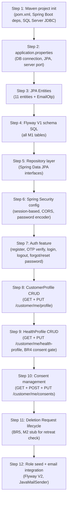

# PHASE 2 — PROPOSED IMPLEMENTATION PLAN

> **Status: REVISED 2026-10-13 — see "REVISED M1 PLAN — HEALTH & DIETARY PROFILE" below — updated 2026-10-13 with the team-lead design decisions (R9); `03_Design/Diagrams/03_Data_Model/M1_ERD.drawio` and `05_Development/docs/API_CONTRACT.md` §5 were updated to match.** The original Phase 2 draft is retained for historical reference; where the revision conflicts with the draft, the revision wins. Auth, login and customer-profile portions of this plan have since been implemented and committed (`ff49668`); health, consent and deletion work remains unimplemented. No code or migration was created or executed as part of this revision.

---

## REVISED M1 PLAN — HEALTH & DIETARY PROFILE (2026-10-13)

### R0. Temporary planning baseline and source priority

For the current planning phase, the temporary source of truth is, in priority order:

1. **Current frontend demo/prototype** — temporary functional/UI reference for M1 health fields:
   - `05_Development/frontend/src/pages/customer/HealthProfilePage.tsx` (Screen 8)
   - `05_Development/frontend/src/pages/customer/HealthDataDeletionPage.tsx` (Screen 9, entry point only)
   - `05_Development/frontend/src/types/customer.ts` (`WellnessProfile`, `HealthNotes`, `DietaryProfile`, `HealthDataConsent`, `HealthDataDeletionRequest`)
   - `05_Development/frontend/src/context/CustomerContext.tsx` (`wellnessProfile`, `updateWellnessProfile`, `submitDeletionRequest` — localStorage mock)
   - `05_Development/frontend/src/data/mockCustomer.ts` (`INITIAL_WELLNESS_PROFILE`)
2. **M1 ERD (authoritative)** — `03_Design/Diagrams/03_Data_Model/M1_ERD.drawio`. This is the single authoritative target data model. (A repository-root copy referenced in an earlier draft has since been removed; this path is the target the plan and `API_CONTRACT.md` §5 follow.)
3. **Current implementation** (`05_Development/backend` entities/repos, `03_Design/Database/HSWRMS_SQLServer_Database.sql`, `05_Development/database/schema.sql`) — implementation evidence to audit against, NOT authority for redefining requirements.
4. **Older ERDs/schemas/plans** (`M1_Phase1_Audit.md`, earlier plan drafts) — historical references only.
5. **SRS / Project Specification** — used to identify constraints (BR4 consent gating, BR5 deletion lifecycle, role privacy boundaries); conflicts with (1)/(2) are recorded in R3, not silently resolved.

**Do not assume existing code or the old SQL schema is correct merely because it exists.** In particular, the 3-text-column `HealthProfile` in Java/SQL does NOT override the detailed ERD attributes or the frontend's distinct fields.

Schema statements below are **file-based inspection only**. No live SQL Server verification was performed in this revision (backend `spring.jpa.hibernate.ddl-auto: none`; no DB connection check, no migration executed).

---

### R1. Field-by-field audit (frontend demo + new ERD vs current implementation)

Legend — Status: ✅ implemented | ⚠ partially | ❌ missing | ⚠️CONFLICT.

> Audit snapshot taken before the 2026-10-13 team-lead decisions. D-references in Follow-up columns are superseded — see **R9**.

| #   | Frontend label / field                                                      | Frontend state property (persistence)                    | Target ERD entity.attribute                                 | Existing Java entity property                                                                    | Existing SQL column (file-based)                     | Existing API/DTO | Status          | Follow-up                                                            |
| --- | --------------------------------------------------------------------------- | -------------------------------------------------------- | ----------------------------------------------------------- | ------------------------------------------------------------------------------------------------ | ---------------------------------------------------- | ---------------- | --------------- | -------------------------------------------------------------------- |
| 1   | Consent checkbox "I Agree & Grant Consent (v1.2)"                           | `consent.hasConsented` (localStorage)                    | `ConsentRecord.granted` + `consent_type` + `policy_version` | `ConsentRecord.consentStatus`/`consentType`/`policyVersion` (entity only)                        | `ConsentRecord.granted` vs `consent_status` — see C4 | ❌ none          | ⚠️CONFLICT + ❌ | R4-D3, R4-D4; persist + enforce before health writes                 |
| 2   | Consent timestamp                                                           | `consent.consentedAt` (localStorage)                     | `ConsentRecord.granted_at`                                  | `ConsentRecord.grantedAt`                                                                        | `granted_at DATETIME2`                               | ❌               | ⚠               | Populated by consent API                                             |
| 3   | Policy version "v1.2 — Wellness Treatment & Dietary Data Privacy Agreement" | `consent.policyVersion` (localStorage)                   | `ConsentRecord.policy_version`                              | `ConsentRecord.policyVersion`                                                                    | `policy_version NVARCHAR(50)`                        | ❌               | ⚠               | Server-authoritative version constant                                |
| 4   | Purpose limitation text                                                     | `consent.purposeSummary` (localStorage)                  | (no ERD attribute — UI copy only)                           | —                                                                                                | —                                                    | ❌               | ✅ demo-only    | Keep as UI text; do not persist                                      |
| 5   | Current Health Conditions / Tension Areas                                   | `healthNotes.medicalConditions: string[]` (localStorage) | `HealthProfile.current_health_condition` (NVARCHAR(MAX))    | ❌ none — Java `HealthProfile` has only `allergies`/`dietaryRequirements`/`treatmentSafetyNotes` | ❌ (same 3 text cols in both schema files)           | ❌               | ⚠️CONFLICT      | Redesign entity/schema per ERD (R7)                                  |
| 6   | Past Injuries or Surgeries                                                  | `healthNotes.injuriesOrSurgeries: string`                | `HealthProfile.surgery_injury_history`                      | ❌                                                                                               | ❌                                                   | ❌               | ⚠️CONFLICT      | as #5                                                                |
| 7   | Mobility / Movement Considerations                                          | `healthNotes.mobilityConsiderations: string`             | `HealthProfile.mobility_joint_notes`                        | ❌                                                                                               | ❌                                                   | ❌               | ⚠️CONFLICT      | as #5                                                                |
| 8   | Current Regular Supplements / Medications                                   | `healthNotes.currentMedications: string`                 | `HealthProfile.supplement_notes`                            | ❌                                                                                               | ❌                                                   | ❌               | ⚠️CONFLICT      | as #5                                                                |
| 9   | Current Stress & Fatigue Level (select: mild/moderate/high)                 | `healthNotes.stressLevel: 'mild'\|'moderate'\|'high'`    | `HealthProfile.stress_fatigue_level`                        | ❌                                                                                               | ❌                                                   | ❌               | ⚠️CONFLICT      | Keep UI values `mild\|moderate\|high`; CHECK constraint in migration |
| 10  | Therapy & Essential Oil Preferences                                         | `healthNotes.treatmentPreferences: string[]`             | `HealthProfile.preferred_therapy_method` (NVARCHAR(500))    | ❌                                                                                               | ❌                                                   | ❌               | ⚠️CONFLICT      | Serialize comma list ↔ text or revisit D1                            |

| 11 | Prior therapist notes | `healthNotes.therapistNotes: string` | `TreatmentHealthNote.note_content` (1.._ child) | ❌ | ❌ (no table) | ❌ | ⚠️CONFLICT + ❌ | Author/reader unresolved — R4-D5 |
| 12 | Known Food Allergies (Strict Safety Alert) | `dietaryProfile.allergies: string[]` | `FoodAllergy.allergy_name` + `notes` (1.._ child) | ❌ (`allergies` text col is NOT the ERD model) | ❌ (no table) | ❌ | ⚠️CONFLICT | Child-table persistence per ERD |
| 13 | Dietary Principles | `dietaryProfile.dietaryRestrictions: string[]` | `DietaryRequirement.requirement_name` + `notes` (1..\* child) | ❌ (`dietaryRequirements` text col not ERD) | ❌ (no table) | ❌ | ⚠️CONFLICT | Child-table persistence per ERD |
| 14 | Food Intolerances | `dietaryProfile.intolerances: string[]` | `HealthProfile.food_intolerance_notes` (text) | ❌ | ❌ | ❌ | ⚠️CONFLICT | Text column per ERD |
| 15 | Disliked Ingredients | `dietaryProfile.dislikedIngredients: string[]` | `HealthProfile.disliked_ingredients` (text) | ❌ | ❌ | ❌ | ⚠️CONFLICT | Text column per ERD |
| 16 | Kitchen Preparation Special Notes | `dietaryProfile.specialInstructions: string` | `HealthProfile.kitchen_special_notes` (text) | ❌ | ❌ | ❌ | ⚠️CONFLICT | Text column per ERD |
| 17 | Save button | `updateWellnessProfile()` → localStorage | (HealthProfile write) | ❌ no service/controller/DTO | — | ❌ no `GET/PUT /customers/me/health-profile` | ❌ | R5 step C–D |
| 18 | Deletion entry link → `/customer/health-profile/deletion` | `submitDeletionRequest()` → localStorage | `HealthDataDeletionRequest` | entity exists (FK `health_profile_id`, `requested_by_user_id`) | table exists (file-based) | ❌ none | ⚠ entry point only | Deferred — R8 |
| 19 | (backend registration consent checkbox) | `RegisterRequest.consent` `@AssertTrue` — validated but **never persisted** | `ConsentRecord` row | no save in `AuthService.register()` | table exists | register ignores consent after validation | ⚠ | R4-D3: record ToS consent at registration |

Structural relationships:

| Relationship                                                               | ERD (new baseline)                                         | Current Java/SQL                                                      | Status             |
| -------------------------------------------------------------------------- | ---------------------------------------------------------- | --------------------------------------------------------------------- | ------------------ |
| User 1 — 0..1 CustomerProfile                                              | ✅                                                         | ✅ (UNIQUE user_id)                                                   | ✅                 |
| CustomerProfile 1 — 0..1 HealthProfile                                     | ✅ FK `customer_profile_id`                                | ✅ same in Java + SQL                                                 | ✅                 |
| HealthProfile 1..\* FoodAllergy / DietaryRequirement / TreatmentHealthNote | ✅ child tables                                            | ❌ absent everywhere                                                  | ❌ missing         |
| CustomerProfile 1..\* ConsentRecord                                        | ✅ FK `customer_profile_id`                                | ⚠️ FK `user_id` in Java+SQL                                           | ⚠️CONFLICT (C4)    |
| CustomerProfile 1..\* HealthDataDeletionRequest                            | ✅ FK `customer_profile_id`, has `request_type`            | ⚠️ FK `health_profile_id` + `requested_by_user_id`, no `request_type` | ⚠️CONFLICT (C5)    |
| HealthProfile extra columns                                                | ERD has 9 health attributes, **no** `anonymization_status` | Java+SQL add `anonymization_status` + 3 generic text columns          | ⚠️CONFLICT (C1/C2) |

Privacy/authz boundaries (AGENTS.md + SRS BR-06): Customer owns own profile only (JWT-principal pattern already proven in `CustomerProfileService`); Therapist sees only treatment-relevant notes (M3); F&B/Chef sees only allergy/dietary warnings (M4); Receptionist must not see sensitive health data. No backend health endpoint exists yet, so no boundary is currently enforced or violated server-side.

API validation, tests, frontend/backend integration for health: **none exist** (0 health tests; `customerProfileApi.ts` deliberately carries no health fields; `api/health/healthApi.ts` is only a dev backend-reachability check).

### R2. Confirmed requirements (temporary baseline)

- UC08 Health & Dietary Profile (Customer, Screen 8) with all fields listed in R1 — field granularity comes from the frontend demo; the ERD supplies the target persistence model.
- UC09 Consent management: explicit, purpose-limited consent (policy v1.2 in UI) required **before** health data is stored (SRS BR-04 / Decree 13 constraint — consistent with, not overriding, the baseline).
- UC10 Health Data Deletion: customer-facing entry point must exist; lifecycle execution deferred (R8).
- Role privacy: Therapist = treatment-relevant notes only; F&B/Chef = allergy/dietary warnings only; Receptionist = no sensitive health data; Manager ≠ Admin.
- CustomerProfile 1:1 User and 1:0..1 HealthProfile ownership per ERD.
- Registration consent checkbox must be persisted as a `ConsentRecord` (ERD has the entity; demo collects the checkbox).

### R3. Implementation gaps (target vs current)

- G1: No `GET/PUT /api/v1/customers/me/health-profile` endpoint, no HealthProfile service/controller/DTO/tests.
- G2: No consent persistence anywhere (`AuthService.register()` validates `consent` but saves no `ConsentRecord`); no consent endpoints; no server-side BR-04 gate.
- G3: `HealthProfile` Java entity + both SQL schema files carry only `allergies`/`dietary_requirements`/`treatment_safety_notes` text columns — 8 of the ERD's 9 health attributes and all 3 child tables are absent from code and schema.
- G4: `FoodAllergy`, `DietaryRequirement`, `TreatmentHealthNote` entities/tables/repositories do not exist.
- G5: Health deletion has entity + repository + demo UI but no API and no lifecycle logic.
- G6: Frontend HealthProfilePage persists to localStorage only; no health API client exists.
- G7: Zero automated tests for any health/consent/deletion behavior.

### R4. Design conflicts (recorded, not silently resolved)

- **C1 — HealthProfile shape:** ERD (9 detailed attributes + 3 child tables) vs Java/SQL (3 generic text columns + `anonymization_status`). Baseline = ERD + frontend; existing code/schema must be reconciled (R7). `anonymization_status` exists only in old schema — decide keep/defer (D6).
- **C2 — stress_fatigue_level values:** frontend uses `mild|moderate|high`; the task brief mentions LOW/MEDIUM/HIGH "or equivalent". Baseline keeps `mild|moderate|high`.
- **C3 — list vs text:** frontend stores allergies/dietary as string arrays; ERD normalizes allergies/dietary-principles into child tables but keeps intolerances/disliked/kitchen as text. Follow ERD exactly; do not collapse to 3 text columns.
- **C4 — ConsentRecord FK + semantics:** ERD FK → `customer_profile_id`, attribute `granted` (+granted_at/revoked_at/policy_version); Java/SQL FK → `user_id` with `consent_status ∈ {GRANTED,REVOKED,PENDING}`. Equivalent semantics, different shape — needs decision (D3).
- **C5 — HealthDataDeletionRequest shape:** ERD FK → `customer_profile_id` with `request_type`; Java/SQL FK → `health_profile_id` + `requested_by_user_id`, no `request_type`, status PENDING/DEFERRED/COMPLETED/CANCELLED. Needs decision (D4).
- **C6 — treatment_safety_notes:** old schema concept with no frontend field; the ERD replaces it with `TreatmentHealthNote` children. Do not implement `treatment_safety_notes` in M1 API.

### R5. Unresolved decisions (require human approval before the affected step)

- **D1:** `preferred_therapy_method` is a single NVARCHAR(500) in the ERD while the frontend edits a `string[]` — approve comma-joined serialization (temporary) or ERD attribute change. **[RESOLVED 2026-10-13 → R9-C: `HealthProfileTherapyPreference` child records; scalar removed from ERD.]**
- **D2:** Author/intended readers of `TreatmentHealthNote` (customer-entered vs therapist-entered; M1 vs M3 scope) — blocks any note write API; M1 ships the table + read-only customer copy at most. **[RESOLVED 2026-10-13 → R9-D: M3-owned, therapist-authored, no M1 customer write API; conflicts with SRS UC08 flow — flagged for SRS review.]**
- **D3:** ConsentRecord reconciliation: adopt ERD FK `customer_profile_id` + `granted` boolean, or keep implemented `user_id` + status enum (requires schema migration either way if ERD wins). Also decide consent_type taxonomy (e.g. HEALTH_DATA_PROCESSING, TO_SERVICE) and single-active vs multi-record semantics (old Q10). **[RESOLVED 2026-10-13 → R9-A: ERD now FK `user_id`; types {TO_SERVICE, HEALTH_DATA_PROCESSING}; history-preserving grant/revoke; max 1 active per (user_id, consent_type).]**
- **D4:** HealthDataDeletionRequest reconciliation: adopt ERD FK `customer_profile_id` + `request_type`, or keep implemented shape. **[RESOLVED 2026-10-13 → R9-E: FK `customer_profile_id` + retain `requested_by_user_id` → User + `request_type` scope; code/schema reconciliation moves to schema task G.]**
- **D5:** Whether registration persists a TO_SERVICE `ConsentRecord` immediately (recommended) and its policy_version value. **[RESOLVED 2026-10-13 → R9-B: yes, persist TO_SERVICE at registration with provisional policy v1.0.]**
- **D6:** Keep or defer `anonymization_status` (not in ERD; needed later for deletion/anonymization execution). **[RESOLVED 2026-10-13 → R9-C: retained in ERD, system-managed, excluded from customer DTOs/UI.]**
- **D7:** M2 interface contract for "active/upcoming retreat" check (blocks deletion lifecycle only). **[PARTIALLY RESOLVED → R9-E: interface `hasActiveOrUpcomingRetreat(customerProfileId)` defined; M2 implementation + retention policy still open.]**

### R6. Revised implementation order (dependency-aware; supersedes old Section 8 order for health work)

> Consent persistence and backend consent enforcement (C) must complete before any health-profile write (D) is enabled. Steps are small, independently testable slices. This task only revises the plan — nothing below is implemented yet.

- **A. Audit & baseline (DONE — this revision).** Field-by-field mapping R1; baseline recorded R0; conflicts C1–C6 and decisions D1–D7 recorded.
- **B. Next approval checkpoint — ERD + API-contract design review (the immediate next step):** the team-lead decisions (R9) are applied in `03_Design/Diagrams/03_Data_Model/M1_ERD.drawio` and `05_Development/docs/API_CONTRACT.md` §5; the team reviews these two artifacts before any health/consent/deletion code is written. D1–D6 are resolved; only genuinely open items remain (R9 "Still open").
- **C. Consent persistence + backend enforcement (no health writes yet):**
  - C1: persist `ConsentRecord` at registration (ToS consent, provisional policy v1.0 — decided, R9-B).
  - C2: consent endpoints per `API_CONTRACT.md` §5.2 — `GET/POST /api/v1/customers/me/consents` + `POST /api/v1/customers/me/consents/{consentType}/revoke` (no PUT on the collection; rationale documented in the contract), userId from JWT principal, policy version server-constant.
  - C3: shared consent-check component (`hasActiveConsent`) wired as a guard for the future health write path.
  - Tests: unit tests for grant/revoke/idempotency; slice tests for endpoints (401 unauthenticated, own-user-only); no E2E claim.
- **D. HealthProfile read/write APIs per the updated ERD (gated on checkpoint-B design approval):**
  - D1: reshape `HealthProfile` to the updated ERD (8 content attributes + system-managed `anonymization_status`); add `FoodAllergy`, `DietaryRequirement`, `HealthProfileTherapyPreference` child entities (+ repositories). `TreatmentHealthNote` is M3-owned (R9-D): no M1 write API; its table rides with schema task G if approved.
  - D2: `GET/PUT /api/v1/customers/me/health-profile` — userId from JWT; PUT replaces child collections (delete-and-recreate within transaction) matching frontend semantics (arrays); PUT requires active health-data consent (C3 guard) else 4xx with stable error code.
  - D3: DTOs mirroring frontend field semantics (arrays for allergies/dietary principles/intolerances/disliked; enum mild|moderate|high).
  - Tests: service unit tests incl. consent-gated write; controller slice tests (validation, 401/403/404, child-collection replace); repository contract tests on H2 (existing pattern).
- **E. Validation, authorization, hardening:** bean validation on DTOs; size limits; ensure no endpoint exposes one customer's health data to another (IDOR tests); role restrictions (CUSTOMER only for these endpoints in M1).
- **F. Frontend integration (preserve current UI + field semantics):** `healthProfileApi.ts` + `consentApi.ts`; CustomerContext loads server wellness profile with authenticated-identity precedence (same pattern as AccountSettings); HealthProfilePage saves via PUT then refreshes; consent checkbox maps to consent API; keep deletion page as entry point only. Verification: `npx --no-install tsc -b`, manual walkthrough, i18n untouched.
- **G. Schema reconciliation/migration — separate, explicitly reviewed task:** draft migration to evolve SQL Server schema to the ERD (HealthProfile column rework, child tables, ConsentRecord/HealthDataDeletionRequest decisions D3/D4). Written as a `_draft_` script alongside the existing draft; **never executed without separate explicit human approval**; `ddl-auto` stays `none`.
- **H. Deletion request basic flow — planned after health-profile work (D/F):** create `PENDING`, read status, cancel while `PENDING`/`DEFERRED` per `API_CONTRACT.md` §5.4. **Deletion/anonymization execution stays deferred** pending the retention policy and the M2 contract (R9-E); the customer-facing entry point/UI stays as-is until then.

Ordering constraint: checkpoint B (ERD/API-contract design review) → C < D < F → H basic flow. G is a separate schema task, reviewed only after checkpoint B and re-reviewed before any E2E against real SQL Server; deletion/anonymization execution remains deferred.

### R7. Schema migration vs application code (tracked separately)

- Application-code slices (C, D, E, F) must not silently alter schema. Because `ddl-auto: none`, entity changes require the G migration to run before real-database E2E; H2 create-drop test profiles are unaffected.
- Migration G scope (draft only): HealthProfile rework to ERD attributes; new FoodAllergy/DietaryRequirement (+ TreatmentHealthNote pending D2); ConsentRecord reconciliation (D3); HealthDataDeletionRequest reconciliation (D4); keep existing idempotent/halting style of `_draft_m1_identity_health_profile.sql`.
- The existing uncommitted draft (`05_Development/database/migrations/_draft_m1_identity_health_profile.sql`) stays untouched by this plan and remains unexecuted.

### R8. Verification plan (per slice)

- Unit: consent grant/revoke semantics; consent-gated health write; child-collection replace mapping; stress-level enum validation.
- Slice/MVC: unauthenticated 401 on all new endpoints; cross-user isolation (user A token cannot read/write user B); validation 400 shapes.
- Repository contract (H2): child-table cascades and unique CustomerProfile↔HealthProfile.
- Manual (dev, after G is explicitly approved and run by a human): register → grant consent → save profile → restart backend → data persists; therapist/F&B views remain untouched in M1.
- Explicit ban: no agent-run migrations, no DB state changes, no unit-test results presented as SQL Server E2E proof.

---

### R9. Team-lead design decisions (approved 2026-10-13) — supersede conflicting items above

> These decisions supersede any conflicting assumptions in R0–R8, the historical draft below, older ERDs/schemas, and pre-existing code. Applied to `03_Design/Diagrams/03_Data_Model/M1_ERD.drawio` and `05_Development/docs/API_CONTRACT.md` §5. Design only — no application code, SQL or migration was created or executed.

- **A. ConsentRecord:** relationship to `User` via `user_id` (NOT `customer_profile_id`). History-preserving lifecycle: grant = INSERT a new record; revoke = close the active record via `revoked_at` (`granted=false`); re-grant = INSERT a new record — history is never overwritten. At most one active record (`granted=true AND revoked_at IS NULL`) per `(user_id, consent_type)`. `consent_type ∈ {TO_SERVICE, HEALTH_DATA_PROCESSING}` — no invented categories. Fields retained: consent_type, granted, granted_at, revoked_at, policy_version.
- **B. Registration & consent policy:** successful registration persists a `TO_SERVICE` consent record (provisional policy version `v1.0`, later a backend constant/config). `HEALTH_DATA_PROCESSING` is never auto-granted at registration; its policy version is `v1.2` (matches the current UI) until formally changed. Backend rejects health-profile writes without an active `HEALTH_DATA_PROCESSING` consent; a frontend checkbox is never sufficient authorization.
- **C. HealthProfile & multi-value preferences:** aligned to the detailed ERD and the actual frontend. `FoodAllergy` and `DietaryRequirement` remain 1..\* children. The UI's single combined multi-value control "Therapy & Essential Oil Preferences" → new child `HealthProfileTherapyPreference` (multiple records, NOT a comma-separated string); nullable `therapy_code` reserved for future M3 catalog mapping — M1 creates no therapy catalog. Allergies / food intolerance / disliked ingredients / kitchen notes stay distinct fields (never merged into one allergy field). `stress_fatigue_level` is confirmed a UI enum: `mild | moderate | high`. `anonymization_status` retained as system-managed, excluded from customer DTOs and the frontend.
- **D. TreatmentHealthNote:** belongs to M3's therapist-session workflow; notes are created by Therapists — no customer write API in M1. M1 may later provide a limited treatment-safe projection to authorized Therapists, never the full HealthProfile by default. The ERD now carries an ownership note to avoid implying M1 owns the workflow.
- **E. HealthDataDeletionRequest:** FK `customer_profile_id` (scope), plus retained `requested_by_user_id` → `User` (added to the ERD), plus `request_type` (scope, e.g. `HEALTH_DATA`; it does NOT imply hard-delete vs anonymize). Basic workflow only: create `PENDING`, read status, cancel while `PENDING`/`DEFERRED`. Actual deletion/anonymization execution is UNRESOLVED (retention policy + M2 integration contract). M1↔M2 contract: `hasActiveOrUpcomingRetreat(customerProfileId)` — interface only, real M2 implementation deferred, test stub allowed later; M1 must not query M2 repositories/tables.

**Resolved by R9:** D1, D2, D3, D4, D5, D6 (see R5 annotations). **Still open (human input needed):** retention policy & deletion/anonymization execution semantics; M2 contract details/implementation; M3/M4 projection field lists + delivery mechanism; storage normalization for multi-value text fields (`food_intolerance_notes`, `disliked_ingredients`, `current_health_condition`); validation length limits; effect of consent revocation on already-stored health data; whether concurrent deletion requests are allowed.

**SRS conflicts flagged for human review (not silently resolved):**

1. SRS UC08 flow has the Customer updating `TreatmentHealthNote` records — conflicts with decision D (M3/therapist-authored). ERD annotated; SRS text needs formal correction.
2. SRS conceptual `Health_Profile` entity describes 3 attributes (allergies / dietary requirements / treatment-safety notes) + anonymization — superseded for design by the detailed approved ERD; reconcile at next SRS revision.
3. SRS says "A pending request may be cancelled" — the approved decision also allows cancelling while `DEFERRED` (consistent with the M1 business-flow diagram).
4. SRS has no `TO_SERVICE`/`HEALTH_DATA_PROCESSING` types or policy versions — introduced by decision B; the demo UI already collects a registration Terms checkbox and health consent v1.2.

**Next approval checkpoint:** review of the updated `M1_ERD.drawio` + `API_CONTRACT.md` §5 (R6-B). Health-profile implementation, frontend integration and the schema-migration task all gate on it.

---

## 1. Confirmed M1 Scope (original draft — retained for reference; superseded by R2 where they differ)

> **HISTORICAL DRAFT — Sections 1–9 below predate the 2026-10-13 team-lead decisions (R9).** Where they conflict with R0–R9 — consent FK/semantics (e.g. Section 4 `consent_records.customer_profile_id`), HealthProfile shape, deletion-request shape, session-based auth, step order — the R-sections and the updated ERD/API contract win. Section 4's SQL mappings are stale and will be reconciled by the schema-migration task after design approval.

### In Scope (confirmed from all four M1 diagrams + SRS)

| Feature                                            | UC        | Sources                                                                 |
| -------------------------------------------------- | --------- | ----------------------------------------------------------------------- |
| Guest registration (email/password)                | UC01      | ERD + UseCase + BusinessFlow + ScreenFlow + SRS                         |
| Email OTP verification                             | UC02      | ERD (`email_verified`) + all diagrams                                   |
| Email/password login                               | UC04      | UseCase + BusinessFlow + ScreenFlow                                     |
| Forgot/reset password via email                    | UC03      | UseCase + BusinessFlow + ScreenFlow                                     |
| Role-based post-login routing                      | —         | BusinessFlow + ScreenFlow                                               |
| Customer Account Settings management               | UC07      | CustomerProfile ERD + UseCase + ScreenFlow S07                          |
| Health & Dietary Profile management                | UC08      | HealthProfile ERD + UseCase + BusinessFlow + ScreenFlow S08             |
| Consent management                                 | UC09      | ConsentRecord ERD + UseCase + BusinessFlow                              |
| Health Data Deletion Request lifecycle             | UC10      | HealthDataDeletionRequest ERD + UseCase + BusinessFlow + ScreenFlow S09 |
| OAuth SSO structure (AuthIdentity entity + schema) | UC05/UC06 | ERD + UseCase                                                           |

### Conditionally In Scope (pending user answers)

- Full OAuth2 SSO integration with live Google/Facebook (Q2)
- `TreatmentHealthNote` — depends on author determination (Q5)
- Admin staff account management — likely M6, needs confirmation (Q11)

### Out of Scope (confirmed)

- Booking, Check-in, Villa (M2)
- Spa scheduling, Therapy sessions (M3)
- Food ordering, F&B (M4)
- Folio, Payment (M5)
- System Administration, Audit, Delegation, Permission Matrix, Feature Flags (M6)

---

## 2. Proposed Vertical Slice

### Recommended Baseline — 4 Tiers

```
Tier 1 — Core Auth
POST /auth/register → POST /auth/verify-email → POST /auth/login → POST /auth/logout
POST /auth/forgot-password → POST /auth/reset-password
GET /auth/me

Tier 2 — Customer Profile
GET /customer/me/profile → PUT /customer/me/profile

Tier 3 — Health & Consent
GET /customer/me/health-profile → PUT /customer/me/health-profile
GET /customer/me/consents → POST /customer/me/consents → PUT /customer/me/consents/{id}

Tier 4 — Deletion Request
POST /customer/me/health-data-deletion
GET /customer/me/health-data-deletion
DELETE /customer/me/health-data-deletion/{id}
```

**Why this order?**

- Auth is a hard prerequisite for everything else (Spring Security guards all `customer/me/**` endpoints).
- CustomerProfile must exist before HealthProfile (FK constraint).
- Consent must gate HealthProfile creation (BR4 — consent required before storing health data).
- Deletion request depends on HealthProfile existence and on M2 retreat status check (BR5).

**Compared to candidate sequence from ScreenFlow:**
The ScreenFlow path `S01 → S03 → S04 → S05 → Router → S02 → S07 | S08 → S09` maps exactly to Tier 1 → Tier 2 → Tier 3 → Tier 4. The proposed vertical slice faithfully follows the M1 screen flow.

---

## 3. Authentication Strategy

> **[REVISED 2026-10-13 — HISTORICAL]** The recommendation below (session-based) was NOT followed: login/JWT was implemented and committed (`ff49668`) using a stateless JWT bearer flow (`JwtTokenProvider`, `JwtAuthenticationFilter`, `apiClient` Authorization header), human-verified E2E. Retained for reference only; do not treat as the current plan.

### Option 1 — Session-Based (HTTP Session + Cookie)

| Criterion                   | Assessment                                                                                                |
| --------------------------- | --------------------------------------------------------------------------------------------------------- |
| Spring Security fit         | Native default. `HttpSession`, `SecurityContextHolder`. Zero extra libraries.                             |
| React + Spring MVC          | Works with `credentials: 'include'` (fetch) and CORS `allowCredentials = true`.                           |
| Academic simplicity         | Very low boilerplate. Spring Security manages sessions automatically.                                     |
| Implementation complexity   | Low.                                                                                                      |
| Local development           | Straightforward on localhost.                                                                             |
| Security                    | Requires CSRF protection (Spring Security provides by default). Session fixation protection is automatic. |
| Frontend/backend separation | Requires CORS config for cross-origin cookies (`SameSite=None; Secure` in production).                    |
| Future maintainability      | Stateful — harder to scale horizontally, but irrelevant for a local academic project.                     |

### Option 2 — JWT (Stateless Bearer Token)

| Criterion                   | Assessment                                                                                                |
| --------------------------- | --------------------------------------------------------------------------------------------------------- |
| Spring Security fit         | Supported via custom `OncePerRequestFilter`. Requires JJWT or Spring Security OAuth2 Resource Server.     |
| React + Spring MVC          | Standard `Authorization: Bearer <token>` header. No cookie concerns.                                      |
| Academic simplicity         | More boilerplate: token generation, signing key management, refresh token lifecycle, logout blacklisting. |
| Implementation complexity   | Higher. Must implement `JwtFilter`, token store, and refresh flow manually.                               |
| Local development           | Stateless. No server-side storage.                                                                        |
| Security                    | Token revocation requires a blacklist or short expiry. Signing key must be securely managed.              |
| Frontend/backend separation | Cleaner. No cookie domain issues.                                                                         |
| Future maintainability      | Stateless. Easier to scale, easier to add mobile/API consumers later.                                     |

### Recommendation: **Session-Based Authentication**

**Rationale:**

1. This is an academic project running locally on a single server.
2. Session-based auth is Spring Security's default — minimum boilerplate, maximum correctness guarantee.
3. JWT adds unnecessary complexity (refresh token lifecycle, signing key management, logout blacklisting) for no practical benefit at this scale.
4. The Web Demo imposes no auth contract. The backend has full freedom.
5. If the team later needs JWT (e.g., for a mobile client), migration is a Spring Security config-level change, not a domain-level rewrite.

> [!IMPORTANT]
> This is a recommendation only. Do not implement until the user explicitly approves.

---

## 4. Entity / Database Mapping

Based on `M1_ERD.drawio` (authoritative). All column names use `snake_case` matching the ERD exactly.

### `users`

```sql
user_id          BIGINT PK IDENTITY
email            NVARCHAR(255) NOT NULL UNIQUE       -- BR1
phone_number     NVARCHAR(50) NULL                   -- [PENDING Q6]
password_hash    NVARCHAR(255) NULL                  -- NULL for SSO-only accounts
account_status   VARCHAR(30) NOT NULL                -- pending_verification | active | inactive | locked
email_verified   BIT NOT NULL DEFAULT 0
created_at       DATETIME2 NOT NULL DEFAULT GETDATE()
updated_at       DATETIME2 NOT NULL DEFAULT GETDATE()
```

### `auth_identities`

```sql
auth_identity_id  BIGINT PK IDENTITY
user_id           BIGINT NOT NULL FK -> users(user_id)
provider          VARCHAR(50) NOT NULL                -- GOOGLE | FACEBOOK
provider_subject  VARCHAR(255) NOT NULL
UNIQUE (provider, provider_subject)                   -- BR2
```

### `roles`

```sql
role_id      INT PK IDENTITY
role_name    VARCHAR(50) NOT NULL UNIQUE             -- CUSTOMER | RECEPTIONIST | THERAPIST | FB_STAFF | MANAGER | ADMIN
description  NVARCHAR(255)
```

### `user_roles`

```sql
user_id      BIGINT NOT NULL FK -> users(user_id)    PK
role_id      INT NOT NULL FK -> roles(role_id)       PK
assigned_at  DATETIME2 NOT NULL DEFAULT GETDATE()
```

### `customer_profiles`

```sql
customer_profile_id             BIGINT PK IDENTITY
user_id                         BIGINT NOT NULL UNIQUE FK -> users(user_id)   -- BR3 (1:1)
full_name                       NVARCHAR(255) NOT NULL                         -- [PENDING Q1: ERD location confirmed]
date_of_birth                   DATE NULL
preferred_language              VARCHAR(10) NULL
residential_address             NVARCHAR(500) NULL
emergency_contact_name          NVARCHAR(255) NULL
emergency_contact_phone         NVARCHAR(50) NULL
emergency_contact_relationship  NVARCHAR(100) NULL
booking_update_notifications    BIT NOT NULL DEFAULT 1    -- [PENDING Q3: event vs channel]
pre_checkin_notifications       BIT NOT NULL DEFAULT 1
therapy_reminder_notifications  BIT NOT NULL DEFAULT 1
created_at                      DATETIME2 NOT NULL DEFAULT GETDATE()
updated_at                      DATETIME2 NOT NULL DEFAULT GETDATE()
```

### `health_profiles`

```sql
health_profile_id         BIGINT PK IDENTITY
customer_profile_id       BIGINT NOT NULL UNIQUE FK -> customer_profiles(customer_profile_id)  -- 1:1
current_health_condition  NVARCHAR(MAX) NULL
surgery_injury_history    NVARCHAR(MAX) NULL
mobility_joint_notes      NVARCHAR(MAX) NULL
supplement_notes          NVARCHAR(MAX) NULL
stress_fatigue_level      VARCHAR(20) NULL    -- mild | moderate | high (inferred from Web Demo)
preferred_therapy_method  NVARCHAR(500) NULL
food_intolerance_notes    NVARCHAR(MAX) NULL
disliked_ingredients      NVARCHAR(MAX) NULL
kitchen_special_notes     NVARCHAR(MAX) NULL
created_at                DATETIME2 NOT NULL DEFAULT GETDATE()
updated_at                DATETIME2 NOT NULL DEFAULT GETDATE()
```

### `food_allergies` [PENDING Q4]

```sql
food_allergy_id    BIGINT PK IDENTITY
health_profile_id  BIGINT NOT NULL FK -> health_profiles(health_profile_id)
allergy_name       NVARCHAR(255) NOT NULL
notes              NVARCHAR(MAX) NULL
created_at         DATETIME2 NOT NULL DEFAULT GETDATE()
```

### `dietary_requirements` [PENDING Q4]

```sql
dietary_requirement_id  BIGINT PK IDENTITY
health_profile_id       BIGINT NOT NULL FK -> health_profiles(health_profile_id)
requirement_name        NVARCHAR(255) NOT NULL
notes                   NVARCHAR(MAX) NULL
created_at              DATETIME2 NOT NULL DEFAULT GETDATE()
```

### `treatment_health_notes` [PENDING Q5 — author/module unclear]

```sql
treatment_health_note_id  BIGINT PK IDENTITY
health_profile_id         BIGINT NOT NULL FK -> health_profiles(health_profile_id)
note_content              NVARCHAR(MAX) NOT NULL
created_at                DATETIME2 NOT NULL DEFAULT GETDATE()
```

### `consent_records`

```sql
consent_id           BIGINT PK IDENTITY
customer_profile_id  BIGINT NOT NULL FK -> customer_profiles(customer_profile_id)
consent_type         VARCHAR(100) NOT NULL    -- e.g., HEALTH_DATA_PROCESSING
granted              BIT NOT NULL
granted_at           DATETIME2 NULL
revoked_at           DATETIME2 NULL
policy_version       VARCHAR(20) NULL
```

### `health_data_deletion_requests`

```sql
deletion_request_id  BIGINT PK IDENTITY
customer_profile_id  BIGINT NOT NULL FK -> customer_profiles(customer_profile_id)
request_type         VARCHAR(100) NULL        -- [PENDING Q9: enum values unknown]
status               VARCHAR(30) NOT NULL     -- PENDING | DEFERRED | COMPLETED | CANCELLED
requested_at         DATETIME2 NOT NULL DEFAULT GETDATE()
processed_at         DATETIME2 NULL
```

### `email_otps` (technical — not in ERD, required for OTP implementation)

```sql
otp_id      BIGINT PK IDENTITY
user_id     BIGINT NOT NULL FK -> users(user_id)
otp_code    VARCHAR(10) NOT NULL
purpose     VARCHAR(30) NOT NULL    -- EMAIL_VERIFICATION | PASSWORD_RESET
expires_at  DATETIME2 NOT NULL
used        BIT NOT NULL DEFAULT 0
created_at  DATETIME2 NOT NULL DEFAULT GETDATE()
```

### Initial Role Seed

```sql
INSERT INTO roles (role_name, description) VALUES
  ('CUSTOMER',      'Resort customer: health, profile, booking access'),
  ('RECEPTIONIST',  'Front desk staff'),
  ('THERAPIST',     'Spa therapist or yoga instructor'),
  ('FB_STAFF',      'Food and beverage staff or chef'),
  ('MANAGER',       'Resort operations manager (read-mostly)'),
  ('ADMIN',         'System administrator (governance)');
```

**Column status:**

- Confirmed from ERD: all columns except `email_otps` table
- Inferred (technical): `email_otps` table; `stress_fatigue_level` enum values (mild/moderate/high from Web Demo)
- Pending resolution: Q1 (`full_name` placement), Q3 (notification semantics), Q4 (child tables vs text), Q5 (TreatmentHealthNote author), Q6 (phone_number duplication), Q9 (request_type values)

---

## 5. Spring MVC Architecture

### Package Structure

```
com.hswrms.m1
├── config/
│   ├── SecurityConfig.java          -- Spring Security chain, CORS, session policy
│   └── WebMvcConfig.java            -- CORS allowed origins and headers
├── controller/
│   ├── AuthController.java          -- /auth/** endpoints
│   └── CustomerController.java      -- /customer/me/** endpoints
├── service/
│   ├── AuthService.java
│   ├── UserService.java
│   ├── CustomerProfileService.java
│   ├── HealthProfileService.java
│   ├── ConsentService.java
│   ├── DeletionRequestService.java
│   └── OtpService.java              -- OTP generation, storage, validation, expiry
├── repository/
│   ├── UserRepository.java
│   ├── AuthIdentityRepository.java
│   ├── RoleRepository.java
│   ├── CustomerProfileRepository.java
│   ├── HealthProfileRepository.java
│   ├── FoodAllergyRepository.java
│   ├── DietaryRequirementRepository.java
│   ├── TreatmentHealthNoteRepository.java
│   ├── ConsentRecordRepository.java
│   ├── HealthDataDeletionRequestRepository.java
│   └── EmailOtpRepository.java
├── entity/
│   ├── User.java
│   ├── AuthIdentity.java
│   ├── Role.java
│   ├── UserRole.java
│   ├── CustomerProfile.java
│   ├── HealthProfile.java
│   ├── FoodAllergy.java
│   ├── DietaryRequirement.java
│   ├── TreatmentHealthNote.java
│   ├── ConsentRecord.java
│   ├── HealthDataDeletionRequest.java
│   └── EmailOtp.java
├── dto/
│   ├── request/
│   │   ├── RegisterRequest.java
│   │   ├── VerifyEmailRequest.java
│   │   ├── LoginRequest.java
│   │   ├── ForgotPasswordRequest.java
│   │   ├── ResetPasswordRequest.java
│   │   ├── UpdateProfileRequest.java
│   │   ├── UpsertHealthProfileRequest.java
│   │   ├── ConsentRequest.java
│   │   └── DeletionRequest.java
│   └── response/
│       ├── AuthResponse.java
│       ├── CustomerProfileResponse.java
│       ├── HealthProfileResponse.java
│       ├── ConsentRecordResponse.java
│       └── DeletionRequestResponse.java
├── security/
│   └── UserDetailsServiceImpl.java  -- loads UserDetails from DB
├── exception/
│   ├── GlobalExceptionHandler.java  -- @ControllerAdvice, maps exceptions to HTTP responses
│   ├── BusinessException.java
│   └── ResourceNotFoundException.java
└── util/
    └── OtpGenerator.java
```

### Layer Responsibilities

| Layer      | Responsibility                                                                                      |
| ---------- | --------------------------------------------------------------------------------------------------- |
| Controller | HTTP request/response; input validation (JSR-303); delegates to Service; returns HTTP status + JSON |
| Service    | Business logic; enforces BR1-BR5; transaction management; calls Repository                          |
| Repository | Spring Data JPA; no business logic                                                                  |
| Entity     | JPA entity; maps to DB table; no business logic                                                     |
| DTO        | Request/response shapes; decoupled from entity                                                      |
| Security   | Spring Security config; `UserDetails` loading; session policy                                       |
| Exception  | Centralized error response; maps exceptions to HTTP status codes                                    |

> [!NOTE]
> No additional layers (Mapper frameworks, event bus, CQRS, etc.) are introduced. This is a conventional Spring MVC layered architecture appropriate for an academic project.

---

## 6. HTTP/JSON Boundary

### Auth Group (`/auth`)

| Method | Path                    | Purpose                                       | Actor            |
| ------ | ----------------------- | --------------------------------------------- | ---------------- |
| POST   | `/auth/register`        | Create User + CustomerProfile stub + send OTP | Guest            |
| POST   | `/auth/verify-email`    | Submit OTP, activate account, auto-login      | Guest            |
| POST   | `/auth/resend-otp`      | Resend verification OTP                       | Guest            |
| POST   | `/auth/login`           | Email/password login, start session           | Guest            |
| POST   | `/auth/logout`          | Invalidate session                            | Authenticated    |
| POST   | `/auth/forgot-password` | Request password reset OTP/link               | Guest/Registered |
| POST   | `/auth/reset-password`  | Submit new password + reset token             | Guest/Registered |
| GET    | `/auth/me`              | Return current session user info and role     | Authenticated    |

### Customer Group (`/customer/me`)

| Method | Path                                     | Purpose                                          | Actor    |
| ------ | ---------------------------------------- | ------------------------------------------------ | -------- |
| GET    | `/customer/me/profile`                   | Read own CustomerProfile                         | Customer |
| PUT    | `/customer/me/profile`                   | Update own CustomerProfile                       | Customer |
| GET    | `/customer/me/health-profile`            | Read HealthProfile + allergies + dietary + notes | Customer |
| PUT    | `/customer/me/health-profile`            | Upsert HealthProfile + child records             | Customer |
| GET    | `/customer/me/consents`                  | List ConsentRecords                              | Customer |
| POST   | `/customer/me/consents`                  | Grant a consent                                  | Customer |
| PUT    | `/customer/me/consents/{id}`             | Revoke a consent                                 | Customer |
| POST   | `/customer/me/health-data-deletion`      | Submit deletion request                          | Customer |
| GET    | `/customer/me/health-data-deletion`      | View current deletion request                    | Customer |
| DELETE | `/customer/me/health-data-deletion/{id}` | Cancel pending deletion request                  | Customer |

> [!NOTE]
> These are high-level intentions, not finalized contracts. Exact request body fields, response shapes, validation rules, and HTTP status codes will be defined during implementation after user approval.

> [!WARNING]
> No endpoints from the old SRS API spec are restored or referenced. If any old endpoint names appear in the SRS, they are ignored.

---

## 7. SQL Server Persistence Plan

### Database Connection (template)

```properties
spring.datasource.url=jdbc:sqlserver://localhost:1433;databaseName=hswrms_db;encrypt=false;trustServerCertificate=true
spring.datasource.username=${DB_USERNAME}
spring.datasource.password=${DB_PASSWORD}
spring.datasource.driver-class-name=com.microsoft.sqlserver.jdbc.SQLServerDriver
spring.jpa.hibernate.ddl-auto=validate
spring.jpa.show-sql=true
spring.jpa.properties.hibernate.dialect=org.hibernate.dialect.SQLServer2012Dialect
```

Credentials stored in `application-local.properties` (gitignored) or environment variables.

### Schema Management

**Recommended: Flyway**

- `src/main/resources/db/migration/V1__create_m1_schema.sql` — all M1 tables
- `src/main/resources/db/migration/V2__seed_roles.sql` — role seed data
- `src/main/resources/db/migration/V3__seed_admin_user.sql` — initial admin account
- `spring.jpa.hibernate.ddl-auto=validate` — Hibernate validates against Flyway-managed schema.

**Alternative for early dev:** `ddl-auto=create` lets Hibernate generate the schema from entities. Switch to `validate + Flyway` before cross-module integration.

### OTP Storage

**Recommendation: DB table `email_otps`** (Option A — simple)

- No Redis infrastructure required.
- OTP row: `user_id`, `otp_code`, `purpose`, `expires_at`, `used`.
- Mark `used = true` after consumption. Delete/clean up expired rows periodically.

### JPA Notes

- `@Entity` + `@Table` on all entities
- `@OneToOne(fetch = LAZY)` for CustomerProfile → HealthProfile
- `@OneToMany(fetch = LAZY)` for HealthProfile → FoodAllergy, DietaryRequirement, TreatmentHealthNote
- `@OneToMany(fetch = LAZY)` for CustomerProfile → ConsentRecord, HealthDataDeletionRequest
- `@Column(nullable = false)` for all NOT NULL columns
- `@UniqueConstraint` on `users.email` (BR1) and `(auth_identities.provider, provider_subject)` (BR2)
- Password hashed with BCrypt (`PasswordEncoder` bean)

---

## 8. Implementation Order

> **[REVISED 2026-10-13]** Steps 1–8 below are done or superseded by committed work (`ff49668`); Steps 9–12 are superseded by **R6** (consent-before-health-writes, ERD-aligned health profile, deletion deferred).



---

## 9. Risks and Unresolved Decisions

> **[REVISED 2026-10-13]** Risks R1–R10 below are the historical draft's list (many answered or superseded: auth uses JWT; Q1/Q3 partially resolved by the committed CustomerProfile work; Q4/Q5/Q9 remain and are renumbered as D1/D2/D4/D7 in **R5**). New risks for the health slice are tracked in **R3–R5** of the revision.

| ID  | Risk / Decision                                             | Impact                                       | Action Required                              |
| --- | ----------------------------------------------------------- | -------------------------------------------- | -------------------------------------------- |
| R1  | Q1 not answered: `full_name` placement                      | Schema design blocked                        | Answer Q1 before Step 3                      |
| R2  | Q3 not answered: notification field semantics               | CustomerProfile schema ambiguous             | Answer Q3 before Step 3                      |
| R3  | Q2 not answered: SSO scope                                  | Auth implementation scope                    | Answer Q2 before Step 7                      |
| R4  | M2 RetreatBooking dependency for deletion check             | Deletion service stub needed                 | Coordinate with M2 team; implement stub      |
| R5  | OTP email requires SMTP                                     | Email verification blocked                   | Configure SMTP or use mock/log in dev        |
| R6  | Q4 not answered: child tables vs text for allergies/dietary | HealthProfile schema                         | Answer Q4 before Step 3                      |
| R7  | Q5 not answered: TreatmentHealthNote author                 | RBAC design for note endpoint                | Answer Q5 before Step 9                      |
| R8  | No test data strategy defined                               | Manual testing slow                          | Agree on seed SQL or test fixtures in Step 4 |
| R9  | `account_status` state machine not formally defined         | Auth logic gaps for locked/inactive accounts | Define transitions before Step 7             |
| R10 | Q10 not answered: ConsentRecord single vs multi             | Consent table design and UC09 behavior       | Answer Q10 before Step 10                    |

---

> **HARD STOP (historical draft footer).** The original Phase 2 draft ended here awaiting approval; large parts of it have since been implemented and committed as `ff49668`.
>
> **Current status (2026-10-13):** health/consent/deletion work proceeds only under the **REVISED M1 PLAN (R0–R8)** at the top of this file, starting with human approval of R5 decisions D3/D5 before step R6-C. No application code, migration, or database change was made while revising this plan.
