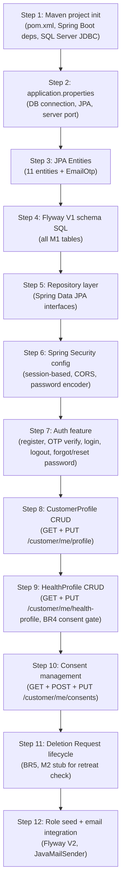

# PHASE 2 — PROPOSED IMPLEMENTATION PLAN
> **Status: AWAITING USER APPROVAL — No code written, no files modified.**

---

## 1. Confirmed M1 Scope

### In Scope (confirmed from all four M1 diagrams + SRS)
| Feature | UC | Sources |
|---|---|---|
| Guest registration (email/password) | UC01 | ERD + UseCase + BusinessFlow + ScreenFlow + SRS |
| Email OTP verification | UC02 | ERD (`email_verified`) + all diagrams |
| Email/password login | UC04 | UseCase + BusinessFlow + ScreenFlow |
| Forgot/reset password via email | UC03 | UseCase + BusinessFlow + ScreenFlow |
| Role-based post-login routing | — | BusinessFlow + ScreenFlow |
| Customer Account Settings management | UC07 | CustomerProfile ERD + UseCase + ScreenFlow S07 |
| Health & Dietary Profile management | UC08 | HealthProfile ERD + UseCase + BusinessFlow + ScreenFlow S08 |
| Consent management | UC09 | ConsentRecord ERD + UseCase + BusinessFlow |
| Health Data Deletion Request lifecycle | UC10 | HealthDataDeletionRequest ERD + UseCase + BusinessFlow + ScreenFlow S09 |
| OAuth SSO structure (AuthIdentity entity + schema) | UC05/UC06 | ERD + UseCase |

### Conditionally In Scope (pending user answers)
- Full OAuth2 SSO integration with live Google/Facebook (Q2)
- `TreatmentHealthNote` — depends on author determination (Q5)
- Admin staff account management — likely M6, needs confirmation (Q11)

### Out of Scope (confirmed)
- Booking, Check-in, Villa (M2)
- Spa scheduling, Therapy sessions (M3)
- Food ordering, F&B (M4)
- Folio, Payment (M5)
- System Administration, Audit, Delegation, Permission Matrix, Feature Flags (M6)

---

## 2. Proposed Vertical Slice

### Recommended Baseline — 4 Tiers

```
Tier 1 — Core Auth
POST /auth/register → POST /auth/verify-email → POST /auth/login → POST /auth/logout
POST /auth/forgot-password → POST /auth/reset-password
GET /auth/me

Tier 2 — Customer Profile
GET /customer/me/profile → PUT /customer/me/profile

Tier 3 — Health & Consent
GET /customer/me/health-profile → PUT /customer/me/health-profile
GET /customer/me/consents → POST /customer/me/consents → PUT /customer/me/consents/{id}

Tier 4 — Deletion Request
POST /customer/me/health-data-deletion
GET /customer/me/health-data-deletion
DELETE /customer/me/health-data-deletion/{id}
```

**Why this order?**
- Auth is a hard prerequisite for everything else (Spring Security guards all `customer/me/**` endpoints).
- CustomerProfile must exist before HealthProfile (FK constraint).
- Consent must gate HealthProfile creation (BR4 — consent required before storing health data).
- Deletion request depends on HealthProfile existence and on M2 retreat status check (BR5).

**Compared to candidate sequence from ScreenFlow:**
The ScreenFlow path `S01 → S03 → S04 → S05 → Router → S02 → S07 | S08 → S09` maps exactly to Tier 1 → Tier 2 → Tier 3 → Tier 4. The proposed vertical slice faithfully follows the M1 screen flow.

---

## 3. Authentication Strategy

### Option 1 — Session-Based (HTTP Session + Cookie)

| Criterion | Assessment |
|---|---|
| Spring Security fit | Native default. `HttpSession`, `SecurityContextHolder`. Zero extra libraries. |
| React + Spring MVC | Works with `credentials: 'include'` (fetch) and CORS `allowCredentials = true`. |
| Academic simplicity | Very low boilerplate. Spring Security manages sessions automatically. |
| Implementation complexity | Low. |
| Local development | Straightforward on localhost. |
| Security | Requires CSRF protection (Spring Security provides by default). Session fixation protection is automatic. |
| Frontend/backend separation | Requires CORS config for cross-origin cookies (`SameSite=None; Secure` in production). |
| Future maintainability | Stateful — harder to scale horizontally, but irrelevant for a local academic project. |

### Option 2 — JWT (Stateless Bearer Token)

| Criterion | Assessment |
|---|---|
| Spring Security fit | Supported via custom `OncePerRequestFilter`. Requires JJWT or Spring Security OAuth2 Resource Server. |
| React + Spring MVC | Standard `Authorization: Bearer <token>` header. No cookie concerns. |
| Academic simplicity | More boilerplate: token generation, signing key management, refresh token lifecycle, logout blacklisting. |
| Implementation complexity | Higher. Must implement `JwtFilter`, token store, and refresh flow manually. |
| Local development | Stateless. No server-side storage. |
| Security | Token revocation requires a blacklist or short expiry. Signing key must be securely managed. |
| Frontend/backend separation | Cleaner. No cookie domain issues. |
| Future maintainability | Stateless. Easier to scale, easier to add mobile/API consumers later. |

### Recommendation: **Session-Based Authentication**

**Rationale:**
1. This is an academic project running locally on a single server.
2. Session-based auth is Spring Security's default — minimum boilerplate, maximum correctness guarantee.
3. JWT adds unnecessary complexity (refresh token lifecycle, signing key management, logout blacklisting) for no practical benefit at this scale.
4. The Web Demo imposes no auth contract. The backend has full freedom.
5. If the team later needs JWT (e.g., for a mobile client), migration is a Spring Security config-level change, not a domain-level rewrite.

> [!IMPORTANT]
> This is a recommendation only. Do not implement until the user explicitly approves.

---

## 4. Entity / Database Mapping

Based on `M1_ERD.drawio` (authoritative). All column names use `snake_case` matching the ERD exactly.

### `users`
```sql
user_id          BIGINT PK IDENTITY
email            NVARCHAR(255) NOT NULL UNIQUE       -- BR1
phone_number     NVARCHAR(50) NULL                   -- [PENDING Q6]
password_hash    NVARCHAR(255) NULL                  -- NULL for SSO-only accounts
account_status   VARCHAR(30) NOT NULL                -- pending_verification | active | inactive | locked
email_verified   BIT NOT NULL DEFAULT 0
created_at       DATETIME2 NOT NULL DEFAULT GETDATE()
updated_at       DATETIME2 NOT NULL DEFAULT GETDATE()
```

### `auth_identities`
```sql
auth_identity_id  BIGINT PK IDENTITY
user_id           BIGINT NOT NULL FK -> users(user_id)
provider          VARCHAR(50) NOT NULL                -- GOOGLE | FACEBOOK
provider_subject  VARCHAR(255) NOT NULL
UNIQUE (provider, provider_subject)                   -- BR2
```

### `roles`
```sql
role_id      INT PK IDENTITY
role_name    VARCHAR(50) NOT NULL UNIQUE             -- CUSTOMER | RECEPTIONIST | THERAPIST | FB_STAFF | MANAGER | ADMIN
description  NVARCHAR(255)
```

### `user_roles`
```sql
user_id      BIGINT NOT NULL FK -> users(user_id)    PK
role_id      INT NOT NULL FK -> roles(role_id)       PK
assigned_at  DATETIME2 NOT NULL DEFAULT GETDATE()
```

### `customer_profiles`
```sql
customer_profile_id             BIGINT PK IDENTITY
user_id                         BIGINT NOT NULL UNIQUE FK -> users(user_id)   -- BR3 (1:1)
full_name                       NVARCHAR(255) NOT NULL                         -- [PENDING Q1: ERD location confirmed]
date_of_birth                   DATE NULL
preferred_language              VARCHAR(10) NULL
residential_address             NVARCHAR(500) NULL
emergency_contact_name          NVARCHAR(255) NULL
emergency_contact_phone         NVARCHAR(50) NULL
emergency_contact_relationship  NVARCHAR(100) NULL
booking_update_notifications    BIT NOT NULL DEFAULT 1    -- [PENDING Q3: event vs channel]
pre_checkin_notifications       BIT NOT NULL DEFAULT 1
therapy_reminder_notifications  BIT NOT NULL DEFAULT 1
created_at                      DATETIME2 NOT NULL DEFAULT GETDATE()
updated_at                      DATETIME2 NOT NULL DEFAULT GETDATE()
```

### `health_profiles`
```sql
health_profile_id         BIGINT PK IDENTITY
customer_profile_id       BIGINT NOT NULL UNIQUE FK -> customer_profiles(customer_profile_id)  -- 1:1
current_health_condition  NVARCHAR(MAX) NULL
surgery_injury_history    NVARCHAR(MAX) NULL
mobility_joint_notes      NVARCHAR(MAX) NULL
supplement_notes          NVARCHAR(MAX) NULL
stress_fatigue_level      VARCHAR(20) NULL    -- mild | moderate | high (inferred from Web Demo)
preferred_therapy_method  NVARCHAR(500) NULL
food_intolerance_notes    NVARCHAR(MAX) NULL
disliked_ingredients      NVARCHAR(MAX) NULL
kitchen_special_notes     NVARCHAR(MAX) NULL
created_at                DATETIME2 NOT NULL DEFAULT GETDATE()
updated_at                DATETIME2 NOT NULL DEFAULT GETDATE()
```

### `food_allergies` [PENDING Q4]
```sql
food_allergy_id    BIGINT PK IDENTITY
health_profile_id  BIGINT NOT NULL FK -> health_profiles(health_profile_id)
allergy_name       NVARCHAR(255) NOT NULL
notes              NVARCHAR(MAX) NULL
created_at         DATETIME2 NOT NULL DEFAULT GETDATE()
```

### `dietary_requirements` [PENDING Q4]
```sql
dietary_requirement_id  BIGINT PK IDENTITY
health_profile_id       BIGINT NOT NULL FK -> health_profiles(health_profile_id)
requirement_name        NVARCHAR(255) NOT NULL
notes                   NVARCHAR(MAX) NULL
created_at              DATETIME2 NOT NULL DEFAULT GETDATE()
```

### `treatment_health_notes` [PENDING Q5 — author/module unclear]
```sql
treatment_health_note_id  BIGINT PK IDENTITY
health_profile_id         BIGINT NOT NULL FK -> health_profiles(health_profile_id)
note_content              NVARCHAR(MAX) NOT NULL
created_at                DATETIME2 NOT NULL DEFAULT GETDATE()
```

### `consent_records`
```sql
consent_id           BIGINT PK IDENTITY
customer_profile_id  BIGINT NOT NULL FK -> customer_profiles(customer_profile_id)
consent_type         VARCHAR(100) NOT NULL    -- e.g., HEALTH_DATA_PROCESSING
granted              BIT NOT NULL
granted_at           DATETIME2 NULL
revoked_at           DATETIME2 NULL
policy_version       VARCHAR(20) NULL
```

### `health_data_deletion_requests`
```sql
deletion_request_id  BIGINT PK IDENTITY
customer_profile_id  BIGINT NOT NULL FK -> customer_profiles(customer_profile_id)
request_type         VARCHAR(100) NULL        -- [PENDING Q9: enum values unknown]
status               VARCHAR(30) NOT NULL     -- PENDING | DEFERRED | COMPLETED | CANCELLED
requested_at         DATETIME2 NOT NULL DEFAULT GETDATE()
processed_at         DATETIME2 NULL
```

### `email_otps` (technical — not in ERD, required for OTP implementation)
```sql
otp_id      BIGINT PK IDENTITY
user_id     BIGINT NOT NULL FK -> users(user_id)
otp_code    VARCHAR(10) NOT NULL
purpose     VARCHAR(30) NOT NULL    -- EMAIL_VERIFICATION | PASSWORD_RESET
expires_at  DATETIME2 NOT NULL
used        BIT NOT NULL DEFAULT 0
created_at  DATETIME2 NOT NULL DEFAULT GETDATE()
```

### Initial Role Seed
```sql
INSERT INTO roles (role_name, description) VALUES
  ('CUSTOMER',      'Resort customer: health, profile, booking access'),
  ('RECEPTIONIST',  'Front desk staff'),
  ('THERAPIST',     'Spa therapist or yoga instructor'),
  ('FB_STAFF',      'Food and beverage staff or chef'),
  ('MANAGER',       'Resort operations manager (read-mostly)'),
  ('ADMIN',         'System administrator (governance)');
```

**Column status:**
- Confirmed from ERD: all columns except `email_otps` table
- Inferred (technical): `email_otps` table; `stress_fatigue_level` enum values (mild/moderate/high from Web Demo)
- Pending resolution: Q1 (`full_name` placement), Q3 (notification semantics), Q4 (child tables vs text), Q5 (TreatmentHealthNote author), Q6 (phone_number duplication), Q9 (request_type values)

---

## 5. Spring MVC Architecture

### Package Structure

```
com.hswrms.m1
├── config/
│   ├── SecurityConfig.java          -- Spring Security chain, CORS, session policy
│   └── WebMvcConfig.java            -- CORS allowed origins and headers
├── controller/
│   ├── AuthController.java          -- /auth/** endpoints
│   └── CustomerController.java      -- /customer/me/** endpoints
├── service/
│   ├── AuthService.java
│   ├── UserService.java
│   ├── CustomerProfileService.java
│   ├── HealthProfileService.java
│   ├── ConsentService.java
│   ├── DeletionRequestService.java
│   └── OtpService.java              -- OTP generation, storage, validation, expiry
├── repository/
│   ├── UserRepository.java
│   ├── AuthIdentityRepository.java
│   ├── RoleRepository.java
│   ├── CustomerProfileRepository.java
│   ├── HealthProfileRepository.java
│   ├── FoodAllergyRepository.java
│   ├── DietaryRequirementRepository.java
│   ├── TreatmentHealthNoteRepository.java
│   ├── ConsentRecordRepository.java
│   ├── HealthDataDeletionRequestRepository.java
│   └── EmailOtpRepository.java
├── entity/
│   ├── User.java
│   ├── AuthIdentity.java
│   ├── Role.java
│   ├── UserRole.java
│   ├── CustomerProfile.java
│   ├── HealthProfile.java
│   ├── FoodAllergy.java
│   ├── DietaryRequirement.java
│   ├── TreatmentHealthNote.java
│   ├── ConsentRecord.java
│   ├── HealthDataDeletionRequest.java
│   └── EmailOtp.java
├── dto/
│   ├── request/
│   │   ├── RegisterRequest.java
│   │   ├── VerifyEmailRequest.java
│   │   ├── LoginRequest.java
│   │   ├── ForgotPasswordRequest.java
│   │   ├── ResetPasswordRequest.java
│   │   ├── UpdateProfileRequest.java
│   │   ├── UpsertHealthProfileRequest.java
│   │   ├── ConsentRequest.java
│   │   └── DeletionRequest.java
│   └── response/
│       ├── AuthResponse.java
│       ├── CustomerProfileResponse.java
│       ├── HealthProfileResponse.java
│       ├── ConsentRecordResponse.java
│       └── DeletionRequestResponse.java
├── security/
│   └── UserDetailsServiceImpl.java  -- loads UserDetails from DB
├── exception/
│   ├── GlobalExceptionHandler.java  -- @ControllerAdvice, maps exceptions to HTTP responses
│   ├── BusinessException.java
│   └── ResourceNotFoundException.java
└── util/
    └── OtpGenerator.java
```

### Layer Responsibilities
| Layer | Responsibility |
|---|---|
| Controller | HTTP request/response; input validation (JSR-303); delegates to Service; returns HTTP status + JSON |
| Service | Business logic; enforces BR1-BR5; transaction management; calls Repository |
| Repository | Spring Data JPA; no business logic |
| Entity | JPA entity; maps to DB table; no business logic |
| DTO | Request/response shapes; decoupled from entity |
| Security | Spring Security config; `UserDetails` loading; session policy |
| Exception | Centralized error response; maps exceptions to HTTP status codes |

> [!NOTE]
> No additional layers (Mapper frameworks, event bus, CQRS, etc.) are introduced. This is a conventional Spring MVC layered architecture appropriate for an academic project.

---

## 6. HTTP/JSON Boundary

### Auth Group (`/auth`)
| Method | Path | Purpose | Actor |
|---|---|---|---|
| POST | `/auth/register` | Create User + CustomerProfile stub + send OTP | Guest |
| POST | `/auth/verify-email` | Submit OTP, activate account, auto-login | Guest |
| POST | `/auth/resend-otp` | Resend verification OTP | Guest |
| POST | `/auth/login` | Email/password login, start session | Guest |
| POST | `/auth/logout` | Invalidate session | Authenticated |
| POST | `/auth/forgot-password` | Request password reset OTP/link | Guest/Registered |
| POST | `/auth/reset-password` | Submit new password + reset token | Guest/Registered |
| GET | `/auth/me` | Return current session user info and role | Authenticated |

### Customer Group (`/customer/me`)
| Method | Path | Purpose | Actor |
|---|---|---|---|
| GET | `/customer/me/profile` | Read own CustomerProfile | Customer |
| PUT | `/customer/me/profile` | Update own CustomerProfile | Customer |
| GET | `/customer/me/health-profile` | Read HealthProfile + allergies + dietary + notes | Customer |
| PUT | `/customer/me/health-profile` | Upsert HealthProfile + child records | Customer |
| GET | `/customer/me/consents` | List ConsentRecords | Customer |
| POST | `/customer/me/consents` | Grant a consent | Customer |
| PUT | `/customer/me/consents/{id}` | Revoke a consent | Customer |
| POST | `/customer/me/health-data-deletion` | Submit deletion request | Customer |
| GET | `/customer/me/health-data-deletion` | View current deletion request | Customer |
| DELETE | `/customer/me/health-data-deletion/{id}` | Cancel pending deletion request | Customer |

> [!NOTE]
> These are high-level intentions, not finalized contracts. Exact request body fields, response shapes, validation rules, and HTTP status codes will be defined during implementation after user approval.

> [!WARNING]
> No endpoints from the old SRS API spec are restored or referenced. If any old endpoint names appear in the SRS, they are ignored.

---

## 7. SQL Server Persistence Plan

### Database Connection (template)
```properties
spring.datasource.url=jdbc:sqlserver://localhost:1433;databaseName=hswrms_db;encrypt=false;trustServerCertificate=true
spring.datasource.username=${DB_USERNAME}
spring.datasource.password=${DB_PASSWORD}
spring.datasource.driver-class-name=com.microsoft.sqlserver.jdbc.SQLServerDriver
spring.jpa.hibernate.ddl-auto=validate
spring.jpa.show-sql=true
spring.jpa.properties.hibernate.dialect=org.hibernate.dialect.SQLServer2012Dialect
```
Credentials stored in `application-local.properties` (gitignored) or environment variables.

### Schema Management
**Recommended: Flyway**
- `src/main/resources/db/migration/V1__create_m1_schema.sql` — all M1 tables
- `src/main/resources/db/migration/V2__seed_roles.sql` — role seed data
- `src/main/resources/db/migration/V3__seed_admin_user.sql` — initial admin account
- `spring.jpa.hibernate.ddl-auto=validate` — Hibernate validates against Flyway-managed schema.

**Alternative for early dev:** `ddl-auto=create` lets Hibernate generate the schema from entities. Switch to `validate + Flyway` before cross-module integration.

### OTP Storage
**Recommendation: DB table `email_otps`** (Option A — simple)
- No Redis infrastructure required.
- OTP row: `user_id`, `otp_code`, `purpose`, `expires_at`, `used`.
- Mark `used = true` after consumption. Delete/clean up expired rows periodically.

### JPA Notes
- `@Entity` + `@Table` on all entities
- `@OneToOne(fetch = LAZY)` for CustomerProfile → HealthProfile
- `@OneToMany(fetch = LAZY)` for HealthProfile → FoodAllergy, DietaryRequirement, TreatmentHealthNote
- `@OneToMany(fetch = LAZY)` for CustomerProfile → ConsentRecord, HealthDataDeletionRequest
- `@Column(nullable = false)` for all NOT NULL columns
- `@UniqueConstraint` on `users.email` (BR1) and `(auth_identities.provider, provider_subject)` (BR2)
- Password hashed with BCrypt (`PasswordEncoder` bean)

---

## 8. Implementation Order



---

## 9. Risks and Unresolved Decisions

| ID | Risk / Decision | Impact | Action Required |
|---|---|---|---|
| R1 | Q1 not answered: `full_name` placement | Schema design blocked | Answer Q1 before Step 3 |
| R2 | Q3 not answered: notification field semantics | CustomerProfile schema ambiguous | Answer Q3 before Step 3 |
| R3 | Q2 not answered: SSO scope | Auth implementation scope | Answer Q2 before Step 7 |
| R4 | M2 RetreatBooking dependency for deletion check | Deletion service stub needed | Coordinate with M2 team; implement stub |
| R5 | OTP email requires SMTP | Email verification blocked | Configure SMTP or use mock/log in dev |
| R6 | Q4 not answered: child tables vs text for allergies/dietary | HealthProfile schema | Answer Q4 before Step 3 |
| R7 | Q5 not answered: TreatmentHealthNote author | RBAC design for note endpoint | Answer Q5 before Step 9 |
| R8 | No test data strategy defined | Manual testing slow | Agree on seed SQL or test fixtures in Step 4 |
| R9 | `account_status` state machine not formally defined | Auth logic gaps for locked/inactive accounts | Define transitions before Step 7 |
| R10 | Q10 not answered: ConsentRecord single vs multi | Consent table design and UC09 behavior | Answer Q10 before Step 10 |

---

> **HARD STOP. Awaiting explicit user approval of Phase 1 + Phase 2 before any implementation begins.**
>
> No Java files, Maven configuration, SQL scripts, Spring Boot initialization, or repository changes have been made.
